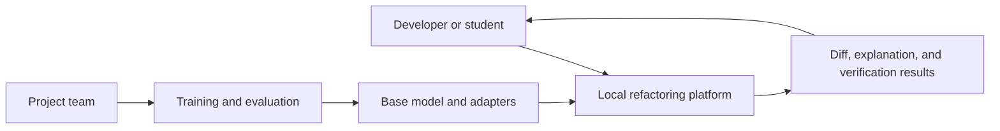
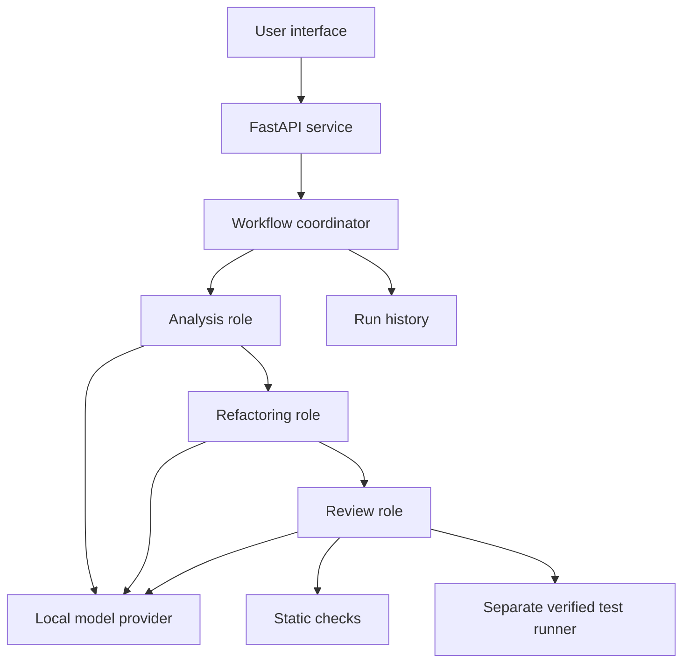

# System design

The proposed design separates the interface, workflow coordination, model inference, and verification. The current implementation is a small FastAPI service for static analysis. The product interface, model provider, agents, persistent run history, and test runner are not yet implemented.

## System context

## Proposed components

Roles exchange versioned JSON schemas. Proposed run states are queued, analyzing, generating, verifying, completed, and failed. Results keep syntax validity, test availability, test outcomes, and the agent's verdict separate. Input code is data; it does not grant the model permission to execute commands or change the host.

## Runtime sequence

Validate input size and structure, collect static indicators, and run bounded analysis, generation, and review. Record the run identifier, settings, model revision, timing, and failures. Present the change for explicit user review before acceptance.

A failed check keeps the proposal rejected or uncertain. The initial experiment allows at most one correction attempt; changing this limit is an experimental decision that must be recorded.

## Implemented API

- GET /health returns service health, version, and scaffold mode.
- POST /api/v1/analyze accepts a code field and returns syntax_valid, findings, and error. The engine is static heuristics, not a language model.
- GET /docs and /openapi.json provide the generated API reference.

## Planned contracts

POST /runs, GET /runs/{id}, and acceptance actions will be specified before interface implementation. They are not available endpoints yet. Begin with an explicit workflow; adopt LangGraph only if a small comparison shows a practical benefit for state handling or recovery.

## Storage and deployment

The foundation needs no external database. SQLite is a candidate for local run history; PostgreSQL is justified only if concurrent or multi-user access requires it. React and TypeScript are candidates for the product interface after the contracts are agreed. The FastAPI reference page is a development aid, not the final interface.

The first release is local. Microservices and Kubernetes are outside the current scope.

## Trust boundaries

The analysis service must not read arbitrary host files or execute input. Any test runner must be separate, non-root, resource-limited, without secrets, network access, host paths, or the Docker socket. Docker alone is not sufficient grounds to expose arbitrary code execution to the public. The initial release remains limited to trusted examples.
