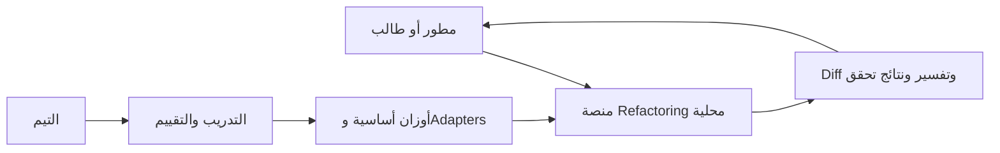
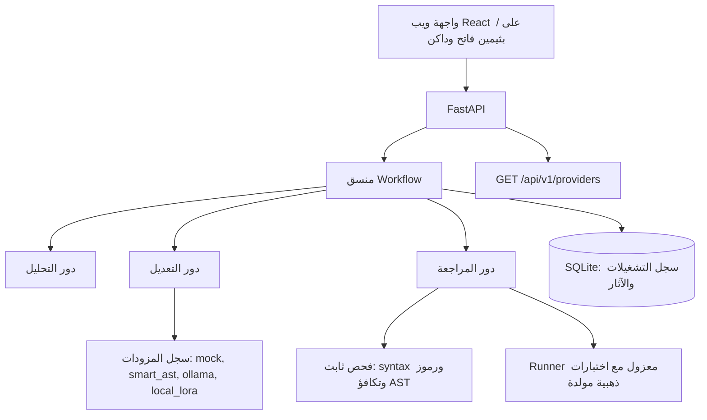

# تصميم منصة Refactoring

يفصل التصميم العرض وتنسيق الأدوار واستدلال الموديل والتحقق. الحالة المنفذة الآن: Workflow
متعدد الأدوار كامل، واجهة ويب واحدة احترافية (React/TypeScript مع ثيمين فاتح وداكن على `/`)،
سجل تشغيل SQLite، Runner معزول مع توليد اختبارات تكافؤ، وحزمة تقييم A–D بمقاييس أكاديمية.
مسار QLoRA منفذ في `training/train_lora.py` بعقد prompt مشترك مع الاستدلال، لكن التدريب الفعلي
ونتائج المجموعتين C وD ما زالا معلقين على عتاد CUDA، ويُعلن غيابهم صراحة بدل عرض موديل أساسي
كأنه مخصص.

## سياق النظام

## المكونات المنفذة

- **دور التحليل** (`src/agents/analysis_agent.py`): محلل AST استرشادي (FR02) يعيد `findings`
  ومقاييس بنيوية و`ast_graph` (عقد المشهد ثلاثي الأبعاد)، ثم خطة مهيكلة: الـsmell الأساسي
  والاستراتيجية والرموز الهدف ومستوى المخاطر وخطوات تنفيذ مرتبة.
- **دور التعديل** (`src/agents/refactoring_agent.py`): Prompt نظام صريح بعقود الناتج، واختيار
  تحويل حتمي آمن عند توفر مزود `smart_ast`، مع نقل critique المراجعة عند إعادة المحاولة.
- **دور المراجعة** (`src/agents/review_agent.py`): تحقق ثلاث طبقات — syntax، ثم حفظ الرموز
  (مقارنة أسماء فقط)، ثم تكافؤ سلوكي عبر Runner (اختبارات المستخدم أو اختبارات ذهبية مولدة)
  وحارس انحدار Maintainability Index (نقاط ونسَب معًا). الحكم ثلاثة: `approved` أو `rejected`
  أو `uncertain`، وكل حكم غير معتمد يرفق critique قابلًا للتنفيذ (FR04، NFR06).
- **المنسق** (`src/agents/orchestrator.py`): خطوات Ingestion → Analysis → Generation →
  Verification → Completion؛ يخزن `agent_traces` ولقطات المقاييس `metrics_before/after/delta`
  والاختبارات المولدة و`ast_graph_before/after`، وحد محاولة تصحيح واحدة، وحدود FR08
  (استدعاءات، توكنز، زمن) كما هي. عند بدء العملية تُعلَّم أي تشغيلات بقيت غير منتهية من عملية سابقة
  كـ`failed` برسالة صريحة (لا تشغيل «حيّ» بلا عامل).
- **سجل المزودات** (`src/models/registry.py`): `mock` (حتمي للاختبار)، `smart_ast` (تحويلات AST
  آمنة على CPU)، `ollama` (خادم محلي عبر HTTP)، `local_lora` (يتطلب Adapter فعليًا؛ يرفع
  `ProviderUnavailableError` بدل تقديم موديل أساسي كأنه مخصص). الكتالوج خلف
  `GET /api/v1/providers` بذاكرة فحص قصيرة (15 ثانية).
- **Runner المعزول** (`src/runner/sandbox.py`) و**مولّد اختبارات التكافؤ**
  (`src/runner/test_generator.py`): عزل subprocess بحدود زمن وذاكرة ومعالج وبيئة منقاة ومنع
  شبكة الخروج، وتوليد حالات ذهبية من عينات مدخلة ثابتة ومقارنة نتائج الأصل والمرشح.
- **حزمة التقييم** (`src/evaluation/`): مجموعتا مقارنة A–D على مجموعة مدمجة أو أي split من
  البيانات، مع CodeBLEU وتشابه AST وانحدار MI وpass@1، و`smell_resolution_rate` و
  `refactor_success_rate` مفصولة بين findings وclean-control، وتصدير CSV وJSON إلى
  `experiments/`. المجموعة A تتلقى نفس findings التي تتلقاها B، و`--baseline base` يقارن مع
  الموديل الأساسي الحقيقي.
- **مسار QLoRA** (`training/train_lora.py`): 4-bit NF4، rank 16/alpha 32/all-linear،
  `max_length=2048`، 3 epochs، cosine، gradient checkpointing، أفضل checkpoint حسب validation
  loss. يستخدم `src/models/prompting.py` نفسه للتدريب والاستدلال ويكتب `run-manifest.json`
  بالبصمات والعتاد ونتيجة smoke generation بفحص AST فقط.

## دورة التشغيل

التحقق من حجم المدخل وصيغته، ثم جمع المؤشرات الثابتة، ثم تحليل وخطة، ثم توليد مرشح، ثم مراجعة
ثلاثية الطبقات. عند `rejected` تُجرى محاولة تصحيح واحدة بحد أقصى وتُسجل أثرها؛ وعند `uncertain`
يكتمل التشغيل مع علامة تحذير بدل إعلان نجاح نظيف. يحفظ المنسق معرف التشغيل والإعدادات ومدة كل
خطوة، ويُخزن السجل في SQLite مع ترحيل أعمدة idempotent (`_ensure_columns`). الواجهة تعرض
الكود والـDiff والآثار ورسوم AST قبل اعتماد المستخدم النهائي (FR06).

## العقود المنفذة الآن

- `GET /health`: الحالة وإصدار الخدمة والوضع `production`.
- `POST /api/v1/analyze`: يحلل بلا تنفيذ ويعيد `syntax_valid` و`findings` و`metrics` و`ast_graph`.
- `GET /api/v1/providers`: كتالوج المزودات مع توفّر حي ونصيحة إصلاح عند الغياب.
- `POST /runs` (يدعم `?sync=true`)، `GET /runs/{id}`، `GET /runs`: تشغيل ومتابعة وسجل (FR03، FR07، FR10). عند بلوغ حد التزامن يرد `429` برسالة صريحة.
- `GET /runs/{id}/report`: تقرير Markdown من سجل التشغيل المخزَّن (inline أو `?download=true`) بلا أي قيمة غير مقيسة (FR07، NFR06).
- `POST /runs/{id}/feedback` و`/runs/{id}/decision`: قرار المستخدم بقبول أو رفض (FR06) — الثانية alias للواجهة.
- `GET /api/v1/stats`: مجاميع مقيسة (حالات، أحكام، متوسط ووسيط المدة، متوسط التوكنز، نسبة الاعتماد) مع `truncated` عند تجاوز العينة (NFR06).
- `GET /metrics`: نفس المجاميع بصيغة Prometheus نصية بلا مكتبة، مع `refactor_runs_in_flight` و`refactor_provider_available` (NFR07).
- كل استجابة تحمل `X-Request-ID` و`X-Process-Time-Ms`، ومسارات API تُسجَّل بهما، وسجلات الخدمة تُكتب JSON سطرًا لكل حدث (ADR19).
- `/` واجهة الويب المبنية، و`/docs` و`/openapi.json` مرجع API المولد.

## التخزين والنشر

التشغيل محلي دون قاعدة بيانات خارجية؛ SQLite بوضع WAL هو سجل الجهاز الواحد، وكل اتصال يطبّق
`busy_timeout` و`synchronous=NORMAL` كي لا يتحول تزامن الواجهة مع عامل الخلفية إلى
«database is locked» (ADR19)، وننتقل إلى PostgreSQL فقط عند حاجة فعلية للتزامن. واجهة الويب
(`frontend/`) تبني بـVite إلى `frontend/dist` وتقدَّم من نفس عملية FastAPI مع تراجع آمن عند غياب
البناء (صفحة placeholder بتعليمة البناء بدل الفشل). لا Microservices ولا Kubernetes في نطاق
الثمانية أسابيع (ADR04).

## الملاحظة والتشغيل

كل طلب API يُسجَّل كسطر JSON واحد (المسار، الحالة، المدة، `request_id`) فيُطابَق سطر السجل مع
ترويسة الاستجابة عند تشخيص عطل (ADR16، ADR19). السجلات نصية للقراءة البشرية عند
`REFACTOR_AI_LOG_FORMAT=text`. `GET /api/v1/stats` يجمع المقاييس من السجل نفسه، و`GET /metrics`
يعرضها بصيغة Prometheus بلا مكتبة خارجية، و`scripts/check_contract.py` يمنع انحراف العقد بين
نماذج Pydantic وعقد Zod في الواجهة قبل الوصول إلى المتصفح. `scripts/smoke_ui.py` يثبت أن الإصدار
يبوت ويخدم الواجهة وينفّذ تشغيلًا كاملًا على قاعدة مؤقتة.

## حدود الثقة

لا يقرأ التحليل ملفات الجهاز ولا ينفذ Python المرسل (NFR01). اختبارات الكود المُدخل تجري فقط في
Runner منفصل بدون أسرار أو شبكة خارجة وبمستخدم غير root وموارد محدودة (NFR02)، وتُقبل فيه
أمثلة موثوقة أو اختبارات ذهبية مولدة آليًا. حاوية Docker وحدها ليست مبررًا لفتح تنفيذ كود مجهول
للعامة. [خطة التحقق](../development/testing.md) تفصل الأدلة المطلوبة.
