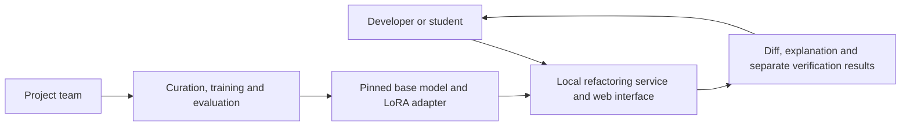
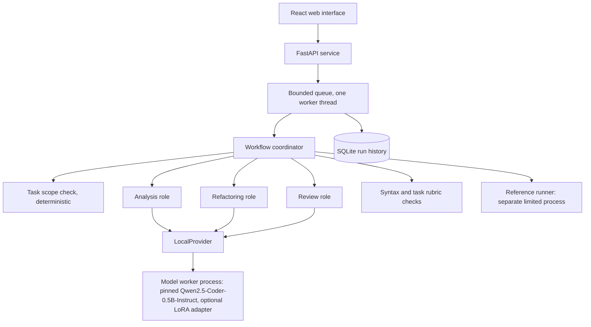

# System design

The system separates the interface, workflow coordination, model inference and verification. All components below are implemented and tested; the exact interfaces are in the [component contracts](contracts.md) and the workflow details in the [workflow design](workflow.md).

## System context

## Components

| Component | Code | Role |
|---|---|---|
| Web interface | `frontend/` | Input, demonstration cases, progress, outcome, diff, four verification results, decision, history |
| Service | `src/refactor_ai/api.py`, `runs/` | HTTP contract, bounded queue, serialized runs, SQLite records, restart recovery |
| Coordinator | `src/refactor_ai/agents/` | Scope check, roles, budgets, deadline, one correction, disposition |
| Task definition | `src/refactor_ai/tasks/guard_clauses.py`, `task_format.py` | Scope, reference rewrite, rubric, refactor-v2 prompt and parser, shared with curation and training |
| Model provider | `src/refactor_ai/providers/` | Worker process in the training environment, token and time limits, exact model identity; a labelled fake provider for tests |
| Verification | `src/refactor_ai/verification/` | Syntax, rubric, trusted reference tests in an isolated process, disposition |
| Data and evaluation | `src/refactor_ai/data/`, `evaluation/`, `scripts/` | Curation, splits and leakage checks, the A/B/C/D harness and reports |
| Training | `training/` | LoRA training script, pinned CUDA environment, the private Kaggle lane |

## Runtime sequence

1. The service validates the request (size, UTF-8, Python syntax, reference-case match) and queues the run.
2. The coordinator checks the task scope deterministically; unsupported input completes as `no_change` with no model call.
3. Multi-role runs call the analysis role, then the refactoring role (with the findings as notes), verify the candidate, call the review role and allow at most one correction; single-role runs make exactly one refactoring call.
4. Syntax, the task rubric, the reference tests and the model review are reported separately, and the disposition follows the fixed order in the contracts. Missing tests never count as a pass.
5. The record keeps the run identifier, settings, model and adapter identity, every attempt, stage timings, the stop reason and any error. The person downloads, accepts or rejects the proposal; the service never writes to the person's files.

Run states are `queued`, `analyzing`, `generating`, `verifying`, `completed` and `failed`; changing the correction limit or the budgets requires a new evaluation protocol version.

## Storage and deployment

The first release runs locally on one machine: one FastAPI process serves the API and the built interface, SQLite stores run history, and the model worker runs in a separate process with the training environment's interpreter, so the core environment never imports PyTorch. GPU training and the evaluation runs used a private Kaggle lane because the demonstration laptop has 4 GB of VRAM and 8 GB of RAM ([lane](../../training/kaggle/README.md)). Microservices, multi-user access, authentication and public hosting are outside this release.

## Trust boundaries

Submitted code is data: the service only parses it and never executes it. Model output is also untrusted: it reaches execution only through the reference runner, only for server-owned demonstration or dataset cases, and only after static admission checks. The runner uses a separate interpreter in isolated mode with an empty environment, a temporary directory, operating-system limits (a Job Object on Windows, resource limits and an unprivileged user under root on Linux) and an audit hook that blocks network access, process creation, native code and file writes. It is not a sandbox for arbitrary untrusted code; the limits are listed in [runner safety](../development/runner-safety.md).
