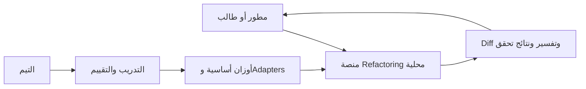
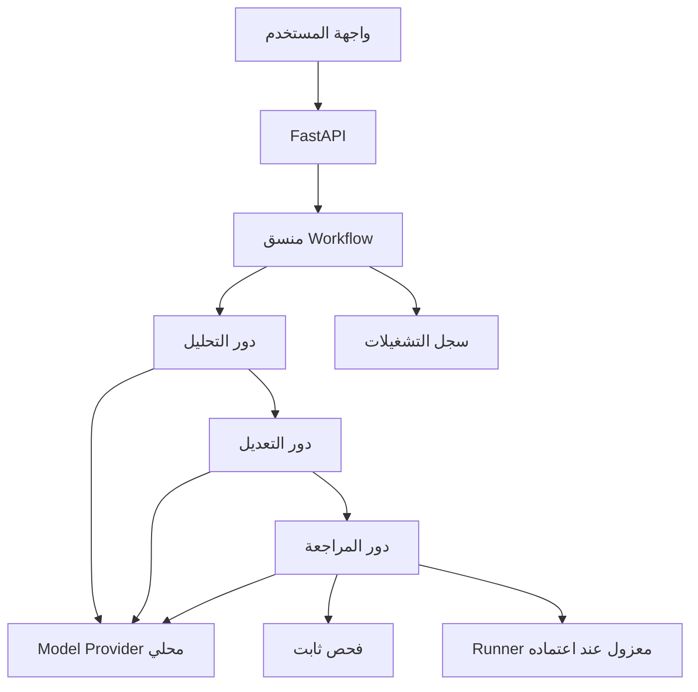

# تصميم منصة Refactoring

التصميم المستهدف يفصل العرض وتنسيق الأدوار واستدلال الموديل والتحقق. التنفيذ الحالي خدمة FastAPI صغيرة للتحليل البنيوي فقط؛ لا توجد واجهة منتج أو موديل أو Runner منفذ بعد.

## سياق النظام

## المكونات المستهدفة

الأدوار تتبادل JSON له schema وإصدار. حالة التشغيل المقترحة: queued ثم analyzing ثم generating ثم verifying ثم completed أو failed. نتيجة التحقق تجمع `syntax_valid` و`tests_available` و`tests_passed` و`review_verdict`؛ لا تدمجهم في حكم واحد غير مفسر. البيانات غير الموثوقة تُعامل كنص ولا تمنح الموديل صلاحية تنفيذ أو تعديل النظام.

## دورة التشغيل

التحقق من حجم المدخل وصيغته، ثم جمع مؤشرات ثابتة، ثم تحليل وتوليد ومراجعة محدودة المحاولات. يحفظ المنسق معرف التشغيل والإعدادات ومدة كل خطوة. تعرض الواجهة التعديل للمستخدم قبل اعتماده. عند فشل التحقق تبقى النتيجة مرفوضة أو غير مؤكدة، ويمكن محاولة تصحيح واحدة في التجربة الأولى؛ تغيير الحد قرار تجريبي مسجل.

## العقود الموجودة الآن

- `GET /health`: يعيد الحالة وإصدار الخدمة ووضع `scaffold`.
- `POST /api/v1/analyze`: يستقبل `code` ويعيد `syntax_valid` و`findings` و`error`. التحليل استرشادي ثابت، بلا LLM أو تنفيذ.
- `GET /docs` و`/openapi.json`: المرجع المولد من الخدمة.

## العقود المؤجلة

`POST /runs` و`GET /runs/{id}` وقرار قبول التعديل تُصمم في مرحلة العقود قبل بناء الواجهة؛ لا توجد وعود API غير منفذة. نبدأ بـWorkflow صريح؛ اعتماد LangGraph يتوقف على مقارنة التعقيد والفائدة في تجربة صغيرة.

## التخزين والنشر

البداية تشغيل محلي دون قاعدة بيانات خارجية. SQLite مرشح لسجلات جهاز واحد؛ ننتقل لـPostgreSQL إذا ظهرت حاجة فعلية للتزامن أو تعدد المستخدمين. الواجهة مرشحها React وTypeScript بعد تثبيت العقود. واجهة FastAPI التفاعلية مناسبة لتجربة التأسيس فقط. لا نحتاج Microservices أو Kubernetes في نطاق الثمانية أسابيع.

## حدود الثقة

لا يقرأ التحليل ملفات الجهاز ولا ينفذ Python المرسل. اختبارات الكود المُدخل لاحقًا تجري في Runner منفصل بدون أسرار أو شبكة أو Docker socket، وبمستخدم غير root وموارد محدودة. حاوية Docker وحدها ليست مبررًا لفتح تنفيذ كود مجهول للعامة. [خطة التحقق](../development/testing.md) تفصل الأدلة المطلوبة.
