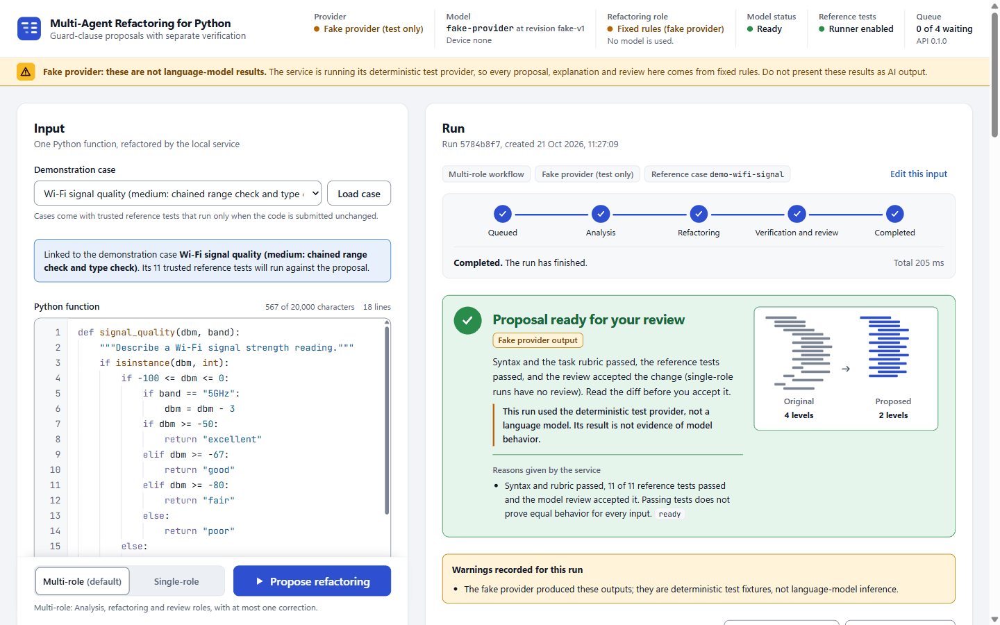
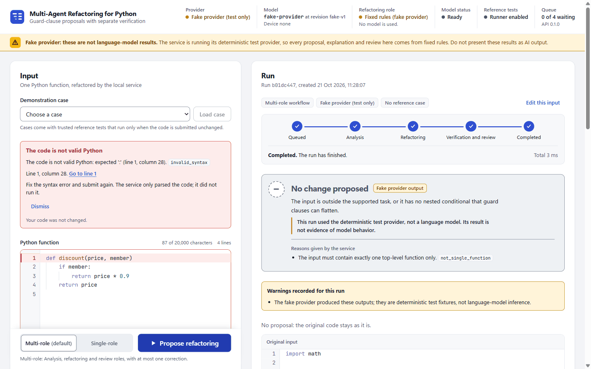
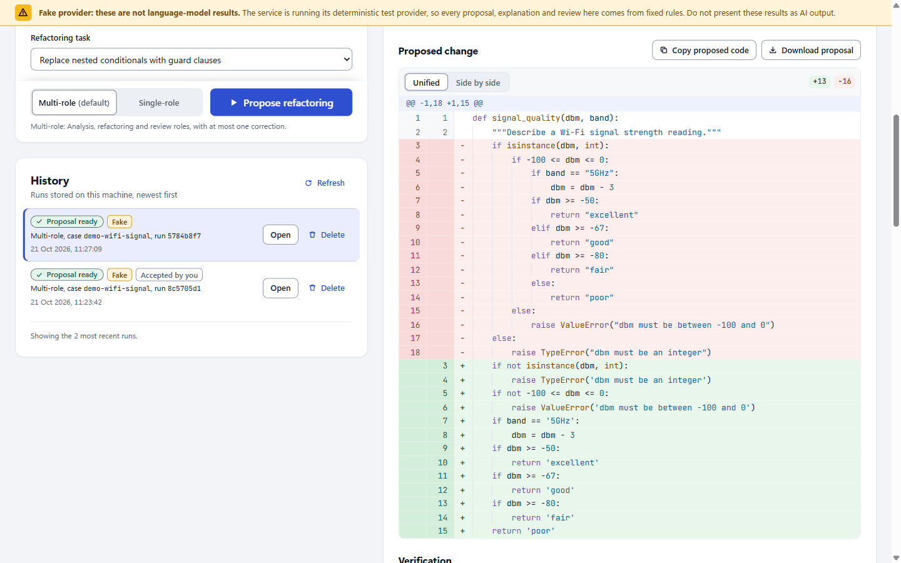
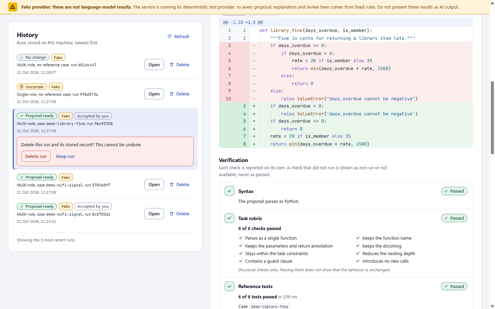

# User guide

This guide explains how to start the refactoring service and how to use its web interface and its HTTP API. It describes the implementation as of 2026-10-21. The [component contracts](../architecture/contracts.md) remain the authoritative description of every field and rule; developers should also read the [setup guide](../development/setup.md) and the [frontend development guide](../development/frontend.md).

Contents: [what the tool does](#what-the-tool-does), [what it does not do](#what-it-does-not-do), [before you start](#before-you-start), [starting the service](#starting-the-service), [the web interface](#using-the-web-interface), [demonstration cases](#the-demonstration-cases), [reading the results](#reading-the-results), [download, accept and reject](#downloading-accepting-and-rejecting), [history](#history), [the API](#using-the-api), [errors](#errors), [limits](#limits), [safety and privacy](#safety-and-privacy), [further reading](#further-reading).

## What the tool does

You paste one small Python function, or load one of six demonstration cases, and the service proposes one refactoring: Replace Nested Conditional with Guard Clauses (task `guard_clauses`). A conditional whose branch always ends in `return` or `raise` becomes an early exit, and the remaining logic moves one level to the left:

```python
def shipping_cost(weight, express):
    """Return the shipping cost."""
    if weight > 0:
        if express:
            return weight * 3
        else:
            return weight * 2
    else:
        raise ValueError("weight must be positive")
```

```python
def shipping_cost(weight, express):
    """Return the shipping cost."""
    if weight <= 0:
        raise ValueError('weight must be positive')
    if express:
        return weight * 3
    return weight * 2
```

The second function is exactly what the deterministic reference transformation writes for the first; it normalizes formatting, which is why the string now has single quotes.

For each submission the service:

1. Checks deterministically whether the function is inside the supported task. If it is not, the run ends as `no_change` with reason codes and no model is called.
2. Generates a proposal. In **multi-role** mode an analysis role reports findings, a refactoring role writes the new function and a review role gives a verdict, with at most one correction. In **single-role** mode the refactoring role is called exactly once.
3. Verifies the proposal in four separate dimensions: syntax, the task rubric, trusted reference tests (only for demonstration cases) and the model review.
4. Derives one outcome, the *disposition*, and shows it with the diff, the explanation, the findings and the complete run record.
5. Lets you copy or download the proposal and record whether you accept or reject it. Your files and your input are never changed.
6. Keeps a local history of runs that you can reopen or delete.

All roles use one local model, Qwen2.5-Coder-0.5B-Instruct at a pinned revision. The refactoring role can optionally use a LoRA adapter fine-tuned for this task. By default the service uses a deterministic **fake provider** instead of the model, so the interface and the API can be used and tested without a GPU. Fake results are fixtures, never model output.

## What it does not do

- It supports one refactoring only. Other refactorings (extract function, loop to comprehension and others) are outside this release.
- It accepts exactly one synchronous, undecorated top-level function of at most 3,000 characters and 60 lines. Classes, methods, several functions, whole files, async functions, generators, `try`/`with`/`match` blocks, imports, nested definitions, `global`/`nonlocal`, double-underscore names and calls to `open`, `print`, `input`, `exec`, `eval` and similar builtins are out of scope; such input ends as `no_change`. The full rules are in the [task scope](../requirements/task-scope.md).
- It does not rewrite conditionals inside loops, and it does not handle NaN in inverted numeric comparisons.
- It never modifies your files or the code in the editor. You decide whether to copy or download a proposal.
- It never executes your code. The only code that is executed is a proposal for one of the six server-owned demonstration cases, against that case's trusted reference tests, in a separate limited process. You cannot upload your own tests.
- It does not prove that behavior is unchanged. Passing reference tests is evidence for the tested inputs only, and exception messages are not compared.
- It does not reliably keep comments or formatting. The deterministic reference transformation (used by the fake provider) drops comments and normalizes formatting through `ast.unparse`; the model is asked not to add comments.
- It is not a networked or multi-user service. It has no accounts and no authentication, and it needs no internet connection or paid service at run time.

## Before you start

| To do this | You need |
|---|---|
| Use the web interface and the API in fake mode | Git, Python 3.11, [uv](https://docs.astral.sh/uv/getting-started/installation/), and Node.js 24.12.0 or a newer 24.x release with npm 11.6 or newer to build the interface once |
| Use the local model | In addition: an NVIDIA GPU with CUDA (measured on an RTX 2050 with 4 GB, where the model process used about 1.0 GB of GPU memory), the separate training environment `.venv-train`, the downloaded model weights (about 1 GB) and `configs/model.local.json` |
| Run the refactoring role with the fine-tuned adapter | In addition: an adapter directory, adapter id and checksum from the models workstream |

Install the core environment as described in the [setup guide](../development/setup.md):

```bash
git clone https://github.com/abdulrhmanmagdy1/grad-refactor-ai.git
cd grad-refactor-ai
uv sync --frozen
```

If uv was installed as a Python package rather than as a standalone program, run every `uv ...` command in this guide as `python -m uv ...`. Run all commands from the repository root unless a step says otherwise: the service resolves `configs/`, `runs/` and `frontend/dist` against the working directory.

## Starting the service

### Build the web interface

The interface is a static build that the service itself serves, so Node.js is needed only to build it, not to run it. Build it after a fresh clone and after every frontend change:

```bash
cd frontend
npm ci
npm run build
cd ..
```

In bash the same can be written as `cd frontend && npm ci && npm run build`; Windows PowerShell 5.1 does not support `&&`, so use the separate lines there. `npm ci` stops with `EBADENGINE` on another Node.js major version (see the [frontend development guide](../development/frontend.md#troubleshooting)).

### Fake mode (default)

```bash
uv run uvicorn refactor_ai.api:app --host 127.0.0.1 --port 8000
```

Open http://127.0.0.1:8000/ for the web interface and http://127.0.0.1:8000/docs for the interactive API reference. In fake mode the header pill shows "Demo mode", the banner "Demo mode: results come from a test stub, not the AI model." stays at the top of the page, GET /health reports `"mode": "fake"`, and every explanation and review starts with `FAKE PROVIDER (not a model):`. The fake refactoring is the deterministic reference transformation and the fake review is a placeholder `accept`, so fake results show that the plumbing works and nothing about a model.

### Local model mode

1. Prepare the training environment and download the pinned model, as described in the [training plan](../data-and-training/training-plan.md#preparation-and-execution) (Windows paths shown; on Linux use `.venv-train/bin/python`):

   ```bash
   python -m uv venv .venv-train --python 3.11
   python -m uv pip install --python .venv-train/Scripts/python.exe --torch-backend cu126 -r training/requirements-cuda.txt
   .venv-train/Scripts/python.exe training/download_model.py --repo-id Qwen/Qwen2.5-Coder-0.5B-Instruct --revision ea3f2471cf1b1f0db85067f1ef93848e38e88c25 --local-dir models/Qwen2.5-Coder-0.5B-Instruct
   ```

2. If `configs/model.local.json` does not exist yet, copy [configs/model.example.json](../../configs/model.example.json) to it (Git ignores the local file). Relative paths in it resolve against the `configs/` folder. Check these keys:

   | Key | Meaning |
   |---|---|
   | `python` | Interpreter of the training environment that runs the model worker: `../.venv-train/Scripts/python.exe` on Windows, `../.venv-train/bin/python` on Linux |
   | `model_dir`, `model_id`, `model_revision` | The downloaded snapshot and its identity; the revision must be the full 40-character commit, and the worker checks it |
   | `adapter_dir`, `adapter_id`, `adapter_sha256` | Optional LoRA adapter; set the directory and id together. The checksum of `adapter_model.safetensors` is verified when given |
   | `device`, `dtype` | `cuda` or `cpu`, and `bfloat16`, `float16` or `float32` (bfloat16 needs an Ampere or newer GPU). Only `cuda` with `bfloat16` has been measured |
   | `load_timeout_s` | Upper bound for starting the worker and loading the model (180 s in the example) |

   Unknown keys are rejected. A broken adapter is a load error, never a silent fallback to the base model.

3. Start the service with the provider variable set. In PowerShell:

   ```powershell
   $env:REFACTOR_AI_PROVIDER = "local"
   uv run uvicorn refactor_ai.api:app --host 127.0.0.1 --port 8000
   ```

   In bash:

   ```bash
   REFACTOR_AI_PROVIDER=local uv run uvicorn refactor_ai.api:app --host 127.0.0.1 --port 8000
   ```

The service starts at once and loads the model in a background process. While it loads, the header shows "Model status: Loading", GET /health reports `"mode": "local_model"`, the configured model identity and `"ready": false` with the detail "The model is loading in the background since startup; runs wait until it is ready.", and submitted runs stay `queued`. On the demonstration laptop the load took 17.6 s with a warm file cache and 88.1 s for a cold first load ([model records](../../experiments/models/README.md)). If loading fails, the header and /health show the provider's reason and runs fail with it.

A `$env:` setting lasts for the current PowerShell window. To return to fake mode, open a new window or run `Remove-Item Env:REFACTOR_AI_PROVIDER`.

### Using the fine-tuned adapter for the refactoring role

Set `REFACTOR_AI_REFACTOR_USE_ADAPTER=true` before starting the service. The refactoring role then runs with the LoRA adapter configured in `configs/model.local.json`; the analysis and review roles always use the base model. The switch applies to every run of that service process; it is not chosen per run.

```powershell
$env:REFACTOR_AI_PROVIDER = "local"
$env:REFACTOR_AI_REFACTOR_USE_ADAPTER = "true"
uv run uvicorn refactor_ai.api:app --host 127.0.0.1 --port 8000
```

```bash
REFACTOR_AI_PROVIDER=local REFACTOR_AI_REFACTOR_USE_ADAPTER=true uv run uvicorn refactor_ai.api:app --host 127.0.0.1 --port 8000
```

GET /health then reports `"refactor_use_adapter": true`, and the header's "Refactoring role" shows "Fine-tuned LoRA adapter" with the adapter id and the start of its checksum. If no adapter is configured, the header shows "Adapter requested, none configured" and "Model status: Adapter missing", /health reports `"ready": false` with the reason, and every run fails with error code `adapter_unavailable` before any model call. The base model is never used in its place. The fake provider has no adapter, so with the switch on, every fake-mode run fails the same way.

At the time of writing (2026-10-21) no adapter trained on the curated dataset has been selected: the full training run is still in progress, and the validation-only choice between the base model and the adapter follows a [selection rule](../../experiments/training/validation-selection-2026-10-20.json) written before any comparison. The 16-step pilot adapter was trained on pilot material as a feasibility check and is not a refactoring model; see the [model card](../data-and-training/model-card.md) for the current state.

The workflow choice in the interface and the adapter switch together correspond to the four evaluation arms:

| Arm | Workflow | REFACTOR_AI_REFACTOR_USE_ADAPTER |
|---|---|---|
| A | Single-role | `false` |
| B | Multi-role | `false` |
| C | Single-role | `true` |
| D | Multi-role | `true` |

Runs started from the web interface or the API are demonstrations, not evaluation records. They use the service's default limits, which are stored with each run; the evaluation harness runs the arms on dataset cases with the fixed settings declared in the [evaluation protocol](../evaluation/protocol.md).

### Other settings

All settings are environment variables read once at startup. An empty value means the default; an invalid value stops startup with a message that names the variable.

| Variable | Default | Meaning |
|---|---|---|
| REFACTOR_AI_PROVIDER | `fake` | `fake` or `local` |
| REFACTOR_AI_MODEL_CONFIG | `configs/model.local.json` | Local model, adapter and worker interpreter settings |
| REFACTOR_AI_DB | `runs/app/runs.sqlite3` | SQLite run history (Git ignores `runs/`) |
| REFACTOR_AI_RUNNER | `auto` | `auto` runs trusted reference tests only when the runner's isolation checks pass; `disabled` always reports `not_run` |
| REFACTOR_AI_MAX_PENDING | `4` | Unfinished runs allowed at once (waiting plus running), 1 to 100 |
| REFACTOR_AI_RETENTION | `200` | Stored runs kept, 1 to 100,000; the oldest finished runs are deleted first |
| REFACTOR_AI_REFACTOR_USE_ADAPTER | `false` | `true` runs the refactoring role with the configured LoRA adapter; accepts `true`/`false`, `1`/`0`, `yes`/`no`, `on`/`off` |
| REFACTOR_AI_PROJECT_MODEL_CONFIG | `configs/model.project.local.json` | The GGUF model of the project review mode; used with `REFACTOR_AI_PROVIDER=local` when the file exists, otherwise project reviews use the static checks only |
| REFACTOR_AI_PROJECT_TESTS | `false` | `true` lets a project review run the uploaded project's own tests when the person asks for it; off by default because those tests execute the uploaded code on this machine |

For interface development with hot reload, run the Vite development server on http://127.0.0.1:5173 next to the service, as described in the [frontend development guide](../development/frontend.md#running-against-the-service).

### Stopping and restarting

Stop the service with Ctrl+C. It stops accepting runs and lets the run in progress finish for up to 10 seconds. It then closes the model worker, records a run it had to cut off as failed with error code `interrupted` (not with the error that closing the worker causes), and marks waiting runs the same way. At the next start, every stored run that had not finished is also marked `interrupted`. Interrupted runs are never rerun automatically; submit them again (the web interface offers "Try again"). Starting uvicorn with `--reload` restarts the process on every code change, which interrupts the run in progress, so use it only for development.

Only one service process can use a run database. A second start with the same `REFACTOR_AI_DB`, for example in another terminal, stops at startup with "The run database ... is already in use by another service process" and leaves the running service's runs untouched. The lock is held on a file next to the database with `.lock` appended to its name (`runs/app/runs.sqlite3.lock` by default) and is released when the service stops.

## Using the web interface

Open http://127.0.0.1:8000/. The labels below are those of the simplified interface of 2026-10-21 (commit `bad4095`). On a wide screen the input panel sits on the left and the result on the right, with the history below; in a narrow window or on a phone the panels form one column. The page follows the operating system's light or dark theme and loads nothing from the internet.

The interface uses short names for the two workflows: **With review** is the multi-role workflow (analysis, refactoring and review roles, at most one correction) and **Fast** is the single-role workflow (one refactoring call). The rest of this guide uses the technical names multi-role and single-role, as the API and the run records do.



The screenshots in this guide were taken on 2026-10-21 with the fine-tuned model (adapter `full-2026-10-21`, bf16) on the demonstration laptop. Each shows one real run, not a typical result. All 26 screenshots, in light and dark themes and at phone width, are in [docs/report/screenshots](../report/screenshots/); the [frontend notes](../report/notes/frontend.md#interface-states-and-screenshots-to-take) list how each state was produced.

### The header

The header holds the title and a status pill, read from GET /health:

| Pill | Meaning |
|---|---|
| "Fine-tuned model ready" | The local model is loaded and the refactoring role uses the fine-tuned adapter |
| "Base model ready" | The local model is loaded without the adapter |
| "Demo mode" | Fake mode: a test stub answers, not a model |
| "Loading", "Adapter missing", "Not ready" | The model cannot serve runs yet; a notice under the header gives the service's own reason |

Select the pill to open the details:

| Item | Shows |
|---|---|
| Provider | "AI model" or "Demo mode (no AI model)" |
| Model | Model id, "at revision" and the start of the revision, and the device |
| Refactoring role | "Fine-tuned LoRA adapter" with the adapter id and the start of its checksum ("Analysis and review use the base model."), "Base model", "Adapter requested, none configured", or "Fixed rules (fake provider)" |
| Model status | "Ready", "Loading", "Adapter missing" or "Not ready" |
| Reference tests | "Runner enabled", or "Runner disabled" with the reason |
| Queue | "N of M waiting": unfinished runs against the queue limit, with the API version |

In fake mode an amber bar under the header reads "Demo mode: results come from a test stub, not the AI model." It stays at the top of the window while you scroll, so no screenshot of a fake result can leave it out.

"Service unreachable" means the page cannot reach the service; start it, then choose "Check again". Right after startup the reference runner is reported as disabled for a few seconds with "The reference runner is still running its isolation self-checks; execution is not enabled yet." (about 5 to 10 s on the demonstration laptop). A run submitted meanwhile waits for the runner.

### Entering code

The input panel, from top to bottom:

- **Demonstration case.** Choose a case in the list (each entry shows its number of reference tests) and select "Load case". The case code replaces the editor content; if you had other code, "Restore previous code" brings it back. A notice such as "Demo case Library fine (easy: two guard clauses): 6 tests will run." says that the code is linked to the case. The link holds only while the code equals the case exactly: an edit removes it with the notice "You changed the demo code, so the tests of ... will not run.", where "Restore the case code" brings the case code back and "Dismiss" keeps your edited code without the link. Without a link, reference tests are `not_available`.
- **Python function.** Paste or type one function. Tab adds four spaces; press Esc and then Tab to move to the next control. The counter above the editor shows "N of 20,000 characters" and the number of lines. Above 20,000 characters submission is blocked; above the task's 3,000 characters or 60 lines a warning says the run will end with no change (`too_long`).
- **Refactoring task.** The only option is "Flatten nested if statements (guard clauses)".
- **Workflow and button.** They stay in view at the bottom of the panel: "With review (default)" (find, rewrite, then review; slower) or "Fast" (one rewrite step), and the main button **Improve code**.

Select **Improve code**. The page follows one run at a time: while it runs, the button is disabled, and you can keep editing.

If the service refuses the submission, an error box appears above the editor with a title, the service's message and error code, and the note "Your code was not changed." For a syntax error it gives the line and column and a "Go to line N" button that selects that line. For a problem with the demonstration case it offers "Restore the case code", "Reload cases" or "Remove the case link"; for a temporary problem such as a full queue it offers "Submit again". "Dismiss" closes the box. Every code is explained under [errors](#errors).



### Following a run

The result panel names the run (a short id and the creation time), shows the workflow and the provider as small tags, and offers "Edit this input" to load the run's code into the editor. While the run is in progress, a stepper shows Queued, Find (With review only), Rewrite, "Check and review" (With review) or "Check" (Fast), then Result, together with the elapsed time. A correction appears as "Rewrite (retry)". The page polls the service, first after 750 ms and then less often, up to every 3 s. Connection problems are retried automatically. After 20 minutes (or twice the run's time limit, if that is longer) the page stops checking and offers "Check again"; the run may still be in progress on the server.

### The result

A completed run shows, from top to bottom:

1. **The verdict**: a colored box with the outcome in plain words and one sentence of advice:

   | Box title | Outcome (disposition) |
   |---|---|
   | "Ready to use" | `proposal_ready`: all checks passed; read the change before you accept it |
   | "Not safe to use" | `rejected`: a check failed; do not use this change |
   | "Not sure" | `uncertain`: nothing failed, but some checks could not run |
   | "Nothing to change" | `no_change`: the tool cannot improve this code (the reason follows) |
   | "Something went wrong" | `failed`: the run stopped before it made a change |

2. **Four check chips**: "Valid Python" (syntax), "Guard clauses" (the task rubric), "Tests" (reference tests, for example "6/6 passed") and "Review" (the model review). Each chip has its own status: "Passed", "Failed", "Not checked", "No tests", "Could not check", "Skipped (Fast)" for the review of a single-role run, or "Demo only" for the fake provider's placeholder review. Only a pass or an accept is drawn in green with a check mark; missing evidence has a dashed outline. The line under the chips reminds you that tests check examples, not every possible input.
3. **Proposed change**: a unified diff or, with "Side by side", the full original and proposed code, with the number of added and removed lines. "Copy proposed code" and "Download proposal" are in this section. A run without a proposal shows your code instead, with "Your code stays as it is."
4. **Your decision**: "Accept proposal" and "Reject proposal" (see [downloading, accepting and rejecting](#downloading-accepting-and-rejecting)).
5. **Details** (closed by default): an outline that draws the indentation of the original and the proposal to the same scale; "Why", the reasons given by the service; "Verification", the four checks in full (the eight rubric checks, the test counts and failures, the review's reasons; see [reading the results](#reading-the-results)); the model's "Explanation" and the analysis "Findings"; and the "Run record" with identity, settings, timings and the raw output of every generation attempt.



The explanation is written by the model and is not checked. In the recorded run above, it states that the guard `days_overdue > 0` returns 0, while the proposed code returns `min(days_overdue * rate, 1500)` there; read the diff, not the explanation.

A failed run shows "Something went wrong" with an explanation of the error code and the step where it stopped, followed by "Try again" (the same code, workflow and case as a new run) and "Edit this input" (loads the run's code into the editor; "Restore previous code" undoes that). Your code stays visible below.

## The demonstration cases

Six hand-written cases ship in [src/refactor_ai/fixtures/demo_cases.json](../../src/refactor_ai/fixtures/demo_cases.json). They are independent of the dataset (compared with all 799 dataset records, none is an exact or near duplicate) and carry 52 trusted reference tests in total. Their tests run only when the case's code is submitted unchanged and the reference runner is enabled.

| Case id | Title | Function | Lines | Reference tests |
|---|---|---|---|---|
| `demo-library-fine` | Library fine (easy: two guard clauses) | `library_fine` | 10 | 6 |
| `demo-print-job` | Print job cost (easy: guards around an elif chain) | `print_job_cost` | 18 | 8 |
| `demo-wifi-signal` | Wi-Fi signal quality (medium: chained range check and type check) | `signal_quality` | 18 | 11 |
| `demo-port-number` | Port number parser (medium: boundaries and a compound condition) | `parse_port` | 16 | 11 |
| `demo-recycling-points` | Recycling reward points (hard: guards before a loop) | `recycling_points` | 21 | 6 |
| `demo-dice-score` | Dice score (hard: four levels, a negated all() and an elif chain) | `dice_score` | 21 | 10 |

The original and reference code of every case passed all 52 tests in the isolated runner on the demonstration laptop, and with the fake provider every case completes as `proposal_ready` in both workflows ([workflow notes](../report/notes/workflow.md#evidence)). With the fake provider this shows the plumbing only.

A short demonstration that covers the main outcomes:

| Step | Input | Expected outcome |
|---|---|---|
| Success path | Load "Library fine" (`demo-library-fine`), With review or Fast, Improve code | Fake mode with the runner enabled: `proposal_ready`, 6 of 6 reference tests passed. Fine-tuned model: `proposal_ready` with 6 of 6 tests in the recorded Fast runs; it depends on the model's proposal |
| Missing evidence | Paste the `shipping_cost` example above (no case), Fast | `uncertain` with reason `tests_not_available` |
| Unsupported input | `def sign(x):` with `if x > 0: return 1`, `elif x < 0: return -1`, `return 0` | `no_change` with reason `no_opportunity`, zero model calls |
| Invalid input | `def broken(x)` without the colon | Rejected before a run starts: `invalid_syntax` at line 1, column 14 |
| Edited case | Load a case and change one character | The link is removed; reference tests become `not_available` |

## Reading the results

### Run status

`queued -> analyzing -> generating -> verifying -> completed` or `failed`. Single-role runs skip `analyzing`. A multi-role correction goes back once from `verifying` to `generating`. Input outside the task goes straight to `completed` with zero model calls. A run that is `completed` or `failed` never changes again, except for your decision.

### The four verification results

The four dimensions are never merged into one verdict. Only `pass` and `accept` count as positive evidence; `not_available`, `not_run` and `error` mean the evidence is missing, and the interface never draws them as a pass.

| Dimension | Value | Meaning |
|---|---|---|
| Syntax | `pass`, `fail` | The proposal does or does not parse with Python's `ast.parse` (the parser message is shown) |
| | `not_run` | There was no proposed code |
| Task rubric | `pass` | All eight structural checks below hold |
| | `fail` | At least one check failed; the failed checks and reasons are listed |
| | `not_run` | The proposal does not parse, or there was none |
| Reference tests | `pass` | At least one trusted test ran and every test passed; the interface shows "N of N tests passed" |
| | `fail` | At least one test failed; up to ten failures are listed with the test index, the problem and a detail |
| | `error` | The runner could not complete the tests |
| | `not_available` | No demonstration case was linked, or the case has no tests |
| | `not_run` | The runner is disabled (by configuration or because an isolation check failed), the proposal does not parse, it leaves the task constraints (for example adds an import or a denied call) and was therefore never executed, or the run's own time ran out before the tests finished |
| Model review | `accept`, `reject`, `uncertain` | The review role's verdict and reasons (multi-role only). In fake mode this is a fixed placeholder `accept`, which the interface shows as "Demo only" on the chip and "Accepted (placeholder)" in the details, drawn as missing evidence |
| | `error` | The review output could not be parsed |
| | `not_run` | Single-role run, or the run stopped before the review |

The model review is advisory: it never overrides a failed deterministic check.

### Rubric checks

| Check | Passes when |
|---|---|
| Parses as a single function | The proposal is one parseable top-level function |
| Keeps the function name | The name is unchanged |
| Keeps the parameters and return annotation | Parameters, defaults and return annotation are unchanged |
| Keeps the docstring | The docstring is unchanged |
| Stays within the task constraints | The proposal still follows the task's exclusion rules |
| Reduces the nesting depth | The maximum control-block nesting depth is lower than the original's |
| Contains a guard clause | At least one `if` without `else` returns or raises |
| Introduces no new calls | No function is called that the original did not call |

The rubric checks structure, not behavior. A proposal that returns the input unchanged passes the syntax check (and any reference tests) but fails "Reduces the nesting depth".

### Reference test failures

| Problem | Meaning |
|---|---|
| Wrong return value (`wrong_value`) | The function returned a different value or type; floats are compared with a relative tolerance of 1e-9 |
| Wrong exception type (`wrong_exception`) | It raised, but another exception type than expected |
| Unexpected exception (`unexpected_exception`) | It raised where a return value was expected |
| Expected exception not raised (`missing_exception`) | It returned where an exception was expected |
| Timed out (`timeout`) | The test process exceeded its time limit |
| Function not found (`missing_function`) | The proposal does not define the expected function |
| Runner error (`runner_error`) | The runner itself failed |

### The outcome (disposition)

The disposition is derived in this order; the first rule that applies wins.

| Disposition | When | What to do |
|---|---|---|
| `failed` | No proposal could be produced: a provider error, a time limit, output without parseable code, an interruption or an internal error | Read the error (see [errors](#errors)) and use "Try again" if the cause was temporary |
| `no_change` | The input is outside the task, or no conditional can be flattened to lower the nesting depth | Read the reason code; often the function is already flat |
| `rejected` | Syntax fails, the rubric fails, reference tests fail or error, or the model review rejects | Do not use the proposal without fixing it; the diff stays available for inspection |
| `uncertain` | Nothing failed, but evidence is missing: tests `not_available` or `not_run`, a multi-role review that was uncertain, errored or did not run, or a check that did not run | Read the diff yourself; submit a demonstration case unchanged to get reference tests |
| `proposal_ready` | Syntax and rubric pass, reference tests pass, and the review accepts (multi-role) or does not run (single-role) | Still read the diff before you accept it; passing tests cover the tested inputs only |

In a multi-role run, a proposal without code, a failed deterministic check or a rejecting review triggers the one correction. Its prompt lists the problems, including up to three failing reference tests with their call, expected and actual values, so a corrected proposal that then passes was informed by those tests.

### Reasons, stop reasons and warnings

Every disposition reason has the form `code: sentence`, for example `tests_not_available: Behavior was not tested: No trusted reference case was selected, so behavior was not tested.` The codes are:

- for `proposal_ready`, `rejected` and `uncertain`: `ready`, `syntax_fail`, `rubric_fail`, `tests_fail`, `tests_error`, `review_reject`, `review_uncertain`, `review_error`, `review_not_run`, `tests_not_available`, `tests_not_run`, `check_not_run`;
- for `failed`: the run's error code;
- for `no_change`: the task's reason codes.

| `no_change` reason | Meaning |
|---|---|
| `too_long` | More than 3,000 characters or 60 lines |
| `not_single_function` | Anything other than exactly one top-level function (imports or statements outside it, two functions, a class) |
| `async_function`, `decorated_function`, `generator_function` | `async def` or `await`; a decorator; `yield` |
| `nested_definition` | A function or class defined inside the function (a `lambda` is allowed) |
| `imports_present`, `global_or_nonlocal` | An import, or `global`/`nonlocal`, inside the function |
| `try_or_with_present`, `match_present` | A `try`, `with` or `match` block |
| `dunder_access` | A double-underscore name or attribute such as `x.__class__` |
| `denied_call:<name>` | A call to a denied builtin, for example `denied_call:print` |
| `no_opportunity` | Valid and in scope, but no conditional can be flattened to lower the nesting depth. Also used, with a warning, when an expression is nested too deeply for the deterministic rewrite to be computed (for example a `return` of several hundred terms joined by `+`) |

(`syntax_error` and `unsupported_task_type` also exist in the task module, but through the API invalid Python is rejected before a run starts and only `guard_clauses` is accepted.)

The **stop reason** in the run record says how the workflow ended:

| Stop reason | Meaning |
|---|---|
| `unsupported_input` | Validation rejected the input; zero calls; `no_change` |
| `single_role_complete` | The single generation was verified |
| `no_correction_needed` | Multi-role: nothing failed and the review did not reject |
| `correction_used` | Multi-role: the one correction was generated and verified |
| `correction_disabled`, `call_budget_exhausted` | A correction was needed but was disabled or fewer than two calls were left |
| `correction_input_too_long` | The correction prompt exceeded the refactoring role's input limit, so the first proposal is reported with a warning |
| `provider_error`, `run_timeout`, `unparseable_output`, `invalid_settings`, `reference_case_mismatch`, `internal_error` | The run failed; see [errors](#errors) |

**Warnings** record anything the reader should know about the run: the fake-provider label, a parser repair of the model output, dropped or replaced analysis findings (the static findings are used when the analysis output is unusable), a skipped correction, submitted code that contains a Markdown fence and makes the prompts ambiguous, or a deterministic rewrite that could not be computed because an expression is nested too deeply.

### The run record

The run record at the bottom of a result lists the run id; workflow, task and reference case; provider and the exact model identity (model id and revision, adapter id and checksum, and whether the adapter was active); which weights the refactoring role requested; attempts and model calls against their limits; created, started and finished times and the duration; the generation limits per role and the run's time limit; stage timings; every generation attempt with its raw model output, parse outcome and verification; the stop reason; your decision; and the schema version.

### What to expect from the model

On the frozen test split of 88 cases with reference tests, run once on a Kaggle T4 under protocol eval-v1, the fine-tuned model in the single-role workflow (Fast) reached `proposal_ready` in 70 cases (79.5%), against 7 (8.0%) for the base model. The multi-role workflow (With review) reached it in 35 cases with the fine-tuned model and in 1 with the base model, mainly because the review role, which uses the base model, often repeats itself until its token limit and its verdict then counts as an error, which makes the outcome `uncertain` ([test results](../../experiments/evaluation/test-2026-10-21/targets-report/summary.md), [report](../report/report.md)). For your own code, which has no reference tests, the best possible outcome is `uncertain`. The evaluation used shorter generation limits than the service defaults, and the laptop serves the adapter in bfloat16, so single runs can differ.

Time per model call depends on the output length: on the demonstration laptop, pilot generations of 80 to 137 tokens took 3.1 to 9.1 s, and 1,024 generated tokens took 55.4 s. A multi-role run makes three model calls, or five with a correction.

## Downloading, accepting and rejecting

Once a run has completed with proposed code, whatever its disposition, you can:

- **Copy proposed code** to the clipboard.
- **Download proposal**: saves `proposal-<run id>.py` (GET /api/v1/runs/{run_id}/proposal). The download is the only way a proposal leaves the service; nothing is written to your files.
- **Accept proposal** or **Reject proposal**: records your decision in the run record and the history (POST /api/v1/runs/{run_id}/decision). It does not change your input or any file. You can change your mind; the latest decision wins. If verification did not mark the proposal `proposal_ready`, the interface reminds you to read the evidence before accepting it.

A run without a proposal (`no_change`, `failed`, or not finished yet) cannot be downloaded or decided; the API answers `proposal_unavailable`.

## History

The History panel lists the runs stored on this machine, newest first: 20 by default, "Show up to 50" for more. Each entry shows the status, the outcome, a "Fake" tag for fake-provider runs, your decision ("Accepted by you" or "Rejected by you"), the workflow, the reference case and a short run id. "Open" shows the full result again in the run panel. "Delete" asks "Delete this run and its stored record? This cannot be undone." with "Delete run" or "Keep run", and then removes the stored record. "Refresh" reloads the list.



- Runs are stored in SQLite at `runs/app/runs.sqlite3` (`REFACTOR_AI_DB`). The history is the service's, so it also contains runs submitted through the API.
- At most `REFACTOR_AI_RETENTION` runs (default 200) are kept. When a run is created, and at startup, the oldest finished runs are deleted first; unfinished runs are never removed.
- Deleting a waiting run means it is skipped. Deleting a running run discards its outcome when the workflow returns; a model call in progress cannot be cancelled.
- To clear everything, stop the service and delete the `runs/app/` folder, or point `REFACTOR_AI_DB` at another file.

## Using the API

The easiest way to try the API is the interactive reference at http://127.0.0.1:8000/docs: open an endpoint, choose "Try it out" and send a request. All endpoints are local, and every error body has the form `{"error": {"code": ..., "message": ..., "details": [...]}}`.

| Method and path | Result |
|---|---|
| GET /health | Provider mode and identity, `ready` and its reason, runner status with its isolation checks, queue usage, and `refactor_use_adapter` |
| GET /api/v1/reference-cases | The demonstration cases: `case_id`, `title`, `function_name`, `code` and `test_count` |
| POST /api/v1/runs | Body `{"code": ..., "workflow_mode": "multi_role" or "single_role", "reference_case_id": optional}`; `task_type` defaults to `guard_clauses`. Answers 202 with `run_id`, `status` and `poll_url`, and a `Location` header |
| GET /api/v1/runs/{run_id} | The full run record; poll it until `status` is `completed` or `failed` |
| GET /api/v1/runs?limit=N | Run summaries, newest first; `limit` 1 to 50, default 20 |
| GET /api/v1/runs/{run_id}/proposal | The proposed code as a `.py` attachment |
| POST /api/v1/runs/{run_id}/decision | Body `{"decision": "accepted"}` or `{"decision": "rejected"}`; returns the updated run record |
| DELETE /api/v1/runs/{run_id} | Removes the stored record; 204 with an empty body |
| POST /api/v1/analyze | The original static heuristics (functions longer than 30 lines, four nested control blocks); no model and independent of the workflow. Code the parser rejects, including code nested too deeply for it, returns `syntax_valid: false` |

A submission with a `reference_case_id` must contain exactly that case's code. Line endings are normalized and trailing whitespace at the very end is ignored; any other difference is rejected with `reference_case_mismatch`. The [example JSON](../architecture/examples/README.md) shows every request, response and run record shape; the [backend notes](../report/notes/backend.md) describe the service's behavior in detail.

### Example session in PowerShell

```powershell
$base = "http://127.0.0.1:8000"
Invoke-RestMethod "$base/health"

# Choose a demonstration case and submit its code unchanged, so that its reference tests run.
$cases = Invoke-RestMethod "$base/api/v1/reference-cases"
$case = $cases | Where-Object { $_.case_id -eq "demo-library-fine" }
$body = @{ code = $case.code; workflow_mode = "multi_role"; reference_case_id = $case.case_id } | ConvertTo-Json
$run = Invoke-RestMethod -Method Post -Uri "$base/api/v1/runs" -ContentType "application/json; charset=utf-8" -Body $body

# Poll until the run has finished.
do {
    Start-Sleep -Seconds 2
    $record = Invoke-RestMethod "$base/api/v1/runs/$($run.run_id)"
    $record.status
} until ($record.status -eq "completed" -or $record.status -eq "failed")

# Outcome, reasons, the four verification results and the diff (or the error of a failed run).
$v = $record.verification
$v.disposition
$v.disposition_reasons
"syntax={0} rubric={1} tests={2} review={3}" -f $v.syntax.status, $v.rubric.status, $v.reference_tests.status, $v.model_review.status
$record.diff
$record.error

# Download the proposal, then record a decision.
Invoke-WebRequest "$base/api/v1/runs/$($run.run_id)/proposal" -UseBasicParsing -OutFile "proposal-$($run.run_id).py"
Invoke-RestMethod -Method Post -Uri "$base/api/v1/runs/$($run.run_id)/decision" -ContentType "application/json" -Body '{"decision": "accepted"}'

# History and deletion.
(Invoke-RestMethod "$base/api/v1/runs?limit=5").runs | Format-Table run_id, status, disposition, human_decision
Invoke-RestMethod -Method Delete -Uri "$base/api/v1/runs/$($run.run_id)"
```

PowerShell turns an error response into an exception; the JSON error body is in `$_.ErrorDetails.Message`:

```powershell
try {
    Invoke-RestMethod -Method Post -Uri "$base/api/v1/runs" -ContentType "application/json" -Body '{"code": "def broken(x)\n    return x\n"}'
} catch {
    $_.ErrorDetails.Message
}
```

This prints `{"error":{"code":"invalid_syntax","message":"The code is not valid Python: expected ':' (line 1, column 14).", ...}}`.

### Example session with curl

In bash (in Windows PowerShell, `curl` is another command; use the PowerShell example or `curl.exe`):

```bash
BASE=http://127.0.0.1:8000
curl -s "$BASE/health"

# Write request.json for a demonstration case; its code must be submitted unchanged.
uv run python -c "import json, pathlib, urllib.request; cases = json.load(urllib.request.urlopen('http://127.0.0.1:8000/api/v1/reference-cases')); case = next(c for c in cases if c['case_id'] == 'demo-library-fine'); pathlib.Path('request.json').write_text(json.dumps({'code': case['code'], 'workflow_mode': 'multi_role', 'reference_case_id': case['case_id']}))"

curl -s -X POST "$BASE/api/v1/runs" -H "Content-Type: application/json" -d @request.json
RUN_ID=replace-with-the-run_id-from-the-response

curl -s "$BASE/api/v1/runs/$RUN_ID"            # repeat until "status" is "completed" or "failed"
curl -s -OJ "$BASE/api/v1/runs/$RUN_ID/proposal"   # saves proposal-<run id>.py
curl -s -X POST "$BASE/api/v1/runs/$RUN_ID/decision" -H "Content-Type: application/json" -d '{"decision": "rejected"}'
curl -s "$BASE/api/v1/runs?limit=5"
curl -s -X DELETE "$BASE/api/v1/runs/$RUN_ID"
```

To submit your own function, write `{"code": "...", "workflow_mode": "single_role"}` to `request.json` with the code as a JSON string (newlines as `\n`) and leave out `reference_case_id`. Poll every one to three seconds; the web interface itself starts at 750 ms and slows down to 3 s.

## Errors

### Errors returned by the API

These come back immediately as an HTTP error; nothing is stored for a rejected submission. The web interface shows them in an error box above the editor and keeps your code.

| Code | HTTP | Meaning | What to do |
|---|---|---|---|
| `validation_error` | 422 | The request does not match the schema: blank code, more than 20,000 characters, an unknown `workflow_mode`, malformed JSON (including a body that is not valid UTF-8 or JSON nested too deeply to decode) or a bad query parameter such as `limit=51`. `details` lists the field, message and type; submitted values are never echoed | Fix the named field |
| `invalid_syntax` | 422 | The code does not parse, or it is nested too deeply or is too complex for Python's parser; the message and `details` give line and column when the parser reports them. The code was parsed only, never run | Fix the syntax ("Go to line N" in the interface) |
| `unknown_reference_case` | 422 | The `reference_case_id` is not one of the demonstration cases | List the cases with GET /api/v1/reference-cases, or submit without a case |
| `reference_case_mismatch` | 422 | The code differs from the selected case | Submit the case's code unchanged, or submit without the case ("Restore the case code" or "Remove the case link") |
| `busy` | 503 | The queue already holds `REFACTOR_AI_MAX_PENDING` unfinished runs (default 4); the response has `Retry-After: 10` | Wait about 10 s and submit again |
| `service_unavailable` | 503 | The run service is starting or shutting down | Wait for startup, or restart the service |
| `payload_too_large` | 413 | The request body exceeds 1 MiB | Shorten the code |
| `run_not_found` | 404 | Unknown, malformed or deleted run id | Check the id; the run may have been deleted or removed by retention |
| `proposal_unavailable` | 409 | Download or decision for a run that has not finished ("The run has not finished yet.") or finished without a proposal ("The run finished without a proposal.") | Wait for the run, or note that it has nothing to download |
| `reference_cases_unavailable` | 500 | The demonstration case file exists but is invalid | See the server log |
| `not_found` | 404 | Unknown route. GET / answers this when the web interface has not been built or the service was started outside the repository root | Check the URL; build the interface |
| `method_not_allowed` | 405 | Wrong method; the `Allow` header lists the methods of the path | Use a listed method |
| `cors_rejected` | 400 | A browser request from an origin other than the Vite development server (`http://127.0.0.1:5173` or `http://localhost:5173`) | Use the built interface or the development server |
| `internal_error` | 500 | Unexpected server error; details are only in the server log | Submit again; read the server log if it repeats |

Any other HTTP error uses the code `http_error`.

### Errors stored on a failed run

A run that fails has `status` `failed`, disposition `failed` and an `error` with `code`, `message` and `stage` (`validation`, `analysis`, `generation`, `verification` or `review`; for an interruption, the status the run had). The evidence gathered so far, such as earlier attempts, is kept.

| Code | Source | Meaning |
|---|---|---|
| `timeout` | Model provider | A model call exceeded its time limit (analysis 60 s, refactoring 120 s, review 90 s); the model worker is restarted for the next call |
| `model_load_error` | Model provider | The model or adapter could not be loaded, failed its identity or checksum check, or the provider reported a different adapter state than requested |
| `input_too_long` | Model provider | A prompt exceeded the role's input-token limit; input is never truncated. When only the correction prompt is too long, the run completes instead with stop reason `correction_input_too_long` |
| `generation_error` | Model provider | The model worker crashed or returned malformed output; it is restarted |
| `busy` | Model provider | The provider was busy with another call for longer than the call's time limit |
| `unavailable` | Model provider | The provider cannot serve calls, for example because the local provider could not start from `configs/model.local.json` |
| `run_timeout` | Workflow | The whole run exceeded its 600 s limit |
| `unparseable_output` | Workflow | No attempt produced parseable code (empty output, no code block or an unterminated code block) |
| `invalid_settings` | Workflow | Multi-role settings with fewer than three calls; cannot happen with the service defaults |
| `reference_case_mismatch` | Workflow | The case did not match the code; the API normally rejects this with HTTP 422 before the run starts |
| `internal_error` | Workflow or service | An unexpected exception; the message names only its type, the details are in the server log |
| `interrupted` | Service | The service stopped before the run finished or started; it is never rerun automatically |
| `workflow_unavailable` | Service | The workflow coordinator could not be loaded in this build |
| `adapter_unavailable` | Service | `REFACTOR_AI_REFACTOR_USE_ADAPTER=true`, but no adapter is configured; the run stopped before any model call instead of using the base model |

In the interface, "Try again" submits the same code, workflow and case as a new run.

### Messages from the web interface itself

| Message | Meaning |
|---|---|
| "Service unreachable" (header) or "Cannot reach the service" | The page cannot reach the service: it is not running on 127.0.0.1:8000, or the development server points elsewhere |
| "The service did not answer in time" | A request timed out in the browser; submit again |
| "Connection problem ... Checking again automatically" | Polling failed temporarily; the run and your input are kept |
| "Stopped checking after ..." | The page stopped polling; the run may still be running. Choose "Check again" |
| "This run no longer exists on the server" | The run was deleted, or retention removed it |
| "Could not load the demonstration cases" | GET /api/v1/reference-cases failed; choose "Try again" next to the message |
| "Download failed" or "Copy failed" | The proposal could not be fetched, or the browser refused clipboard access; for copying, select the code in the side-by-side view instead |

### Startup and configuration problems

| Symptom | Cause and fix |
|---|---|
| Startup stops with a message such as `REFACTOR_AI_PROVIDER must be 'fake' or 'local'` | An invalid setting; correct or unset the named variable |
| "Model status: Not ready" with "The local model provider could not start (...)" | `configs/model.local.json` is missing or invalid, or its interpreter or model path is wrong; runs fail with `unavailable` |
| "Model status: Loading" for a long time | The first load can take one to two minutes; it is bounded by `load_timeout_s` |
| "Model status: Adapter missing" | The adapter switch is on but no adapter is configured; see [the adapter section](#using-the-fine-tuned-adapter-for-the-refactoring-role) |
| "Runner disabled" with a list of failed checks | An isolation self-check failed, so reference tests are `not_run` and runs end at best as `uncertain`; see [runner safety](../development/runner-safety.md) |
| Startup stops with "The run database ... is already in use by another service process" | Another service process uses the same database. Stop it, or set `REFACTOR_AI_DB` to another file for the second one |
| Startup stops because of the database version | `REFACTOR_AI_DB` points to a database with an unknown table layout; use another file |
| GET / answers `{"error": {"code": "not_found", ...}}` instead of the page | The interface has not been built (`frontend/dist` is missing) or the service was started outside the repository root; see [build the web interface](#build-the-web-interface) |

## Limits

| Limit | Value |
|---|---|
| Code accepted by the API | 20,000 characters; request body 1 MiB |
| Supported task input | One function of at most 3,000 characters and 60 lines (longer input completes as `no_change`, `too_long`) |
| Model calls | Single-role exactly 1; multi-role at most 5 (analysis, refactoring, review, one correction and its review) |
| Generation (service defaults, stored with each run) | Greedy decoding (temperature 0), seed 42; new tokens: analysis 384, refactoring 1,024, review 768; input tokens: 2,048, 2,048 and 4,096 |
| Time | Per call: analysis 60 s, refactoring 120 s, review 90 s, each shortened to the time left; per run: 600 s |
| Reference test process | 10 s wall clock, 5 s CPU time, 256 MB memory, one process |
| Queue | 4 unfinished runs (`REFACTOR_AI_MAX_PENDING`); runs are processed one at a time in submission order |
| History | 200 stored runs (`REFACTOR_AI_RETENTION`); at most 50 per list request |

Prompts are counted with the model's own tokenizer and never truncated. Realistic functions up to the 3,000-character limit fit every prompt; dense code with short names and many digits above roughly 2,100 characters skips the correction, and a function made mostly of long numbers can exceed 2,048 tokens in its first prompt and fail with `input_too_long` ([token budgets](../architecture/workflow.md#token-budgets)).

## Safety and privacy

- **Keep the service local.** It has no authentication: anyone who can reach its port can submit, read and delete runs. Start it with `--host 127.0.0.1` as shown, and do not expose it on a network.
- **Submitted code is never executed.** The API only parses code with `ast.parse`. Tests submit snippets that would write a file if executed and check that the file never appears.
- **Only trusted demonstration cases are executed.** The reference runner runs a proposal only for a server-owned demonstration case, only when the proposal stays inside the task constraints, and only after its isolation self-checks pass (all 19 passed on the Windows demonstration laptop). It uses a separate interpreter with an empty environment, a temporary folder, operating-system limits and an audit hook that refuses network, process, file-write and native-code access. On Linux, the runner's tests passed in the Ubuntu job of the continuous integration as a non-root user; when the service runs as root (for example in a container), the runner starts the test process as the unprivileged user 65534 so that its process limit applies. It is a hardening layer, not a sandbox for hostile code: there is no operating-system network, file system or privilege boundary. Do not add untrusted cases. Set `REFACTOR_AI_RUNNER=disabled` to turn execution off completely. Details: [runner safety](../development/runner-safety.md).
- **Model output is untrusted text.** Read the diff before using a proposal. A model `accept` is not a guarantee, passing tests cover the tested inputs only, and fake-provider results are not model results.
- **Your code stays on this machine.** The run history stores submitted code, proposals and raw model output in plain text in `runs/app/runs.sqlite3`. Git ignores `runs/`; delete runs you do not want to keep. The service and the local model need no network access, and the built page loads nothing from the internet.

## Further reading

- [Project README](../../README.md): project status and quickstart
- [Task scope](../requirements/task-scope.md): inclusion rules, reason codes, examples and the rubric
- [Workflow coordinator and verification](../architecture/workflow.md): sequence, budgets, dispositions and token budgets
- [Component contracts](../architecture/contracts.md) and [example JSON](../architecture/examples/README.md)
- [Backend notes](../report/notes/backend.md), [workflow notes](../report/notes/workflow.md), [frontend notes](../report/notes/frontend.md) and [model notes](../report/notes/model.md)
- [Runner safety](../development/runner-safety.md)
- [Evaluation protocol](../evaluation/protocol.md) and [model card](../data-and-training/model-card.md)
