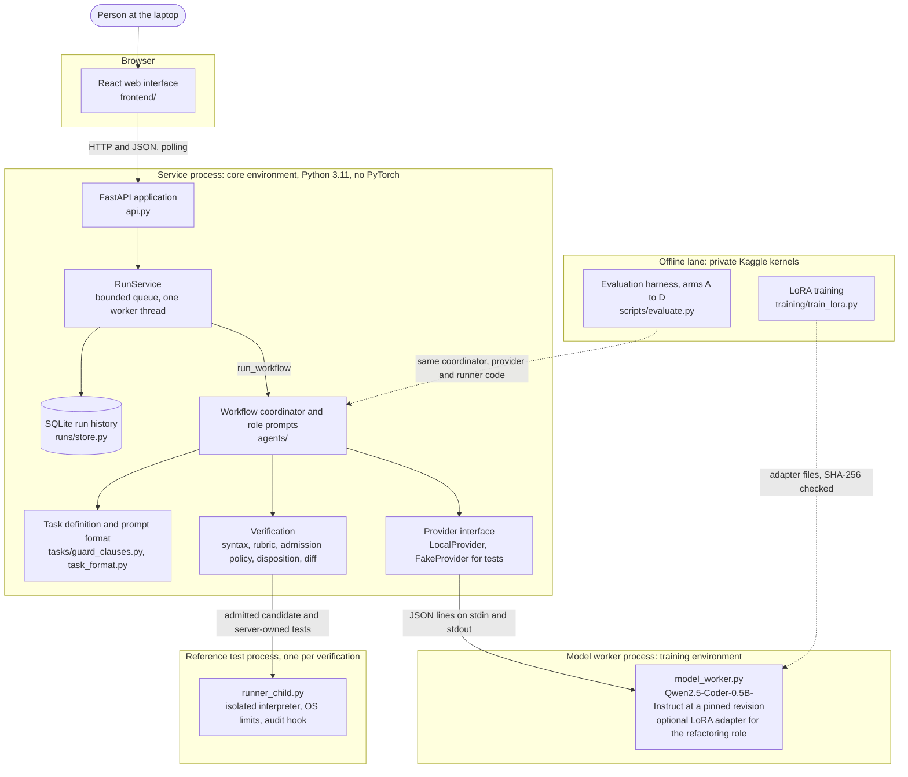
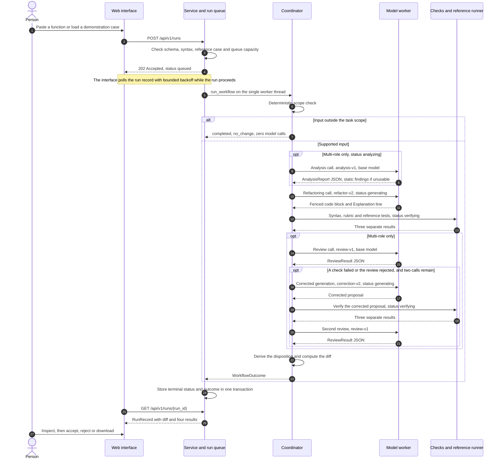
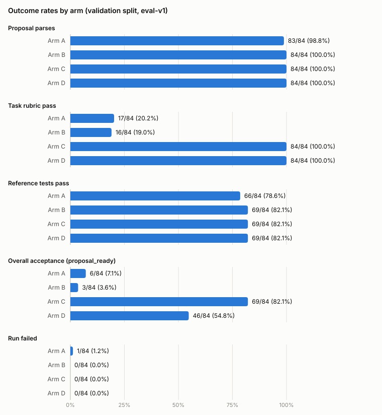
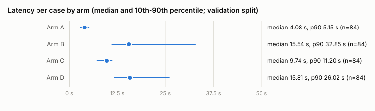
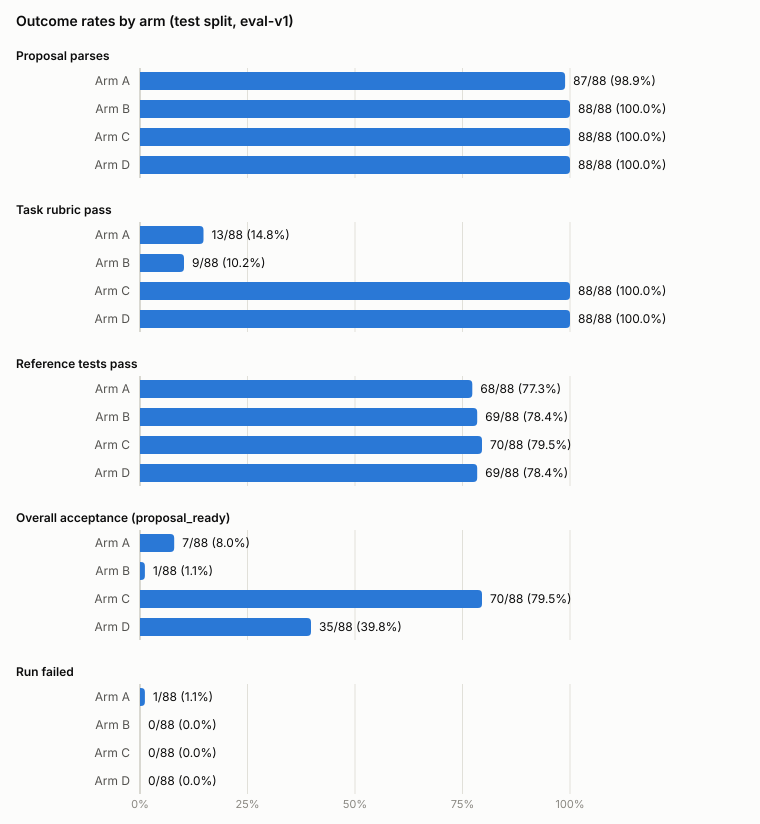

# Multi-Agent Refactoring for Python: Fine-Tuning a Small Local Code Model for Guard-Clause Refactoring

Graduation project report, draft of 2026-10-21.

Team: Abdelrahman Magdy (backend, integration and coordination), Abdullah Tarek (agent workflow and verification), Abdelrahman Adel (models and training), Shahd Abdelhay (data, research and evaluation), Dania El-Walily (frontend, report assembly and presentation) ([team](../planning/team.md)).

The university report template and the official dates are still to be confirmed with the supervisor; this draft follows the structure of the [delivery checklist](../delivery/checklist.md). The implementation and this report were prepared with AI coding agents following the repository's [agent execution pack](../agent-execution/README.md); each student owns, inspects and must be able to explain their workstream (Section 10).

## Abstract

Refactoring tools based on language models must improve structure without changing behavior. This project studies one bounded refactoring, Fowler's Replace Nested Conditional with Guard Clauses, with a small open model that runs on a student laptop (Qwen2.5-Coder-0.5B-Instruct with a 4 GB GPU). It delivers a local web service in which analysis, refactoring and review roles propose a change for one Python function, and deterministic checks report syntax, a task rubric and trusted reference tests separately from the model's own review. A dataset of 799 functions with executed reference tests was curated and split by source group, and the refactoring role was fine-tuned with LoRA. Four arms (original or fine-tuned model, one role or three roles) were compared once on a frozen test split of 88 cases under a protocol and targets fixed beforehand. With one role, the fine-tuned model was accepted in 70 cases (79.5%) against 7 (8.0%) for the original model (65 against 2 discordant cases, exact McNemar p < 0.0001). The three-role workflow lowered acceptance with both models (1 and 35 cases), mainly because the untuned review role's outputs were cut off and counted as errors; eleven of twelve pre-registered targets were met. The results support task-specific fine-tuning of a small local model for this refactoring and show that adding roles helps only if each role is reliable; passing tests do not prove equivalence for all inputs.

## Contents

1. [Introduction](#1-introduction)
2. [Related work](#2-related-work)
3. [Requirements and scope](#3-requirements-and-scope)
4. [System design](#4-system-design)
5. [Implementation](#5-implementation)
6. [Data](#6-data)
7. [Model selection and fine-tuning](#7-model-selection-and-fine-tuning)
8. [Evaluation](#8-evaluation)
9. [Testing and quality assurance](#9-testing-and-quality-assurance)
10. [Limitations, threats to validity and ethics](#10-limitations-threats-to-validity-and-ethics)
11. [Future work and conclusion](#11-future-work-and-conclusion)
12. [References](#references)

## 1. Introduction

### Problem and motivation

A refactoring must change a program's structure while preserving its intended behavior ([proposal](../proposal/project-proposal.md)). Language-model proposals can be unnecessary, invalid or behaviorally incorrect ([proposal](../proposal/project-proposal.md)); for example, Liu et al. (2025) found 13 of 176 ChatGPT and 9 of 137 Gemini solutions for Java refactorings behavior-changing or syntactically invalid ([related work](../research/related-work.md)).

Multi-role and multi-agent designs helped large models generate code (Dong et al., 2023) and refactor Java methods (Xu et al., 2025, a preprint), whereas the gains of self-repair were modest or absent once its cost was counted (Olausson et al., 2024; [related work](../research/related-work.md)). Whether coordination or fine-tuning helps a 0.5-billion-parameter model on this task is open ([related work](../research/related-work.md)), and that is this project's setting: paid model APIs and hosting are outside the budget ([proposal](../proposal/project-proposal.md)), and the demonstration laptop has a 4 GB GPU ([hardware record](../../experiments/hardware/2026-10-20-demonstration-laptop.json)). On 24 validation records with the selected prompt, the original model returned 14 inputs unchanged, and only 2 outputs passed syntax, rubric and reference tests ([prompt-format study](../../experiments/models/2026-10-20-prompt-format-selection.md)).

### Approach

The project studies one catalogued refactoring, "Replace Nested Conditional with Guard Clauses" (Fowler, n.d.), on one small, pure Python function ([task scope](../requirements/task-scope.md)). Analysis, refactoring and review are roles: separate prompts and output formats served by one base model, Qwen2.5-Coder-0.5B-Instruct at revision `ea3f2471` ([model notes](notes/model.md)), and coordinated by explicit code ([system design](../architecture/system-design.md)). In this report, "multi-agent" in the working title denotes this multi-role workflow on one shared base model; whether the title needs a qualification is a question prepared for the first supervisor review, which has not yet been held ([R1 review pack](../supervisor-reviews/r1-scope-and-feasibility.md)). The refactoring role can use a LoRA adapter (Hu et al., 2022). Syntax, a structural rubric, trusted reference tests in an isolated process and the model's review are reported separately; missing tests never count as a pass, a model verdict never overrides a failed check, and user files are never modified ([requirements](../requirements/srs.md), [decision log](../architecture/decisions.md)).

### Research questions

The research questions are those of the [project proposal](../proposal/project-proposal.md):

- **RQ1.** Does a coordinated analysis, modification, and review workflow produce more acceptable refactorings than a single-agent workflow on the selected tasks?
- **RQ2.** How does task-specific fine-tuning change performance relative to the original model?
- **RQ3.** What quality improvements, if any, justify the additional inference time and resource use?

Four arms answer them on a frozen test split: the original model (A, B) or the adapted refactoring role (C, D), each in a single-role (A, C) or multi-role (B, D) workflow. B versus A and D versus C measure coordination, together with the reference-test feedback that only multi-role corrections receive (RQ1); C versus A and D versus B measure fine-tuning (RQ2); latency, calls, tokens and memory are reported per arm (RQ3) ([evaluation protocol](../evaluation/protocol.md)). Improvement is a hypothesis, not a promised result ([proposal](../proposal/project-proposal.md)).

### Contributions

1. **A local refactoring system.** A FastAPI service and React interface execute single-role runs (one model call) and multi-role runs (at most five calls, one correction) ([backend notes](notes/backend.md), [frontend notes](notes/frontend.md), [task scope](../requirements/task-scope.md)). The cited notes exercise these paths with the deterministic fake provider only. The service has one recorded run with the real model, a single-role run with the adapter on the demonstration laptop ([integration record](../../experiments/integration/2026-10-21-first-real-model-run.json)); multi-role runs with the real model are recorded only by the evaluation harness ([validation evidence](../../experiments/evaluation/validation-2026-10-21/provenance.json)).
2. **A curated dataset.** `guard_clauses` v1 holds 799 records with 5,168 trusted reference tests, split 627 / 84 / 88 by source group, with the test split frozen on 2026-10-20 ([data plan](../data-and-training/data-plan.md)). Qualifying real code is rare (4 of 974 MBPP and 1 of 164 HumanEval functions), so 795 records come from 81 template families written by the coding agent on the team's behalf, under the license label `LicenseRef-team-authored-pending`; their redistribution license is still pending ([dataset notice](../../datasets/guard_clauses/v1/NOTICE.md)). Three MBPP functions and one HumanEval function form a separate four-case test probe; the fourth qualifying MBPP function was dropped because of an unreachable return ([data plan](../data-and-training/data-plan.md#sources-and-licenses)).
3. **A fine-tuned adapter.** A rank-8 LoRA adapter was trained and evaluated on Kaggle in fp32 ([training record](../../experiments/training/full-2026-10-21.json)) and adopted by a rule written before any comparison: on validation, arm C reached `proposal_ready` in 69 of 84 cases and arm A in 6 ([selection record](../../experiments/training/validation-selection-2026-10-20.json)). Two GPUs made the effective batch 16 instead of 8, and the laptop serves the adapter in bf16 ([training plan](../data-and-training/training-plan.md)). The adapter weights are neither committed nor released: the repository holds only their SHA-256 checksums, and their redistribution terms have not been reviewed ([training record](../../experiments/training/full-2026-10-21.json), [model card](../data-and-training/model-card.md)).
4. **A frozen evaluation protocol.** Protocol eval-v1, frozen on 2026-10-21 before any test-split run, fixes arms, budgets, prompts, measures, paired tests and numerical targets and hashes 29 code files; the harness refuses a deviating test run ([evaluation protocol](../evaluation/protocol.md), [freeze record](../../experiments/evaluation/protocol-freeze.json)).
5. **A traceable evidence trail.** Hardware, curation, model, training and evaluation records are committed under `experiments/`, failures included ([training failure](../../experiments/training/full-2026-10-20-local-attempt1-failed.json)). The repository is private and has no open-source license ([licensing notice](../../NOTICE.md)).

### Scope of the first release

The task supports one small, pure function of at most 3,000 characters and 60 lines. The function must be synchronous, undecorated and not a generator; its body may not contain imports, nested definitions, `global` or `nonlocal` statements, `try`/`with`/`match` blocks, double-underscore names or attributes, or calls to denied builtins; and it needs an `if`/`else` with a branch that always returns or raises, such that the deterministic rewrite lowers the function's maximum nesting depth. Any other input that the API accepts (up to 20,000 characters) completes as `no_change` with a reason code and no model call ([task scope](../requirements/task-scope.md)). The service runs reference tests only for six server-owned demonstration cases ([workflow notes](notes/workflow.md)). Other refactorings, classes, files, languages and any claim of equivalence for all inputs are excluded ([task scope](../requirements/task-scope.md#outside-the-three-week-release)). The fake provider is test-only ([contracts](../architecture/contracts.md)), the reference runner is not a security boundary for hostile code ([runner safety](../development/runner-safety.md)), the redistribution license of the 795 template-generated records is pending ([data plan](../data-and-training/data-plan.md)), cross-machine reproduction is untested ([hardware record](../../experiments/hardware/2026-10-20-demonstration-laptop.json)), and no supervisor review has been held ([supervisor reviews](../supervisor-reviews/README.md)). AI coding agents, one per workstream and coordinated by an integration agent, produced the implementation under the repository's [agent execution pack](../agent-execution/README.md), together with the documents and records that describe it, including the dataset templates, the related-work table and the protocol freeze ([team allocation](../agent-execution/team-allocation.md), [dataset notice](../../datasets/guard_clauses/v1/NOTICE.md), [related work](../research/related-work.md), [freeze record](../../experiments/evaluation/protocol-freeze.json)). Each student owns a workstream and must inspect and explain it; none of the five inspections has been recorded yet ([team allocation](../agent-execution/team-allocation.md), [acceptance status](../delivery/acceptance-status.md)).

### Status of the results

The validation split (84 cases from 12 template families; cases from one family are not independent) was used only for selection and targets. On it, fine-tuning raised acceptance (`proposal_ready`) in both workflows: C accepted 69 cases against A's 6, and D 46 against B's 3 (both Holm-adjusted p < 1e-10). Coordination raised it for neither model: B did not differ detectably from A (Holm-adjusted p = 0.45), and D accepted fewer cases than C (Holm-adjusted p = 1.1e-5) ([evaluation protocol](../evaluation/protocol.md#validation-baseline), [selection record](../../experiments/training/validation-selection-2026-10-20.json)). All 23 uncertain arm D cases passed every deterministic check, and in 21 of them the review was cut off at the evaluation harness's 384-token review limit ([evaluation notes](notes/data-evaluation.md)). That limit belongs to the frozen harness: the interactive service's defaults allow 768 new tokens for the review and 1,024 for the refactoring, against 384 and 768 in the harness, so the results describe the workflow under the harness budgets ([evaluation protocol](../evaluation/protocol.md#fixed-settings-identical-for-every-arm)). No test-split result exists yet ([evaluation protocol](../evaluation/protocol.md)).

On the frozen test split (88 cases, run once under protocol eval-v1), the fine-tuned refactoring role with one role was accepted in 70 cases (79.5%) against 7 (8.0%) for the original model, while the three-role workflow lowered acceptance with both models: 1 case with the original model and 35 with the adapter. Eleven of the twelve pre-registered targets were met; arm D's acceptance floor was not ([test summary](../../experiments/evaluation/test-2026-10-21/targets-report/summary.md); Section 8).

### Structure of the report

The remaining sections cover related work, requirements and scope, the system design and its implementation, the data, model selection and fine-tuning, the evaluation and its results, testing and quality assurance, limitations, threats to validity and ethics (including the AI-assisted implementation), and finally future work and the conclusion.

## 2. Related work

This section draws on the fifteen primary sources of the project's reading table, each verified on its official page on 2026-10-20 ([reading table](../research/related-work.md)). Other authors' figures are quoted from their abstracts as recorded there, not reproduced, except where a detail is marked as coming from the body of a paper.

### Refactoring catalogues and guard clauses

Fowler (n.d.) describes "Replace Nested Conditional with Guard Clauses": special cases are handled first by early exits, so the normal path of a function is no longer nested ([reading table](../research/related-work.md)). The project adopts this guidance as its single task (ADR12, pending supervisor review) and implements it deterministically: a rewrite is admitted only when it lowers the maximum nesting depth, a syntax-tree transformation produces the reference targets, and an eight-check rubric judges structure, not behavior ([task scope](../requirements/task-scope.md), [decisions](../architecture/decisions.md)).

### Language models for refactoring

Shirafuji et al. (2023) used few-shot GPT-3.5 prompts to simplify Python programs; semantically correct outputs had 17.35% lower average cyclomatic complexity and 25.84% fewer lines, but comments were sometimes deleted or translated. Liu et al. (2025) found 13 of 176 ChatGPT solutions and 9 of 137 Gemini solutions for real-world Java refactorings unsafe, through changed behavior or syntax errors. Zhang et al. (2024) combined prompts with generated rule code over syntax trees to rewrite Python into idioms, exceeding or approaching 90% accuracy, F1, precision and recall for nine idioms ([reading table](../research/related-work.md)).

These studies use large language models on broader or different refactoring families, yet three observations carry over. Unsafe outputs support separate deterministic checks of syntax, rubric and reference tests that a model verdict never overrides ([decisions](../architecture/decisions.md)); the hybrid approach of Zhang et al. (2024) parallels the project's deterministic syntax-tree code for scope, targets and rubric; and the comment loss recurs, since curated targets do not preserve comments ([data plan](../data-and-training/data-plan.md)).

### Multi-agent code generation and review

Xu et al. (2025), the nearest multi-agent refactoring system reviewed, report 582 of 703 Java method-level refactorings that compiled and passed tests, against 61 for the RawGPT baseline. Dong et al. (2023) assigned analyst, coder and tester roles to ChatGPT and report relative Pass@1 improvements of 29.9% to 47.1% over a single agent. Huang et al. (2023) added test-designer and test-executor agents; with GPT-4 they report 96.3% and 91.8% pass@1 on HumanEval and MBPP using fewer tokens than the previous state of the art. Olausson et al. (2024) found that, once its cost is counted, self-repair yields modest and sometimes no gains, limited by the quality of the model's feedback ([reading table](../research/related-work.md)).

The project's multi-role arms (B and D) adopt this decomposition as analysis, refactoring and review roles under tighter conditions: one 0.5B base model serves every role, a run makes at most five calls, and reference tests come from the trusted original, never a model ([protocol](../evaluation/protocol.md), [data plan](../data-and-training/data-plan.md)). Following Huang et al. (2023) and Olausson et al. (2024), every arm reports calls, tokens and latency. Weak model feedback, which limited self-repair in Olausson et al. (2024), took a different form in the validation run: 87 of the 260 base-model reviews (B 58 of 161, D 29 of 99) began with an accept verdict but reached the 384-token limit while repeating the same reason or sentence, so they could not be parsed and counted as review errors. An unparseable review does not trigger a correction, so these reviews voided the verdict rather than weakening a repair; where no deterministic check had failed, the review error left the case uncertain, which accounts for 21 of arm D's 23 uncertain cases ([protocol](../evaluation/protocol.md), [workflow](../architecture/workflow.md)). Conversely, the correction prompt lists failing reference tests, oracle feedback that a user's own code would not supply, so acceptance after a correction is optimistic ([protocol](../evaluation/protocol.md)).

### Parameter-efficient fine-tuning

Hu et al. (2022) introduced LoRA, which trains low-rank matrices beside frozen weights; against full fine-tuning of GPT-3 175B they report 10,000 times fewer trainable parameters, three times less GPU memory, equal or better quality and no added inference latency. Weyssow et al. (2025) found parameter-efficient fine-tuning ahead of in-context learning and retrieval-augmented generation for code generation. Hui et al. (2024) describe the Qwen2.5-Coder family (0.5B to 32B parameters) without listing its pretraining sources in the abstract ([reading table](../research/related-work.md)).

The base model, Qwen2.5-Coder-0.5B-Instruct, was the only candidate measured and was chosen to fit the 4 GB laptop GPU ([model notes](notes/model.md)). The adapter used in arms C and D (`full-2026-10-21`) is one unquantized LoRA adapter (rank 8, alpha 16, 4,399,104 trainable parameters, 0.88%) for the refactoring role ([model card](../data-and-training/model-card.md), [training plan](../data-and-training/training-plan.md), [protocol](../evaluation/protocol.md)); an earlier pilot adapter with the same LoRA configuration, trained for 16 steps on 16 pilot records, served only as a feasibility check ([model notes](notes/model.md), [training records](../../experiments/training/README.md)). Training ran on Kaggle in fp32, because the T4 has no native bf16. The session exposed two T4 GPUs and the Trainer used both, so the effective batch was 16 records per optimizer step instead of the configured 8 (inferred from the step count: 120 optimizer steps instead of about 237); a rerun must pin the GPU count to reproduce it ([training record](../../experiments/training/full-2026-10-21.json), [model notes](notes/model.md)). The demonstration laptop, by contrast, serves the adapter in bf16 ([model card](../data-and-training/model-card.md), [model notes](notes/model.md)). There, kept as separate layers switchable per call, the adapter decoded at about half the base model's speed on eight pilot functions (median 7.2 against 14.6 generated tokens per second of call time), unlike the latency result of Hu et al. (2022) ([laptop check](../../experiments/models/2026-10-21-laptop-adapter-check.json), [model notes](notes/model.md)). Validation and test evaluation run in fp32 on one Kaggle T4, so their quality and latency figures are not measurements of the bf16 laptop service ([protocol](../evaluation/protocol.md), [model notes](notes/model.md)).

### Behavior-preservation evaluation

Chen et al. (2021) evaluated code models by functional correctness on unit tests (pass@k), and Austin et al. (2021) by the share of MBPP tasks solved. Liu et al. (2023) showed that such tests can be too weak: additional tests reduced pass@k by up to 19.3% to 28.9%. Allamanis (2019) showed that duplicates can inflate metrics by up to 100% ([reading table](../research/related-work.md)). To detect near-duplicate files, that paper compared the Jaccard similarities of their sets and multisets of identifier and literal tokens with thresholds of 0.8 and 0.7 respectively, and it excluded files with fewer than 20 identifier tokens; these method details come from the body of the paper, not from its abstract ([reading table](../research/related-work.md), [leakage module](../../src/refactor_ai/data/leakage.py)).

The project transfers functional correctness to refactoring as differential testing of pure functions: expected outcomes come from executing the trusted original, and the 799 records carry 5,168 tests that execute every return and raise statement and detect 95.1% of 10,807 single-point mutants ([data plan](../data-and-training/data-plan.md), [manifest](../../datasets/guard_clauses/v1/manifest.json)), following DeMillo et al. (1978) ([references](../references.md)). For some records this score overstates the tests as evidence of unchanged behavior. The score is measured over the candidate inputs only, with return values compared by exact `repr` and type; with the reference runner's float tolerance, 10,240 of the 10,807 mutants (94.8%) are detected, and in the test records `gc1-freight-quote-01` and `gc1-freight-quote-06` a candidate that drops a rounding call passes every reference test. Some undetected mutants also change behavior on inputs that the candidate value pools never produce and still pass the committed tests, for example in the test records `gc1-recipe-scaling-07` and `gc1-quiz-score-03` ([data plan](../data-and-training/data-plan.md)). Given the finding of Liu et al. (2023), passing tests counts as evidence for the tested inputs only. The project applies the criterion of Allamanis (2019) to every function, without the paper's exclusion of small files, and no pair across splits was flagged ([data plan](../data-and-training/data-plan.md), [leakage module](../../src/refactor_ai/data/leakage.py)). Because the abstract of Hui et al. (2024) does not list the pretraining sources, overlap between the base model's pretraining data and the public MBPP and HumanEval benchmarks cannot be excluded, so the test split's four cases from these benchmarks are also reported separately ([reading table](../research/related-work.md), [protocol](../evaluation/protocol.md)).

### Comparison and gap

| Work | Task, language | Model | Structure | Evaluation |
|---|---|---|---|---|
| Shirafuji et al. (2023) | Program simplification, Python | GPT-3.5 | Few-shot prompting, ten candidates | Share refactored; complexity and length |
| Liu et al. (2025) | Opportunities and solutions, Java | ChatGPT, Gemini | Prompting; reapplication with tested refactoring engines | Expert comparison; unsafe solutions |
| Zhang et al. (2024) | Pythonic idioms, Python | Not named in abstract | Prompts plus rule code over syntax trees | Accuracy, F1, precision, recall |
| Xu et al. (2025) | Method-level refactoring, Java | Not named in abstract | Multiple agents, retrieval, verbal reinforcement learning | Compilation and test pass rate; user study |
| Dong et al. (2023) | Code generation, language not named in abstract | ChatGPT | Analyst, coder and tester roles | Pass@1 |
| Huang et al. (2023) | Code generation, Python | Nine models, GPT-4 headline | Programmer, test designer (model-generated tests used as feedback), test executor | pass@1 on HumanEval and MBPP; token overhead |
| Olausson et al. (2024) | Self-repair, Python | Code Llama, GPT-3.5, GPT-4 | Model feedback, then repair | Pass rate including repair cost |
| This project | Guard clauses, one Python function | Qwen2.5-Coder-0.5B-Instruct, optional LoRA adapter | One refactoring call, or analysis, refactoring, review and at most one correction | Syntax, rubric, trusted reference tests and model review kept separate; calls, tokens, latency |

*Sources: [reading table](../research/related-work.md) and [protocol](../evaluation/protocol.md).*

Apart from Xu et al. (2025), role-based workflows and self-repair were studied for code generation. The refactoring studies whose abstracts name a model used large closed models (GPT-3.5, ChatGPT, Gemini); Zhang et al. (2024) and Xu et al. (2025) do not name theirs in the abstract, and the reading table classes them as large-model studies. As far as the abstracts show, none of the fifteen sources crosses fine-tuning with role coordination in one paired design, and none applies a role-based refactoring workflow to a model below one billion parameters. The project addresses this narrower question with four arms on one task, one model and one frozen test split ([protocol](../evaluation/protocol.md)). This gap is limited to the reviewed sources; the contribution is a bounded empirical study in which improvement is a hypothesis and a negative result is valid ([proposal](../proposal/project-proposal.md), [reading table](../research/related-work.md)).

Against this background, the test results in Section 8 place the project's contribution in the small-model, local setting: task-specific LoRA fine-tuning of a 0.5B model made a large difference for this refactoring, while role coordination with an untuned reviewer did not.

The review is itself limited: it has no recorded search strategy, relies mainly on abstracts, and includes five arXiv preprints or technical reports, among them Xu et al. (2025) and Huang et al. (2023). Its entry for Allamanis (2019) also lists the near-duplicate criterion among the abstract's findings, although the criterion appears only in the body of the paper. A coding agent compiled the review for the workstream owner, whose reading is pending, and no supervisor meeting has yet discussed it ([reading table](../research/related-work.md), [first supervisor review pack (R1, phase P1)](../supervisor-reviews/r1-scope-and-feasibility.md)).

## 3. Requirements and scope

This section states what the first release is required to do, how far each requirement is met according to the project's acceptance evidence, how the single supported refactoring task is defined, under which constraints the work was carried out, and what lies outside the release. The requirements are taken from the software requirements specification ([SRS](../requirements/srs.md)), the task definition from the [task scope](../requirements/task-scope.md) and its executable form, the module [`guard_clauses.py`](../../src/refactor_ai/tasks/guard_clauses.py), and the status of each requirement from the [acceptance matrix](../delivery/acceptance-matrix.md). Two qualifications apply throughout. The acceptance matrix is a working draft of 2026-10-21, prepared by the coding agent of the workflow and verification workstream and awaiting inspection by its owner, Abdullah Tarek. No supervisor review has been held ([supervisor reviews](../supervisor-reviews/README.md)), although the SRS requires requirements that affect the academic scope to be confirmed in a recorded supervisor review; the scope described here is therefore the team's proposal, not an approved scope.

### Intended use and use cases

The project proposal names a student or developer reviewing a small Python function or file as the intended user; the first release accepts one function ([project proposal](../proposal/project-proposal.md)). The system proposes one change and presents the evidence available to assess it; the decision stays with the user, and the user's files are never modified. One set of requirements covers two products: the local web tool, and a research study that compares the original and the fine-tuned model in single-role and multi-role workflows (arms A to D of the [evaluation protocol](../evaluation/protocol.md)), which requirement FR09 addresses. The SRS defines four use cases. Their state is taken from the acceptance matrix and explained with the requirement status below.

| ID | Use case | State in the acceptance matrix |
|---|---|---|
| UC01 | Submit a valid example, inspect the proposed change and download an accepted result | Plumbing tested; not yet shown with the real model |
| UC02 | Submit invalid Python and receive an error without the code being executed | Tested |
| UC03 | Encounter a generation or verification failure and see a clear reason rather than a success indicator | Tested with fake and scripted failures |
| UC04 | Run a comparison experiment and export case-level records and a summary | Plumbing tested; no model comparison yet |

### Functional and quality requirements

The SRS assigns priority P0 to requirements that are essential to the agreed release and P1 to requirements that are included only if time permits ([SRS](../requirements/srs.md)). The functional requirements are listed below with condensed acceptance criteria.

| ID | Requirement | Acceptance criterion (condensed from the SRS) | Priority |
|---|---|---|---|
| FR01 | Accept bounded Python input | Non-blank text of up to 20,000 characters is accepted; larger or malformed requests are rejected with an understandable response; input outside the task scope completes as `no_change` with reason codes and no model call | P0 |
| FR02 | Analyze code | Structured findings with locations and reasons, or an empty result; static rules for long functions (including async ones) and nested control blocks; the workflow's analysis reports `nested_conditional` findings whose line ranges lie inside the input | P0 |
| FR03 | Propose a refactoring | Proposed code, an explanation and the refactoring type `guard_clauses`, or an explicit `no_change` or failure with a reason | P0 |
| FR04 | Verify a proposal | Syntax, task rubric, trusted reference-test results and the model review are presented as separate results; missing tests never count as a pass | P0 |
| FR05 | Show a diff | Added and removed lines and the affected components are displayed | P0 |
| FR06 | Preserve user control | Acceptance, rejection and download without automatic modification of the original input | P0 |
| FR07 | Trace each run | Identifier, configuration, model version, state, duration and failures are recorded | P0 |
| FR08 | Bound execution | One model call in single-role runs; at most five calls and one correction in multi-role runs; per-role token and time limits and a whole-run time limit | P0 |
| FR09 | Compare experiments | The agreed variants are evaluated on the same test cases and the results are exported | P0 |
| FR10 | Retain run history | Previous results can be retrieved on the demonstration machine | P1 |

The quality requirements are:

| ID | Requirement (condensed from the SRS) |
|---|---|
| NFR01 | The API does not execute submitted or generated code; input is analysed by parsing the syntax tree only |
| NFR02 | Any test execution uses a separate runner with CPU, memory, time, network, file-system and privilege limits; the initial release executes trusted examples only |
| NFR03 | Basic operation requires neither a paid API nor committed credentials |
| NFR04 | The core environment uses Python 3.11 and a lockfile; GPU training dependencies are resolved separately for the actual hardware |
| NFR05 | Experiment records identify the code, data, model revision, configuration, seed and hardware |
| NFR06 | Passing tests are never presented as proof of full behavioral equivalence |
| NFR07 | Response-time and memory targets are set after measurements on the demonstration machine during P1 |

The reviewed literature supports the separation required by FR04 and NFR06: general-purpose language models proposed refactorings that changed behavior or did not parse (Liu et al., 2025), and weak test suites overestimate the correctness of generated code (Liu et al., 2023) ([related work](../research/related-work.md)).

### Requirement status

The acceptance matrix traces each of the 17 requirements to code, automated tests and retained records and assigns one of five states: implemented and tested; implemented, evidence pending; partially implemented; not implemented; excluded ([acceptance matrix](../delivery/acceptance-matrix.md)). Two evidence rules govern the classification. Tests that use the deterministic fake provider, which is the service's default mode and returns fixtures rather than model output, count as evidence for deterministic behavior (validation, budgets, verification, records and the API) but never for model behavior. Real-model evidence comes only from records under `experiments/` produced with Qwen/Qwen2.5-Coder-0.5B-Instruct at revision `ea3f2471cf1b1f0db85067f1ef93848e38e88c25`. The matrix rests on a test snapshot taken on 2026-10-21 on the demonstration laptop at commit `ee87a11` with uncommitted changes in the working tree: the 27 Python test files were run in seven batches because of the laptop's memory limit, and 1,493 tests passed, 8 GPU tests were skipped and none failed ([test snapshot](../delivery/acceptance-matrix.md#test-snapshot-used-for-this-matrix)). The skipped GPU tests passed 8 of 8 in separate runs on the laptop, on 2026-10-20 with the pilot adapter and on 2026-10-21 with the trained adapter ([GPU test record](../../experiments/models/2026-10-20-local-provider-gpu-tests.json)), and the last recorded frontend run passed 488 tests and skipped 5 in 13 files ([frontend notes](notes/frontend.md)).

| ID | Requirement | Priority | Status in the acceptance matrix | Basis and open points recorded in the matrix |
|---|---|---|---|---|
| FR01 | Accept bounded Python input | P0 | Implemented and tested | Size, blank, malformed and syntax rejections and the zero-call `no_change` path are tested for every exclusion reason; the task limits of 3,000 characters and 60 lines remain preliminary |
| FR02 | Analyze code | P0 | Implemented and tested | The coordinator enforces the finding type and line ranges and falls back to static findings; the quality of model-written findings is unmeasured |
| FR03 | Propose a refactoring | P0 | Implemented, evidence pending | Every result shape is tested with fake and scripted providers; no committed record showed the real model producing proposals through the workflow |
| FR04 | Verify a proposal | P0 | Implemented and tested | Four separate dimensions; the disposition order is unit-tested over all 450 combinations of the four dimensions and both modes, and the verification path is also tested with the real runner in separate coordinator and runner tests; the real model's review verdicts are unmeasured |
| FR05 | Show a diff | P0 | Implemented and tested | The application computes the diff itself and ignores any diff supplied by the model; unified and side-by-side views |
| FR06 | Preserve user control | P0 | Implemented and tested | Accept, reject and download are explicit; the original input is kept verbatim and the service writes no host file |
| FR07 | Trace each run | P0 | Implemented and tested | The run record stores identifier, settings, model identity, status, timings, attempts and errors; identity reporting passed in the recorded GPU tests |
| FR08 | Bound execution | P0 | Implemented and tested | Call, correction, token, per-call and per-run limits are tested; token and timeout enforcement of the real model worker passed on the GPU |
| FR09 | Compare experiments | P0 | Implemented, evidence pending | Harness, arms, test-split guard and report are tested with stubs and the fake provider; no model comparison was committed and the protocol was not frozen |
| FR10 | Retain run history | P1 | Implemented and tested | SQLite history with listing, retrieval, deletion, retention and restart recovery |
| NFR01 | No execution in the API | Quality | Implemented and tested | Input is parsed with `ast` only; submitted snippets that would write a file never create it |
| NFR02 | Limited separate runner | Quality | Partially implemented | Time, CPU, memory and process limits are enforced by the operating system; network and file-system limits only by an in-process audit hook; no privilege boundary when the service runs as a normal user |
| NFR03 | No paid API or committed credentials | Quality | Implemented and tested | Fake mode by default; the local model runs offline without an account; a pattern scan found no credentials in tracked files |
| NFR04 | Python 3.11, lockfile, separate GPU stack | Quality | Implemented and tested | Python 3.11 is pinned and CI installs with `uv sync --frozen`; the GPU stack is pinned separately |
| NFR05 | Identifying experiment records | Quality | Implemented, evidence pending | The record formats carry every field; the final training and evaluation records did not exist, and existing records came from working trees with uncommitted changes |
| NFR06 | Tests are not proof of equivalence | Quality | Implemented and tested | The ready reason and the interface state that passing tests cover the tested inputs only; the report and slides remained to be checked |
| NFR07 | Response-time and memory targets | Quality | Partially implemented | Load time (17.6 s warm, 88.1 s cold), decoding speed (13.8 to 26.1 tokens per second) and about 1.0 GB of GPU memory were measured on the laptop; no targets are declared |

Of the 17 requirements, 12 are implemented and tested, three are implemented with evidence pending (FR03, FR09 and NFR05) and two are partially implemented (NFR02 and NFR07); none is recorded as not implemented or excluded. All ten functional requirements are implemented. The two whose evidence is pending, FR03 and FR09, are those whose criteria concern the behavior of the real model, for which fake-provider tests never count. FR02 and FR04 count as tested because deterministic code enforces their criteria whatever the model writes, although the quality of the model's findings and review verdicts was unmeasured when the matrix was drafted. NFR02 is partial because the runner has no operating-system privilege, network or file-system boundary ([runner safety](../development/runner-safety.md#honest-limits)); NFR07 reflects a planning step that has not been taken.

**Evidence committed after the draft.** Several records that the matrix lists as missing were committed after it was drafted; for example, it names the protocol freeze record as absent ([FR09 in the matrix](../delivery/acceptance-matrix.md#fr09-compare-experiments)). The matrix was committed in `3ffb16f`, and the following records followed later the same day in commits `c3f0709` and `9582c66`:

- **Training record (NFR05).** The record of the LoRA run `full-2026-10-21` names the model revision, dataset hash, split sizes, configuration, seed, hardware and adapter checksums ([training record](../../experiments/training/full-2026-10-21.json)). Kaggle has no Git checkout, so the code is identified by the SHA-256 of the uploaded bundle, which was built from a working tree with uncommitted changes at Git head `a546f84`.
- **Validation baseline (FR02 to FR04, FR08, FR09, NFR05).** The four arms ran once on the 84 validation cases on Kaggle, and the 336 case-level records, logs and provenance are retained byte for byte ([provenance](../../experiments/evaluation/validation-2026-10-21/provenance.json)). They provide what the matrix had listed as missing: committed evidence of the analysis, refactoring and review roles running with the real model through the coordinator. The bundle was built from commit `ee87a11` with uncommitted changes; the provenance record names the two files that differed.
- **Frozen protocol (FR09).** Protocol eval-v1 was frozen on 2026-10-21, after the validation baseline and before any test-split run, with numerical targets and the SHA-256 of 29 files of workflow, scoring and generation code ([freeze record](../../experiments/evaluation/protocol-freeze.json)).
- **First real-model service run (FR03, FR07, UC01).** The service, using the local model with the adapter in bfloat16 on the laptop, completed a single-role run of the demonstration case `demo-library-fine` as `proposal_ready`, with 6 of 6 reference tests passed and the model and adapter identity in the run record ([integration record](../../experiments/integration/2026-10-21-first-real-model-run.json)). The record contains no human decision, so the accept and download steps of UC01 have been exercised with the fake provider only.

The status column above reproduces the matrix unchanged. The matrix itself requires a refresh once the training record and the final evaluation exist; until its owner performs that refresh, the records above are reported as additional evidence, not as changes of status. They do not settle NFR07: the numerical targets of the frozen protocol concern acceptance, syntax validity and failure rates on the test split, and no document declares a response-time or memory target. The validation run measured a median latency per case between 4.08 s (arm A) and 15.81 s (arm D) and a peak resident memory of 2,253.9 MB for the model worker, but on a Kaggle T4, not on the demonstration machine that NFR07 names ([validation summary](../../experiments/evaluation/validation-2026-10-21/report/kaggle-grad-refactor-ai-eval-600603dc/summary.md)). The decisive evidence for FR09 and UC04 is the single run of the frozen protocol on the test split, for which no committed record existed when this section was written.

The frozen test-split evaluation ran on 2026-10-21 and is reported in Section 8 ([test summary](../../experiments/evaluation/test-2026-10-21/targets-report/summary.md)); it provides the evidence for FR09 and UC04 that the matrix lists as pending, and the matrix status is left for its owner to refresh.

### Task definition

**The refactoring.** The first release supports exactly one refactoring, identified as `guard_clauses` (task version 1): "Replace Nested Conditional with Guard Clauses" from Fowler's refactoring catalogue (Fowler, n.d.). A conditional whose branch always ends in `return` or `raise` becomes an early exit, a guard clause, and the remaining logic moves one level to the left. A change is supported only when it lowers the function's maximum control-block nesting depth ([task scope](../requirements/task-scope.md)). The input is one small, pure function, and the proposal is the whole refactored function. The single definition of the task is the standard-library module [`guard_clauses.py`](../../src/refactor_ai/tasks/guard_clauses.py). Together with the prompt module `task_format.py`, it is imported by the service, data curation, training and evaluation alike, so that the prompt used in fine-tuning equals the prompt used at inference (ADR13 in the [decision log](../architecture/decisions.md)). Where the task-scope page and the module disagree, the page declares the code authoritative.

**Reasons for the choice.** Decision ADR12, proposed for the first supervisor review, gives three reasons: the rubric can be structural and deterministic, behavior can be checked with differential reference tests on pure functions, and a deterministic transformation of the syntax tree supplies the curated targets ([decision log](../architecture/decisions.md)). The alternatives it records are loop-to-comprehension rewrites, boolean-return simplification and extract-function. Prior studies of language-model refactoring address broader or different refactoring families with large models (Shirafuji et al., 2023; Zhang et al., 2024; Liu et al., 2025; Xu et al., 2025); a single catalogued refactoring with a deterministic reference and executable checks is a narrower setting that suits a 0.5B local model ([related work](../research/related-work.md)).

**Inclusion rules.** An input is supported when all of the following hold ([task scope](../requirements/task-scope.md#inclusion-rules)):

1. It parses as Python and contains exactly one top-level statement, a function definition.
2. It has at most 3,000 characters and 60 lines.
3. The function is synchronous, undecorated and not a generator.
4. The body contains no imports, nested functions or classes, `global` or `nonlocal` statements, `try`, `with` or `match` blocks, or double-underscore names or attributes, and it calls none of `open`, `print`, `input`, `exec`, `eval`, `compile`, `__import__`, `globals`, `locals`, `vars`, `setattr`, `delattr`, `breakpoint`, `exit`, `quit` and `help`.
5. At least one `if`/`else`, directly in the function body or in a branch of another `if`, has a branch that always ends in `return` or `raise`, and applying the deterministic rewrite lowers the maximum nesting depth; an `elif` counts at the level of its `if`.

**A worked example.** The first example of the task scope inverts the outer condition into a raising guard and lowers the nesting depth from 2 to 1:

```python
def shipping_cost(weight, express):
    """Return the shipping cost."""
    if weight > 0:
        if express:
            return weight * 3
        else:
            return weight * 2
    else:
        raise ValueError("weight must be positive")
```

```python
def shipping_cost(weight, express):
    """Return the shipping cost."""
    if weight <= 0:
        raise ValueError("weight must be positive")
    if express:
        return weight * 3
    return weight * 2
```

The second version is the output of the deterministic reference transformation `to_guard_clauses`, shown in the repository's code style; the transformation itself emits `ast.unparse` formatting and drops comments. The example's reference tests call the function with the arguments `[2, True]`, `[2, False]`, `[0, True]`, `[-1, False]` and `[1.5, True]` and expect `6`, `4`, a `ValueError`, a `ValueError` and `4.5`; they passed for both versions in the isolated reference runner on the demonstration laptop on 2026-10-20 ([task scope](../requirements/task-scope.md#before-and-after-examples)).

**Exclusions.** Input outside the scope completes with the disposition `no_change` and zero model calls, and each reason is reported as `<code>: <sentence>` ([task scope](../requirements/task-scope.md#exclusion-rules-and-reason-codes)).

| Reason code | Meaning |
|---|---|
| `syntax_error` | The input is not valid Python |
| `too_long` | More than 3,000 characters or 60 lines |
| `not_single_function` | Anything other than exactly one top-level function, such as statements outside it, two functions or a class |
| `async_function`, `decorated_function`, `generator_function` | `async def` or `await`; a decorator; `yield` or `yield from` |
| `nested_definition`, `imports_present`, `global_or_nonlocal` | A function or class defined inside the function (a `lambda` is allowed); an import; `global` or `nonlocal` |
| `try_or_with_present`, `match_present` | A `try` or `with` block; a `match` statement |
| `dunder_access` | A double-underscore name or attribute, such as `x.__class__` |
| `denied_call:<name>` | A call to one of the denied builtins of inclusion rule 4 |
| `no_opportunity` | Valid and in scope, but no conditional can be flattened to lower the nesting depth, for example an already flat `if`/`elif` chain or an `if`/`else` inside a loop |
| `unsupported_task_type` | A task type other than `guard_clauses` (workflow only; the API accepts only `guard_clauses`) |

The module defines one further reason code that the task-scope page does not list: `too_complex` ("The input is nested too deeply to analyze."), returned when valid input within the size limits is nested too deeply for the recursive syntax-tree helpers ([`guard_clauses.py`](../../src/refactor_ai/tasks/guard_clauses.py)). It was introduced with the defect fixes of commit `f187b63`, and the interface has displayed it since commit `acfa9f1`. Because the code is authoritative, the task-scope page is due for a correction, as is the [workflow page](../architecture/workflow.md), which still describes such input as `no_opportunity` with a warning.

**Rubric.** A proposal passes the task rubric only when all eight structural checks hold: it is one parseable top-level function (`parses_as_single_function`); its name, signature (parameters, defaults and return annotation) and docstring are unchanged (`same_name`, `same_signature`, `same_docstring`); it stays inside the exclusion rules (`within_task_constraints`); its maximum nesting depth is lower than the original's (`nesting_reduced`); at least one `if` without `else` returns or raises (`has_guard_clause`); and it calls no function that the original did not call (`no_new_calls`) ([task scope](../requirements/task-scope.md#rubric)). The rubric does not judge behavior. Syntax (checked with `ast.parse` only), the rubric, the reference tests and the model review are reported separately and combined into one disposition in a fixed order: `rejected` when a deterministic check fails or the review rejects, `uncertain` when evidence is missing (for example when no reference tests are available or a multi-role review did not run), and otherwise `proposal_ready`. A reference-test `pass` counts only when at least one test ran and every test passed, and a model `accept` never overrides a failed deterministic check ([workflow](../architecture/workflow.md#verification-and-disposition)).

**Limits and budgets.** The service defaults and the budgets of the frozen evaluation protocol share the call limits and the run time limit but differ in the per-role token and time limits ([task scope](../requirements/task-scope.md#limits-and-budgets), [user guide](../delivery/user-guide.md), [protocol](../evaluation/protocol.md#fixed-settings-identical-for-every-arm)):

| Limit | Service default | Evaluation protocol eval-v1 |
|---|---|---|
| Code accepted by the API | 20,000 characters; request body 1 MiB | Not applicable (the harness calls the coordinator directly) |
| Task input | 3,000 characters and 60 lines (preliminary) | Same task rules |
| Model calls | Single-role exactly 1; multi-role at most 5, with at most 1 correction | Same |
| Input tokens per call (analysis, refactoring, review) | 2,048, 2,048 and 4,096 | 2,048 for every role |
| Generated tokens (analysis, refactoring, review) | 384, 1,024 and 768 | 384, 768 and 384 |
| Time per call (analysis, refactoring, review) | 60 s, 120 s and 90 s, each lowered to the time left in the run | 120 s for every role |
| Time per run | 600 s | 600 s |
| Decoding | Greedy (temperature 0), seed 42 | Greedy (temperature 0, top_p 1), seed 42 |
| Reference-test process | 10 s wall clock, 5 s CPU time, 256 MB memory, one process | The same runner; the test run stops if it is not enabled |

The protocol states its budgets instead of inheriting the service defaults: they were declared in the draft protocol before any model run, the validation baseline and every numerical target were measured with them, and stating them protects the evaluation against later changes to the application. Comparison results therefore describe the workflow under the protocol's budgets. The most visible effect concerns the review role: in the validation run, 87 of 260 review outputs reached the 384-token limit while repeating one reason or sentence, could not be parsed and counted as review errors ([protocol](../evaluation/protocol.md#fixed-settings-identical-for-every-arm)). Prompts are counted with the model's own tokenizer and never truncated. Realistic functions up to the 3,000-character limit fit every prompt, dense code above roughly 2,100 characters skips the correction (stop reason `correction_input_too_long`), and digit-dense code can fail its first prompt with `input_too_long` ([token budgets](../architecture/workflow.md#token-budgets)).

**Consequences of the narrow scope.** Three consequences follow from these rules and belong to the scope rather than being defects. First, real code rarely contains the pattern in an admissible form: 4 of 974 MBPP functions, 1 of 164 HumanEval functions and 4 of 2,630 top-level functions of TheAlgorithms/Python qualify ([data plan](../data-and-training/data-plan.md#sources-and-licenses)). The dataset `guard_clauses-v1` therefore holds 795 records from 81 team-authored template families plus 3 MBPP functions and 1 HumanEval function, 799 records split by source group into 627 training, 84 validation and 88 test records ([manifest](../../datasets/guard_clauses/v1/manifest.json)). Second, trusted reference tests exist only for server-owned cases: the six demonstration cases with 52 tests in the service ([runner safety](../development/runner-safety.md#isolation-checklist)) and the dataset records, with 5,168 tests in all, in the evaluation ([manifest](../../datasets/guard_clauses/v1/manifest.json)). A function that a user pastes therefore ends at best as `uncertain` with the reason `tests_not_available`, because missing tests never count as a pass and model-generated tests are excluded ([R4 review pack](../supervisor-reviews/r4-first-release.md)). Third, passing reference tests is evidence for the tested inputs only (NFR06), and the tests compare exception types but not their messages ([user guide](../delivery/user-guide.md)).

### Constraints

**Hardware.** One laptop is the only machine available to the team; it hosts the service, the interface and the demonstration. GPU training and the evaluation runs use a private lane on Kaggle ([Kaggle lane](../../training/kaggle/README.md)). The laptop column below is taken from the [hardware record](../../experiments/hardware/2026-10-20-demonstration-laptop.json) and the [training environment record](../../experiments/hardware/2026-10-20-training-environment.json), the Kaggle column from the [training record](../../experiments/training/full-2026-10-21.json) and the [freeze record](../../experiments/evaluation/protocol-freeze.json).

| Resource | Demonstration laptop | Kaggle lane |
|---|---|---|
| System | Windows 11 Home, 64-bit; no administrator rights; Docker not installed | Linux, private script kernels |
| CPU and memory | AMD Ryzen 7 7435HS, 8 cores and 16 threads; 7.8 GB RAM | 4 CPUs; 32,869,452 kB RAM |
| GPU | NVIDIA GeForce RTX 2050 with 4,096 MiB, about 760 MiB of it used by the desktop session | Two NVIDIA Tesla T4 with 15,360 MiB each; the training run's step count implies both were used; inference uses one |
| Precision | bfloat16 for serving ([integration record](../../experiments/integration/2026-10-21-first-real-model-run.json)) | float32 for training and inference (the T4 has no native bfloat16) |
| Software | Python 3.11.9; PyTorch 2.14.1+cu126 in the separate training environment | Python 3.13.15; Kaggle's PyTorch 2.11.0+cu128 |
| Free disk | About 9 GB at the start | Not recorded |

These limits shaped the work in measurable ways. The 4 GB GPU limits unquantized fine-tuning to models of roughly 0.5B parameters, and the free disk allows only one small model at a time ([hardware record](../../experiments/hardware/2026-10-20-demonstration-laptop.json)). Qwen2.5-Coder-0.5B-Instruct (Hui et al., 2024) is therefore the only model measured; the 1.5B variant was not downloaded because neither its bf16 weights (3.09 GB) nor its 4-bit variant (1.15 GB) fitted the free disk above the team's floor ([model notes](notes/model.md)). Memory was the binding resource on the laptop. While five workstreams ran concurrently, free RAM ranged from 130 to 850 MB of 8,009 MB and process creation failed with a paging-file error ([training environment record](../../experiments/hardware/2026-10-20-training-environment.json)), and the first full LoRA training attempt stopped after 22 of 237 steps when the laptop ran out of virtual memory ([failed attempt record](../../experiments/training/full-2026-10-20-local-attempt1-failed.json), [acceptance status](../delivery/acceptance-status.md)). Training and evaluation were therefore moved to Kaggle, which introduces three deviations that apply to the training and evaluation results. Training and evaluation ran in float32 on a T4, whereas the laptop serves the adapter in bfloat16. The step count (40 per epoch for 627 records) shows an effective batch of 16 records per optimizer step, which the training record attributes to the Trainer splitting each batch over both visible T4 GPUs; the run had 120 steps instead of about 237 ([training record](../../experiments/training/full-2026-10-21.json), [model notes](notes/model.md)). Latency and memory measured on Kaggle are comparable only on that hardware ([protocol](../evaluation/protocol.md#model-and-hardware)). Because only one physical machine exists, a clean-setup reproduction can be labelled only as a same-laptop reproduction, and cross-machine reproduction is untested ([roadmap](../planning/roadmap.md)). The runner has no operating-system privilege, network or file-system boundary; the laptop has no administrator rights or Docker, and a restricted token or AppContainer on Windows, or namespaces or a rootless container on Linux, are recorded as future work. The reference runner is a hardening layer for server-owned cases (a separate interpreter in isolated mode, operating-system limits for time, CPU, memory and process count, and an audit hook), not a sandbox for hostile code ([runner safety](../development/runner-safety.md#honest-limits)).

**Budget.** The team owner agreed on a budget of zero paid services ([decision log](../architecture/decisions.md)); decision ADR04 records local operation without paid services, and the project proposal places paid model APIs and paid hosting outside the budget ([project proposal](../proposal/project-proposal.md)). NFR03 turns this into a requirement. At run time the service needs no internet connection, account or paid service ([user guide](../delivery/user-guide.md)), and the base model is licensed under Apache-2.0 ([model card](../data-and-training/model-card.md)). The only external GPU compute is Kaggle's free GPU service, used through private kernels: the training session consumed 20.5 GPU minutes ([training record](../../experiments/training/full-2026-10-21.json)), and the validation evaluation ran in a kernel session from 08:44:58 to 10:01:10 UTC on 2026-10-21 ([provenance](../../experiments/evaluation/validation-2026-10-21/provenance.json)).

**Time and organisation.** The plan allows 21 calendar days from the team's agreed kickoff, in five phases with supervisor reviews on Days 2, 5, 10 and 15 and by Day 21: scope and feasibility; data and baseline; first integration and training; first-release integration with the feature freeze; and evaluation and delivery ([roadmap](../planning/roadmap.md)). The calendar dates and the official university deadline remain unconfirmed. Each of the five team members owns one workstream ([team plan](../planning/assignments.md)). The implementation was produced on 2026-10-20 and 2026-10-21 (the plan's calendar dates are unconfirmed) on the one laptop by AI coding agents, one per workstream, coordinated by an integration agent and checked by an independent review, following the repository's [agent execution pack](../agent-execution/README.md). Ownership of each workstream remains with the named student, who has to inspect and explain it before accepting the delivery ([team allocation](../agent-execution/team-allocation.md), ADR16 in the [decision log](../architecture/decisions.md)). In this run the work of phases P2 to P4 was built on 2026-10-20 and 2026-10-21, before the scope review that the roadmap places on Day 2; a change of task decided at that review would require a new task version, dataset, prompt, training run, evaluation protocol and demonstration cases ([R1 review pack](../supervisor-reviews/r1-scope-and-feasibility.md)). At the time of writing none of the five supervisor reviews has been held, no team inspection of a workstream has been recorded ([acceptance status](../delivery/acceptance-status.md)), and the R4 review pack records the feature freeze as not declared ([R4 review pack](../supervisor-reviews/r4-first-release.md)).

**Licensing.** Of the 799 dataset records, 795 are generated from template families that the coding agent wrote on behalf of the team; they carry the placeholder license `LicenseRef-team-authored-pending`, because their redistribution license is still a team decision. The three MBPP records are licensed CC-BY-4.0 and the HumanEval record MIT ([manifest](../../datasets/guard_clauses/v1/manifest.json)). The adapter has not been released, and its redistribution terms have not been reviewed ([model card](../data-and-training/model-card.md)).

### Outside the scope

The following items lie outside the first release. Excluded items are deliberately not part of it; deferred items are named as future work. The acceptance matrix records that no requirement of the SRS itself is excluded ([acceptance matrix](../delivery/acceptance-matrix.md#deferred-and-excluded-scope)).

| Item | Status | Source |
|---|---|---|
| Refactoring types other than `guard_clauses`, such as extract function, loop to comprehension or boolean simplification | Excluded | [Task scope](../requirements/task-scope.md#outside-the-three-week-release) |
| More than one function, classes, methods, whole files or repositories, and languages other than Python | Excluded | Task scope, [project proposal](../proposal/project-proposal.md) |
| Async functions, generators, decorators, `try`/`with`/`match`, imports and nested definitions | Excluded; such input completes as `no_change` | Task scope |
| Rewriting conditionals inside loops, NaN-aware inversion of numeric comparisons, and preserving comments and formatting in the reference transformation | Excluded | Task scope, ADR12 in the [decision log](../architecture/decisions.md) |
| Executing user-supplied code or tests; model-generated tests as evidence | Excluded | Task scope, [runner safety](../development/runner-safety.md) |
| Automatic changes to the user's files, branches or repositories | Excluded | Task scope, project proposal (the [roadmap](../planning/roadmap.md) lists authentication, public hosting, repository-wide edits and extra languages as deferred rather than excluded) |
| Any claim of behavioral equivalence for all inputs | Excluded | Task scope, NFR06 |
| Training a language model from scratch | Excluded | Project proposal |
| Public deployment, authentication, multi-user access and microservices | Excluded | [System design](../architecture/system-design.md), project proposal |
| Paid model APIs, paid inference and paid hosting | Excluded | Project proposal, ADR04 |
| Fine-tuning of the analysis and review roles, which use the base model | Deferred | Project proposal, ADR07, [model card](../data-and-training/model-card.md) |
| Dedicated orchestration frameworks and multiple model services | Deferred | [Roadmap](../planning/roadmap.md), ADR10 |
| An operating-system network, file-system and privilege boundary for the reference runner | Deferred (future work) | Runner safety, NFR02 |
| Response-time and memory targets | Deferred | NFR07 in the [acceptance matrix](../delivery/acceptance-matrix.md) |

### Open scope decisions

The review packs prepare the following scope questions for the supervisor; none has been decided ([R1 review pack](../supervisor-reviews/r1-scope-and-feasibility.md), [R4 review pack](../supervisor-reviews/r4-first-release.md), [supervisor reviews](../supervisor-reviews/README.md)):

- **Task choice (ADR12).** The team proposes to keep the single task `guard_clauses`. The revisit condition written into ADR12, that the base model cannot produce any valid output on pilot examples, was met with the first prompt format (0 of 9 pilot outputs parseable) and was resolved by a code-first prompt format rather than by a change of task ([model notes](notes/model.md)).
- **Model and compute (ADR08 and R3).** Qwen2.5-Coder-0.5B-Instruct as the only measured candidate under the 4 GB GPU and disk limits, and the use of Kaggle's free GPU, including project data placed there, for training and evaluation.
- **Academic scope.** Whether one refactoring type, one function per run and the listed exclusions meet the department's requirements, and whether a negative result is an acceptable outcome.
- **Title wording.** The three roles are separate prompts and schemas served by one shared base model and coordinated by explicit code; the R1 pack asks whether "Multi-Agent" in the title needs a qualification such as "multi-role workflow on one local model".
- **Coding-agent assistance.** Whether producing the implementation with coding agents is acceptable under the department's rules, and how it must be declared in the report and the presentation.
- **Limits and product behavior.** The task-input limits of 3,000 characters and 60 lines, which the [task scope](../requirements/task-scope.md) marks as preliminary and the [acceptance matrix](../delivery/acceptance-matrix.md) (FR01) leaves to the P1 supervisor review; whether NFR02 is to be reported as partially met; and whether pasted code that ends at best as `uncertain` is acceptable for the first release.
- **Data license.** The redistribution license of the team-authored records.

Until these decisions are recorded, the requirements, the task definition and the exclusions in this section describe the release as built and proposed by the team.

## 4. System design

This section describes the design of the first release as implemented: the components and the processes that host them, the architectural decisions behind them, the life cycle of a refactoring run, the bounded workflow that coordinates the three model roles, the rules that combine separate verification results into one disposition, and the trust boundaries around the execution of model output. The interfaces are defined by the Pydantic models in [contracts.py](../../src/refactor_ai/contracts.py) and explained in the design pages for the [system](../architecture/system-design.md), the [component contracts](../architecture/contracts.md), the [workflow](../architecture/workflow.md) and the [reference runner](../development/runner-safety.md). When a design page and the code disagree, the repository treats the code as authoritative ([task scope](../requirements/task-scope.md)), and this section follows the same rule.

### Design drivers

The requirements and scope section lists the requirements in full. Four groups of them determine the structure of the design ([SRS](../requirements/srs.md)):

- **Verification independent of the model (FR04, NFR06).** Syntax, the task rubric, trusted reference tests and the model's review are kept as four separate results, combined into one disposition by a fixed order in which a model verdict never overrides a failed check and missing evidence never counts as a pass.
- **Bounded execution (FR08).** An explicit coordinator enforces a call budget, a single correction, per-role token and time limits and a deadline for the whole run.
- **No execution of untrusted code in the service (NFR01, NFR02).** The API only parses code; the only submitted or generated code that is ever executed is an admitted model proposal for a server-owned case, in a separate process with operating-system limits.
- **Traceability and comparability (FR07, NFR05).** Every run stores its settings, the exact model identity, each attempt, stage timings and its stop reason, and the evaluation arms A to D are configurations of one implementation that differ only in their declared settings ([evaluation protocol](../evaluation/protocol.md)).

The design also has to fit one demonstration laptop with a 4,096 MiB GPU, no administrator rights and no Docker ([hardware record](../../experiments/hardware/2026-10-20-demonstration-laptop.json)), without paid services (ADR04 in the [decision log](../architecture/decisions.md)), and it serves one task, "Replace Nested Conditional with Guard Clauses" (Fowler, n.d.), on one small, pure function ([task scope](../requirements/task-scope.md)).

### Components and process boundaries

The design separates the user interface, run management, workflow coordination with model inference, and verification. Figure 4.1 shows the components and the operating-system processes that host them. The service process runs in the core environment (Python 3.11 with locked dependencies) and never imports PyTorch; a test checks that importing the provider modules loads neither `torch` nor `transformers` ([model notes](notes/model.md)). The model is loaded by a separate worker process started with the training environment's interpreter, and every execution of reference tests happens in a further short-lived process. The evaluation harness in the offline lane runs the same coordinator, provider and runner code, so the research arms and the interactive tool share one implementation ([data and evaluation notes](notes/data-evaluation.md), [Kaggle lane](../../training/kaggle/README.md)).



*Figure 4.1. Components and process boundaries of the first release. Solid arrows are calls or messages at run time; dotted arrows link the offline lane, which runs the same code in separate processes. Sources: [system design](../architecture/system-design.md), [model notes](notes/model.md), [runner safety](../development/runner-safety.md), [Kaggle lane](../../training/kaggle/README.md).*

Table 4.1 lists the components, their code and the workstream that owns each of them ([team plan](../planning/assignments.md), [team allocation](../agent-execution/team-allocation.md)).

| Component | Code | Responsibility | Workstream (owner) |
|---|---|---|---|
| Web interface | `frontend/` | Input, demonstration cases, progress, outcome, diff, the four verification results, decision, history | Frontend and delivery (Dania El-Walily) |
| Service and run management | `api.py`, `config.py`, `runs/` | HTTP contract, admission checks, bounded queue, single worker thread, SQLite records, restart recovery | Backend, integration and coordination (Abdelrahman Magdy) |
| Shared contracts | `contracts.py`, `docs/architecture/examples/` | Schema version 1 of every request, record and role output | Backend, integration and coordination (Abdelrahman Magdy) |
| Task definition | `tasks/guard_clauses.py`, `task_format.py` | Scope rules, deterministic reference rewrite, rubric, refactoring prompt and parser | Coordination and contracts (Abdelrahman Magdy); task scope by Abdullah Tarek |
| Coordinator and roles | `agents/` | Scope check, analysis, refactoring and review roles, budgets, deadline, single correction | Agent workflow and verification (Abdullah Tarek) |
| Verification and reference runner | `verification/` | Syntax, rubric, admission policy, isolated reference tests, disposition, diff | Agent workflow and verification (Abdullah Tarek) |
| Provider interface and fake provider | `providers/base.py`, `providers/fake.py` | The shared provider interface and a labeled fake provider for tests | Coordination and contracts (Abdelrahman Magdy) |
| Local model provider | `providers/local.py`, `providers/model_worker.py` | Worker process, token and time limits, exact model identity | Models and training (Abdelrahman Adel) |
| Training | `training/` | LoRA training script, pinned CUDA environment, private Kaggle lane | Models and training (Abdelrahman Adel) |
| Data and evaluation | `data/`, `evaluation/`, `scripts/curate_dataset.py`, `scripts/validate_dataset.py`, `scripts/evaluate.py`, `scripts/report_evaluation.py` | Curation, splits and leakage checks, the A/B/C/D harness and reports | Data, research and evaluation (Shahd Abdelhay) |

*Table 4.1. Components of the first release. Paths without a top-level folder are relative to `src/refactor_ai/`.*

**Contracts.** The components were built in parallel against contracts agreed before implementation ([team allocation](../agent-execution/team-allocation.md)). Every contract model rejects unknown fields ([contracts.py](../../src/refactor_ai/contracts.py)). Example JSON for each request, response, record and role output is generated from the models and from the service's own helpers, and a test fails when an example is missing, stale or unexpected ([contract examples](../architecture/examples/README.md)); the interface keeps a TypeScript mirror of the contract that is tested against `contracts.py` ([frontend notes](notes/frontend.md)). A field change therefore updates the models, the design page, the examples and the contract tests together ([component contracts](../architecture/contracts.md)).

**Provider interface.** The coordinator depends only on a small provider interface: `mode`, `info()`, `generate(GenerationRequest) -> GenerationResult` and `close()`. Expected failures are returned as typed errors (`timeout`, `model_load_error`, `input_too_long`, `generation_error`, `busy`, `unavailable`) instead of being raised, and every result carries the exact `ModelReference`: model id, revision, adapter id and checksum, and whether the adapter was active for that call ([component contracts](../architecture/contracts.md)). Two implementations exist. The `FakeProvider` is deterministic, prefixes its texts with `FAKE PROVIDER (not a model):` and serves tests and interface development; it is the service's default mode, and its outputs never count as inference, training or evaluation evidence ([setup guide](../development/setup.md)). The `LocalProvider` starts `model_worker.py` with the training environment's interpreter. The two processes exchange one JSON object per line; the worker reports the identity it actually loaded, and the parent checks it against the configuration before serving. Calls are serialized by a lock, and a timeout terminates the worker so that the next call starts a new one, which also bounds a generation that cannot be cancelled (ADR14; [model notes](notes/model.md)). The worker replaces the sampling defaults in the model repository's `generation_config.json` (temperature 0.7, top_p 0.8, top_k 20), so decoding is exactly what each request specifies; the service defaults and the evaluation settings both request greedy decoding at temperature 0 ([model notes](notes/model.md), [evaluation protocol](../evaluation/protocol.md)).

**One base model for three roles.** One loaded copy of Qwen2.5-Coder-0.5B-Instruct (Hui et al., 2024) at revision `ea3f2471` serves the analysis, refactoring and review roles, and the LoRA adapter (Hu et al., 2022) is enabled per call through `use_adapter`; only the refactoring role may request it ([component contracts](../architecture/contracts.md)). Arm C thus differs from arm A, and arm D from arm B, only in the weights of the refactoring role, and only one model occupies the 4 GB GPU. The adapter is kept as a separate layer rather than merged into the base weights, which is what allows per-call switching; the measured cost is slower decoding on the laptop, a median of 7.2 against 14.6 tokens per second on pilot functions in bfloat16 ([model notes](notes/model.md)). Three checks prevent a silent fallback to the base model, which would invalidate the comparison. The provider refuses an adapter whose weights or configuration differ from the configured SHA-256 values, or whose LoRA B matrices are all zero; the coordinator fails a run with `model_load_error` when the provider reports a different adapter state from the one requested; and the service fails a run with `adapter_unavailable`, before any model call, when the adapter is requested but none is configured ([model notes](notes/model.md), [workflow](../architecture/workflow.md), [backend notes](notes/backend.md)).

**Shared task module.** The task definition and the refactoring prompt format are standard-library modules imported by the service, curation, training and evaluation, so the format used for fine-tuning is the format used at inference (ADR13). The refactoring role answers with one fenced Python block followed by an `Explanation:` line (prompt version refactor-v2) rather than JSON, which the decision log expects small models to produce more reliably (no experiment compared the two forms; the prompt-format study compared four fenced-block variants); the analysis and review roles answer in JSON, which the coordinator parses strictly ([decision log](../architecture/decisions.md), [component contracts](../architecture/contracts.md)).

### Architectural decisions

The decision log records each significant choice with its status ([decision log](../architecture/decisions.md)). Table 4.2 summarizes the decisions that shape the design. The log defines "Implemented" as built and tested in the repository, not as approved by the supervisor, and no supervisor review had been held at the time of writing ([supervisor reviews](../supervisor-reviews/README.md)); every decision below therefore remains a team decision.

| ADR | Decision | Recorded status | Consequence for the design |
|---|---|---|---|
| ADR04 | Local operation and no paid services | Agreed | Service and model run on the laptop with no hosted model API; training and evaluation later moved to free Kaggle GPUs |
| ADR06 | Python 3.11, uv and FastAPI | Foundation choice | Locked core environment and a typed, inspectable HTTP API |
| ADR08 | Small open-weight model with LoRA | Proposed, measuring | A 0.5B base model sized to the 4 GB GPU |
| ADR09 | SQLite for local run history | Implemented in contract | A single database file, no database server |
| ADR10 | Explicit workflow before a dedicated agent framework | Implemented in contract | The coordinator is plain Python with budgets visible in code |
| ADR12 | Single task: guard clauses | Proposed for R1 | Deterministic rubric and reference rewrite; differential reference tests on pure functions |
| ADR13 | Shared task module and one prompt format | Implemented | Training format equals inference format; a prompt change needs a new protocol version |
| ADR14 | Model inference in a separate worker process | Implemented in contract | Core environment and CI never import PyTorch; a timeout kills and restarts the worker |
| ADR15 | Deterministic validation before any model call | Implemented in contract | Unsupported input completes as `no_change` with zero calls; model verdicts never override failed checks |
| ADR16 | Agent team execution on one laptop | In progress | One coding agent per workstream on the agreed contracts; each student owner inspects their workstream |

*Table 4.2. Architectural decisions that shape the design, with the status recorded in the decision log.*

Three entries need comment. ADR10 defers agent frameworks: the project's tool references list LangGraph only as a candidate for workflow state and coordination ([references](../references.md)), and the coordinator implements the role sequence directly, so that its call budget and stop conditions are explicit in one module. ADR13 originally recorded an explanation-first answer format (refactor-v1); it was replaced by the code-first refactor-v2 after a validation-only comparison in which the base model stopped before writing code in 22 of 24 records with refactor-v1 and produced code in 24 of 24 with refactor-v2 ([component contracts](../architecture/contracts.md), [prompt-format selection](../../experiments/models/2026-10-20-prompt-format-selection.md)). ADR16 records that the components were implemented by AI coding agents, one per workstream, under the repository's [agent execution pack](../agent-execution/README.md), with each student remaining the owner who must inspect and explain the workstream ([team allocation](../agent-execution/team-allocation.md)); the limitations section discusses what this means for the report.

### Run life cycle

**Admission.** A run is created with POST /api/v1/runs. The service checks, in this order, the request schema (non-blank code of at most 20,000 characters), Python syntax with `ast.parse` only, the reference case (unknown identifier, then a mismatch between the submitted code and the case's code) and the queue capacity; request bodies above 1 MiB are rejected before parsing, and a rejected submission stores nothing ([backend notes](notes/backend.md)). An accepted run is stored as `queued` and answered with 202, a `RunAccepted` body and a `Location` header. `REFACTOR_AI_MAX_PENDING` (default 4) bounds the waiting runs plus the run in progress; beyond it the service answers 503 `busy` with `Retry-After: 10`. Exactly one worker thread calls the workflow, in submission order, so model inference is serialized, and a test checks that no two workflow calls overlap ([backend notes](notes/backend.md)).

**States and transitions.** A run has six states: `queued`, `analyzing`, `generating`, `verifying`, `completed` and `failed`, the last two terminal ([contracts.py](../../src/refactor_ai/contracts.py)). The service sets `queued` and records the failures it detects itself, such as a run interrupted by a restart; the other statuses are reported by the coordinator through its `on_status` callback ([workflow](../architecture/workflow.md), [backend notes](notes/backend.md)). Table 4.3 lists the transitions. The only backward transition is the single `verifying -> generating` of the correction.

| From | To | Cause |
|---|---|---|
| (submission) | `queued` | Admission by the service |
| `queued` | `analyzing` | The worker starts a multi-role run |
| `queued` | `generating` | The worker starts a single-role run |
| `queued` | `completed` | Input outside the task scope: disposition `no_change`, zero model calls |
| `analyzing` | `generating` | The analysis call returned, or its output was replaced by static findings |
| `generating` | `verifying` | A refactoring call returned, including output that could not be parsed |
| `verifying` | `generating` | The single correction, at most once per run |
| `verifying` | `completed` | Final verification and, in multi-role runs, the review are finished |
| any non-terminal | `failed` | Provider error, run timeout, no parseable code in any attempt, invalid settings, reference-case mismatch, missing adapter, internal error, or interruption by a restart or shutdown |

*Table 4.3. Run state transitions ([workflow](../architecture/workflow.md), [backend notes](notes/backend.md)).*

**Persistence and recovery.** The worker stores each non-terminal status when the coordinator reports it, and stores the terminal status together with the outcome and `finished_at` in one transaction, so a client that observes `completed` or `failed` always sees the complete result. SQLite runs with write-ahead logging and `synchronous=NORMAL`: transactions stay atomic and the file stays consistent after a crash, but the last commits before a power loss can be lost. An exclusive operating-system lock on a companion `.lock` file allows one service process per database file. On startup, every stored run that is not terminal becomes `failed` with error code `interrupted`, keeping its last status as the stage and all stored evidence; such runs are never rerun. On shutdown, the service stops admitting runs, allows the run in progress up to 10 seconds, closes the provider (which stops the model worker) and marks waiting runs as interrupted ([backend notes](notes/backend.md)). A manual check on 2026-10-20 killed the service while one run was verifying and another was queued; after the restart, both were reported as `interrupted` with stages `verifying` and `queued` ([backend notes](notes/backend.md)).

**Warm-up, history and decisions.** In local mode the model loads in a background thread at startup; `/health` answers during the load, and submitted runs stay `queued` until it finishes. Retention keeps at most `REFACTOR_AI_RETENTION` runs (default 200) by deleting the oldest finished runs, never an unfinished one, and DELETE removes a record at any status. A completed run with proposed code can be downloaded, accepted or rejected whatever its disposition, because the person sees the verification results first; the latest decision wins. The download is the only way a proposal leaves the service, which never writes to the person's files (FR06; [backend notes](notes/backend.md)).

The first end-to-end run with the fine-tuned model on the laptop, recorded on 2026-10-21 in the arm C configuration (single role, adapter on the refactoring role), shows where the time of a run goes: validation took 0.003 s, the single generation call 19.8 s (233 prompt and 149 completion tokens) and verification, including the 6 reference tests, 0.25 s ([first real-model run](../../experiments/integration/2026-10-21-first-real-model-run.json)). The record demonstrates that the components work together on the real model; it is not an evaluation result.

### Workflow sequence and budgets

The coordinator exposes one function, `run_workflow(request, *, provider, settings, runner, on_status) -> WorkflowOutcome`. It never raises for run errors: every failure becomes a well-formed outcome. A variant, `run_workflow_traced`, also returns one record per provider call (role, prompt version, requested adapter state, reported model identity, raw output and parse outcome) ([workflow](../architecture/workflow.md)). The evaluation harness calls `run_workflow` through a metering wrapper around the provider, so that calls, tokens, latency and model identity are measured independently of the workflow's own counters ([harness](../../src/refactor_ai/evaluation/harness.py)). Figure 4.2 shows the sequence of a multi-role run.



*Figure 4.2. Sequence of one run. Single-role runs make only the refactoring call and its verification. Failure paths (provider errors, run timeout) end the run as `failed` at the step where they occur and are omitted. Sources: [workflow](../architecture/workflow.md), [backend notes](notes/backend.md), [frontend notes](notes/frontend.md).*

The steps follow the [workflow design](../architecture/workflow.md):

1. **Validate** without a model call. Multi-role settings with fewer than three calls fail as `invalid_settings`, a reference case that does not match the code fails as `reference_case_mismatch`, and `guard_clauses.check_input` decides the scope. Unsupported input completes as `no_change` with reason codes (for example `too_long`, `denied_call:print` or `no_opportunity`) and zero calls (ADR15).
2. **Analyze** (multi-role only) with one call to prompt analysis-v1. The JSON output is parsed strictly with at most one deterministic repair, and findings are validated one by one; at most 20 findings with line ranges inside the input are kept. When the output is unusable, the deterministic findings are used instead, marked `source=static`, with a warning. The analysis model cannot turn a supported input into `no_change`: validation decides the scope.
3. **Generate** with one refactoring call to prompt refactor-v2; multi-role runs add the findings as analysis notes, single-role runs never do. The output is parsed with at most one deterministic repair, and the model is never called again to fix its own output.
4. **Verify** the proposal: syntax with `ast.parse` only, the task rubric, and the trusted reference tests through the runner, each recorded separately. Nothing is executed in the coordinator's process.
5. **Review** (multi-role only) with one call to prompt review-v1, which shows the original code, the deterministic results and the proposal and asks for an `accept`, `reject` or `uncertain` verdict.
6. **Correct once** (multi-role only), as described in the next subsection.

The three roles have a direct precedent in the analyst, coder and tester roles that Dong et al. (2023) assigned to ChatGPT ([related work](../research/related-work.md)); here they are adapted to a 0.5B model under a fixed call budget. Behavior is checked by trusted reference tests rather than by a model role, and the review contributes one separate signal that can never override a failed check.

**Budgets.** Table 4.4 shows the call budget of each mode ([workflow](../architecture/workflow.md)). Each role also has its own limits on input tokens, generated tokens and time, declared in `WorkflowSettings` and stored with every run ([contracts.py](../../src/refactor_ai/contracts.py)); the service defaults and the different settings frozen for the evaluation are compared in the requirements and evaluation sections.

| Mode | Arms | Model calls | Order |
|---|---|---|---|
| Single-role | A, C | Exactly 1 | Refactoring |
| Multi-role | B, D | At most 5 | Analysis, refactoring, review, corrected refactoring, review |

*Table 4.4. Call budgets. Both modes share a limit of 600 s for the whole run ([task scope](../requirements/task-scope.md), [evaluation protocol](../evaluation/protocol.md)).*

Several mechanisms enforce these limits. A single-role run is limited to one call whatever its settings, and the coordinator turns any attempt to exceed the call budget into an internal error rather than an extra call ([coordinator.py](../../src/refactor_ai/agents/coordinator.py)). The run deadline is checked before every model call and every verification step, and each call's timeout is the smaller of the role's limit and the time left; when the time is used up, the run fails with `run_timeout` at the step that could not start, and the reference runner receives the time left as its wall-clock limit ([workflow](../architecture/workflow.md)). The provider counts every rendered prompt with the model's own tokenizer and refuses a prompt that exceeds the role's input limit with `input_too_long`, so no input is silently truncated; under the service defaults, realistic functions up to the 3,000-character limit fit every prompt ([workflow token budgets](../architecture/workflow.md#token-budgets)).

### The single correction

A multi-role run requests one correction when the first attempt produced no parseable code, when a deterministic check failed (syntax, rubric, or reference tests with status `fail` or `error`), or when the review rejected the proposal. An `uncertain` or unparseable review and reference tests that are `not_available` or `not_run` do not trigger it ([workflow](../architecture/workflow.md)). The correction starts only when `max_corrections` is at least 1 and two calls remain, one for the corrected generation and one for its review, so a corrected proposal is never left unreviewed because of the budget ([workflow notes](notes/workflow.md)). The corrected proposal, its verification and its review become the final result; if the correction produced no parseable code, the first proposal and its verification are reported with a warning. There is never a second correction.

The correction prompt (correction-v2) embeds the unchanged refactor-v2 prompt, the previous answer and the concrete problems the application found: syntax errors, rubric reasons, the reference-test counts with up to three failing tests (call, expected and actual values), and the reviewer's reasons and suggestion ([workflow](../architecture/workflow.md)). Because it holds the code twice, it is the one prompt that can exceed the refactoring role's input limit when the first prompt fit. The coordinator does not estimate tokens itself: when the provider refuses the corrected generation as `input_too_long`, the run completes with stop reason `correction_input_too_long` and reports the first proposal with its full verification. Under the service defaults this affects only dense code above roughly 2,100 characters ([task scope](../requirements/task-scope.md)).

Listing failing reference tests in the correction prompt is test-oracle feedback that only the multi-role arms receive and that a person's own code would not supply; the evaluation section discusses its consequences ([evaluation protocol](../evaluation/protocol.md)). A single round of repair is consistent with the finding of Olausson et al. (2024) that, once its cost is counted, self-repair yields modest gains limited by the quality of the feedback; for the same reason every arm reports calls, tokens and latency ([related work](../research/related-work.md)).

Every outcome carries a stop reason that names how the run ended (Table 4.5).

| Status | Stop reasons |
|---|---|
| `completed` | `unsupported_input` (zero calls), `single_role_complete`, `no_correction_needed`, `correction_used`, `correction_disabled` (a correction was needed but `max_corrections` is 0), `call_budget_exhausted` (fewer than two calls left), `correction_input_too_long` |
| `failed` | `provider_error` (with the provider's error code), `run_timeout`, `unparseable_output` (no attempt produced code), `invalid_settings`, `reference_case_mismatch`, `internal_error` |

*Table 4.5. Stop reasons of the coordinator ([workflow](../architecture/workflow.md)).*

### Verification and disposition

The verification result keeps four dimensions separate (Table 4.6), as FR04 requires.

| Dimension | Values | Produced by |
|---|---|---|
| `syntax` | pass, fail, not_run | `ast.parse` only; `not_run` when there is no code |
| `rubric` | pass, fail, not_run | Eight structural checks: one function, same name, signature and docstring, inside the task constraints, nesting reduced, at least one guard clause, no new calls |
| `reference_tests` | pass, fail, error, not_available, not_run | The reference runner, for server-owned cases only |
| `model_review` | accept, reject, uncertain, error, not_run | The review role in multi-role runs; `error` when its output cannot be parsed |

*Table 4.6. Verification dimensions ([workflow](../architecture/workflow.md), [task scope](../requirements/task-scope.md)).*

Reference tests are `not_available` when no reference case was selected or the case has no tests, and `not_run` when no runner is configured, the runner is disabled, the proposal does not parse, or the proposal leaves the task constraints (imports, double-underscore access, denied calls, nested definitions, more than one function). Such proposals are never handed to the runner. A proposal that fails only other rubric checks, for example because the nesting depth is unchanged, is still tested, because the result is informative ([workflow](../architecture/workflow.md)).

The disposition is derived in a fixed order ([component contracts](../architecture/contracts.md), [disposition.py](../../src/refactor_ai/verification/disposition.py)):

1. `failed`: the workflow could not produce a proposal (provider error, timeout, unparseable output, internal error).
2. `no_change`: the input is outside the task scope or has no supported finding.
3. `rejected`: syntax fails, the rubric fails, the reference tests fail or error, or the model review rejects.
4. `uncertain`: the review is uncertain or errored, a multi-role review did not run, the reference tests are `not_available` or `not_run`, or a deterministic check did not run.
5. `proposal_ready`: syntax and rubric pass, the reference tests pass, and the review accepts (multi-role) or is not run (single-role).

Three rules make the order conservative. A test `pass` counts only when at least one test ran and every test passed. A model `accept` never overrides a failed deterministic check. Missing evidence, that is, reference tests that are not available or not run, or a multi-role review that did not run, yields `uncertain`, never `proposal_ready`. The disposition is independent of the run status: a run that `completed` may be `rejected` or `uncertain`. Each reason has the form `<code>: <sentence>`, so the interface can show the sentence and evaluation scripts can count the code; a ready reason states the limit of the evidence, for example "ready: Syntax and rubric passed, 6 of 6 reference tests passed and no model review is part of the single-role workflow. Passing tests does not prove equal behavior for every input." ([first real-model run](../../experiments/integration/2026-10-21-first-real-model-run.json)). The disposition order is tested over all 450 combinations of the four dimensions and both modes ([workflow notes](notes/workflow.md)). The diff and the changed lines are computed by the application with `difflib` from the original and the proposal, never taken from model output, and the submitted code is never modified ([workflow](../architecture/workflow.md)).

### Trust boundaries

The design treats both the submitted code and the model's output as untrusted data. Table 4.7 lists the boundaries that data crosses and the controls at each.

| Boundary | What crosses it | Controls |
|---|---|---|
| Browser to service | Code as text, run identifiers, decisions | Service started on the loopback address; bodies limited to 1 MiB and code to 20,000 characters; code parsed with `ast.parse` and never executed; run identifiers validated as 32 hexadecimal characters; validation errors never echo submitted values; CORS limited to the two development-server origins; a Content Security Policy in the built interface restricts scripts, styles and data to its own origin ([setup guide](../development/setup.md), [backend notes](notes/backend.md), [frontend notes](notes/frontend.md)) |
| Service to model worker | Rendered prompts out; generated text and model identity back | Model output is parsed, never executed in the service; the diff is computed from the texts; the reported identity and adapter state are checked; host paths are removed from error messages ([model notes](notes/model.md), [workflow](../architecture/workflow.md)) |
| Service to reference runner | An admitted candidate and the tests of a server-owned case | Callers choose a case by identifier from an allowlist and cannot submit paths, tests, commands or URLs; static admission before any execution; a separate isolated process with operating-system limits and an audit hook ([runner safety](../development/runner-safety.md)) |
| Offline lane to laptop | Adapter weights and configuration | SHA-256 of the weights and of the configuration checked against the configured values before serving ([model notes](notes/model.md)) |

*Table 4.7. Trust boundaries and their controls.*

Tests submit snippets that would write a file if executed, at module level and inside functions, to both the static analysis endpoint and the run endpoint, and assert that the file never appears ([backend notes](notes/backend.md)). Untrusted code therefore reaches execution on one path only: a model proposal, for a server-owned demonstration or dataset case, through the reference runner. The six demonstration cases, with 52 trusted tests, are independent of the dataset; the near-duplicate check against them found a highest similarity of 0.24 ([data and evaluation notes](notes/data-evaluation.md)).

### Reference runner

The reference runner checks behavior by executing a proposal against the trusted tests of a server-owned case. It is designed as defense in depth for trusted cases and model-generated candidates, not as a sandbox for arbitrary code ([runner safety](../development/runner-safety.md)). One execution proceeds as follows:

1. **Static admission** in the service process, on syntax trees only: the candidate must be exactly one top-level function inside the task constraints. The policy also refuses any reference to a denied builtin, such as `f = eval`, and the attribute builtins `getattr`, `hasattr`, `setattr` and `delattr` unless the attribute name is a string literal that does not start with an underscore.
2. **Process start**: the base interpreter runs `runner_child.py` in isolated mode without site packages or bytecode writes, with an empty environment (only `SYSTEMROOT` on Windows) in a new temporary directory; the tests and the candidate are sent once over standard input.
3. **Operating-system limits** before any candidate code runs. On Windows, the process is created suspended, assigned to a Job Object that limits committed memory, CPU time and active processes, and resumed only after its membership is confirmed. On Linux, the child applies resource limits on address space, CPU time, process count, file size and core dumps, and refuses to run if that fails.
4. **Audit hook**, installed as the child's first statement: it refuses sockets, process creation, native code, file-system and environment changes and new hooks; once candidate code can run, it also refuses imports of network, process, native-code and introspection modules, every file write, reads outside the interpreter's library directories and the temporary directory, and frame access.
5. **Execution and comparison**: the function runs in a namespace without the denied builtins; return values are compared by type and value (floats with a relative tolerance of 1e-9) and raised exceptions by type name.
6. **Result channel**: results are lines tagged with a random per-run nonce on a private copy of the output descriptor, capped at 256 KiB; standard output is redirected to the null device before candidate code runs.
7. **Limits and cleanup**: a wall-clock timeout terminates the job or process group, and the runner confirms that no process is left and removes the temporary directory.

The default limits are 10 s of wall-clock time, 5 s of CPU time, 256 MB of memory, one process, at most 200 tests and 20,000 candidate characters. A timeout at the runner's own limits counts against the candidate (`fail`), whereas a timeout at a limit lowered to the time left in the run is reported as `not_run`, because the run's time ran out rather than the candidate's ([runner safety](../development/runner-safety.md)).

The runner fails closed. Execution is enabled only when 19 isolation self-checks pass, among them that network access, file writes, host reads, subprocesses, native code and introspection are blocked, that the memory, CPU-time and process limits hold, that the environment is scrubbed and that the working directory is removed. When any check fails, every run reports `not_run` with the names of the failed checks, and `/health` shows the same result. All 19 checks passed on the demonstration laptop on 2026-10-20 ([runner safety](../development/runner-safety.md)) and in the Kaggle validation run of 2026-10-21 ([validation run manifest](../../experiments/evaluation/validation-2026-10-21/evaluation/kaggle-grad-refactor-ai-eval-600603dc/run.json)). The rule was exercised in practice: a first Kaggle evaluation run on 2026-10-20 executed as root, where Linux does not apply the process-count limit, so `process_limit_enforced` failed and no reference tests ran; the runner now starts the test process as the unprivileged user `nobody` when the service runs as root ([runner safety](../development/runner-safety.md)). The remaining gaps, in particular that the audit hook runs inside the candidate's interpreter and that there is no operating-system network, file-system or privilege boundary on the laptop, are stated in the runner documentation and discussed in the limitations section ([runner safety](../development/runner-safety.md#honest-limits)).

### Deployment

The first release runs on one machine. One FastAPI process serves the API and, when it has been built, the web interface; SQLite stores the run history under `runs/`, which Git ignores; and the model worker runs beside the service ([system design](../architecture/system-design.md), [backend notes](notes/backend.md)). On the laptop the model is served in bfloat16 ([first real-model run](../../experiments/integration/2026-10-21-first-real-model-run.json)). GPU training and the evaluations run in a private Kaggle lane, which uploads a checksummed code bundle, runs private kernels that verify the bundle and the model checksum, and returns the outputs with per-file checksums; the Tesla T4 GPUs there have no native bfloat16 support, so training and evaluation use float32 ([Kaggle lane](../../training/kaggle/README.md)). Microservices, multi-user access, authentication and public hosting are outside this release ([system design](../architecture/system-design.md)).

### Budget compliance on the validation split

The validation run of 2026-10-21 executed the design with the real model on 84 cases per arm ([evaluation protocol](../evaluation/protocol.md)). In all 336 case records, the call count measured by the harness equals the count reported by the workflow, and no case exceeds its budget: at most one call in arms A and C and at most five in arms B and D ([validation records](../../experiments/evaluation/validation-2026-10-21/evaluation/kaggle-grad-refactor-ai-eval-600603dc/records.jsonl)). The correction ran in 79 of 84 B cases and 15 of 84 D cases ([evaluation protocol](../evaluation/protocol.md)). The review role's main failure mode, outputs cut at the 384-token limit of the evaluation settings, is analyzed in the evaluation section.

The test run of eval-v1 confirms the same bounds on 88 cases per arm: at most one call per case in arms A and C, a mean of 4.93 and 3.43 calls in B and D, no timeout and no budget or adapter warning ([test summary](../../experiments/evaluation/test-2026-10-21/targets-report/summary.md)).

### Limitations of the design

The limitations section treats validity, safety and governance in full; the following limits belong to the design itself.

- The fake provider exists for tests and development; every outcome it produces carries a warning ([workflow design](../architecture/workflow.md)), and none is evidence of model behavior ([component contracts](../architecture/contracts.md)).
- Behavior is checked only where trusted tests exist: the six demonstration cases in the service and the dataset cases in the evaluation. A function that a person pastes ends at best as `uncertain` ([workflow](../architecture/workflow.md)).
- The reference runner is a hardening layer for trusted cases, not a sandbox for hostile code ([runner safety](../development/runner-safety.md)).
- One worker thread serializes runs, and the interface polls rather than receiving pushed updates; the design serves one person on one machine ([backend notes](notes/backend.md), [frontend notes](notes/frontend.md)).
- The review role is served by the same 0.5B base model, and on validation no final review rejected a proposal or reported uncertainty ([validation records](../../experiments/evaluation/validation-2026-10-21/evaluation/kaggle-grad-refactor-ai-eval-600603dc/records.jsonl)); whether the review adds information beyond the deterministic checks under the current limits is an open question for the evaluation.
- The run record of schema version 1 has no field for per-call model identities or for the raw analysis and review outputs; they exist only in the workflow trace and in the evaluation records ([workflow](../architecture/workflow.md), [evaluation protocol](../evaluation/protocol.md)).
- The design decisions have not been reviewed by the supervisor ([supervisor reviews](../supervisor-reviews/README.md)).

## 5. Implementation

This section describes how the specified system was built: the run service, the workflow that coordinates the three model roles, the verification checks and the isolated reference runner, the model provider, the web interface, and the tooling used to test the code and to run GPU jobs. For each part it states the main mechanisms, the reasons for them, the evidence that they work and their limits. Dataset curation, LoRA training and the evaluation protocol have their own sections and appear here only where the implementation depends on them.

One rule applies throughout. Unless a statement cites a real-model record, it is not evidence of model behavior. The workflow and API tests use the deterministic fake provider or scripted stand-ins for the model; they establish the deterministic behavior of the software (input validation, budgets, verification, storage and error handling) and say nothing about the quality of the model's refactorings ([acceptance matrix](../delivery/acceptance-matrix.md)). Other statements rest on the evidence cited with them, for example the reference runner's checks with real processes or measurements on the laptop.

### How the implementation was produced

The repository foundation (documentation, the core Python environment, continuous integration and a training foundation) was committed on 2026-10-15 and 2026-10-16, ending with the three-week plan and an agent execution pack (commits `c0b2f58` to `3aa2998` in the Git history). The implementation described in this section was committed on 2026-10-20 and 2026-10-21 (commits `d2d2f0b` to `9582c66`). It was produced on the demonstration laptop by AI coding agents that followed the repository's own [agent execution pack](../agent-execution/README.md): one coding agent per workstream, working on shared contracts and coordinated by an integration agent, and an independent review of the result ([team allocation](../agent-execution/team-allocation.md); [README](../../README.md); ADR16 in the [decision log](../architecture/decisions.md)). Under the allocation, review findings return to the owning workstream. The confirmed findings were fixed with a regression test each, in two commits: `f187b63` (task scope, parsing, runner, workflow, API and storage) and `c3f0709` (the six fixes to the model provider) (Git history; [model notes](notes/model.md)).

The agents were instructed to edit only the paths of their own workstream, to route changes to other workstreams' files through the coordinator, and never to fabricate measurements, data provenance, citations, test results or approvals ([team allocation](../agent-execution/team-allocation.md)). The record does not show that every edit stayed within the editor's own paths: the coordinator made two fixes in files of other workstreams, the Kaggle kernel of the models workstream and the reference runner of the verification workstream ([model notes](notes/model.md)), and the acceptance documents in `docs/delivery/`, which the frontend and delivery workstream owns, were prepared by the coding agent of the agent workflow and verification workstream ([acceptance matrix](../delivery/acceptance-matrix.md)). The workstream technical notes on which this section draws were written within the same agent workstreams ([team allocation](../agent-execution/team-allocation.md)).

Ownership did not move to the agents. Each workstream remains the responsibility of its student owner ([assignments](../planning/assignments.md)): Abdelrahman Magdy (backend and integration), Abdullah Tarek (agent workflow and verification), Abdelrahman Adel (models and training), Shahd Abdelhay (data and evaluation) and Dania El-Walily (frontend and delivery). Each owner has to inspect the code and evidence of that workstream and be able to explain it before the delivery is accepted. At the time of writing these inspections have not been recorded, and no supervisor review has taken place ([acceptance status](../delivery/acceptance-status.md); [R4 review pack](../supervisor-reviews/r4-first-release.md)). Table 5.1 lists the order in which the parts were built.

*Table 5.1. Main implementation commits in order (Git history).*

| Commit | Date | Content |
|---|---|---|
| `d2d2f0b` | 2026-10-20 | Shared contracts, guard-clause task definition and fake provider |
| `f282276` | 2026-10-20 | Role workflow, verification checks and trusted-case runner |
| `d377723` | 2026-10-20 | Run API, SQLite run history and bounded run queue |
| `5549a77` | 2026-10-20 | Local web interface |
| `446db35` | 2026-10-20 | Curated dataset, frozen splits and evaluation harness |
| `23c384b` | 2026-10-20 | Local model provider, training environment and LoRA pilot |
| `f8dc49c` | 2026-10-20 | Code-first `refactor-v2` prompt and the adapter switch |
| `a546f84` | 2026-10-21 | Reference tests run unprivileged under root; the Kaggle lane |
| `ee87a11` | 2026-10-21 | Redesign of the web interface |
| `f187b63` | 2026-10-21 | Fixes for the review findings in task scope, parsing, runner, workflow, API and storage |
| `e4d6f31`, `884a4cf` | 2026-10-21 | Evaluation harness hardening; removal of Kaggle's torchao |
| `6e9751c`, `c3f0709`, `9582c66` | 2026-10-21 | Frozen test evaluation allowed on Kaggle; trained adapter recorded and adopted, with the six provider fixes from the review; protocol eval-v1 frozen |

### System overview

The implementation follows the component design of the [system design](../architecture/system-design.md). Table 5.2 maps each component to its code and owning workstream.

*Table 5.2. Components, code and owning workstream.*

| Component | Code | Workstream (owner) |
|---|---|---|
| Contracts and task definition | `src/refactor_ai/contracts.py`, `task_format.py`, `tasks/guard_clauses.py` | Coordination and contracts (Abdelrahman Magdy) |
| Run service | `src/refactor_ai/api.py`, `config.py`, `runs/` | Backend and integration (Abdelrahman Magdy) |
| Workflow coordinator | `src/refactor_ai/agents/` | Agent workflow and verification (Abdullah Tarek) |
| Verification and reference runner | `src/refactor_ai/verification/` | Agent workflow and verification (Abdullah Tarek) |
| Model provider | `src/refactor_ai/providers/` | Models and training (Abdelrahman Adel); the fake provider belongs to coordination |
| Web interface | `frontend/` | Frontend and delivery (Dania El-Walily) |
| Dataset and evaluation harness | `src/refactor_ai/data/`, `evaluation/`, `scripts/evaluate.py`, `scripts/report_evaluation.py` | Data and evaluation (Shahd Abdelhay) |
| Training and the Kaggle lane | `training/` | Models and training (Abdelrahman Adel) |

Three choices shape every component.

**Authoritative contracts.** The Pydantic models in `contracts.py` define every request, record and setting, together with the provider error codes (schema version 1). The API error codes and the codes that the service itself writes into a failed run are enumerated in `runs/errors.py` ([error vocabulary](../../src/refactor_ai/runs/errors.py); [backend notes](notes/backend.md)). The [contracts page](../architecture/contracts.md), the example JSON files and the contract tests change together with them. The example run records are generated by `scripts/export_contract_examples.py` from the real coordinator with the fake provider, with reference-test results replayed from the real runner, and a `--verify-runner` check confirmed on 2026-10-20 that the replayed results match a live run ([backend notes](notes/backend.md)). The web interface keeps a TypeScript mirror of the models, and its tests compare the mirror field by field with `contracts.py` ([frontend development](../development/frontend.md)).

**One task module.** `tasks/guard_clauses.py` (scope rules with reason codes, the deterministic reference transformation and the eight-check rubric) and `task_format.py` (the refactoring prompt and its parser) are standard-library modules imported by the service, the dataset curation, the training script and the evaluation harness. The prompt format the adapter was trained on is therefore the format the service sends (ADR13 in the [decision log](../architecture/decisions.md)). The one supported task is "Replace Nested Conditional with Guard Clauses" (Fowler, n.d.) applied to one small function ([task scope](../requirements/task-scope.md)).

**Two environments.** The core environment, used by the service, the tests and continuous integration, is Python 3.11 locked with uv and never installs PyTorch; a test checks that importing the provider modules does not import `torch` or `transformers` ([model notes](notes/model.md)). The model runs in a separate training environment with PyTorch 2.14.1 for CUDA 12.6, Transformers 5.20.2 and PEFT 0.21.2, locked in `training/requirements-cuda.txt` ([training environment record](../../experiments/hardware/2026-10-20-training-environment.json)).

At run time the system consists of up to three local processes and the browser (Table 5.3). Only the reference test process executes model-generated code, and only for server-owned cases.

*Table 5.3. Processes at run time.*

| Process | Contents | Input | Executes submitted or generated code |
|---|---|---|---|
| Service | FastAPI application under uvicorn, run service with one worker thread, workflow coordinator, SQLite store, built web interface | HTTP on 127.0.0.1 | No: code is parsed with `ast` only |
| Model worker | `model_worker.py` under the training environment's interpreter, holding the base model and the optional LoRA adapter | One JSON line per request on stdin | No: it generates text |
| Reference test process (one per test run) | `runner_child.py` under the base interpreter in isolated mode, inside a Windows Job Object or under Linux resource limits | One JSON payload on stdin: candidate, trusted tests, limits | Yes: the candidate function, only for server-owned cases and after static admission |
| Browser | The built React application, served by the service | JSON over HTTP | No |

The demonstration machine is a Windows 11 laptop with an 8-core AMD Ryzen 7 7435HS, 7.8 GB of RAM and an NVIDIA GeForce RTX 2050 with 4,096 MiB of memory, without administrator rights and without Docker ([hardware record](../../experiments/hardware/2026-10-20-demonstration-laptop.json)). These limits explain several choices below: a model of 0.5 billion parameters, an isolation design that needs no administrator rights, and the move of GPU training and evaluation to Kaggle.

### Run service

The service (`api.py`, `runs/`) exposes the HTTP API of Table 5.4, stores every run in SQLite and processes runs one at a time. `create_app()` builds the application and accepts each component (workflow, provider, runner, demonstration cases) as an argument, so tests can replace any of them; the module-level `app` that uvicorn loads wires the real components at startup ([backend notes](notes/backend.md)).

*Table 5.4. HTTP API (all endpoints are local).*

| Method and path | Purpose |
|---|---|
| GET /health | Provider mode and exact model identity, runner status with its isolation checks, queue size, whether the refactoring role uses the adapter |
| POST /api/v1/analyze | Static heuristics of the repository foundation; no model |
| GET /api/v1/reference-cases | The allowlist of demonstration cases |
| POST /api/v1/runs | Submit a run; 202 with a `Location` header |
| GET /api/v1/runs | Run history, newest first, 1 to 50 per request (default 20) |
| GET /api/v1/runs/{run_id} | The complete run record |
| GET /api/v1/runs/{run_id}/proposal | The proposal as a `.py` attachment |
| POST /api/v1/runs/{run_id}/decision | Records the person's `accepted` or `rejected` decision; the latest decision wins |
| DELETE /api/v1/runs/{run_id} | Removes the stored record |

**Admission.** A submission is checked in a fixed order: request schema and size (`validation_error`, with at most 20,000 characters of code), Python syntax (`invalid_syntax`, with line, column and the parser message), the reference case (`unknown_reference_case`, then `reference_case_mismatch`) and queue capacity (`busy`). A rejected submission stores nothing. Line endings are normalized to LF before storage. A submission that names a demonstration case must contain exactly that case's code after line-ending normalization; trailing whitespace at the very end is ignored, so an editor that adds or drops the final newline does not cause a false mismatch.

**Run lifecycle.** A run moves through `queued`, `analyzing`, `generating` and `verifying` and ends as `completed` or `failed`; the only backward step is one `verifying` to `generating` transition for the correction. The worker thread sets `started_at` when it takes a run, stores each status the workflow reports as it happens, and writes the terminal status together with the outcome and `finished_at` in one transaction, so a client that sees `completed` or `failed` always sees the complete result. If the workflow raises, or returns an outcome that does not validate, the run fails with `internal_error` and a message that names only the exception type; the traceback stays in the server log.

**Bounded queue.** `REFACTOR_AI_MAX_PENDING` (default 4) bounds the unfinished runs, counting the waiting runs and the one in progress. A submission beyond the bound receives 503 `busy` with a fixed `Retry-After: 10` header. Exactly one worker thread calls the workflow, in submission order, and a test checks that no two workflow calls overlap. Serializing runs matches the local provider, which serves one generation at a time behind a lock ([model notes](notes/model.md)).

**Storage.** One SQLite table holds the complete `RunRecord` JSON of each run, with indexes on creation order and status. One connection, shared behind a lock, serves the worker and the request threads, and every write, including read-modify-write updates such as decisions, runs in a `BEGIN IMMEDIATE` transaction. The database uses write-ahead logging with `synchronous=NORMAL`: transactions remain atomic and the file remains consistent after a crash, but the last commits before a power loss can be lost. With the default rollback journal each commit had taken about 50 ms on the laptop. `PRAGMA user_version` records the table layout, and an unknown version stops startup. Stored rows that no longer validate are skipped and logged, and the database path is never returned by the API.

**One process per database.** From startup to shutdown the store holds an exclusive operating-system lock on a file next to the database (`runs/app/runs.sqlite3.lock` by default), and a second service on the same file stops at startup before its recovery step. The lock fixes an observed defect: uvicorn runs the application startup before it binds its port, so a second start in another terminal had marked the first service's queued and running runs `interrupted` even though its own port binding then failed.

**Recovery and shutdown.** At startup every stored run that is neither `completed` nor `failed` becomes `failed` with error code `interrupted`, keeping its last status as the stage and all stored evidence; such runs are never rerun. At shutdown the service stops accepting runs, gives the run in progress up to 10 s, then closes the provider, which stops the model worker and so ends a running generation, and marks the waiting runs `interrupted`. A run cut off this way is also recorded as `interrupted`, and whatever the workflow returns after the provider was closed is discarded, because it would reflect the shutdown rather than the model or the input.

**Retention and deletion.** `REFACTOR_AI_RETENTION` (default 200) caps the stored runs: the oldest finished runs are deleted when a run is created and at startup, and unfinished runs are never pruned. DELETE removes a record at once. A waiting run is then skipped, and the outcome of a running run is discarded when the workflow returns, because an in-flight model call cannot be canceled. The history stays on the local machine in a directory that Git ignores.

**Error model.** Every error, including FastAPI's own request validation errors, unknown routes and wrong methods, uses one envelope, `{"error": {"code", "message", "details"}}`, and validation details never echo submitted values. Besides the admission codes, the API uses `service_unavailable` (503) while the run service is not running, `run_not_found` (404), `proposal_unavailable` (409) for a run that has not finished or has no proposal, `payload_too_large` (413) for bodies over 1 MiB, `not_found` and `method_not_allowed` (404 and 405), `cors_rejected` (400) and `internal_error` (500). Failures stored on a run come either from the workflow (for example `timeout` or `unparseable_output`) or from the service itself (`internal_error`, `interrupted`, `workflow_unavailable` and `adapter_unavailable`) ([contracts](../architecture/contracts.md)).

**Safety measures.** The service never executes submitted or generated code (NFR01 in the [requirements](../requirements/srs.md)). It parses input with `ast.parse` only, and parser failures, including inputs nested too deeply for the parser, become `invalid_syntax`. Tests submit snippets that would write a file if executed, at module level and inside functions, to both code endpoints and assert that the file never appears. Run identifiers are 32 hexadecimal characters and are validated before any lookup, request bodies above 1 MiB are rejected before parsing, and cross-origin requests are accepted only from the two addresses of the Vite development server, without credentials. The built interface is served only for GET and HEAD paths that no route matched and whose first segment is not a reserved name, and the reserved names are checked again on the resolved file path, so other spellings of the same directory (for example `/./api/...` or a Windows NTFS stream suffix) return 404 ([backend notes](notes/backend.md)). The service has no authentication: anyone who can reach its port can submit, read and delete runs, so it must listen on 127.0.0.1 only ([user guide](../delivery/user-guide.md)).

**Startup and missing components.** At startup the service loads the workflow coordinator, the local provider (only when `REFACTOR_AI_PROVIDER=local`), the reference runner (unless `REFACTOR_AI_RUNNER=disabled`) and the demonstration cases. A missing component is reported and never replaced by a pretend result: a missing workflow fails each run with `workflow_unavailable`, a missing provider appears in `/health` as not ready with its reason, and a missing runner is reported as disabled with its reason. Two slow initializations run in background threads, so `/health` answers at once. The runner's isolation self-checks took 9.5 s on the laptop; until they finish, `/health` reports the runner as not yet enabled, and a run submitted meanwhile waits for it. In local mode the model is loaded at startup through `LocalProvider.warm_up()`. While it loads, `/health` reports the provider as not ready and says why, and the worker keeps submitted runs `queued` until the load has ended, because a generation that waited for the provider lock would otherwise exceed its own timeout and fail as `busy`.

**Adapter flag.** `REFACTOR_AI_REFACTOR_USE_ADAPTER=true` makes every API run request the LoRA adapter for the refactoring role, which is the behavior of arms C and D, and the flag is reported in `/health`. If the provider has no adapter configured, `/health` says so, and every run fails with `adapter_unavailable` before any model call. The base model is never used in place of a requested adapter.

**Evidence.** The backend tests cover every endpoint and error code, the persisted status sequence, queue saturation with `Retry-After`, serialized workflow calls, restarts after a clean shutdown, after a stuck worker and after a run cut off at shutdown, a second service refused at startup, retention and deletion, the static file rules and the non-execution of submitted code; three tests run the real coordinator with the fake provider through `POST /api/v1/runs` to completion ([backend notes](notes/backend.md)). A manual check on 2026-10-20 killed the service while one run was verifying and another was queued; after a restart on the same database both were reported as `interrupted` with the stages `verifying` and `queued`. On 2026-10-21 the service ran for the first time with the local model and the trained adapter ([integration record](../../experiments/integration/2026-10-21-first-real-model-run.json)). `/health` reported the model as ready, loaded in 33.2 s on the RTX 2050 in bfloat16, and all 19 runner checks as passed. A single-role run of the demonstration case `demo-library-fine` completed as `proposal_ready` with one model call (233 prompt tokens and 149 completion tokens in 19.8 s of generation) and 6 of 6 reference tests passed in 0.23 s. This record shows that the components work together with the real model; a single run is not an evaluation result.

### Workflow coordinator and output parsing

The workflow (`agents/coordinator.py`, `prompts.py` and `parsing.py`) implements the multi-role design. In this implementation an "agent" is a role: a prompt with its own output format and generation limits, served by the same loaded base model. The coordinator is an explicit function that fixes the order of the calls and their budgets; no agent framework is used (ADR10 in the [decision log](../architecture/decisions.md)). Role decomposition of this kind improved code generation with a large model in Dong et al. (2023); whether it helps a 0.5B model on this task is a question for the evaluation and is not assumed by the implementation ([related work](../research/related-work.md)). Table 5.5 lists the roles.

*Table 5.5. Roles and their default limits in the service.*

| Role | Runs in | Prompt version | Output format | Weights | New tokens / input tokens / time limit |
|---|---|---|---|---|---|
| Analysis | Multi-role runs | `analysis-v1` | JSON `AnalysisReport` | Base model | 384 / 2,048 / 60 s |
| Refactoring | Both modes | `refactor-v2`; correction `correction-v2` | One fenced Python block, then one `Explanation:` line | Base model, or the LoRA adapter when `refactor_use_adapter` is set | 1,024 / 2,048 / 120 s |
| Review | Multi-role runs | `review-v1` | JSON `ReviewResult` | Base model | 768 / 4,096 / 90 s |

**Sequence.** `run_workflow` first validates the input deterministically with `guard_clauses.check_input`. Unsupported input completes as `no_change` with reason codes and zero model calls, and the analysis model cannot turn a supported input into `no_change` ([workflow notes](notes/workflow.md)). A multi-role run then calls the analysis role, calls the refactoring role with the analysis findings as notes, verifies the candidate and calls the review role. When no code was produced, a deterministic check failed or the review rejected, it makes exactly one correction, followed by its verification and a second review; an `uncertain` or unparseable review and missing tests do not trigger a correction. A single-role run makes exactly one refactoring call and no review. `run_workflow` never raises for run errors: every failure becomes a well-formed outcome with a stop reason ([workflow design](../architecture/workflow.md)).

**Budgets and deadline.** A single-role run has exactly one call, and a multi-role run at most five (analysis, refactoring, review, correction and review). A correction starts only if two calls remain, so a corrected proposal is never left without its review, and there is never a second correction. The run's time limit (600 s by default) is checked before every model call and every verification step; each call's timeout is the smaller of the role's limit and the time left, and the reference runner receives the time left as its wall-clock limit. A timeout caused by this shortening is reported as `run_timeout`, not as a model failure.

**Adapter integrity.** Refactoring calls request the adapter according to `refactor_use_adapter`, while analysis and review always request the base model. If the provider reports a different adapter state than requested, the run fails with `model_load_error`, so arms C and D cannot silently run on the base model.

**Parsing.** The refactoring output is parsed by the shared `task_format` parser, which applies at most one deterministic repair (unfenced code that starts at `def`, or several code blocks) and otherwise reports a typed error (`empty_output`, `no_code_block` or `unterminated_code_block`). The code-first format was adopted after a validation-only comparison in which the base model stopped before writing code in 22 of 24 records with the earlier explanation-first format and produced code in 24 of 24 with the code-first one ([contracts](../architecture/contracts.md)). Analysis and review output is parsed as strict JSON and repaired at most once: a fence around the whole output is removed, the first balanced JSON object is extracted and, for the review, the case of the verdict is normalized. Unknown keys and wrong types are errors, with no conversion of strings into numbers or booleans. Analysis findings are validated one by one, so an invalid finding (another type than `nested_conditional`, or lines outside the input) is dropped with a warning without discarding the others; if no valid finding remains, the static findings of the scope check are used with `source=static`. The model is never called a second time to repair its own output.

**Correction prompt.** The correction prompt embeds the unchanged `refactor-v2` prompt, followed by the previous answer and the problems found by the application: syntax errors, rubric reasons, reference-test counts with up to three failing calls and their expected and actual values, and the reviewer's reasons and suggestion. Showing failing reference tests to the model is oracle feedback that only multi-role runs receive, and the evaluation protocol discloses it ([protocol](../evaluation/protocol.md), section on oracle feedback in arms B and D). Olausson et al. (2024) found that self-repair is limited by the quality of the feedback; in this implementation the feedback combines deterministic check results, including the failing tests, with the review written by the same 0.5B model.

**Token budgets.** The coordinator has no tokenizer and does not estimate prompt lengths. The provider counts every rendered prompt with the model's tokenizer and refuses one that is too long as `input_too_long` before generating. Because the correction prompt holds the code twice, it is the one prompt that can exceed its limit when the first prompt fitted; a refused correction is skipped, and the run completes with the stop reason `correction_input_too_long`, the first proposal and a warning. Measurements with the pinned tokenizer show that realistic inputs at the 3,000-character limit fit every prompt, that the largest reachable review prompt measured 3,965 of 4,096 tokens, and that dense code above roughly 2,100 characters skips the correction ([token budgets](../architecture/workflow.md#token-budgets)).

**Result assembly.** The diff and the changed lines are computed by the application with `difflib` from the original and the proposal; a diff written by the model is ignored. `run_workflow_traced` also returns one record per provider call (role, prompt version, requested adapter state, reported model identity, timing, tokens, raw output and parse outcome). The evaluation harness uses this trace because the stored run record has no field for the raw analysis and review outputs.

**Settings used in the evaluation.** The limits in Table 5.5 are the interactive defaults of the service. Protocol eval-v1 deliberately uses the harness's own settings for every arm instead: 384, 768 and 384 new tokens for analysis, refactoring and review, 2,048 input tokens and 120 s per call for every role, and 600 s per case ([protocol freeze record](../../experiments/evaluation/protocol-freeze.json)). Evaluation results therefore describe those limits, not the service defaults. The strict review parser interacts with the shorter review limit: in the validation baseline, 87 of the 260 review outputs of arms B and D reached the 384-token limit, and in 21 of arm D's 23 `uncertain` cases the review was cut off while repeating one reason, so its JSON could not be parsed and the review counted as `error` ([data and evaluation notes](notes/data-evaluation.md)).

**Evidence and limits.** The workflow tests cover both modes with exact call counts and status sequences, every unsupported-input reason, analysis repair and fallback, every reference-test status and review verdict, the correction and its exhaustion, provider errors of every code in every role, run deadlines and model-identity checks. A shared invariant check runs after every workflow test (call budgets, allowed status transitions, stop reasons consistent with the status, the diff recomputed from the texts, the reason format and that the outcome can be stored), and the disposition order is checked over all 450 combinations of the four verification dimensions and both modes ([workflow notes](notes/workflow.md)). All of these tests use the fake or scripted providers. Code that contains a Markdown fence makes the fenced blocks of the prompts ambiguous; such runs continue with a warning.

### Verification and the isolated reference runner

**Four separate dimensions.** Each proposal is checked in four dimensions that are stored and shown separately and are never merged into a single score ([workflow design](../architecture/workflow.md)):

- syntax, checked with `ast.parse` only (`pass`, `fail` or `not_run`);
- the task rubric, eight structural checks: the candidate parses as a single function, keeps the name, signature and docstring, stays inside the task constraints, reduces the nesting depth, contains at least one guard clause and introduces no new calls (`pass`, `fail` or `not_run`);
- the trusted reference tests (`pass`, `fail`, `error`, `not_available` or `not_run`);
- the model review (`accept`, `reject`, `uncertain`, `error` or `not_run`).

The disposition follows a fixed order. `failed` and `no_change` are decided by the coordinator. A proposal is `rejected` if the syntax check, the rubric or the tests fail or error, or if the review rejects. It is `uncertain` if the review is uncertain or unparseable, a multi-role review did not run, or the tests are `not_available` or `not_run`. Otherwise it is `proposal_ready`. A reference-test `pass` counts only if at least one test ran and every test passed, a model `accept` never overrides a failed deterministic check, and every reason is stored as `<code>: <sentence>`. The ready reason itself states that passing tests do not prove equal behavior for every input (NFR06). This separation responds to reports of behavior-changing and syntactically invalid refactorings by general-purpose models (Liu et al., 2025) and of test suites that overestimate correctness (Liu et al., 2023) ([related work](../research/related-work.md)).

**Which code is executed.** Reference tests exist only for server-owned cases: in the service, the six hand-written demonstration cases with 52 tests in total, and in the evaluation harness, the curated dataset records. API callers choose a case by its identifier and cannot submit paths, tests, commands or URLs. Code that a person pastes without selecting a case therefore ends at best as `uncertain` with the reason `tests_not_available`. This is deliberate: missing tests never count as a pass, and model-generated tests are outside the task scope ([R4 review pack](../supervisor-reviews/r4-first-release.md)). A candidate is executed only if it parses and stays inside the task constraints; other rubric failures, such as unchanged nesting, are still tested because the result is informative.

**Isolation layers.** The reference runner (`verification/runner.py`, `runner_child.py`, `policy.py` and `_winjob.py`) executes the candidate against the trusted tests in a separate process protected by several independent layers (Table 5.6), none of which needs administrator rights or a container ([runner safety](../development/runner-safety.md)).

*Table 5.6. Layers of the reference runner.*

| Layer | Mechanism |
|---|---|
| Static admission | In the service process, on syntax trees only: one top-level function inside the task constraints; references to denied builtins are refused even without a call (for example `f = eval`); `getattr`, `hasattr`, `setattr` and `delattr` are allowed only with a literal attribute name that does not start with an underscore |
| Process start | The base interpreter, not the virtual environment's launcher, runs the child with `-I -S -B -X utf8` (isolated mode, no site packages, no bytecode files); the environment is empty except `SYSTEMROOT` on Windows; the working directory is a new temporary directory; the payload arrives over stdin only |
| Operating-system limits on Windows | The child is created suspended and without a console and assigned to a Job Object that limits committed memory, user CPU time and active processes (one), restricts desktop interaction and kills every member when it is closed; membership is confirmed before the threads are resumed, and the process is killed while still suspended if any step fails |
| Operating-system limits on Linux | Before any candidate code, the child sets `RLIMIT_AS`, `RLIMIT_CPU`, `RLIMIT_NPROC` = 0, `RLIMIT_FSIZE` = 0 and `RLIMIT_CORE` = 0 and refuses to run if that fails; it starts in a new session so the whole process group can be killed; when the service runs as root, the child runs as user and group 65534 with no supplementary groups, because `RLIMIT_NPROC` does not bind root |
| Audit hook | A Python audit hook installed as the child's first statement always refuses sockets, process creation and signaling, `ctypes`, the Windows API and registry, file-system and environment changes, new hooks and threads; once candidate code can run it also refuses imports of network, process, native-code and introspection modules, every file write, reads outside the interpreter's library directories and the temporary directory, frame and code access, and resource-limit changes |
| Execution and comparison | The candidate is compiled and the test literals are parsed with `ast.literal_eval` before the hook enters its strict phase; the function runs without `open`, `exec`, `eval`, `print`, `input` and the other denied builtins; return values are compared by type and value (floats and complex numbers with a relative tolerance of 1e-9), and exceptions by type name |
| Result channel | Result lines carry a random per-run nonce and are written to a private copy of the stdout descriptor; descriptor 1 points to the null device before candidate code runs; output is capped at 256 KiB |
| Limits and cleanup | Defaults of 10 s wall clock, 5 s CPU time, 256 MB of memory, one process and at most 200 tests; after each run the runner confirms that no process of the job or group remains and removes the temporary directory |

The wall-clock limit is lowered to the time left in the workflow run. A timeout at the runner's own limit counts against the candidate (`fail`), whereas a timeout at the lowered limit means that the run's time ran out: the result is then `not_run`, unless a test that had already finished failed or errored.

**Self-checks.** Execution is enabled only if 19 isolation self-checks pass on the host; otherwise every run reports `not_run` with the names of the failed checks, and `/health` shows the same list. The probes start real processes. A small function must pass four tests; the operating-system limits must be in place before candidate code runs; the environment must be empty and the working directory isolated and removed afterwards; a connection to a local listener, a file write, a read outside the library directories, `subprocess.run`, `os.system`, `import ctypes` and `sys._getframe` must be refused; an endless loop must be stopped at a 1 s wall-clock limit and a busy loop by a 1 s CPU limit; allocating 64 MB more than the memory limit must raise `MemoryError`; and no process may remain after a timeout. One probe switches the audit hook off and checks that process creation still fails through the operating-system limit alone, which tests that layer independently of the hook. All 19 checks passed on the Windows laptop on 2026-10-20 ([runner safety](../development/runner-safety.md)) and again in the first real-model run through the service ([integration record](../../experiments/integration/2026-10-21-first-real-model-run.json)). On Linux, the Ubuntu job of GitHub Actions run 39418314923 (commit `5549a77`) passed the runner test files as a non-root user, and all 19 checks passed on the Linux host of the Kaggle validation run of 2026-10-21 ([validation run record](../../experiments/evaluation/validation-2026-10-21/evaluation/kaggle-grad-refactor-ai-eval-600603dc/run.json)). An earlier Kaggle evaluation, made before the change to an unprivileged user, reported `process_limit_enforced` as failed, and the runner therefore executed no reference tests there, which is the intended fail-closed behavior. The original and reference code of the six demonstration cases passed all 52 of their tests in the runner on the laptop ([workflow notes](notes/workflow.md)).

**Limits of the runner.** The runner is a hardening layer for model proposals on server-owned cases, not a sandbox for hostile code ([runner safety](../development/runner-safety.md)). The audit hook and the comparison code run in the same interpreter as the candidate, so code that reaches interpreter internals could bypass Python-level defenses; the static policy closes the usual routes, but there is no proof that it closes all of them. Network and file-system access are refused by the hook only, not by the operating system: there is no firewall rule, AppContainer, namespace or container. There is no privilege boundary: the test process runs as the service's user on Windows, and also on Linux unless the service runs as root. The limits differ in precision between the platforms: Windows stopped a busy loop under a 1 s CPU limit only after about 1.5 s of CPU time, and Windows limits committed memory where Linux limits address space. Each test run starts a new interpreter, which takes about 0.3 s on the laptop. A restricted token or AppContainer on Windows, and namespaces or a rootless container on Linux, remain future work, and NFR02 is therefore only partially met ([acceptance matrix](../delivery/acceptance-matrix.md)).

### Model provider

**Interface.** Every provider implements `mode`, `info()`, `generate()` and `close()`. Expected failures are returned in the result with one of six codes (`timeout`, `model_load_error`, `input_too_long`, `generation_error`, `busy` and `unavailable`) and never raised, and every result carries the exact model identity: model id, revision, adapter id and checksum, and whether the adapter was active for that call ([contracts](../architecture/contracts.md)). Two providers exist. The `FakeProvider` is deterministic and test-only: it returns the output of the reference transformation, and its explanations and reasons begin with "FAKE PROVIDER (not a model):", so its results cannot be mistaken for inference, training or evaluation evidence. The `LocalProvider` (`providers/local.py` and `model_worker.py`) serves Qwen2.5-Coder-0.5B-Instruct (Hui et al., 2024) at the pinned revision `ea3f2471`; its 988,097,824-byte weight file matched the published SHA-256 after download ([model records](../../experiments/models/README.md)).

**Worker process.** The provider runs in the core environment and starts `model_worker.py` with the training environment's interpreter, in isolated mode with UTF-8 input and output, offline Hugging Face settings and no console window. The two processes exchange one JSON object per UTF-8 line (protocol version 1). The worker first reports its own process identifier, then loads the model once and replies `ready` with the identity it actually loaded, or `load_error`. Before serving any call, the parent compares that identity with the configuration: model id, revision, adapter id, and the SHA-256 of the adapter weights and of the adapter configuration, which sets the LoRA scaling. The worker also checks the revision recorded by the download metadata and rejects an adapter whose LoRA B matrices are all zero, because such an adapter cannot change any output. A failed adapter load is a `model_load_error`, and a request for the adapter when none is configured returns `unavailable` without starting a worker; the base model is never served in place of a requested adapter ([model notes](notes/model.md)). The separate process keeps PyTorch out of the service (ADR14 in the [decision log](../architecture/decisions.md)), and it gives the service a way to stop a generation that cannot be canceled: ending the process.

**One model, switchable adapter.** One loaded base model serves all roles, and the adapter is selected per call. With `use_adapter=false` the worker runs PEFT's `disable_adapter()`, and in the GPU tests those outputs were identical to the outputs of a provider without an adapter. LoRA (Hu et al., 2022) makes this possible because the adapter consists of low-rank matrices beside the frozen weights. Keeping the matrices separate has a cost: on the laptop, in bfloat16, the adapter decoded at about half the speed of the base model (median 7.2 against 14.6 tokens per second on pilot functions), which the model notes attribute to the LoRA layers being applied separately on every projection ([model notes](notes/model.md)).

**Timeouts and failures.** Calls are serialized by a lock, and a call that cannot obtain the lock within its own timeout returns `busy`. Each request is bounded by its `timeout_s`: on a timeout the parent terminates its own worker, and the next call starts a new one. Model loading is bounded separately by `load_timeout_s` (180 s by default). On Windows a virtual environment's `python.exe` is a launcher that starts the real interpreter as a child process, so the parent keeps a handle to the interpreter process that the worker reported and terminates it as well if it outlives the launcher. Worker crashes, malformed lines, replies to another request and invalid fields become `generation_error` and restart the worker; load failures, load timeouts and identity mismatches become `model_load_error`. The input-token limit is enforced by the worker with the model's tokenizer (`input_too_long`, after which the worker keeps serving), and the new-token limit by generation, which then reports `finish_reason="length"`. CUDA, cuBLAS and cuDNN errors are treated as fatal: the worker replies, exits and is restarted on the next call. Error messages never contain host paths. Decoding is exactly what the request asks for, greedy at temperature 0 and otherwise seeded temperature and top-p sampling; the sampling defaults in the model repository's own configuration are replaced at load time, and greedy decoding was verified over 64 steps, in which every chosen token was the argmax of the raw logits ([model records](../../experiments/models/README.md)).

**Evidence.** 80 provider tests run in the core environment without PyTorch and cover success, UTF-8 round trips, token limits, timeouts with restart, crashes, five kinds of malformed output, load failures and timeouts, identity mismatches, adapter misuse, serialization without cross-talk, configuration validation and the worker's protocol loop. Eight GPU tests run only when `REFACTOR_AI_GPU_TESTS=1` is set. They passed on the laptop, including a 0.5 s timeout that stopped the GPU worker followed by a restart, and the adapter switch, most recently on 2026-10-21 with the trained adapter served in bfloat16 ([GPU test record](../../experiments/models/2026-10-20-local-provider-gpu-tests.json)). Six defects found in review on 2026-10-21, among them a worker left running when the service stopped during the model load and a CUDA error that failed every later call, were each fixed together with a regression test that fails when the fix is reverted ([model notes](notes/model.md)).

**Serving conditions.** The laptop serves the model on the RTX 2050 in bfloat16. With a warm file cache the base model loaded in 17.6 s (88.1 s on a cold first load), its process used about 1.0 GB of GPU memory, and decoding ran at 13.8 to 26.1 tokens per second on the pilot prompts ([model records](../../experiments/models/README.md)). Kaggle's T4 has no native bfloat16, so the adapter was trained in fp32 and all Kaggle evaluations ran in float32; results computed there can differ slightly from the bfloat16 inference that the service performs on the laptop ([Kaggle lane](../../training/kaggle/README.md)).

### Web interface

**Technology and constraints.** The interface (`frontend/`) is a single-page application written in React 19.3.1 and TypeScript 6.0.3 and built with Vite 8.3.4. Dependencies have exact versions and a lock file, and there is no UI kit, code-editor component or CSS framework ([frontend development](../development/frontend.md)). In production FastAPI serves the built files from the same origin as the API, so Node.js is not needed at run time. The built page carries a Content Security Policy that allows scripts, styles, fonts and requests only from its own origin, so it works offline and cannot load anything from the internet. All API calls use relative URLs and pass through a typed client built on the TypeScript contract mirror.

**Interaction design.** The editor is a plain text area with line numbers, because functions are at most 60 lines long and an editor component would add several megabytes. Tab inserts four spaces, but Escape followed by Tab leaves the editor, so there is no keyboard trap. The interface counts characters as Python does, blocks submission above 20,000 characters and warns above the task's 3,000 characters or 60 lines. A demonstration case is linked to a submission only while the editor content equals the case code under the server's own matching rule, so the interface cannot send a case identifier that the server would reject; an edit removes the link with a notice, and undoing the edit restores it. Progress is followed by polling with bounded backoff: the first request comes after 750 ms, the delay grows by a factor of 1.5 up to 3 s while the status is unchanged and returns to 750 ms when it changes, and only one request is in flight at a time. Polling stops at a terminal status, when the page closes, or after 20 minutes or twice the run's own time limit. Polling was preferred to pushed updates because the API defines polling and runs last seconds to minutes ([frontend notes](notes/frontend.md)).

**States.** The interface distinguishes the states a person can meet: an empty page with the service status; a loaded and linked demonstration case, and a removed link; a run in progress with a stepper (queued, analysis, refactoring, verification); the five outcomes (`proposal_ready`, `rejected`, `uncertain`, `no_change` and `failed`); a refused submission with its error, for example invalid syntax with line and column or a full queue; a failed or interrupted run with "Try again"; a recorded decision; the history with deletion; and the header while the model is still loading or when a requested adapter is missing. The header always shows the provider, the exact model identity, which weights the refactoring role uses and, when the model cannot serve runs, the service's own reason. In fake mode a warning bar stays at the top of every scroll position, so no screenshot of a fake result can omit it, and fake results are labeled again in the outcome, the explanation and the history.

**Verification display.** The four verification results are shown as separate entries, never as one verdict, each with its own status and details: the eight rubric checks, the counts and failure details of the reference tests, and the review's reasons. Only a pass or an accept uses the success styling with a check mark. `not_available`, `not_run` and `error`, and a fake provider's placeholder review, are drawn as absent evidence with their own words, and the tests assert this for every status. Every result also states that passing tests cover the trusted inputs only. The proposed change is shown as a unified diff parsed from the service's own diff, or as a side-by-side view of both texts aligned from the same diff, so the two views always agree; an unreadable diff is shown as raw text. The model's raw output is shown verbatim for each attempt and is never parsed in the browser. Accept and reject only record a decision, copy and download are explicit actions, and the editor content is never changed by a run, a decision or an error (FR06).

**Evidence and status.** On the simplified interface (commit `bad4095`) the frontend tests passed 491 and skipped 5 in 13 files, and they passed again in a clean clone of `74daf25` and in CI for every push ([clean-clone record](../../experiments/qa/2026-10-21-clean-clone-reproduction.md)). The skipped file is an optional end-to-end test, which ran once against the real service in fake mode, with the real coordinator and the real reference runner, and passed all 5 of its tests on the earlier interface of `ee87a11` ([frontend notes](notes/frontend.md)). At `ee87a11` the suite included 187 checks of the color pairs of both themes against the WCAG AA contrast thresholds and 53 tests that render every example file of the contracts. Screenshots of the interface states, taken on 2026-10-21 from the simplified interface (commit `bad4095`) served on the demonstration laptop with the fine-tuned model (adapter `full-2026-10-21`, bf16) and the real reference runner, at 1440 by 900 px and 390 by 844 px, are kept in the [screenshots folder](screenshots/); each shows one real run, not a measured rate. Four states (a full queue, an interrupted run, the header while the model loads or an adapter is missing, and a run that failed with `adapter_unavailable`) were not captured, and their rendering is covered by tests only. There is no automated browser test and no ESLint; React hook dependencies were reviewed by hand.

### Tooling: continuous integration, test evidence and the Kaggle lane

**Continuous integration.** The GitHub Actions workflow ([ci.yml](../../.github/workflows/ci.yml)) has two jobs (Table 5.7). Neither downloads a model or needs a GPU; the eight real-model provider tests are skipped unless `REFACTOR_AI_GPU_TESTS=1` is set.

*Table 5.7. Continuous integration jobs.*

| Job | Runners | Steps |
|---|---|---|
| `checks` | `ubuntu-latest` and `windows-latest` | uv 0.12.0; `uv sync --frozen`; `ruff check`; `ruff format --check`; `pytest`; local Markdown link check (`scripts/check_docs.py`) |
| `frontend` | `ubuntu-latest` | Node.js version from `frontend/.nvmrc`; `npm ci`; type check; tests; production build |

The two-platform matrix matters most for the reference runner, whose Windows and Linux paths are separate code. Every push to `main` from `d2d2f0b` to `74daf25` passed all jobs; the runs are listed in the [CI record](../../experiments/qa/2026-10-21-clean-worktree-verification.md#github-actions). At `74daf25` the Ubuntu job passed 1,550 tests and skipped 9 (the GPU tests and one Windows-only launcher test), and the Windows job passed 1,551 and skipped 8.

**Local test evidence.** While several workstreams were running on the laptop, which has 7.8 GB of RAM, the Python suite was run in file groups through a shared lock rather than in one invocation. Table 5.8 is the snapshot taken that way on 2026-10-21 at commit `ee87a11`, with uncommitted changes of the active workstreams in the working tree, for the first version of the acceptance matrix ([acceptance matrix](../delivery/acceptance-matrix.md)). The latest local result is a clean clone of `74daf25` from GitHub, where the whole suite ran in one invocation: 1,551 passed, 8 skipped, 0 failed ([clean-clone record](../../experiments/qa/2026-10-21-clean-clone-reproduction.md)).

*Table 5.8. Python test snapshot of 2026-10-21.*

| Group | Files | Result |
|---|---|---|
| Task definition, prompt format, parsing, prompts, fake provider, contract examples | 6 | 210 passed |
| Coordinator, verification checks, case registry | 3 | 633 passed |
| HTTP API | 3 | 127 passed |
| Run service, store, records, configuration, component loading | 5 | 144 passed |
| Evaluation harness and report, dataset, local provider including the GPU tests | 5 | 106 passed, 8 skipped |
| Reference runner with real processes (Windows path) | 2 | 235 passed |
| Data executor, curation, committed data | 3 | 38 passed |
| Total | 27 | 1,493 passed, 8 skipped, 0 failed |

The 8 skipped tests are the GPU tests, whose separate record is cited above. The acceptance matrix traces each of the 17 requirements to these tests and to retained records; after its refresh at `74daf25`, 14 are implemented and tested and 3 (NFR02, NFR05 and NFR07) partially implemented (Section 9). Its owner has yet to inspect it ([acceptance matrix](../delivery/acceptance-matrix.md)).

**The Kaggle lane.** The first full training attempt on the laptop, made while the other workstreams were also running, stopped after 22 steps, and the GPU work was then moved to Kaggle. The first full training run stopped after 22 steps with `CUBLAS_STATUS_EXECUTION_FAILED` when the GPU memory spilled into system RAM and Windows ran low on virtual memory, and GPU work was then moved to Kaggle's free GPUs ([failed attempt record](../../experiments/training/full-2026-10-20-local-attempt1-failed.json); [model notes](notes/model.md)). The lane ([Kaggle lane](../../training/kaggle/README.md)) runs the repository's own scripts there and brings the results back with checksums. `lane.py` provides five commands. `bundle` packs the source package, the scripts, the dataset, the configurations, the training script, the dependency locks and, optionally, the adapter into a deterministic archive whose manifest records the SHA-256 of every file, the Git head and whether any bundled file differs from that head (since `9582c66`, changes elsewhere in the working tree, such as `frontend/`, do not count). `upload` stores the archive as a private Kaggle dataset and adds a version only when the bundle has changed. `push` creates a private GPU script kernel whose job pins the bundle checksum. `wait` polls the kernel, and `fetch` downloads its outputs and checks every file against the kernel's own output manifest.

Each kernel records its hardware, verifies every bundle file against the manifest and refuses any bundle other than the pinned one, installs the pinned Hugging Face packages beside Kaggle's own PyTorch (a constraint file stops pip from changing it), removes Kaggle's preinstalled torchao, which made PEFT 0.21 fail to import, downloads the model at the pinned revision, checks its SHA-256 and runs the job. On GPUs below compute capability 8.0, such as the T4, it trains in fp32 and runs inference in float32; GPUs with native bf16 use bf16 as the laptop does. A `status.json` file records every step with its duration. The jobs run this way on 2026-10-21 include the training of the adapter (kernel `grad-refactor-ai-train-11708b80`, 20.5 GPU minutes, 14 output files verified; [training record](../../experiments/training/full-2026-10-21.json)) and the validation baseline of all four arms (kernel `grad-refactor-ai-eval-600603dc`, 88 bundle files verified, 4,511.9 s of evaluation, all 20 output files matching the manifest; [validation provenance](../../experiments/evaluation/validation-2026-10-21/provenance.json)).

The test split is guarded at three points. `lane.py push` refuses a test-split job unless it is an evaluation job with an explicit confirmation flag and a protocol version, and unless every bundled file matches the committed tree; the kernel refuses a bundle with uncommitted changes again; and `scripts/evaluate.py` refuses the test split without the frozen protocol record and matching split hashes ([Kaggle lane](../../training/kaggle/README.md)). The single test-split run of protocol eval-v1 uses this lane, and its records are not part of this section.

The single test-split run used exactly this path: the bundle of commit `9582c66` with no uncommitted bundled file, the confirmation flag and protocol version eval-v1, and the harness's own frozen-protocol check ([test provenance](../../experiments/evaluation/test-2026-10-21/provenance.json)).

**Differences between the lane and the laptop.** Kaggle runs Python 3.13.15 with its own PyTorch 2.11.0 for CUDA 12.8, whereas the laptop runs Python 3.11.9 with PyTorch 2.14.1 for CUDA 12.6; six packages are pinned identically in both (transformers 5.20.2, peft 0.21.2, accelerate 1.15.0, safetensors 0.8.0, tokenizers 0.23.3 and huggingface-hub 2.2.0); `datasets` differs (5.1.0 on the laptop, Kaggle's 4.8.5) and is not imported by the project code ([validation provenance](../../experiments/evaluation/validation-2026-10-21/provenance.json); [training environment record](../../experiments/hardware/2026-10-20-training-environment.json)). The training kernel exposed two T4 GPUs and the Trainer used both, so the adapter was trained with an effective batch of 16 records per optimizer step and 120 steps instead of about 237; a rerun must pin the GPU count to reproduce it ([model notes](notes/model.md)). The validation bundle was built from commit `ee87a11` with uncommitted changes; its provenance record names the two files that differed from that commit and the later commits that contain them, and a replay script determined which validation outcomes those changes could affect ([validation provenance](../../experiments/evaluation/validation-2026-10-21/provenance.json)). Kaggle has no Git checkout, so the evaluation records identify their code through the bundle manifest rather than a commit hash.

### Limitations of the implementation

- **Evidence from the fake provider.** Most automated tests use the deterministic fake provider or scripted stand-ins. They show that the deterministic machinery works, not that the model refactors well. The fake provider is test-only and labels every text it produces.
- **Runner isolation.** The reference runner is not a sandbox for hostile code: network and file-system restrictions rely on an in-process audit hook, and there is no privilege boundary on Windows. It is acceptable only because it executes model proposals for server-owned cases.
- **A single local service.** The service has no authentication and must listen on 127.0.0.1. It runs one process per database and one worker thread, so runs are processed one at a time on one machine.
- **Model and hardware.** The model has 0.5 billion parameters because the laptop has a 4 GB GPU and 7.8 GB of RAM, and the 1.5B candidate could not be measured within the free disk space ([model notes](notes/model.md)). Training and evaluation ran in 32-bit floating point on Kaggle T4 GPUs, while the laptop serves in bfloat16, and the adapter was trained with an effective batch of 16 on two GPUs.
- **Settings and token limits.** The evaluation uses shorter generation limits than the service, and under its 384-token review limit truncated reviews could not be parsed and counted as review `error`, which leaves an otherwise passing proposal `uncertain` (21 of arm D's 23 uncertain validation cases); in arm B most such cases were `rejected` by failed deterministic checks. Dense code above roughly 2,100 characters skips the correction, and digit-dense functions can fail their first prompt with `input_too_long`.
- **Interface evidence.** The committed screenshots show single runs of the fine-tuned model on the simplified interface of `bad4095`; four states (S10, S11, S15, S16) were not captured. The frontend tests pass on the simplified interface (491 tests at `bad4095`). There is no automated browser test.
- **Reproduction and records.** Setup was reproduced from a clean clone on the same laptop only, not on a second machine ([clean-clone record](../../experiments/qa/2026-10-21-clean-clone-reproduction.md)), and the training record and the validation baseline were produced from working trees with uncommitted changes. The redistribution license of the team-authored dataset records, which the lane uploads to a private Kaggle dataset, is still pending a team decision ([data and evaluation notes](notes/data-evaluation.md)).
- **Human inspection.** The code was written by AI coding agents. The student owners' inspections and all five supervisor reviews have yet to take place ([acceptance status](../delivery/acceptance-status.md)).

## 6. Data

The study uses one curated dataset, `guard_clauses-v1`, built for the single supported task: the refactoring "Replace Nested Conditional with Guard Clauses" (Fowler, n.d.) applied to one small, pure Python function ([task scope](../requirements/task-scope.md)). Each of its 799 records pairs an original function with a target produced by the project's deterministic reference transformation and with reference tests whose expected outcomes were obtained by executing the trusted original ([data plan](../data-and-training/data-plan.md)). The records serve three purposes: the training split is the fine-tuning data of the refactoring role, the validation split supports every selection decision, and the frozen test split is reserved for the single A/B/C/D comparison under the evaluation protocol eval-v1 ([protocol](../evaluation/protocol.md)). Unless another source is named, the figures in this section come from the dataset manifest ([manifest](../../datasets/guard_clauses/v1/manifest.json)) and the curation log ([curation log](../../experiments/data/curation-log.json)), which the curation command writes together with the records.

The dataset is the responsibility of the data and evaluation workstream, owned by Shahd Abdelhay ([assignments](../planning/assignments.md)). As in the other workstreams, the code was written by a coding agent working for the owner under the repository's agent execution pack, and the owner inspects the result before acceptance ([decisions](../architecture/decisions.md), ADR16; [agent execution pack](../agent-execution/README.md)). For the data, this means that the curation code, the template families and the demonstration cases were produced by the coding agent, which also carried out both passes of the manual review of 20 records ([data plan](../data-and-training/data-plan.md), [NOTICE](../../datasets/guard_clauses/v1/NOTICE.md), [demonstration cases module](../../src/refactor_ai/data/demo.py), [manual review](../../experiments/data/manual-inspection-2026-10-20.md)). The pack forbids invented provenance and silently model-generated ground truth, and it requires any synthetic generation method to be recorded and inspected ([data guidance](../agent-execution/04-data-model-evaluation.md)). Accordingly, no target, explanation or expected test value in the dataset was produced by a language model: targets come from a deterministic program transformation, explanations from the same planning rules, and expected values from executing the original functions. The data plan records the dataset as pending the owner's inspection and the P2 supervisor review ([data plan](../data-and-training/data-plan.md)); the review pack for that meeting has been prepared, but the meeting had not taken place at the time of writing ([R2 review pack](../supervisor-reviews/r2-data-and-baseline.md)).

### Sources and licenses

Real code rarely contains the pattern in a form that the task accepts. Of the 974 MBPP items (Austin et al., 2021), 4 passed the task's static rules (0.41%), and of the 164 HumanEval problems (Chen et al., 2021), 1 passed (0.61%) ([data plan](../data-and-training/data-plan.md#sources-and-licenses)). The dominant exclusion reason was `no_opportunity`, that is, valid in-scope code without a conditional whose rewrite lowers the nesting depth (726 MBPP items and 120 HumanEval problems), followed by code that is not a single function (234 and 26) ([curation log](../../experiments/data/curation-log.json)). A survey of a large, maintained repository, TheAlgorithms/Python (MIT) at commit `6e03a48`, gave the same picture: 4 of 2,630 top-level functions in 1,608 files qualified (0.15%). The survey only parsed that code, and none of its functions is used in the dataset ([survey result](../../experiments/data/survey-thealgorithms.json), [survey script](../../experiments/data/survey_repository_yield.py)).

The dataset therefore combines two kinds of source (Table 6.1). Most records come from team-authored template families: 81 generators of realistic small functions in 27 domain categories, such as shipping, pricing, grading, access control, parsing, scheduling, finance, health, devices and operations. Each family varies function and parameter names, constants, docstrings, annotations, failure by `raise` or by `return`, the order and layout of the checks (a pyramid that continues while the input is valid, error-first `else` nesting, `elif` chains and mixtures), the statements between checks and the core logic; 20% of the variants keep only a subset of the checks, which yields single-guard cases ([data plan](../data-and-training/data-plan.md#template-families)). The families were written for this project by the coding agent on behalf of the team and contain no third-party code ([NOTICE](../../datasets/guard_clauses/v1/NOTICE.md)). The second kind of source is the set of qualifying functions from the two licensed benchmarks, kept as a separate out-of-template probe. Of the five qualifying functions, MBPP task 850 was dropped because its inner `return False` is unreachable, so no test can execute it ([data plan](../data-and-training/data-plan.md#sources-and-licenses)); the curation log records this exclusion at the test stage as an exit line that no test executes ([curation log](../../experiments/data/curation-log.json)).

Table 6.1. Sources, licenses and yield (licenses verified on the official pages on 2026-10-20).

| Source | Records | License | Pinned input | Yield |
|---|---|---|---|---|
| Team template families (81 families, 27 categories) | 795 | `LicenseRef-team-authored-pending`: redistribution license not yet decided by the team | Family code in `src/refactor_ai/data/families/`, seed 20261020 | 1,051 variants generated: 8 duplicates skipped, 5 without a refactoring opportunity, 1,038 qualified with trustworthy tests; 795 kept, 243 surplus unused |
| MBPP (Austin et al., 2021) | 3 | CC-BY-4.0, per the Hugging Face dataset card for the same file; the google-research repository from which the file was fetched is Apache-2.0 and has no data-specific statement | `mbpp/mbpp.jsonl` at google-research commit `f82046b`, SHA-256 checked | 4 of 974 qualified; 3 kept |
| HumanEval (Chen et al., 2021) | 1 | MIT, Copyright (c) OpenAI | `data/HumanEval.jsonl.gz` at openai/human-eval commit `463c980`, SHA-256 checked | 1 of 164 qualified and kept |

Sources: [data plan](../data-and-training/data-plan.md#sources-and-licenses), [manifest](../../datasets/guard_clauses/v1/manifest.json), [NOTICE](../../datasets/guard_clauses/v1/NOTICE.md).

The template counts follow from fixed per-family quotas in attempt order (11 variants for a training family, 7 for a held-out family, three surplus candidates per family left unused) ([data plan](../data-and-training/data-plan.md#sources-and-licenses), [manifest](../../datasets/guard_clauses/v1/manifest.json)). Raw downloads are not committed; they are fetched again from the pinned URLs and checked against the SHA-256 digests stored in the manifest ([data plan](../data-and-training/data-plan.md#github-storage)). The dataset's notice file carries the attribution for MBPP, the MIT notice for HumanEval and the changes made to the real functions, which are limited to normalized line endings and removed trailing spaces or leading blank lines ([NOTICE](../../datasets/guard_clauses/v1/NOTICE.md)). The license of the 795 team-authored records is an open decision of the team, and until it is made these records should not be redistributed outside the project (same source). All 627 training records are team-authored, so the adapter's training data falls under the same pending license ([model card](../data-and-training/model-card.md)).

### Curation pipeline

One command, `scripts/curate_dataset.py`, builds the records, the per-record metadata, the manifest, the curation log and the demonstration cases ([data plan](../data-and-training/data-plan.md#command-and-reproducibility)). The seed 20261020 drives every random choice through string-seeded generators, and no output depends on dictionary or set iteration order, wall-clock time or the hash seed. A `--check` mode rebuilds all outputs in memory and compares them with the committed files; it reported them as reproducible on 2026-10-20 and 2026-10-21 in the working tree that produced them (same source). The manifest stores the SHA-256 of each of the 27 curation source files, so that a later change to the curation code shows up as a changed manifest until the outputs are regenerated ([manifest](../../datasets/guard_clauses/v1/manifest.json)).

A candidate function enters the dataset only when five conditions hold ([data plan](../data-and-training/data-plan.md#inclusion-rules)): the task's static check accepts it; the task rubric passes for the original and its reference rewrite; a real-source function reads no names other than its locals, parameters, builtins and itself; trusted reference tests exist under the rules described below; and the function has no exact or near-duplicate across splits, in the pilot fixtures of the models workstream or in the demonstration cases.

**Records and deterministic targets.** Each record carries the fields of the dataset-record contract, among them the source group and split, the prompt and completion, the original and target code, the reference tests, the source, license and provenance fields, and the prompt and task versions ([contracts](../architecture/contracts.md)). The target is the output of `guard_clauses.to_guard_clauses(original_code)`, the standard-library AST transformation that also defines the task for the service ([task scope](../requirements/task-scope.md), [decisions](../architecture/decisions.md)); no target is written by hand. The same transformation produces the output of the fake provider, a deterministic, test-only stand-in for the model whose output is never evidence of model behavior ([setup](../development/setup.md#running-the-service), [user guide](../delivery/user-guide.md#fake-mode-default)). The fake provider therefore agrees with every target by construction; it is not one of the evaluated systems, and the evaluation harness refuses the test split for any provider other than the local model ([protocol](../evaluation/protocol.md#test-split-guard)). Template originals are printed by the same printer as the targets, except that an `else:` followed by a nested `if` stays nested instead of being collapsed into `elif`, so an original and its target differ only by the refactoring ([data plan](../data-and-training/data-plan.md#template-families)). This printer is built on the printer behind `ast.unparse`, and template originals contain no comments ([code generation module](../../src/refactor_ai/data/codegen.py), [data plan](../data-and-training/data-plan.md#template-families)), so every training record and every template record of the held-out splits shows one uniform formatting style and no comments. Real-source originals keep their original formatting, whereas targets are printed by `ast.unparse`, so for these records the difference between original and target also includes formatting changes ([manual review](../../experiments/data/manual-inspection-2026-10-20.md)). The completion holds the target in a fenced code block followed by one `Explanation:` line (prompt format refactor-v2). The explanation is generated from the same planning rules as the rewrite ([data plan](../data-and-training/data-plan.md#record-format)): it names up to three of the conditions that became guard clauses and what each returns or raises, summarizes any further guards as "N more checks exit early", and states the nesting depth before and after; a guard whose returned expression is longer than 40 characters is described only as returning early ([explanation module](../../src/refactor_ai/data/explain.py)). The training record `gc1-battery-status-01`, for example, has five guard clauses; its explanation names three of them, describes the third only as returning early and ends with "2 more checks exit early" ([records](../../datasets/guard_clauses/v1/records.jsonl)). Two unit tests, each on one example function, check that every guard condition collected by the explanation generator, and therefore every condition an explanation can name, is an `if` test of the target ([curation tests](../../tests/test_data_curation.py)). No test applies this check to the committed records; the only documented check of their explanations is the manual review of 20 records described below ([committed-data tests](../../tests/test_data_committed.py), [manual review](../../experiments/data/manual-inspection-2026-10-20.md)). Prompts and completions are rendered by the functions that the service and the training script also use, so the fine-tuned format equals the inference format ([contracts](../architecture/contracts.md)). For 309 of the 627 training records, selected by a hash of the seed and the record identifier, the prompt also carries the static analysis findings as analysis notes, so that the adapter also sees the prompt variant of the multi-role workflow; validation and test prompts never carry notes ([manifest](../../datasets/guard_clauses/v1/manifest.json)). Per-record curation details, such as the family, the check layout, the nesting depth before and after, the guard clauses created and the test metrics, are kept in `metadata.jsonl` ([data plan](../data-and-training/data-plan.md#record-format)).

**Reference tests from executing trusted originals.** Candidate inputs come from hand-written value pools of each family (a Cartesian product, sampled deterministically to at most 400 calls) and, for real sources, from the source's own test calls and type-directed variations of them ([data plan](../data-and-training/data-plan.md#reference-tests-curation-only-executor)). Expected outcomes are never typed by hand: they are obtained by executing the trusted original in a curation-only executor. The executor runs a separate `python -S -P` process with a minimal environment and a fixed hash seed in a fresh temporary directory that is removed afterwards, defines the function anew for every call so that no state is shared between calls, and applies a budget of 200,000 traced lines per call and a wall-clock timeout per batch (same source). It only ever receives trusted code (the template functions, licensed functions that passed the static checks, their reference rewrites and their mutants), it is never used for user input, and its isolation is limited to what a curation job needs; it is not designed as a sandbox for hostile code ([executor](../../src/refactor_ai/data/executor.py)). A call is usable when the original returns a value whose `repr` round-trips through `ast.literal_eval` with an identical type, or raises from one of its own `raise` statements, with the same outcome under hash seeds 0 and 1. Calls that timed out (9), raised an exception from elsewhere (183) or depended on the hash seed were discarded ([curation log](../../experiments/data/curation-log.json), [data plan](../data-and-training/data-plan.md#reference-tests-curation-only-executor)). The reference rewrite had to reproduce the original's outcome on every usable candidate input of every record, which makes each record a differential test of the transformation itself ([data and evaluation notes](notes/data-evaluation.md)).

Tests are then selected greedily ([data plan](../data-and-training/data-plan.md#reference-tests-curation-only-executor)): first the source's own test calls; then calls that execute uncovered `return` or `raise` lines, produce new branch outcomes, distinguish more single-point mutants or execute new statements; and finally calls with outcomes not yet represented, up to 8 tests, with at least 5 when available and at most 12. The mutants follow the mutation-testing approach of DeMillo et al. (1978): comparisons off by one, flipped equality or membership tests, exchanged `and` and `or`, dropped `not`, inverted branches, lost exits, and dropped clamps or conversions such as `min`, `round` and `abs` (same source; [references](../references.md)). Table 6.2 reports the resulting figures exactly as documented.

Table 6.2. Reference tests over all 799 records.

| Measure | Value |
|---|---|
| Reference tests | 5,168 (3,829 expected returns, 1,339 expected raises); 3 to 10 per record |
| `return` and `raise` statements executed | 3,536 of 3,536 (100%) |
| Branch outcomes covered | 6,549 of 6,556 (ratio 0.9989); all 6,549 outcomes that some candidate input produces |
| Single-point mutants detected (exact `repr` and type) | 10,273 of 10,807 (95.1%); all 10,273 mutants that some candidate input detects |
| Mutants detected with the reference runner's float comparison (`math.isclose`, relative tolerance 1e-9) | 10,240 of 10,807 (94.8%) |

Sources: [manifest](../../datasets/guard_clauses/v1/manifest.json) (`test_metrics`), [data plan](../data-and-training/data-plan.md#reference-tests-curation-only-executor).

**Known gaps in the reference tests.** All of these measures are taken over the candidate inputs only ([data plan](../data-and-training/data-plan.md#reference-tests-curation-only-executor)). A branch outcome counts as reachable when some candidate input produces it, not when it is reachable in principle, and nothing checks whether an undetected mutant is equivalent to the original. Three gaps were confirmed on 2026-10-21 by re-executing the committed tests (same source). First, the 7 uncovered branch outcomes are the true side of `if digit > 9:` in the 7 card-checksum records of the validation split; the branch is reachable, but no candidate input reaches it, so a candidate without the line `digit = digit - 9` passes every reference test of those records. Second, some undetected mutants are not equivalent: some differ only in which `ValueError` they raise, which the tests cannot observe because expectations compare exception types and not messages ([contracts](../architecture/contracts.md)), and others change behavior only on inputs that the value pools never produce; the documented examples include the test records `gc1-recipe-scaling-07` and `gc1-quiz-score-03`. Third, under the runner's float comparison, 33 mutants that drop a `round(...)` call differ from the original only by floating-point noise (26 in training, 5 in validation and 2 in test records); in the test records `gc1-freight-quote-01` and `gc1-freight-quote-06`, a candidate that drops `round(quote, 2)` passes every reference test. Passing the reference tests is therefore weaker evidence of unchanged behavior for these records than the mutation score suggests. This agrees with the finding that insufficient tests overestimate correctness (Liu et al., 2023) and with the requirement that passing tests must never be presented as proof of behavioral equivalence ([requirements](../requirements/srs.md), NFR06). A repository test re-executes every committed test against the original and the target ([committed-data tests](../../tests/test_data_committed.py)).

**Manual review.** Twenty records were read in full: 10 training, 4 validation and 6 test records, drawn with a seeded generator as one record from each of 18 sampled template families plus the two MBPP records `gc1-mbpp-task-113` and `gc1-mbpp-task-47` ([manual review](../../experiments/data/manual-inspection-2026-10-20.md)). The coding agent traced every expected value manually from the original code, without executing it, and reviewed the same 20 records twice, on the first build and again on the final dataset after the fixes described next (same source). The review found two problems, both fixed before the committed freeze (commit `446db35`): a grammatical error in explanations with one unlisted guard, and reference tests that did not exercise a capped or rounded return value. Strengthening the tests changed the case content, which is why the two wave-1 freezes listed in Table 6.5 were superseded ([freeze record](../../experiments/data/test-split-freeze.json)). The second fix added the mutation operator for dropped clamps and the outcome-diversity step of the test selection, and a survivor analysis added exact boundary values to the value pools of 31 families ([manual review](../../experiments/data/manual-inspection-2026-10-20.md)). The review is recorded as to be repeated or confirmed by the owner (same source).

### Splits by source group

The unit of assignment is the source group: each template family is one group, each MBPP or HumanEval item is its own group, and no group crosses splits ([contracts](../architecture/contracts.md), [data plan](../data-and-training/data-plan.md#splits)). Twelve validation and twelve test families were drawn with a seeded shuffle, at most one family per category while categories remained ([splits module](../../src/refactor_ai/data/splits.py)), so each held-out split consists of 12 families that training never sees, each from a different category. All four real-source items were placed in the test split as an out-of-template probe. The family `flag-parse` was pinned to training as a precaution, because it implements the same idea as the function `parse_bool` in the pilot fixtures of the models workstream (identifier and literal Jaccard similarity 0.61, below the near-duplicate threshold) ([manifest](../../datasets/guard_clauses/v1/manifest.json)). Training families contribute 11 variants each and held-out families 7, which bounds the evaluation cost while keeping family diversity; the resulting split ratio is 78.5 / 10.5 / 11.0 ([data plan](../data-and-training/data-plan.md#splits)). Table 6.3 gives the composition and the documented use of each split.

Table 6.3. Split composition and use.

| Split | Records | Source groups | Composition | Use |
|---|---|---|---|---|
| train | 627 | 57 | 57 template families | LoRA training of the refactoring role |
| validation | 84 | 12 | 12 template families | Prompt-format selection, validation loss and checkpoint selection during training, adoption of the adapter, validation baseline and numerical targets of eval-v1 |
| test (frozen) | 88 | 16 | 12 template families (84 records), 3 MBPP items, 1 HumanEval item | The single final A/B/C/D run under eval-v1 |

Sources: [manifest](../../datasets/guard_clauses/v1/manifest.json), [prompt-format selection](../../experiments/models/2026-10-20-prompt-format-selection.md), [training record](../../experiments/training/full-2026-10-21.json), [validation selection](../../experiments/training/validation-selection-2026-10-20.json), [protocol](../evaluation/protocol.md).

The validation families are blood-pressure, card-checksum, garden-watering, http-status, income-tax, meeting-end, parcel-shipping, parking-fee, retry-backoff, scholarship, version-parse and warehouse-bin. The test families are atm-withdrawal, course-enrollment, email-split, freight-quote, hotel-booking, invoice-status, login-attempt, quiz-score, recipe-scaling, reset-token, text-truncate and tracking-status, and the real-source test groups are MBPP tasks 47, 113 and 605 and HumanEval/95 ([manifest](../../datasets/guard_clauses/v1/manifest.json)).

The use of each split is recorded. The prompt-format study ran on 24 validation records and did not read the test records ([prompt-format selection](../../experiments/models/2026-10-20-prompt-format-selection.md)). Training used the 627 training records, evaluated the loss on the 84 validation records and never passed the 88 test records to the trainer; the checkpoint kept as the adapter (epoch 3, `checkpoint-120`) was selected by validation loss only ([training record](../../experiments/training/full-2026-10-21.json)). The decision to adopt the trained adapter for the refactoring role is a separate validation decision. Its rule was written on 2026-10-20, before any comparison: adopt the adapter if arm C reaches more `proposal_ready` outcomes than arm A on the 84 validation cases. Arm C reached 69 of 84 and arm A 6 of 84, so the adapter was adopted ([validation selection](../../experiments/training/validation-selection-2026-10-20.json)). The comparison came from the four-arm validation run on the Kaggle kernel `grad-refactor-ai-eval-600603dc` (same source). The same run is the validation baseline of the protocol ([protocol](../evaluation/protocol.md#validation-baseline)), and the numerical targets of eval-v1 were derived from its counts ([protocol](../evaluation/protocol.md#numerical-targets-set-before-any-test-split-run)). Because the validation split informed all of these decisions, only the test split can provide an estimate on which no decision was tuned.

Three properties of the design limit what held-out results can show. First, categories are not held out: in each held-out split, 10 of the 12 categories also contain training families, and only household and web (validation) and household and security (test) have none. The test family freight-quote and the training family customs-duty, for example, both belong to the shipping category. Held-out results therefore measure transfer to unseen families, not to unseen domains ([data plan](../data-and-training/data-plan.md#splits)). Second, the four real-source cases support descriptive reporting only, and overlap with the base model's pretraining data cannot be excluded, because the abstract of the Qwen2.5-Coder technical report does not list its pretraining sources (Hui et al., 2024; [related work](../research/related-work.md)). The protocol therefore also reports these four cases separately ([protocol](../evaluation/protocol.md#data)). Third, the held-out splits are small and clustered. The validation split has 84 cases from 12 families, and the test split has 88 cases from 16 source groups, 84 of which are seven variants of each of 12 families ([manifest](../../datasets/guard_clauses/v1/manifest.json)). Variants of one family share a skeleton, and on validation their outcomes clustered: arm C, for example, accepted all seven variants in seven of the twelve families but only three of seven in the garden-watering and scholarship families ([results by family](../../experiments/evaluation/validation-2026-10-21/report/kaggle-grad-refactor-ai-eval-600603dc/by_source_group.csv)). The cases are therefore not independent observations, a rate over 84 or 88 of them carries less information than the same number of independent cases would, and the protocol reports results by family as well ([protocol](../evaluation/protocol.md#measures-and-denominators)).

### Duplicate and leakage checks

Allamanis (2019) showed that duplicates between training and test data can inflate the reported performance of machine-learning models of code. The curation therefore checks for exact and near-duplicates and records every comparison in the curation log ([curation log](../../experiments/data/curation-log.json)).

Exact duplicates are checked on whitespace-normalized prompts and AST-normalized code. Prompts and originals must be unique across the whole dataset; targets and completions may repeat only within one split, because two nesting styles of one function legitimately share a target. No exact duplicate was found ([data plan](../data-and-training/data-plan.md#leakage-checks)), and 8 duplicate variants had already been skipped during generation ([curation log](../../experiments/data/curation-log.json)).

Near-duplicates follow the criterion of Allamanis (2019): two functions are near-duplicates when the Jaccard similarity of their sets of identifier and literal tokens is at least 0.8 and that of the corresponding multisets at least 0.7 ([leakage module](../../src/refactor_ai/data/leakage.py), [related work](../research/related-work.md)). The rule is applied to AST-normalized originals and, separately, to targets. Unlike in that paper, small functions are not exempted, which makes the rule stricter for a dataset of short functions ([data plan](../data-and-training/data-plan.md#leakage-checks)). A flagged pair would remove the record of the earlier split in the order train, validation, test, keeping the record of the later split (same source). Table 6.4 shows that no pair was flagged in any comparison.

Table 6.4. Near-duplicate checks (a pair is flagged when the set similarity is at least 0.8 and the multiset similarity at least 0.7).

| Comparison | Pairs examined | Flagged | Highest set similarity |
|---|---|---|---|
| Across splits, original code | 115,236 | 0 | 0.32 (a train-validation pair); 0.25 for pairs with a test record |
| Across splits, target code | 115,236 | 0 | 0.32 (a train-validation pair); 0.25 for pairs with a test record |
| Validation and test records against the 124 code items of the pilot fixtures (3 files) | 42,656 | 0 | 0.42; no pair at or above the 0.5 watch level |
| All 799 records against the 6 demonstration cases (12 code items) | 19,176 | 0 | 0.24; no exact match |

Sources: [curation log](../../experiments/data/curation-log.json) (`leakage`), [data plan](../data-and-training/data-plan.md#leakage-checks).

The comparison with the pilot fixtures matters because the models workstream used the pilot functions in `training/pilot/` for its feasibility work and pilot training ([model notes](notes/model.md)); the curation command and the committed-data tests fail if a fixture that near-duplicates the frozen test split is added ([data plan](../data-and-training/data-plan.md#leakage-checks)). The six demonstration cases offered by the service were written individually, in domains that no template family covers, and their expected outcomes were also obtained by execution ([demonstration cases module](../../src/refactor_ai/data/demo.py)).

Structural similarity is reported but not enforced, since every record applies the same refactoring and similar skeletons across splits are expected. Measured as the Jaccard similarity of 4-gram shingles of the token sequence with names, strings and numbers abstracted, the similarity of an original to its nearest training record has a median of 0.37 (maximum 0.59) in the validation split and 0.36 (maximum 0.59) in the test split ([data plan](../data-and-training/data-plan.md#leakage-checks)).

### Freezes and re-freeze history

The test split was frozen on 2026-10-20. The freeze record stores the 88 test identifiers and the 16 source groups, two hashes with their methods, the prompt version, the curation command and seed, the SHA-256 of the curation code at the freeze and the history of earlier freezes ([freeze record](../../experiments/data/test-split-freeze.json)). The two hashes have different roles. The rendered split hash is the SHA-256 of the split's JSON lines exactly as written, so it changes whenever the prompt format changes. The case-content hash covers one canonical JSON line per record with the identifiers, split and source fields, original and target code, tests, provenance, explanation text and analysis notes, and excludes the layout of prompt and completion ([content module](../../src/refactor_ai/data/content.py), [manifest](../../datasets/guard_clauses/v1/manifest.json)); for the test split it must never change ([data plan](../data-and-training/data-plan.md#test-split-freeze)). The curation command refuses any output with other test identifiers or other case content, and it refuses an output that changes only the rendering unless a re-freeze reason is given, in which case the previous freeze moves to the history. The dataset validator and the evaluation harness check both hashes, and the harness refuses the test split without an explicit confirmation flag and a frozen protocol (same source; [protocol](../evaluation/protocol.md#test-split-guard)). The rule stored with the freeze restricts the split to the final A/B/C/D run under a frozen protocol and forbids training, prompt tuning, model or hyperparameter selection and target setting on it; any change of cases requires a new dataset version and a new protocol version ([freeze record](../../experiments/data/test-split-freeze.json)).

Table 6.5. Freezes of the test split.

| Freeze | Date | Prompt version | Rendered test-split hash | Case-content hash | Status |
|---|---|---|---|---|---|
| Wave-1 curation, before the dataset was committed (frozen twice) | 2026-10-20 | refactor-v1 | `164ce75e…` | not kept | Superseded the same day: the manual review led to stronger reference tests, which changed the case content; no model or person used these versions |
| Committed dataset (commit `446db35`) | 2026-10-20 | refactor-v1 | `b765dbb8…` | `3a1e6b95…` | Superseded by the re-rendering below |
| Re-rendered dataset (commit `f8dc49c`) | 2026-10-20 | refactor-v2 | `27b6d0ec…` | `3a1e6b95…` | Current |

Sources: [freeze record](../../experiments/data/test-split-freeze.json) (current entry and `history`), [regeneration record](../../experiments/data/2026-10-20-refactor-v2-regeneration.json), Git history of `experiments/data/test-split-freeze.json`.

The re-rendering from refactor-v1 to refactor-v2 is the only change to the frozen split after it was committed, and it changed the rendering only ([data plan](../data-and-training/data-plan.md#prompt-version-change-refactor-v1-to-refactor-v2)). On 2026-10-20 the refactoring prompt was changed to the code-first format refactor-v2 (the fenced code block first, then one `Explanation:` line) after a validation-only comparison in which the base model produced a parseable answer for 2 of 24 validation records with refactor-v1 and for 24 of 24 with refactor-v2 ([prompt-format selection](../../experiments/models/2026-10-20-prompt-format-selection.md)). At that point no model or person had been evaluated on the test split ([regeneration record](../../experiments/data/2026-10-20-refactor-v2-regeneration.json)). The dataset was rebuilt with the same command and re-frozen with the recorded reason "prompt rendering changed from refactor-v1 to refactor-v2 on validation-only evidence [...] before any test evaluation; test case content unchanged" ([freeze record](../../experiments/data/test-split-freeze.json)). A record-by-record comparison with the committed refactor-v1 file found that all 799 records keep their identifiers and order, that every field other than `prompt`, `completion` and `prompt_version` is byte-identical, that each new prompt and completion contains exactly the same lines as before in a different order, and that the case-content hashes of all three splits and of the whole file (`a2fb80e5…`) are unchanged ([regeneration record](../../experiments/data/2026-10-20-refactor-v2-regeneration.json)). Only the rendered hashes moved: the records file from `6c586c71…` to `299b4f7f…`, train from `dc4ac534…` to `b6a7fc02…`, validation from `4b8c7625…` to `d18845b0…` and test from `b765dbb8…` to `27b6d0ec…` (same source). A committed test asserts that the test split's case content still has the frozen hash and that every earlier freeze in the history that recorded a content hash has the same one ([committed-data tests](../../tests/test_data_committed.py)).

Two later events concern the dataset without changing its cases. On 2026-10-21, commit `f187b63` changed `tasks/guard_clauses.py` and `task_format.py` (among other fixes, a trailing `elif` no longer counts as a guard clause). Its commit message states that re-checking all 799 records and the six demonstration cases with the changed code gave identical outcomes, so that only the manifest's hashes of these two files were refreshed. For the records and the curation log, the curation run record supports this statement: it documents a curation run at Git HEAD `ee87a11` with exactly these two files uncommitted, and the hashes of its outputs equal those of the committed `records.jsonl` (`299b4f7f…`) and curation log (`ffbd8738…`) ([curation run record](../../experiments/data/curation-run.json)). This is why these two code hashes in the manifest differ from the ones stored in the freeze record ([manifest](../../datasets/guard_clauses/v1/manifest.json), [freeze record](../../experiments/data/test-split-freeze.json)). On the same day the evaluation protocol eval-v1 was frozen. Its record binds the dataset hash `299b4f7f…`, the test split's rendered hash `27b6d0ec…`, its case-content hash `3a1e6b95…` and its 88 cases from 16 source groups, and it states that no test-split run took place before the freeze ([protocol freeze record](../../experiments/evaluation/protocol-freeze.json)). No test-split result was available when this section was written.

The frozen test split was evaluated once, on 2026-10-21, with the content hash unchanged; its results by source are in Section 8 ([test summary](../../experiments/evaluation/test-2026-10-21/targets-report/summary.md)).

### Dataset statistics

Table 6.6 summarizes the committed version of the dataset, `guard_clauses-v1`. The values come from the manifest, except the family and category counts and the character lengths, which come from the data plan, and the token lengths, which come from the prompt-format study.

Table 6.6. Statistics of `guard_clauses-v1`.

| Statistic | Value |
|---|---|
| Task and prompt format | `guard_clauses`, task version 1; prompt refactor-v2 |
| Records | 799: train 627, validation 84, test 88 |
| Records by source | team templates 795, MBPP 3, HumanEval 1 |
| Records by license | `LicenseRef-team-authored-pending` 795, CC-BY-4.0 3, MIT 1 |
| Source groups | train 57, validation 12, test 16 |
| Template families and categories | 81 families in 27 categories |
| Variants per template family | 11 (train), 7 (validation and test) |
| Training prompts with analysis notes | 309 of 627 |
| Reference tests | 5,168 in total; 3 to 10 per record |
| Exclusions recorded by stage | qualification: 5 template variants without a refactoring opportunity; tests: 1 MBPP function with an exit line that no test executes (benchmark items rejected by the static rules are listed in the curation log) |
| Curation seed | 20261020 |
| `records.jsonl` | 799 lines; 3,545,385 bytes with LF line endings; SHA-256 `299b4f7f…`; case-content SHA-256 `a2fb80e5…` |
| Train hashes (rendered / case content) | `b6a7fc02…` / `e4f075dc…` |
| Validation hashes (rendered / case content) | `d18845b0…` / `b3b44b8f…` |
| Test hashes (rendered / case content) | `27b6d0ec…` / `3a1e6b95…` |
| Prompt plus completion length, training records | median 1,841 characters; 90th percentile 2,300; maximum 2,696 |
| Longest record | `gc1-humaneval-95` (test), 3,327 characters |
| Tokenized length in refactor-v2, train / validation | mean 481.9 / 483.1 tokens; maximum 695 / 580; none of the 711 records exceeds the 1,024-token training limit |
| Demonstration cases (outside the splits) | 6 |

Sources: [manifest](../../datasets/guard_clauses/v1/manifest.json), [data plan](../data-and-training/data-plan.md#sizes-and-limits), [prompt-format selection](../../experiments/models/2026-10-20-prompt-format-selection.md).

### Limitations of the data

The following limitations apply to every result obtained with this dataset ([data plan](../data-and-training/data-plan.md#sizes-and-limits), [data and evaluation notes](notes/data-evaluation.md)).

- The template families share one generator design despite their variation. Held-out families test transfer to unseen families with similar skeletons, mostly in categories that training also covers.
- Template originals contain no comments and are all printed by the project's printer built on `ast.unparse`, so all training records and every template record of the held-out splits share one formatting style without comments; only the four real-source originals keep their own formatting ([data plan](../data-and-training/data-plan.md#template-families), [manual review](../../experiments/data/manual-inspection-2026-10-20.md)). The template splits therefore do not cover transfer to commented or differently formatted user code.
- The held-out splits are small and clustered: 84 validation cases from 12 families, and 88 test cases from 16 source groups, 84 of them seven variants each of 12 families. Cases of one family are not independent, so the results are also reported by family ([protocol](../evaluation/protocol.md#measures-and-denominators), [manifest](../../datasets/guard_clauses/v1/manifest.json)).
- Real code is represented by a probe of four functions from public benchmarks that the base model may have seen during pretraining.
- The reference tests compare exception types and not messages, cover only the tested inputs and have the documented gaps described above, two of which concern test records.
- Targets do not preserve comments, and NaN inputs are outside the scope of the transformation and never appear in tests.
- The 795 team-authored records, which include all training records, and the six demonstration cases that ship with the service in `src/refactor_ai/fixtures/demo_cases.json` carry `LicenseRef-team-authored-pending` and have no redistribution license yet; until a license is chosen they should not be redistributed outside the project ([NOTICE](../../datasets/guard_clauses/v1/NOTICE.md), [demonstration cases module](../../src/refactor_ai/data/demo.py), [R2 review pack](../supervisor-reviews/r2-data-and-baseline.md)). The repository notice requires university requirements to be confirmed before any public distribution ([repository notice](../../NOTICE.md)).
- Up to commit `90462d3`, a fresh checkout did not reproduce two curation outputs under `--check`, because the curation log hashed the pilot files with the line endings of the working tree that produced them. Commit `74daf25` hashes them with LF line endings; the records, the metadata, the demonstration cases and the test split did not change, and a fresh clone passed `--check` ([data plan](../data-and-training/data-plan.md#command-and-reproducibility), [clean-clone record](../../experiments/qa/2026-10-21-clean-clone-reproduction.md)).
- Known defects of the curation code remain open, because any code change requires regenerating the committed outputs: `return` and `raise` coverage is measured by line, so an exit that shares its line with its condition would count as executed (no record or demonstration case has that layout, checked on 2026-10-21); without `--check`, the command writes the demonstration file before the overlap and freeze checks run; and the freeze code writes the fixed date 2026-10-20 into any later freeze ([data plan](../data-and-training/data-plan.md#sizes-and-limits)).
- The provenance field of `gc1-humaneval-95` states that trailing spaces were normalized, but two lines still end in a space; the field is part of the frozen case content and therefore stays unchanged in this version (same source).
- The manual review was carried out by the coding agent. The owner's inspection and the supervisor's decisions on the data license, the dataset design, the refactor-v2 change and the freeze history are still pending ([R2 review pack](../supervisor-reviews/r2-data-and-baseline.md)).

## 7. Model selection and fine-tuning

This section describes how the base model was chosen within the limits of the demonstration laptop and how the output format of the refactoring role was fixed on validation data. It then describes how LoRA fine-tuning was tested at pilot scale, why the full training run moved from the laptop to Kaggle and how that run was carried out. Finally, it reports how the base model or the adapter was selected for the refactoring role using validation data only, and how the selected adapter behaved on the laptop. The work described here covers tasks T04, T05, T17 and T22 of the models and training workstream (owner Abdelrahman Adel), which also owns T09 and T12 ([task index](../planning/task-index.md)). As with the rest of the implementation, coding agents produced the scripts, configurations and records of this workstream under the repository's [agent execution pack](../agent-execution/team-allocation.md). The owner is responsible for inspecting them and explaining them, and that inspection is still recorded as pending ([acceptance status](../delivery/acceptance-status.md)). Every measurement of model behaviour below comes from the real model; the fake provider used in the workflow tests is never treated as evidence of model behaviour. The [workstream notes](notes/model.md) summarise the same records. No result on the test split exists at the time of writing.

The order of the steps matters for the method, because the selection rule had to exist before any comparison. The table gives the times recorded in the evidence.

| Time (UTC) | Step | Evidence |
|---|---|---|
| 2026-10-20 10:04 and 11:59 | Benchmark runs 1 and 2 of the base model | [benchmark records](../../experiments/models/README.md) |
| 2026-10-20 11:42 | LoRA pilot, then reload check and memory probe | [training records](../../experiments/training/README.md) |
| 2026-10-20 12:25 | Prompt-format study on 24 validation records | [study record](../../experiments/models/2026-10-20-prompt-format-selection.md) |
| 2026-10-20 12:47 | Selection rule written | [selection record](../../experiments/training/validation-selection-2026-10-20.json) |
| 2026-10-20 13:09 | Full training run started on the laptop; it failed after 22 steps | [failure record](../../experiments/training/full-2026-10-20-local-attempt1-failed.json) |
| 2026-10-21 08:12 | First Kaggle training job pushed; it failed with the torchao ImportError and produced no adapter | Git-ignored lane log (`runs/kaggle/submissions.jsonl`), commit `884a4cf` |
| 2026-10-21 08:18 | Selection rule committed with empty results (commit `a546f84`) | Git history |
| 2026-10-21 08:21 to 08:42 | Full training run on Kaggle (the job that produced the adapter) | [training record](../../experiments/training/full-2026-10-21.json) |
| 2026-10-21 08:44 to 10:01 | Validation evaluation of arms A to D on Kaggle | [validation evidence](../../experiments/evaluation/validation-2026-10-21/provenance.json) |
| 2026-10-21 09:54 to 10:13 | Checks of the trained adapter on the laptop | [provider GPU tests](../../experiments/models/2026-10-20-local-provider-gpu-tests.json), [laptop check](../../experiments/models/2026-10-21-laptop-adapter-check.json), [integration record](../../experiments/integration/2026-10-21-first-real-model-run.json) |

### Hardware gate and choice of the base model

The execution pack requires a hardware gate before any model work. The machine's resources are recorded first, and then "the smallest licensed model that demonstrates the selected task" is chosen with a pinned revision and license ([execution brief](../agent-execution/04-data-model-evaluation.md)). The demonstration laptop was the only machine available. It runs Windows 11 Home on an AMD Ryzen 7 7435HS processor, with 7.8 GB of RAM and about 9 GB of free disk. Its GPU is an NVIDIA GeForce RTX 2050 with 4,096 MiB of memory, about 760 MiB of which the desktop session already used. The account used has no administrator rights, and Docker is not installed ([hardware record](../../experiments/hardware/2026-10-20-demonstration-laptop.json)). The record draws two consequences: only one small model fits on the disk at a time, and 4 GB of GPU memory limits unquantized fine-tuning to models of roughly 0.5B parameters. The training dependencies were installed in a separate environment and locked in `training/requirements-cuda.txt`: 55 packages, among them PyTorch 2.14.1+cu126, Transformers 5.20.2, PEFT 0.21.2 and Accelerate 1.15.0. The GPU reported compute capability 8.6 with bf16 support, and 3,305 of 4,095 MiB were free while the desktop was running ([environment record](../../experiments/hardware/2026-10-20-training-environment.json)). The service's own environment never installs PyTorch. The model runs in a separate worker process, started with the interpreter of the training environment ([workstream notes](notes/model.md)).

The measured candidate was Qwen/Qwen2.5-Coder-0.5B-Instruct ([Hui et al., 2024](../research/related-work.md)) at revision `ea3f2471cf1b1f0db85067f1ef93848e38e88c25`. It is the smallest instruction-tuned code model of its family with a permissive license. It has 0.49B parameters, 24 layers and a 32,768-token context ([workstream notes](notes/model.md)). Its Apache-2.0 license was read from two places: the model card metadata and the LICENSE file at that revision. After download, the weights file (988,097,824 bytes) matched its published SHA-256 (`f9523886…`) ([benchmark records](../../experiments/models/README.md)). Two benchmark runs measured the model on eight pilot functions and one long input, all written by the workstream. These are pilot measurements, not an evaluation. Run 1 started with only 0.3 GB of RAM available, because five workstreams were sharing the laptop, and it is kept only for comparison. Run 2 started with 2.2 GB available and is the representative measurement ([run 2](../../experiments/models/2026-10-20-qwen2.5-coder-0.5b-instruct-benchmark-run2.json), [run 1](../../experiments/models/2026-10-20-qwen2.5-coder-0.5b-instruct-benchmark-run1-under-memory-pressure.json)).

| Measurement (bf16, greedy decoding) | Run 2 (representative) | Run 1 (memory pressure) |
|---|---|---|
| Model load, including the PyTorch import | 17.6 s (warm file cache) | 115.5 s |
| PyTorch memory allocated after load | 942 MiB | 942 MiB |
| Decode speed on the pilot calls | 13.8 to 26.1 tokens/s (median 24.5) | 9.5 to 14.7 tokens/s |
| 1,024 new tokens after a 910-token prompt | 55.4 s (peak 993 MiB allocated) | 100.8 s |
| Outputs that contain a code block (prompt refactor-v1) | 0 of 9 | 0 of 9 |

Greedy decoding was checked over 64 steps. The processed scores equalled the raw logits and every chosen token was the argmax, once the sampling defaults shipped with the model repository had been replaced. The two runs produced byte-identical outputs on all nine prompts. A first load with a cold file cache took 88.1 s ([provider GPU tests](../../experiments/models/2026-10-20-local-provider-gpu-tests.json)). The refactoring prompt adds 141 tokens to the code. A realistic function of 3,000 characters is 769 tokens, so its prompt is 910 tokens. Digit-dense code of the same length reaches 2,896 tokens, and code containing Arabic text reaches 1,461 tokens, because byte-level tokenization bounds the token count only by the number of UTF-8 bytes. These lengths set the per-role limits that the workstream recommended to the service, for example 2,048 input tokens and 1,024 new tokens for the refactoring role ([benchmark records](../../experiments/models/README.md)).

The decisive result of the benchmark was about output format, not speed. The first prompt format, refactor-v1, asked for an `Explanation:` line before the code block. With this format, all nine greedy outputs were explanation paragraphs with no code at all, so the rubric could not be computed. Sampling with the model card's temperature 0.7 and top_p 0.8 over three seeds gave 1 parseable output in 24. That output was an unchanged copy of the input, and it failed the rubric ([sampling record](../../experiments/models/2026-10-20-base-format-sampling-exploration.json)). This met the revisit condition of the task decision ADR12: "the base model cannot produce any valid output on pilot examples" ([decision log](../architecture/decisions.md)). The team kept the task and examined the output format instead, as the next subsection describes.

A second candidate, Qwen2.5-Coder-1.5B-Instruct, was considered but never downloaded or measured ([second-candidate record](../../experiments/models/2026-10-20-second-candidate-not-measured.json)). Two measured limits and one dependency constraint ruled it out on the laptop:

- **Disk.** After the 0.5B download, 2.3 GB was free. Even the 1.15 GB GPTQ-Int4 build would have left about 1.15 GB, and the 1.12 GB GGUF Q4_K_M file (which needs llama.cpp) about 1.18 GB. Both are below the team's floor of 1.5 GB. The bf16 weights (3.09 GB) exceeded the free space outright. Shortly afterwards, a system-wide drop left 288 MB free at 13:12 local time (UTC+3), and only 127 MB were free by 13:20.
- **GPU memory.** The bf16 weights alone take 2,944 MiB, against 3,305 MiB measured free. This would leave almost nothing for activations, and bf16 LoRA training of the 1.5B model would be impossible on this GPU.
- **Dependencies.** The GPTQ, AWQ and GGUF variants need kernel packages or runtimes outside the tested lock, and the training script implements only unquantized LoRA.

The coordinator therefore limited the first wave to the 0.5B model. The record states when to revisit this decision: when more disk space becomes available together with a second GPU environment check, or when the 0.5B model proves unusable after fine-tuning. The study therefore rests on a single measured model, and the choice does not claim that this model is the best available ([training plan](../data-and-training/training-plan.md)). Whether a second candidate must be measured is an open question for the supervisor ([R1 review pack](../supervisor-reviews/r1-scope-and-feasibility.md)).

### Output format of the refactoring role

A prompt-format study compared four formats for the refactoring role, using the base model and validation data only ([study record](../../experiments/models/2026-10-20-prompt-format-selection.md); raw outputs in the [JSON record](../../experiments/models/2026-10-20-prompt-format-selection.json)). The selection rule was fixed before any output was seen. The winning variant is the one with the most records whose output passes syntax, the rubric and the reference tests. Ties are broken first by parse rate and then by the shorter mean prompt. The study used 24 validation records: the two lowest identifiers in each of the 12 validation source groups. The test split was not read. The model ran through the project's local provider with greedy decoding and up to 1,024 new tokens. Each output was scored with the shared parser, the syntax check, the task rubric and the isolated reference runner. As a control, all 24 reference targets passed their own tests in the same runner. The four variants were:

- **v1:** the existing refactor-v1 prompt (explanation first).
- **v2:** the same instructions, but with the fenced code block required first and one `Explanation:` line after it.
- **v3:** v2 with a final instruction to begin the answer with a Python code fence.
- **v4:** v2 with a one-shot example taken from the pilot functions.

| Variant (24 records each) | Parsed | Rubric pass | Reference tests pass | All checks pass | Unchanged copies | Mean prompt tokens |
|---|---|---|---|---|---|---|
| v1 (refactor-v1, explanation first) | 2 | 0 | 2 | 0 | 1 | 280.4 |
| v2 (code first, adopted as refactor-v2) | 24 | 5 | 19 | 2 | 14 | 280.4 |
| v3 (v2 with an instruction to start with a code fence) | 24 | 4 | 21 | 2 | 16 | 287.4 |
| v4 (v2 with a one-shot example) | 24 | 1 | 22 | 1 | 17 | 399.4 |

Putting the code first removed the format failure completely: 2 of 24 outputs parsed with v1 and 24 of 24 with each code-first format. The untrained model, however, then usually returned its input unchanged (14 to 17 of 24). Such copies pass the reference tests and fail the rubric. Some changed outputs did the opposite, passing the rubric and failing the tests, so neither check is enough on its own. The two records that passed every check with v2 and with v3 are the same two records from one family (garden-watering). The difference between those two variants is therefore not meaningful, while the difference between v1 and the code-first formats is. The one-shot example added 119 prompt tokens and did not help. Under the rule, v2 ranked first: it tied with v3 on overall passes and on parse rate, and it had the shorter prompt. It was adopted as prompt version refactor-v2.

The change kept the task and its rubric as they were. Its effect on the study is that a format failure alone no longer sets the base-model arms of the later comparison to zero. Its cost was regenerating the curated dataset in the new format. A record-by-record comparison found the following ([regeneration record](../../experiments/data/2026-10-20-refactor-v2-regeneration.json), [data plan](../data-and-training/data-plan.md)):

- All 799 records kept their identifiers and their order.
- Only the `prompt`, `completion` and `prompt_version` fields changed.
- The case-content hashes of all three splits stayed the same.

The test split was re-frozen with a recorded reason before any test evaluation. In refactor-v2, the training records average 481.9 tokens (maximum 695) and the validation records 483.1 tokens (maximum 580). None of them exceeds the training budget of 1,024 tokens set below ([study record](../../experiments/models/2026-10-20-prompt-format-selection.md)). The supervisor has yet to confirm whether this change, made on validation evidence, is methodologically acceptable; the question is prepared in the [R2 review pack](../supervisor-reviews/r2-data-and-baseline.md).

### LoRA feasibility pilot

Low-rank adaptation (LoRA) trains small low-rank matrices beside the frozen weights of a pretrained model, with far fewer trainable parameters and less GPU memory than full fine-tuning ([Hu et al., 2022](../research/related-work.md)). For code generation, parameter-efficient fine-tuning has been reported to outperform in-context learning and retrieval-augmented generation across several models ([Weyssow et al., 2025](../research/related-work.md)). Together, these results support LoRA as the adaptation method under a 4 GB GPU. Before any longer run, the execution brief requires a small pilot. The pilot must save and reload an adapter and confirm that it changes the loaded model state; checkpoint resumption is to be tested separately if required ([execution brief](../agent-execution/04-data-model-evaluation.md)). The pilot did all three.

The training script, `training/train_lora.py`, trains on exactly the text that the service sends at inference time. The masked prefix is the refactoring-role chat, rendered by the same function that the provider's worker uses. The target is the completion followed by the chat template's end-of-turn token (`<|im_end|>`, id 151645), so generation stops where training stopped. The script also enforces several safeguards ([training plan](../data-and-training/training-plan.md)):

- Before training, every record is compared with the template's own rendering of the full conversation.
- Only the training split is trained on, and only the validation split is evaluated. Test records never reach the trainer.
- A record longer than `max_length` stops the run instead of being truncated.

The pilot used 22 records that the workstream wrote for this purpose: 16 for training, 4 for validation and 2 held out. They are in the refactor-v1 format, which predates the prompt study, and they are not the curated dataset ([pilot record](../../experiments/training/pilot-2026-10-20.json)).

- **Adapter.** Rank 8, alpha 16 and dropout 0.05 on all seven attention and MLP projections. This gives 4,399,104 trainable parameters (0.88% of 498,431,872), kept in fp32 on a bf16 base model.
- **Training settings.** Batch size 1 with gradient accumulation 2, learning rate 2e-4 with linear decay, 16 optimizer steps (two epochs) and seed 42.
- **Results.** The run took 20.8 s. Training loss fell from 0.846 to 0.039. Validation loss fell from 0.433 at step 4 to 0.080 at step 16.
- **Memory.** Peak PyTorch memory was 2,167 MiB allocated and 3,728 MiB reserved. Total GPU use peaked at 3,896 of 4,096 MiB.
- **Artifact.** The adapter file has 17,640,136 bytes (SHA-256 `cf74fcea…`).

The adapter was then reloaded in a fresh process through the worker's own loading code ([reload record](../../experiments/training/pilot-2026-10-20-reload-check.json)):

- **Effect on outputs.** It changed every greedy output on 12 prompts (4 validation and 8 benchmark). The largest change of a last-position logit was between 5.69 and 6.56.
- **Effect on loss.** It lowered the teacher-forced loss on the four validation references from 0.797 to 0.080.
- **Format and rubric.** With the adapter, 12 of 12 outputs parsed and 10 of 12 passed the rubric. Without it, 1 of 12 parsed and none passed.
- **Switching off.** With the adapter switched off, the eight benchmark outputs were byte-identical to those of a separate base-model process, so on these prompts disabling the adapter reproduced the base model's outputs.

A separate run with the same settings was stopped after step 8 and then resumed from its checkpoint. The resumed run executed only steps 9 to 16, with the same learning-rate schedule, and its losses stayed within 2e-3 of the uninterrupted run (final validation loss 0.0797 against 0.0801). Two fresh runs with the same seed already differ by up to 3e-3 from step 3, because some GPU kernels are not deterministic. Adapters from repeated runs are therefore not bitwise identical ([pilot record](../../experiments/training/pilot-2026-10-20.json); raw logs in the [uninterrupted](../../experiments/training/pilot-2026-10-20-full.json), [interrupted](../../experiments/training/pilot-2026-10-20-interrupted.json) and [resumed](../../experiments/training/pilot-2026-10-20-resumed.json) run records).

Two of the twelve adapter outputs in the reload check failed the rubric ([training records](../../experiments/training/README.md)). One adapter output (pilot-18) kept the nesting, so the rubric rejected it. It also dropped the paid-but-not-shipped branch, a behaviour change that the structural rubric does not check. In the validation run described below, behaviour changes appeared in outputs that passed the rubric. The other output (bench-07) kept the behaviour but not the guard-clause shape. The model also repeated nesting depths from the pilot explanations even when they were wrong. The benchmark functions share the style of the pilot records, so these results show that the adapter learned the output format, not that it generalises ([pilot record](../../experiments/training/pilot-2026-10-20.json)).

A memory probe then measured one LoRA training step for each sequence length ([probe record](../../experiments/training/2026-10-20-training-memory-probe.json)). The cells give peak allocated PyTorch memory and the time of the step.

| Sequence length (tokens) | Without gradient checkpointing | With gradient checkpointing |
|---|---|---|
| 1,024 | 4,529 MiB, 2.30 s | 2,838 MiB, 0.87 s |
| 1,280 | 5,353 MiB, 28.0 s | 3,293 MiB, 1.61 s |
| 2,048 | out of memory | 4,665 MiB, 2.68 s |

About 3.2 GB of the GPU is free while the desktop is running. Beyond that, the Windows driver moves allocations into system RAM. The records attribute the 28 s step at 1,280 tokens to this spilling ([pilot record](../../experiments/training/pilot-2026-10-20.json)). Other steps that needed more memory than that took between 1.2 and 9.6 s, so the probe shows a risk of severe slowdown, not a fixed cost ([probe record](../../experiments/training/2026-10-20-training-memory-probe.json)). The budget adopted for the training run was therefore:

- a `max_length` of 1,024 tokens with gradient checkpointing;
- batch size 1;
- at most 60 minutes per job;
- one retained checkpoint ([training records](../../experiments/training/README.md)).

All curated training and validation records fit within this budget. A realistic 3,000-character input, however, would produce a record of about 1,512 tokens.

### Failed local training run and the move to Kaggle

The full configuration, `configs/training.full.json`, kept the pilot's adapter: rank 8, alpha 16, dropout 0.05 and the same seven projections ([configuration](../../configs/training.full.json)). It set:

- a learning rate of 2e-4 with cosine decay and 12 warm-up steps;
- three epochs;
- batch size 1 with gradient accumulation 8;
- a `max_length` of 1,024 with gradient checkpointing;
- selection of the best epoch by validation loss;
- seed 42 and a 55-minute time cap.

The first attempt ran on the laptop in bf16 on 2026-10-20. It stopped after 22 of 237 planned optimizer steps (179.5 s) with `CUBLAS_STATUS_EXECUTION_FAILED` in the backward pass. Windows logged a low-virtual-memory event that named the training process as the largest memory consumer, at 7,604,318,208 bytes. Other workstreams were running at the time: when the run started, about 775 MB of RAM was available, and the commit charge stood at about 24.9 GB of a 30.4 GB limit ([failure record](../../experiments/training/full-2026-10-20-local-attempt1-failed.json)). The record attributes the failure to GPU memory spilling into system memory, the behaviour that the memory probe had shown. By step 20, the logged training loss had fallen from 0.740 to 0.102. No checkpoint existed, however, because the first save was due at the end of the first epoch. Repeating the run with nothing else running on the laptop was not tried ([R3 review pack](../supervisor-reviews/r3-integration-and-training.md)).

Heavy GPU runs were then moved to Kaggle's free GPU service through a private lane built for the purpose ([Kaggle lane](../../training/kaggle/README.md)). The lane works as follows:

1. It packs the repository's code, the dataset and the configuration into a deterministic bundle with a SHA-256 for every file, and uploads the bundle as a private dataset.
2. Each job is a private script kernel. It verifies the bundle against the hash that the job names, and it installs the pinned Transformers, PEFT, Accelerate and related packages alongside Kaggle's own PyTorch.
3. The kernel downloads the model at the pinned revision and checks the SHA-256 of the weights. It then runs the repository's own training or evaluation script and writes a status file and a checksum manifest of its outputs.
4. When the outputs are fetched, they are verified file by file.

The T4 GPUs that Kaggle provides (compute capability 7.5) have no native bf16. The lane therefore trains in fp32 and runs inference in float32, whereas the laptop serves the model in bf16.

The coordinator made two fixes before the lane could produce valid runs:

- **torchao.** Kaggle's image ships torchao 0.10. PEFT 0.21 raises an ImportError while creating LoRA layers whenever a torchao version older than 0.16 is installed, and this made the first Kaggle training job fail. The kernel now uninstalls torchao, which the project does not use, and every later run records the removal (commit `884a4cf`; [training records](../../experiments/training/README.md)).
- **Reference runner as root.** Kaggle sessions run as root, and the Linux limit on the number of processes (`RLIMIT_NPROC`) does not apply to root. The reference runner's process-limit self-check therefore failed, and, as designed, the runner disabled itself, so a first Kaggle evaluation ran no reference tests. When the service runs as root, the runner now starts the test process as the unprivileged user and group 65534, which restores the limit (commit `a546f84`; [runner safety](../development/runner-safety.md)). This fix concerns the evaluation kernels, not training. It does not make the runner a sandbox for hostile code, which the runner was never designed to be.

Using an external service departs from the decision to operate locally (ADR04 in the [decision log](../architecture/decisions.md)). It also places the project data, including the frozen test records, in a private dataset on a third-party platform. The training script never passes test records to the trainer. Evaluation jobs run on the validation split, with one exception: the single evaluation of the frozen test split, which the lane accepts only for a bundle built from a clean, committed tree and only under the frozen protocol ([Kaggle lane](../../training/kaggle/README.md)). Both the use of Kaggle and the location of the data are open questions for the supervisor ([R3 review pack](../supervisor-reviews/r3-integration-and-training.md)).

### Full training run

The run completed in a private Kaggle kernel on 2026-10-21, between 08:21 and 08:42 UTC ([training record](../../experiments/training/full-2026-10-21.json)).

- **Code.** The code is identified by the bundle SHA-256 (`46acfc0a…`). The bundle was built from commit `a546f84` with uncommitted changes, and its 85 files were verified inside the kernel.
- **Hardware and software.** The kernel had two Tesla T4 GPUs (15,360 MiB each) and Python 3.13.15. It used Kaggle's own PyTorch 2.11.0+cu128 instead of the lock's 2.14.1+cu126, together with the pinned Transformers 5.20.2, PEFT 0.21.2 and Accelerate 1.15.0.
- **Configuration.** The configuration was used unchanged except for the paths, fp32 precision and a time cap raised to 200 minutes.
- **Data.** Training used the 627 records of the training split (57 template families) from the dataset with SHA-256 `299b4f7f…`, in refactor-v2. The 84 validation records were evaluated by loss after each epoch, and the 88 test records never reached the trainer. Every record matched the chat template's tokenization, and the longest had 695 tokens.

| Setting | Value |
|---|---|
| Adapter | LoRA rank 8, alpha 16, dropout 0.05 on the q, k, v, o, gate, up and down projections; 4,399,104 trainable parameters (0.88%) in fp32 |
| Optimisation | Learning rate 2e-4, cosine decay, 12 warm-up steps, no weight decay, 3 epochs, seed 42 |
| Batch | 1 record per device with gradient accumulation 8; two visible GPUs gave 16 records per optimizer step |
| Sequence length | `max_length` 1,024 with gradient checkpointing |
| Precision | fp32 throughout (the T4 has no native bf16) |
| Checkpoint selection | Best epoch by validation loss; one checkpoint retained |

The effective batch differs from the configured one. The kernel exposed two GPUs, and the Hugging Face Trainer splits every batch across all visible GPUs when it is not launched as a distributed job. Each optimizer step therefore used 2 × 1 × 8 = 16 records instead of the 8 configured for one GPU. The run had 40 steps per epoch and 120 in total, instead of about 237. The training record infers this from the step count and states it. The adapter is thus the product of half as many optimizer updates as the configuration intended, each over twice as many records. No run with an effective batch of 8 exists for comparison. A rerun must pin the GPU count. To get the configured batch of 8, expose a single GPU; to reproduce this adapter's batch of 16 on one GPU, set gradient accumulation to 16 ([training plan](../data-and-training/training-plan.md)).

| Epoch | Optimizer step | Training loss logged at that step | Validation loss |
|---|---|---|---|
| 1 | 40 | 0.02288 | 0.03611 |
| 2 | 80 | 0.01263 | 0.03884 |
| 3 | 120 | 0.01269 | 0.03596 |

Training loss fell from 0.689 at step 1 to 0.013 at step 120. Most of that fall happened in the first 20 steps: the loss was already 0.09765 at step 20. Validation loss changed by less than 0.003 across the three epochs, so the second and third epochs mainly lowered the training loss. Epoch 3 (`checkpoint-120`) had the lowest validation loss and was kept on that criterion alone. Validation loss is a teacher-forced loss, not a refactoring measure, and it played no part in the selection decision described below.

- **Duration.** The training script reported 1,144.2 s, of which 1,124.3 s was trainer runtime, including the three validation passes. The recorded mean time per optimizer step was 8.88 s. The whole Kaggle session used 20.5 GPU minutes, including the hardware check, bundle verification, package installation and model download.
- **Memory.** Peak PyTorch memory on the first GPU was 5,970 MiB allocated and 11,652 MiB reserved per step in fp32.
- **Artifact.** The adapter weights file has 17,640,136 bytes and SHA-256 `dff9ae024f0314224d84759772918b59a3fa9037ecbf7ad7a7d43357e1b1d5d2`. Its configuration file has SHA-256 `a190572935f3c37d2f22fcca45024c4fb4f790e3f99802457abc2d3f38682571`. All 14 output files matched the kernel's checksums after download.

The adapter is kept in a Git-ignored folder on the laptop and has not been released. Its redistribution terms have not been reviewed ([model card](../data-and-training/model-card.md)).

### Validation-only selection

The selection rule was written before any comparison: "Adopt the LoRA adapter for the refactoring role if arm C's proposal_ready count on the full validation split (84 cases) is higher than arm A's; otherwise keep the base model and report it. Validation split only; the test split is never used for this decision" ([selection record](../../experiments/training/validation-selection-2026-10-20.json)). The record states that the rule was written at 12:47 UTC on 2026-10-20, before the first training attempt. The Git history shows that the record was committed with empty `results` and `decision` fields in commit `a546f84` at 08:18 UTC on 2026-10-21, minutes before the training job that produced the adapter started (08:21 UTC; [training record](../../experiments/training/full-2026-10-21.json)). An earlier Kaggle training job, pushed before this commit (at 08:12 UTC according to the lane's Git-ignored log `runs/kaggle/submissions.jsonl`), failed with the torchao ImportError described above and produced no adapter (commit `884a4cf`; [R3 review pack](../supervisor-reviews/r3-integration-and-training.md)). The committed rule therefore still preceded any comparison. The two arms in the rule are defined as follows:

- **Arm A:** the base model in the single refactoring role.
- **Arm C:** the same workflow with the adapter.

The rule therefore isolates the effect of fine-tuning. A case counts as `proposal_ready` when its final proposal parses, passes the rubric and all reference tests, and is accepted by the review where a review runs ([protocol](../evaluation/protocol.md)). The rule is a plain count comparison without a significance threshold. Whether that is sufficient is a question prepared for the supervisor ([R3 review pack](../supervisor-reviews/r3-integration-and-training.md)).

The evaluation harness ran each of the four arms once on the 84 validation cases on Kaggle, using one T4 in float32: 336 attempts in 76.2 GPU minutes. It used the settings of protocol eval-v1, which was still a draft at the time:

- greedy decoding;
- at most 768 new tokens for refactoring and 384 for analysis and review;
- 2,048 input tokens and 120 s per call.

These are the harness limits of eval-v1, so they also governed the selection. They are not the service's interactive defaults. Those allow 1,024 new tokens for refactoring, as the workstream recommended, and 768 new and 4,096 input tokens for review, the upper values that the workstream recommended for that role ([benchmark records](../../experiments/models/README.md)). The laptop integration run described below used the service defaults, so results obtained through the service are not directly comparable with the validation counts ([protocol](../evaluation/protocol.md), [integration record](../../experiments/integration/2026-10-21-first-real-model-run.json)).

The kernel outputs are kept byte for byte with their provenance ([validation evidence](../../experiments/evaluation/validation-2026-10-21/provenance.json), [summary](../../experiments/evaluation/validation-2026-10-21/report/kaggle-grad-refactor-ai-eval-600603dc/summary.md)). Arms B and D add analysis and review roles on the base model. They ran in the same evaluation because the protocol needed a validation baseline for all four arms, but they do not enter the selection rule.

| Measure (out of 84 cases) | A: base, single role | B: base, multi-role | C: adapter, single role | D: adapter, multi-role |
|---|---|---|---|---|
| `proposal_ready` (primary measure) | 6 | 3 | 69 | 46 |
| Syntax valid | 83 | 84 | 84 | 84 |
| Rubric pass | 17 | 16 | 84 | 84 |
| Reference tests pass | 66 | 69 | 69 | 69 |
| Rejected / uncertain / failed | 77 / 0 / 1 | 79 / 2 / 0 | 15 / 0 / 0 | 15 / 23 / 0 |
| Provider calls per case (mean) | 1.00 | 4.86 | 1.00 | 3.36 |
| Median latency per case (s) | 4.08 | 15.54 | 9.74 | 15.81 |

Arm A's one failed run was an output cut off at the 768-token limit ([protocol](../evaluation/protocol.md)). Arm C accepted 69 cases and arm A accepted 6, so the rule adopted the adapter for the refactoring role. The analysis and review roles keep the base model, as in arm D, and the laptop's model configuration now points at the adapter ([selection record](../../experiments/training/validation-selection-2026-10-20.json)). On the same cases, 65 were accepted only by C, 2 only by A, 4 by both and 13 by neither. The rule did not require a significance test, but the exact McNemar test gives a Holm-adjusted p of 1.2e-16 ([protocol freeze record](../../experiments/evaluation/protocol-freeze.json)). The validation bundle was built from slightly earlier code than the code that was later frozen. Replaying every deterministic decision of the 336 records with both code versions changes no outcome of arms A, C or D, so the decision stands. It leaves three outcomes of arm B undetermined ([code-change check](../../experiments/evaluation/validation-2026-10-21/code-change-check.json)).

The counts also show what the adapter changed and what it did not:

- **Shape and copies.** The adapter gave every output the guard-clause shape: rubric pass rose from 17 of 84 to 84 of 84. The reference-test counts are close, however (69 with the adapter, 66 without), because most of the base model's passes are unchanged copies of the input. Counted for this report from the [case records](../../experiments/evaluation/validation-2026-10-21/evaluation/kaggle-grad-refactor-ai-eval-600603dc/records.jsonl), treating a proposal as a copy when its Python syntax tree equals that of the original function, 53 of arm A's 66 passes are copies, while arm C produced no copy at all.
- **Behaviour changes.** All 15 arm C cases that were not accepted passed syntax and the rubric but failed the reference tests. The adapter therefore changed the function's behaviour in 15 of 84 cases. These cases come from five of the twelve validation families: garden-watering 4, scholarship 4, warehouse-bin 3, meeting-end 2 and parking-fee 2. In each of the other seven families, arm C accepted all seven cases ([per-family table](../../experiments/evaluation/validation-2026-10-21/report/kaggle-grad-refactor-ai-eval-600603dc/by_source_group.csv)).

This is the main remaining failure pattern, and only the reference tests detect it. It agrees with reports of behaviour-changing refactorings by language models ([Liu et al., 2025](../research/related-work.md)), and passing tests remains limited evidence that behaviour is preserved ([Liu et al., 2023](../research/related-work.md)).

Arm D accepted fewer cases than arm C (46 against 69), although both used the same adapter for refactoring. Most of the difference comes from the reviewer. D's 23 uncertain cases passed syntax, the rubric and the reference tests, and were not accepted (disposition uncertain) only because the base model's review could not be parsed. The weak link was the base model's review. In 21 of these cases, its output began with an accept verdict and then repeated the same reason or sentence until it was cut off at the 384-token limit ([protocol](../evaluation/protocol.md)). The other two reviews also began with an accept verdict, but they ended before the limit as malformed JSON (counted for this report from the [case records](../../experiments/evaluation/validation-2026-10-21/evaluation/kaggle-grad-refactor-ai-eval-600603dc/records.jsonl)). This agrees in spirit with [Olausson et al. (2024)](../research/related-work.md), who found repair limited by the quality of feedback, although here the failure was one of output format, not of wrong feedback.

Adding roles to the base model did not help either. B accepted 3 cases in the recorded run (1 to 4 under the frozen code), against 6 for A. The exact McNemar test does not detect this difference (recorded Holm-adjusted p = 0.45; 0.125 to 0.73 over the attainable outcomes; [protocol freeze record](../../experiments/evaluation/protocol-freeze.json), [summary](../../experiments/evaluation/validation-2026-10-21/report/kaggle-grad-refactor-ai-eval-600603dc/summary.md)). In B and D, the single correction prompt shows up to three failing reference tests, an oracle that A and C do not receive (a correction ran in 79 of 84 B cases and 15 of 84 D cases). B's and D's counts are therefore optimistic for real use ([protocol](../evaluation/protocol.md)).

The adapter also has a cost. Arm C's median latency per case was 9.74 s against 4.08 s for arm A, with similar token counts (485.6 against 432.8 tokens per case). This is consistent with the slower decoding through the adapter measured on the laptop (next subsection).

These are validation results, and validation data informed three decisions: the prompt format, the epoch that was kept (`checkpoint-120`, chosen by validation loss; [training record](../../experiments/training/full-2026-10-21.json)) and the adoption of the adapter. The 84 cases come from 12 template families written for the project, and cases within one family are not independent ([selection record](../../experiments/training/validation-selection-2026-10-20.json)). The counts are therefore not unbiased estimates of performance on unseen data. Providing such an estimate is the role of the frozen test split. The protocol's test targets were also derived from these counts: eval-v1, frozen after this run, requires at least 64 accepted cases out of 88 for arm C, and it expects C to accept more cases than A. A missed target is to be reported as a finding, not used to retune ([protocol](../evaluation/protocol.md)).

On the frozen test split the adopted adapter behaved as on validation: with one role it was accepted in 70 of 88 cases against 7 for the original model, and all 18 of its rejected proposals kept the guard-clause shape but failed reference tests ([test summary](../../experiments/evaluation/test-2026-10-21/targets-report/summary.md); Section 8).

### Check of the trained adapter on the laptop

The adapter was trained and selected in fp32 on a T4, but it is served on the RTX 2050 in bf16, so it was also checked on the laptop. The provider verifies the adapter when loading it. If a configured adapter cannot be loaded, or if its weights or configuration do not match the recorded SHA-256 values, the load fails with an error, and the base model is never served in its place ([workstream notes](notes/model.md)). The eight real-GPU provider tests passed with the trained adapter on 2026-10-21, in 159.11 s ([provider GPU tests](../../experiments/models/2026-10-20-local-provider-gpu-tests.json)):

- With the adapter switched off, the outputs on three prompts equalled those of a provider without an adapter.
- With the adapter switched on, the outputs differed.
- Every result reported the adapter identifier and its checksum.

The base model and the adapter loaded in 18.6 s in that run.

On the eight benchmark pilot functions, the check used prompt refactor-v2 and the evaluation's refactoring settings (greedy decoding, at most 768 new tokens) ([laptop check](../../experiments/models/2026-10-21-laptop-adapter-check.json)):

- **With the adapter**, all eight outputs parsed and passed the rubric, and six of them were identical to the reference rewrite.
- **With the adapter switched off**, all eight outputs parsed and four passed the rubric.

The pilot functions have no reference tests, so this check covers format and shape only. The adapter roughly halves decoding speed. Measured as completion tokens per second of call time, the median rate was 7.2 tokens per second with the adapter against 14.6 without it, and the median call took 18.7 s against 5.8 s. This contrasts with the absence of added inference latency reported for LoRA ([Hu et al., 2022](../research/related-work.md)). The workstream notes attribute the slowdown to the LoRA layers being applied separately on every projection. That design keeps the adapter switchable per call, so one base model can serve every role. Absolute speeds on the laptop depend on how much memory other programs leave free, as the two benchmark runs showed. The base-model rate in this check is lower than the median of 24.5 tokens per second in benchmark run 2, so only the ratio within the same check is interpreted.

Finally, the service itself ran one demonstration case end to end on the laptop, in local-model mode with the adapter (`demo-library-fine`, single role). The proposal passed syntax, the rubric and 6 of 6 reference tests, and it was marked `proposal_ready` after 19.8 s of generation ([integration record](../../experiments/integration/2026-10-21-first-real-model-run.json)). Its explanation, however, states that the `days_overdue > 0` guard returns 0. In the proposed code, that guard actually returns the computed fine, and the final statement returns 0. No check examines the explanation: the syntax check, the rubric and the reference tests all concern the code, and the single-role workflow runs no review. As in the pilot, the explanation remains unverified model text.

### Limitations

- **One model.** Only Qwen2.5-Coder-0.5B-Instruct was measured. Limits on disk, GPU memory and runtimes excluded the 1.5B candidate ([second-candidate record](../../experiments/models/2026-10-20-second-candidate-not-measured.json)). The conclusions hold only for this 0.5B model, this task and these cases.
- **One machine and an external service.** Only one laptop was available, so reproduction on a second machine is untested ([hardware record](../../experiments/hardware/2026-10-20-demonstration-laptop.json)). Training and selection depended on a free external service with session limits ([R3 review pack](../supervisor-reviews/r3-integration-and-training.md)).
- **Precision and software differences.** Training and selection ran in fp32 on Kaggle T4 GPUs with Kaggle's PyTorch 2.11.0, while the laptop serves the adapter in bf16 with PyTorch 2.14.1. Outputs on the laptop can therefore differ slightly from the validation run ([selection record](../../experiments/training/validation-selection-2026-10-20.json)). Even repeated runs on the same GPU are not bitwise identical ([pilot record](../../experiments/training/pilot-2026-10-20.json)).
- **Effective batch.** Because two GPUs were visible, the adapter was trained with an effective batch of 16 instead of the configured 8. A rerun must pin the GPU count ([training record](../../experiments/training/full-2026-10-21.json)).
- **Licensing.** The 627 training records were generated from template families that the coding agent wrote on behalf of the team, and their license is still pending (`LicenseRef-team-authored-pending`). The adapter's redistribution terms have not been reviewed, and the adapter has not been released ([dataset manifest](../../datasets/guard_clauses/v1/manifest.json), [model card](../data-and-training/model-card.md)).
- **Behaviour changes.** The adapter changed behaviour in 15 of 84 validation cases even though they passed the rubric. The rubric checks structure only, and passing reference tests supports behaviour preservation only on the tested inputs ([protocol](../evaluation/protocol.md)).
- **Review budget.** Arm D's validation result depends on the protocol's 384-token review limit. In arms B and D, 87 of 260 review outputs were cut off at that limit ([protocol](../evaluation/protocol.md)).
- **No supervisor review.** The supervisor has not reviewed any decision in this section: the model choice, the refactor-v2 change, the use of Kaggle and the selection rule are open questions in review packs whose meetings have not taken place ([supervisor reviews](../supervisor-reviews/README.md)). The owner's inspection of the workstream is also still pending ([acceptance status](../delivery/acceptance-status.md)).

## 8. Evaluation

This section sets out how the four configurations of the system are compared. It reports the validation evidence used for model selection and for the numerical targets, and it reserves space for the final test-split results. The comparison follows protocol eval-v1 ([protocol](../evaluation/protocol.md)), which was frozen on 2026-10-21, after the validation baseline and before any test-split run. Its freeze record states that no test run preceded the freeze ([freeze record](../../experiments/evaluation/protocol-freeze.json)). The coding agent working for the data and evaluation workstream (owner Shahd Abdelhay) prepared the protocol, its executable part and the freeze record under the repository's [agent execution pack](../agent-execution/README.md). The protocol and the freeze record are marked as pending the owner's review ([protocol](../evaluation/protocol.md)). Every evaluation result in this section comes from the validation split and was used for selection and target setting only. None of them is a test result, and the test-split results are still pending.

### Comparison design and arms

The evaluation separates the effect of fine-tuning from the effect of role coordination on one task: `guard_clauses`, task version 1. The refactoring prompt is refactor-v2, which puts the fenced code first and one `Explanation:` line after it. It was selected on validation records only ([protocol](../evaluation/protocol.md); [prompt-format selection](../../experiments/models/2026-10-20-prompt-format-selection.md)). Table 8.1 defines the four arms. Their settings are implemented in [protocol.py](../../src/refactor_ai/evaluation/protocol.py), and the freeze record stores them for each arm.

| Arm | Model configuration | Workflow | `mode` | Adapter on the refactoring role | `max_calls` | `max_corrections` |
|---|---|---|---|---|---|---|
| A | Original model | Refactoring role only | `single_role` | No | 1 | 0 |
| B | Original model | Analysis, refactoring and review, at most one correction | `multi_role` | No | 5 | 1 |
| C | LoRA adapter on the refactoring role | Refactoring role only | `single_role` | Yes | 1 | 0 |
| D | LoRA adapter on the refactoring role; analysis and review on the original model | Analysis, refactoring and review, at most one correction | `multi_role` | Yes | 5 | 1 |

*Table 8.1. Arms of protocol eval-v1 ([protocol](../evaluation/protocol.md); [freeze record](../../experiments/evaluation/protocol-freeze.json)).*

Four paired comparisons on the same cases were declared in advance ([protocol](../evaluation/protocol.md)):

- B vs A isolates role coordination with the original model.
- C vs A isolates fine-tuning with a single role.
- D vs C isolates role coordination with the adapted refactoring role.
- D vs B isolates fine-tuning within the multi-role workflow.

B vs A and D vs C address the coordination question (RQ1), C vs A and D vs B address the fine-tuning question (RQ2), and the cost measures address RQ3 ([project proposal](../proposal/project-proposal.md)). The design follows the reviewed literature ([related work](../research/related-work.md)). Role-based decomposition improved code generation with large models (Dong et al., 2023; Huang et al., 2023). By contrast, the gains of self-repair were modest or absent once the cost of repair was counted, and they depended on the quality of the model's feedback (Olausson et al., 2024). Every arm therefore reports its cost next to its quality measures. Calls and latency are reported over all N attempts, and tokens over the attempts for which the provider reported token counts, with that number shown (84/84 in every arm on validation; [report.py](../../src/refactor_ai/evaluation/report.py)).

The base model is Qwen/Qwen2.5-Coder-0.5B-Instruct (Hui et al., 2024) at revision `ea3f2471`. Before the validation run, the Kaggle kernel checked its weights file against the pinned SHA-256 (prefix `f9523886`) ([freeze record](../../experiments/evaluation/protocol-freeze.json)). The LoRA adapter (Hu et al., 2022) is `full-2026-10-21`, with weights SHA-256 prefix `dff9ae02` and configuration SHA-256 prefix `a1905729`. It was trained on the 627 training records only, and only the refactoring role of arms C and D uses it. Analysis and review always run on the base model ([protocol](../evaluation/protocol.md); [training record](../../experiments/training/full-2026-10-21.json)).

Inference runs on Kaggle through the project's lane on one Tesla T4 (cuda:0, 15,360 MiB, compute capability 7.5). Two cards are visible and one is used. The data type is float32 because the T4 has no native bfloat16 support. The software is torch 2.11.0+cu128, CUDA 12.8, transformers 5.20.2, peft 0.21.2 and accelerate 1.15.0, with Kaggle's preinstalled torchao removed ([freeze record](../../experiments/evaluation/protocol-freeze.json)). The test run uses the same lane, machine shape, device and data type, so its latency and memory figures can be compared with the validation figures. Neither set is comparable with figures from other hardware ([protocol](../evaluation/protocol.md)). The demonstration laptop serves a different configuration: the same model and adapter in bfloat16 on an RTX 2050 ([laptop adapter check](../../experiments/models/2026-10-21-laptop-adapter-check.json)).

### Fixed settings and budgets

All arms share one set of generation settings ([protocol](../evaluation/protocol.md)):

- greedy decoding (temperature 0, top_p 1) with seed 42;
- at most 2,048 input tokens and 120 s per call;
- at most 384 new tokens for analysis, 768 for refactoring and 384 for review;
- a run timeout of 600 s per case.

The prompts are analysis-v1, refactor-v2, correction-v2 (which embeds refactor-v2) and review-v1. Their texts are part of the frozen code ([freeze record](../../experiments/evaluation/protocol-freeze.json)).

These harness settings differ on purpose from the service's interactive defaults (Table 8.2). The protocol gives three reasons ([protocol](../evaluation/protocol.md)):

1. The harness budgets were declared in the draft protocol when the harness was added (commit 446db35, 2026-10-20), before any model was run through the evaluation harness. Base-model benchmark runs outside the harness had been recorded earlier that day ([benchmark record](../../experiments/models/2026-10-20-qwen2.5-coder-0.5b-instruct-benchmark-run1-under-memory-pressure.json)). The service defaults were set later that day (commit f8dc49c) for interactive use on the demonstration laptop.
2. The validation baseline, and with it every numerical target, was measured with the harness settings. The test run must use them to stay comparable.
3. Because the protocol states its own settings, a later change to the application cannot silently change the evaluation.

The results therefore describe the workflow under the harness budgets, not under the service defaults.

| Role | eval-v1: new tokens / input tokens / timeout | Service default (not used): new tokens / input tokens / timeout |
|---|---|---|
| Analysis | 384 / 2,048 / 120 s | 384 / 2,048 / 60 s |
| Refactoring | 768 / 2,048 / 120 s | 1,024 / 2,048 / 120 s |
| Review | 384 / 2,048 / 120 s | 768 / 4,096 / 90 s |

*Table 8.2. Per-role generation limits of eval-v1 compared with the service defaults ([freeze record](../../experiments/evaluation/protocol-freeze.json)).*

The harness counts every provider call itself. It flags any call beyond `max_calls` and any adapter flag that does not match the arm. Reference tests run in the verification workstream's trusted reference runner. If the runner's isolation checks fail, the tests are recorded as `not_run` and never count as a pass.

Before timing starts, the harness runs the runner's self-checks and one untimed warm-up generation per adapter state. It repeats the warm-up after a model worker has stopped, so that a model reload is not charged to the next case. The arm order rotates from case to case, so no arm always runs first. Each (case, arm) pair is attempted once. An interrupted run may be resumed for missing attempts only, and a completed attempt is never repeated to get a better outcome ([protocol](../evaluation/protocol.md)).

A guard in [`scripts/evaluate.py`](../../scripts/evaluate.py) protects the test split ([protocol](../evaluation/protocol.md); [protocol.py](../../src/refactor_ai/evaluation/protocol.py)). A test run requires all of the following:

- the flags `--i-confirm-frozen-test` and `--protocol-version eval-v1`;
- the local model provider;
- a freeze record that matches the run in protocol version, per-arm settings, model identity, dataset and split hashes, and the SHA-256 of each of the 29 frozen files of workflow, scoring and generation code.

The single test run must cover every test case with the reference runner enabled. It stops before its first attempt if the runner is not enabled, if a warm-up call fails, or if a warm-up call reports a different model identity. [`tests/test_evaluation_freeze.py`](../../tests/test_evaluation_freeze.py) checks that the committed freeze record is accepted and agrees with the training record, the validation evidence and the targets rule ([protocol](../evaluation/protocol.md)). After the freeze, the 110 automated (pytest) tests of the data and evaluation code passed, including the report, target and freeze tests ([data and evaluation notes](notes/data-evaluation.md)).

### Oracle feedback in arms B and D

In the multi-role arms, the single correction is requested when the first proposal fails syntax, the rubric or the reference tests, or when the review rejects it. The correction prompt, correction-v2, lists the problems that the application found. These include the line "Reference tests: k of n passed" and up to three failing reference tests, each with the call, its arguments and the expected return value or exception ([protocol](../evaluation/protocol.md); [workflow](../architecture/workflow.md)).

These are the evaluation's own reference tests. Arms B and D therefore receive test-oracle feedback that arms A and C never receive. A user's own code would not have this feedback either, because the service runs reference tests only for a chosen reference case. As a result, the reference-test and acceptance rates of B and D after a correction are optimistic for real use. The comparisons B vs A and D vs C measure role coordination together with this feedback. On the validation split, a correction ran in 79 of 84 B cases and in 15 of 84 D cases ([freeze record](../../experiments/evaluation/protocol-freeze.json)).

### Data

The baseline, the prompt checks and the adapter selection used only the validation split: 84 cases from 12 template families that do not occur in training ([protocol](../evaluation/protocol.md); [dataset manifest](../../datasets/guard_clauses/v1/manifest.json)). The final comparison uses the frozen test split of 88 cases in 16 source groups ([test-split freeze record](../../experiments/data/test-split-freeze.json)):

- 84 cases from 12 further unseen template families;
- three real functions from MBPP (Austin et al., 2021);
- one real function from HumanEval (Chen et al., 2021).

The test split was frozen on 2026-10-20 and re-rendered the same day for refactor-v2, with the case content unchanged. The case-content hash (prefix `3a1e6b95`) stayed the same, and the rendered hash became `27b6d0ec` ([test-split freeze record](../../experiments/data/test-split-freeze.json)). The four real functions are also reported separately. The abstract of the base model's technical report does not list its pretraining sources, so overlap with these public benchmarks cannot be excluded (Hui et al., 2024; [related work](../research/related-work.md)). Across the 799 records of the dataset, each record carries 3 to 10 trusted reference tests, 5,168 in total. These tests detect 95.1% of 10,807 single-point mutants, that is, all 10,273 mutants that any candidate input detects ([data and evaluation notes](notes/data-evaluation.md); [dataset manifest](../../datasets/guard_clauses/v1/manifest.json)). No candidate input distinguishes the remaining 534 mutants from the original. Some of them are equivalent to it, but others change behavior on inputs that the value pools never produce, and the committed tests pass them ([data plan](../data-and-training/data-plan.md)).

### Measures and denominators

Table 8.3 lists the measures. Overall acceptance is the primary measure.

| Measure | Definition |
|---|---|
| Overall acceptance (primary) | Disposition `proposal_ready`: the run completed; the final proposal parses and passes the task rubric and all reference tests; and the review accepts it (B, D) or no review runs (A, C) |
| Syntax validity | The run completed and the final proposal parses with `ast.parse` |
| Rubric success | The run completed and the task rubric passes; the rubric checks structure, not behavior |
| Reference-test pass | The run completed and all reference tests pass; also reported over the cases whose tests executed, meaning at least one test produced a result |
| Failure and timeout rates | Run status `failed` or a harness exception, by failure type; provider or run timeouts |
| Rejected, uncertain, no change | The remaining dispositions, each over N |
| Latency | Wall-clock time of the whole workflow per case: median and 90th percentile (nearest rank), and mean |
| Calls and tokens | Provider calls per case, counted by the harness; prompt plus completion tokens |
| Memory | Peak resident memory of the model worker process, and GPU memory in use after the case |
| Recheck agreement | Agreement between the harness's own syntax and rubric recheck and the workflow's result |

*Table 8.3. Measures of eval-v1 ([protocol](../evaluation/protocol.md); [report.py](../../src/refactor_ai/evaluation/report.py)).*

N is the number of attempted cases of an arm: 84 per arm on validation and 88 per arm on the test split. Every rate uses N as its denominator ([protocol](../evaluation/protocol.md)):

- Failures, timeouts and harness exceptions count as non-success.
- Nothing missing is counted as zero. A measurement that could not be taken is recorded as null, with a reason.
- A failed run has no final proposal, so its syntax, rubric and reference-test outcomes are `not_run` and never count as a success. This holds even when the workflow had already checked an earlier proposal.

The disposition follows a fixed order ([workflow](../architecture/workflow.md)):

1. The coordinator decides `failed` and `no_change`.
2. A proposal is `rejected` when syntax, the rubric or the reference tests fail, or when the review rejects it.
3. It is `uncertain` when the review is uncertain or cannot be parsed, or when a deterministic check did not run.
4. Otherwise it is `proposal_ready`.

A model's acceptance never overrides a failed deterministic check. A reference-test pass requires at least one executed test, with every test passing.

Two properties of the memory measures affect how they can be read. The worker's peak resident memory is cumulative from the moment the worker started. For the GPU figure, the harness reads after each case the used memory that nvidia-smi reports for the first GPU it lists. This figure covers the whole device, including every process on it, and reflects the resident model rather than a per-call peak ([resources.py](../../src/refactor_ai/evaluation/resources.py)). One model worker serves all four arms: the harness wraps a single provider for every arm ([harness.py](../../src/refactor_ai/evaluation/harness.py)), and that provider's worker loads the base model once and selects the adapter per call ([local.py](../../src/refactor_ai/providers/local.py)). The peak RSS figure therefore describes that worker, and the GPU figure the whole device, mainly the worker's resident model. Neither is specific to an arm.

### Statistical analysis

The paired comparisons use overall acceptance. For each pre-declared pair, the analysis works over the cases attempted by both arms ([freeze record](../../experiments/evaluation/protocol-freeze.json); [report.py](../../src/refactor_ai/evaluation/report.py)):

1. It counts the cases accepted by the first arm only and by the second arm only.
2. It applies the two-sided exact McNemar test to these discordant pairs, which is a binomial test with p = 0.5.
3. It adjusts the four p-values with the Holm procedure at alpha 0.05.

Rates are always reported with their counts. The cases come from 12 validation families and 16 test source groups, and the variants of one family come from one generator in one domain ([data plan](../data-and-training/data-plan.md)), so the cases are not independent. Results are therefore also reported by family, and conclusions are limited to this task, these cases and this model ([protocol](../evaluation/protocol.md)).

Passing reference tests supports behavior preservation only on the tested inputs, and exception messages are not compared. Insufficient tests are known to overestimate the correctness of generated code (Liu et al., 2023). The Data subsection gives the mutation score of the reference tests and its limits.

### Numerical targets

Numerical targets were derived from the validation baseline before any test-split run. A fixed rule produces them; it is implemented in [targets.py](../../src/refactor_ai/evaluation/targets.py) and recorded in the freeze record ([protocol](../evaluation/protocol.md)):

- For every arm, the floor for overall acceptance and the floor for syntax validity are the lower limit of the two-sided 95% Clopper-Pearson (exact binomial) interval of the validation proportion.
- The ceiling for the failure rate is the upper limit of that interval.
- Where a validation count is undetermined under the frozen code, a floor uses the smallest attainable count and a ceiling the largest.
- Limits are rounded to six decimals in the arm's favor.
- A floor is met when the test rate over all 88 attempted cases is at least the limit. A ceiling is met when that rate is at most the limit.

Table 8.4 gives the resulting targets with their equivalent counts out of 88.

| Arm | Validation accepted (of 84) | Acceptance floor | Validation syntax-valid (of 84) | Syntax floor | Validation failed (of 84) | Failure ceiling |
|---|---|---|---|---|---|---|
| A | 6 | ≥ 2.67% (at least 3 of 88) | 83 | ≥ 93.54% (at least 83 of 88) | 1 | ≤ 6.46% (at most 5 of 88) |
| B | 1 to 4 | ≥ 0.03% (at least 1 of 88) | 81 to 84 | ≥ 89.92% (at least 80 of 88) | 0 to 3 | ≤ 10.08% (at most 8 of 88) |
| C | 69 | ≥ 72.26% (at least 64 of 88) | 84 | ≥ 95.70% (at least 85 of 88) | 0 | ≤ 4.30% (at most 3 of 88) |
| D | 46 | ≥ 43.52% (at least 39 of 88) | 84 | ≥ 95.70% (at least 85 of 88) | 0 | ≤ 4.30% (at most 3 of 88) |

*Table 8.4. Frozen targets per arm. B's validation counts are ranges because three of its outcomes are undetermined under the frozen code ([freeze record](../../experiments/evaluation/protocol-freeze.json); [protocol](../evaluation/protocol.md)).*

Arm B's acceptance floor is almost vacuous, at least one accepted case out of 88. B's validation acceptance was itself very low, and the rule uses its least favorable attainable count, 1 of 84.

Each paired comparison also has an expected direction. It is the sign of the validation difference when that difference's Holm-adjusted exact McNemar p-value is below 0.05 for every attainable validation outcome. All eight attainable outcomes of B's three undetermined cases were checked, and where the condition fails, no direction is expected (Table 8.5). On the test split, a direction is ([protocol](../evaluation/protocol.md)):

- confirmed when the difference has the expected sign with a Holm-adjusted p below 0.05;
- reversed when it has the opposite sign with such a p;
- not confirmed otherwise.

| Comparison | Expected on the test split | Validation Holm-adjusted p over the attainable outcomes |
|---|---|---|
| C vs A (fine-tuning, single role) | C accepts more | 1.2e-16 |
| D vs B (fine-tuning, multi-role) | D accepts more | 1.7e-13 to 1.5e-11 |
| D vs C (coordination, adapted role) | C accepts more | 1.1e-5 |
| B vs A (coordination, original model) | None | 0.125 to 0.73 |

*Table 8.5. Frozen expected directions of the paired comparisons ([freeze record](../../experiments/evaluation/protocol-freeze.json)).*

The intervals describe the sampling variation of an 84-case validation estimate. The test split comes from unseen families, so a missed target is a finding to report, not a reason to re-tune. The targets are thresholds, not hypothesis tests, and the validation run meets its own targets by construction ([protocol](../evaluation/protocol.md)).

### Validation baseline (selection evidence, not test results)

**Run and provenance.** The four arms ran once on the 84 validation cases on Kaggle on 2026-10-21. The run used the private kernel `grad-refactor-ai-eval-600603dc` between 08:44 and 10:01 UTC, and the evaluation step itself took 4,511.9 s ([provenance](../../experiments/evaluation/validation-2026-10-21/provenance.json)). It produced 336 case-level records ([protocol](../evaluation/protocol.md)). The kernel outputs are kept byte for byte, and all 20 output files match the kernel's own manifest. The reference runner passed every isolation self-check, and both warm-up calls reported the expected model identity ([provenance](../../experiments/evaluation/validation-2026-10-21/provenance.json)). The protocol was still a draft when this run took place ([validation summary](../../experiments/evaluation/validation-2026-10-21/report/kaggle-grad-refactor-ai-eval-600603dc/summary.md)).

**Code used.** The validation bundle was built from commit ee87a11 with uncommitted changes. Of 85 compared files, 83 are identical to ee87a11. The reference runner matches the version later committed in f187b63, and the kernel template matches the version committed in 884a4cf ([provenance](../../experiments/evaluation/validation-2026-10-21/provenance.json)). The frozen code includes later fixes from f187b63 and e4d6f31. One of them is a corrected rubric that no longer counts a trailing `elif` as a guard clause ([protocol](../evaluation/protocol.md)).

A replay script re-applied every deterministic decision of the 336 records under both code versions, without a model ([protocol](../evaluation/protocol.md); [code-change check](../../experiments/evaluation/validation-2026-10-21/code-change-check.json)):

- The current report code reproduces every table of the Kaggle report.
- No outcome of A, C or D changes.
- Three outcomes of B become undetermined. `gc1-blood-pressure-01` and `gc1-blood-pressure-05`, recorded as `proposal_ready`, now fail the rubric's guard-clause check and would receive a correction. `gc1-http-status-07` would receive a different correction prompt.

Under the frozen code, B's attainable validation counts are therefore 1 to 4 accepted, 81 to 84 syntax-valid and 0 to 3 failed. The targets use the least favorable of these values ([protocol](../evaluation/protocol.md)). The harness defects fixed in e4d6f31 did not occur in this run. No run failed in B, C or D, and A's one failure was already scored as not run. No runner error left zero tests executed, and no model worker stopped ([protocol](../evaluation/protocol.md)).

Table 8.6 gives the outcomes, Table 8.7 the cost and Table 8.8 the paired comparisons. Tables 8.6 and 8.7 are copied from the report that `scripts/report_evaluation.py` produced from the validation records. That report rounds very small p-values to 0.0000, so the p-values in Table 8.8 are taken from the freeze record.

| Measure | A | B | C | D |
|---|---|---|---|---|
| Run completed | 83/84 (98.8%) | 84/84 (100.0%) | 84/84 (100.0%) | 84/84 (100.0%) |
| Run failed (any reason) | 1/84 (1.2%) | 0/84 (0.0%) | 0/84 (0.0%) | 0/84 (0.0%) |
| Timed out (provider or run) | 0/84 (0.0%) | 0/84 (0.0%) | 0/84 (0.0%) | 0/84 (0.0%) |
| Proposal parses (syntax pass) | 83/84 (98.8%) | 84/84 (100.0%) | 84/84 (100.0%) | 84/84 (100.0%) |
| Task rubric pass | 17/84 (20.2%) | 16/84 (19.0%) | 84/84 (100.0%) | 84/84 (100.0%) |
| Reference tests pass | 66/84 (78.6%) | 69/84 (82.1%) | 69/84 (82.1%) | 69/84 (82.1%) |
| Reference tests executed | 83/84 (98.8%) | 84/84 (100.0%) | 84/84 (100.0%) | 84/84 (100.0%) |
| Overall acceptance (proposal_ready) | 6/84 (7.1%) | 3/84 (3.6%) | 69/84 (82.1%) | 46/84 (54.8%) |
| Rejected | 77/84 (91.7%) | 79/84 (94.0%) | 15/84 (17.9%) | 15/84 (17.9%) |
| Uncertain | 0/84 (0.0%) | 2/84 (2.4%) | 0/84 (0.0%) | 23/84 (27.4%) |
| No change | 0/84 (0.0%) | 0/84 (0.0%) | 0/84 (0.0%) | 0/84 (0.0%) |
| Harness recheck disagrees with workflow | 0/84 (0.0%) | 0/84 (0.0%) | 0/84 (0.0%) | 0/84 (0.0%) |
| Reference tests pass, of executed | 66/83 (79.5%) | 69/84 (82.1%) | 69/84 (82.1%) | 69/84 (82.1%) |

*Table 8.6. Outcomes by arm on the validation split, N = 84 per arm. These are recorded counts and selection evidence, not test results. Under the frozen code, B's counts lie within 1 to 4 accepted, 81 to 84 syntax-valid and 0 to 3 failed ([validation summary](../../experiments/evaluation/validation-2026-10-21/report/kaggle-grad-refactor-ai-eval-600603dc/summary.md); [protocol](../evaluation/protocol.md)).*

| Measure | A | B | C | D |
|---|---|---|---|---|
| Latency median (s) | 4.08 | 15.54 | 9.74 | 15.81 |
| Latency p90 (s) | 5.15 | 32.85 | 11.20 | 26.02 |
| Latency mean (s) | 4.34 | 20.30 | 9.65 | 18.79 |
| Calls per case (mean) | 1.00 | 4.86 | 1.00 | 3.36 |
| Calls (total) | 84 | 408 | 84 | 282 |
| Tokens per case (mean; cases with counts) | 432.8 (84/84) | 2851.7 (84/84) | 485.6 (84/84) | 1850.8 (84/84) |
| Worker peak RSS MB (max; cases measured) | 2253.9 (84) | 2253.9 (84) | 2253.9 (84) | 2253.9 (84) |
| GPU memory used MB (max; cases measured) | 2395 (84) | 2395 (84) | 2395 (84) | 2395 (84) |
| Budget or adapter warnings | 0 | 0 | 0 | 0 |

*Table 8.7. Cost by arm on the validation split (Kaggle T4, float32). Selection evidence, not test results ([validation summary](../../experiments/evaluation/validation-2026-10-21/report/kaggle-grad-refactor-ai-eval-600603dc/summary.md)).*



*Figure 8.1. Outcome rates by arm on the validation split, 84 cases per arm. Selection evidence, not test results. Generated by `scripts/report_evaluation.py` from the validation records ([figure source](../../experiments/evaluation/validation-2026-10-21/report/kaggle-grad-refactor-ai-eval-600603dc/figures/outcome_rates.svg)).*



*Figure 8.2. Latency per case by arm on the validation split: median and 10th to 90th percentile, Kaggle T4, float32. Selection evidence, not test results ([figure source](../../experiments/evaluation/validation-2026-10-21/report/kaggle-grad-refactor-ai-eval-600603dc/figures/latency.svg)).*

| Comparison | Effect isolated | Paired cases | First only | Second only | Both | Neither | p (exact) | p (Holm) |
|---|---|---|---|---|---|---|---|---|
| B vs A | Role coordination, original model | 84 | 2 | 5 | 1 | 76 | 0.45 | 0.45 |
| C vs A | Fine-tuning, single role | 84 | 65 | 2 | 4 | 13 | 3.1e-17 | 1.2e-16 |
| D vs C | Role coordination, adapted refactoring role | 84 | 2 | 25 | 44 | 13 | 5.6e-6 | 1.1e-5 |
| D vs B | Fine-tuning, multi-role | 84 | 44 | 1 | 2 | 37 | 2.6e-12 | 7.8e-12 |

*Table 8.8. Paired comparisons of overall acceptance on the validation split. Exact McNemar test with Holm adjustment over the four comparisons. Selection evidence, not test results. Recorded outcomes are shown; under the frozen code the Holm-adjusted p-values range as given in Table 8.5 ([paired table](../../experiments/evaluation/validation-2026-10-21/report/kaggle-grad-refactor-ai-eval-600603dc/paired.csv); [freeze record](../../experiments/evaluation/protocol-freeze.json)).*

**Selection.** The adoption rule for the adapter was written on 2026-10-20, before any comparison. It said: adopt the adapter for the refactoring role if arm C has more `proposal_ready` cases than arm A on the full validation split; otherwise keep the base model and report that result ([selection record](../../experiments/training/validation-selection-2026-10-20.json)). Arm C accepted 69 of 84 cases and arm A 6 of 84. Because C's 69 accepted cases exceed A's 6, the rule adopted the adapter for the refactoring role. On the same cases, 65 were accepted only by C and 2 only by A (Table 8.8). The test split played no part in this decision ([selection record](../../experiments/training/validation-selection-2026-10-20.json); [model notes](notes/model.md)).

**Observations.** Five patterns in the validation records matter for reading the final comparison.

1. **The original model fails mainly on structure.** Arms A and B pass the rubric in 17 and 16 of 84 cases, while their reference tests pass in 66 and 69 cases (Table 8.6). This agrees with the earlier prompt-format study, in which the untrained base model usually returned its input unchanged. Such copies pass the reference tests and fail the rubric ([prompt-format selection](../../experiments/models/2026-10-20-prompt-format-selection.md)).
2. **The adapter produces the structure but does not always preserve behavior.** Arms C and D pass the rubric in all 84 cases, yet their reference tests fail in 15 cases each. All 15 cases that C did not accept kept the guard-clause shape and failed reference tests, in five of the twelve validation families ([model notes](notes/model.md)). Only the reference tests detect these changes. This matches reports that refactorings proposed by large language models can change behavior (Liu et al., 2025).
3. **Coordination with the original model shows no detectable difference.** In B vs A, 2 cases were accepted only by B and 5 only by A (Holm p = 0.45; Table 8.8). This holds although B made 4.86 calls per case against A's single call (Table 8.7) and received a correction with oracle feedback in 79 cases.
4. **Fine-tuning raised acceptance in both workflows, while coordination with the adapted role lowered it.** C vs A gave 65 against 2 discordant cases (Holm p = 1.2e-16), and D vs B gave 44 against 1 (Holm p = 7.8e-12). D vs C gave 2 against 25 (Holm p = 1.1e-5; Table 8.8). The next subsection shows that this loss comes mostly from the review output, not from the proposals.
5. **Acceptance clusters by family.** Arm C accepted all seven variants in seven of the twelve families, but only three of seven in the garden-watering and scholarship families ([results by family](../../experiments/evaluation/validation-2026-10-21/report/kaggle-grad-refactor-ai-eval-600603dc/by_source_group.csv)). This is why cases of one family cannot be treated as independent.

**Cost.** Arm B was the most expensive in tokens (2,851.7 per case), calls (4.86 per case) and mean latency (20.30 s), followed by D (1,850.8 tokens, 3.36 calls, 18.79 s). Their median latencies were close, with D slightly higher (15.81 s against 15.54 s), while B's 90th percentile was higher (32.85 s against 26.02 s; Table 8.7). Arm C's median latency of 9.74 s is more than twice A's 4.08 s, although C generated only about a third more tokens than A: 207.6 against 154.7 completion tokens per case. Both arms receive the same prompts, 278.0 tokens on average, which make up most of the totals in Table 8.7 ([validation records](../../experiments/evaluation/validation-2026-10-21/evaluation/kaggle-grad-refactor-ai-eval-600603dc/records.jsonl)). Per call, C also produced fewer completion tokens per second of call time than A (medians 21.8 against 36.3, computed from the same records). This is consistent with an observation of the model workstream that was made on the laptop in bfloat16, on pilot functions rather than validation cases: there the adapter decoded at about half the speed of the base model (median 7.2 against 14.6 tokens per second), because its LoRA layers are applied separately on every projection ([model notes](notes/model.md)). No case came close to the 600 s run limit; the slowest case took 45.7 s, in arm D ([arm metrics](../../experiments/evaluation/validation-2026-10-21/report/kaggle-grad-refactor-ai-eval-600603dc/arm_metrics.csv)). The memory figures are identical across arms for the reason given under Measures and denominators.

### Failure mode on validation: truncated model reviews

In arm D on validation, the largest single cause of lost acceptance was the review output, not the proposals. Arm B shows the same truncated reviews, but there they cost little acceptance, because most B proposals had already failed the rubric (16 of 84 passed; Table 8.6). Of 260 review outputs, 87 reached the 384-token review limit: 58 of 161 in arm B and 29 of 99 in arm D (Table 8.9). Each of these outputs began with an accept verdict and was repeating itself when it was cut off. In 82 of them one reason repeated at least three times, and in the other 5 one sentence repeated 7 to 9 times ([freeze record](../../experiments/evaluation/protocol-freeze.json)). A cut-off output cannot be parsed, so the review counts as an error. Under the disposition rule, a review error makes an otherwise passing proposal `uncertain`, and an unparseable review does not trigger a correction ([workflow](../architecture/workflow.md)).

| Role (new-token limit) | Outputs | Outputs that reached the limit |
|---|---|---|
| Analysis (384) | 168 | 0 |
| Refactoring (768) | 430 | 3 |
| Review (384), arm B | 161 | 58 |
| Review (384), arm D | 99 | 29 |
| Review (384), both arms | 260 | 87 |

*Table 8.9. Model outputs that reached their new-token limit on the validation split ([freeze record](../../experiments/evaluation/protocol-freeze.json); [protocol](../evaluation/protocol.md)).*

In arm D, all 23 uncertain cases passed syntax, the rubric and the reference tests. They failed only because the review output could not be parsed, and in 21 of them the review had reached the token limit ([data and evaluation notes](notes/data-evaluation.md)). In the case-level records, 23 of the 25 cases that C accepted and D did not are these uncertain cases ([validation records](../../experiments/evaluation/validation-2026-10-21/evaluation/kaggle-grad-refactor-ai-eval-600603dc/records.jsonl)). In arm B, 31 of 84 cases ended with such a review ([protocol](../evaluation/protocol.md)). Only 2 of them, `gc1-garden-watering-04` and `gc1-garden-watering-06`, passed every deterministic check and became `uncertain`. The other 29 had failed the rubric, so they were rejected whatever the review returned ([validation records](../../experiments/evaluation/validation-2026-10-21/evaluation/kaggle-grad-refactor-ai-eval-600603dc/records.jsonl)).

No final review in either arm returned a reject or uncertain verdict. B's final reviews were 49 accepts and 35 errors, and D's were 57 accepts and 27 errors ([selection record](../../experiments/training/validation-selection-2026-10-20.json)). Every rejection in B and D on validation therefore came from a deterministic check. The review did not flag any of the 15 D proposals that failed reference tests. Its unparseable outputs instead turned 23 D proposals that had passed every deterministic check into `uncertain` cases, 21 of them because of the token limit. This agrees with the finding of Olausson et al. (2024) that repair is limited by the quality of the model's feedback. Here the reviewer is the same 0.5B base model.

The other roles rarely reached their limits. Three of 430 refactoring outputs and none of the 168 analysis outputs did so. One of the three was A's single failed run, whose output was cut off at 768 tokens and could not be parsed. The longest prompt had 743 tokens against a limit of 2,048, and the slowest single call took 20.9 s against a limit of 120 s ([protocol](../evaluation/protocol.md); [freeze record](../../experiments/evaluation/protocol-freeze.json)).

The protocol nevertheless keeps the 384-token review budget, because the baseline and all targets were measured with it. A larger budget might only lengthen the repetition loops, and this was not tested ([protocol](../evaluation/protocol.md)). The test run uses the same settings, so its records will show whether this failure mode recurs on unseen families. Any change to the review budget or prompt would require a new protocol version (eval-v2), and its results would be reported as exploratory ([protocol](../evaluation/protocol.md)).

### Test-split results (eval-v1)

The single test-split run of the frozen protocol ran on 2026-10-21 in the private Kaggle kernel `grad-refactor-ai-eval-3ba44332` (Tesla T4, float32), from a code bundle of the freeze commit `9582c66` with no uncommitted bundled file; all 20 output files matched the kernel's manifest after download, and no earlier test-split run exists ([test provenance](../../experiments/evaluation/test-2026-10-21/provenance.json)). The tables below are copied without editing from the report that the protocol's command generated, with every attempt counted over N = 88 per arm ([test summary](../../experiments/evaluation/test-2026-10-21/targets-report/summary.md)):

`python -m uv run python scripts/report_evaluation.py <records.jsonl> --out <directory> --targets experiments/evaluation/protocol-freeze.json`

| Measure | A | B | C | D |
|---|---|---|---|---|
| Run completed | 87/88 (98.9%) | 88/88 (100.0%) | 88/88 (100.0%) | 88/88 (100.0%) |
| Run failed (any reason) | 1/88 (1.1%) | 0/88 (0.0%) | 0/88 (0.0%) | 0/88 (0.0%) |
| Timed out (provider or run) | 0/88 (0.0%) | 0/88 (0.0%) | 0/88 (0.0%) | 0/88 (0.0%) |
| Proposal parses (syntax pass) | 87/88 (98.9%) | 88/88 (100.0%) | 88/88 (100.0%) | 88/88 (100.0%) |
| Task rubric pass | 13/88 (14.8%) | 9/88 (10.2%) | 88/88 (100.0%) | 88/88 (100.0%) |
| Reference tests pass | 68/88 (77.3%) | 69/88 (78.4%) | 70/88 (79.5%) | 69/88 (78.4%) |
| Reference tests executed | 87/88 (98.9%) | 88/88 (100.0%) | 88/88 (100.0%) | 88/88 (100.0%) |
| Overall acceptance (proposal_ready) | 7/88 (8.0%) | 1/88 (1.1%) | 70/88 (79.5%) | 35/88 (39.8%) |
| Rejected | 80/88 (90.9%) | 85/88 (96.6%) | 18/88 (20.5%) | 19/88 (21.6%) |
| Uncertain | 0/88 (0.0%) | 2/88 (2.3%) | 0/88 (0.0%) | 34/88 (38.6%) |
| No change | 0/88 (0.0%) | 0/88 (0.0%) | 0/88 (0.0%) | 0/88 (0.0%) |
| Harness recheck disagrees with workflow | 0/88 (0.0%) | 0/88 (0.0%) | 0/88 (0.0%) | 0/88 (0.0%) |
| Reference tests pass, of executed | 68/87 (78.2%) | 69/88 (78.4%) | 70/88 (79.5%) | 69/88 (78.4%) |

*Table 8.10. Outcomes by arm on the test split, N = 88 per arm (eval-v1).*



*Figure 8.3. Outcome rates by arm on the test split, 88 cases per arm (eval-v1). Generated by `scripts/report_evaluation.py` from the test records ([figure source](../../experiments/evaluation/test-2026-10-21/targets-report/figures/outcome_rates.svg)).*

| Measure | A | B | C | D |
|---|---|---|---|---|
| Latency median (s) | 3.03 | 16.02 | 7.74 | 17.86 |
| Latency p90 (s) | 4.95 | 31.16 | 10.77 | 29.99 |
| Latency mean (s) | 3.55 | 20.17 | 8.27 | 18.78 |
| Calls per case (mean) | 1.00 | 4.93 | 1.00 | 3.43 |
| Calls (total) | 88 | 434 | 88 | 302 |
| Tokens per case (mean; cases with counts) | 381.1 (88/88) | 2704.5 (88/88) | 433.6 (88/88) | 1811.7 (88/88) |
| Worker peak RSS MB (max; cases measured) | 2258.5 (88) | 2258.5 (88) | 2258.5 (88) | 2258.5 (88) |
| GPU memory used MB (max; cases measured) | 2615 (88) | 2615 (88) | 2615 (88) | 2615 (88) |
| Budget or adapter warnings | 0 | 0 | 0 | 0 |

*Table 8.11. Cost by arm on the test split (Kaggle T4, float32; eval-v1).*

| Arm | Failure types (attempts) |
|---|---|
| A | none: 87, unparseable_output: 1 |
| B | none: 88 |
| C | none: 88 |
| D | none: 88 |

*Table 8.12. Failure types by arm on the test split (eval-v1).*

| Comparison | Effect isolated | Paired cases | First only | Second only | Both | Neither | p (exact) | p (Holm) |
|---|---|---|---|---|---|---|---|---|
| B vs A | Role coordination, original model | 88 | 0 | 6 | 1 | 81 | 0.0312 | 0.0312 |
| C vs A | Fine-tuning, single role | 88 | 65 | 2 | 5 | 16 | 0.0000 | 0.0000 |
| D vs C | Role coordination, adapted refactoring role | 88 | 1 | 36 | 34 | 17 | 0.0000 | 0.0000 |
| D vs B | Fine-tuning, multi-role | 88 | 34 | 0 | 1 | 53 | 0.0000 | 0.0000 |

*Table 8.13. Paired comparisons of overall acceptance on the test split. Exact McNemar test with Holm adjustment over the four comparisons (eval-v1). "First only" counts cases accepted by the first-named arm only; p values printed as 0.0000 are below 0.00005.*

| Source (cases) | A | B | C | D |
|---|---|---|---|---|
| team-template (84) | 7/84 (8.3%) | 1/84 (1.2%) | 67/84 (79.8%) | 35/84 (41.7%) |
| mbpp (3) | 0/3 (0.0%) | 0/3 (0.0%) | 2/3 (66.7%) | 0/3 (0.0%) |
| humaneval (1) | 0/1 (0.0%) | 0/1 (0.0%) | 1/1 (100.0%) | 0/1 (0.0%) |

*Table 8.14. Overall acceptance by source on the test split (eval-v1). The four public-benchmark functions are reported separately because pretraining overlap cannot be excluded.*

| Arm | Measure | Target (frozen) | Measured | Result |
|---|---|---|---|---|
| A | proposal_ready | ≥ 2.67% | 7/88 (8.0%) | met |
| A | syntax_valid | ≥ 93.54% | 87/88 (98.9%) | met |
| A | failed | ≤ 6.46% | 1/88 (1.1%) | met |
| B | proposal_ready | ≥ 0.03% | 1/88 (1.1%) | met |
| B | syntax_valid | ≥ 89.92% | 88/88 (100.0%) | met |
| B | failed | ≤ 10.08% | 0/88 (0.0%) | met |
| C | proposal_ready | ≥ 72.26% | 70/88 (79.5%) | met |
| C | syntax_valid | ≥ 95.70% | 88/88 (100.0%) | met |
| C | failed | ≤ 4.30% | 0/88 (0.0%) | met |
| D | proposal_ready | ≥ 43.52% | 35/88 (39.8%) | not met |
| D | syntax_valid | ≥ 95.70% | 88/88 (100.0%) | met |
| D | failed | ≤ 4.30% | 0/88 (0.0%) | met |

*Table 8.15. Assessment of the frozen targets on the test split (eval-v1). The targets are from the [freeze record](../../experiments/evaluation/protocol-freeze.json); 11 of the 12 are met.*

| Comparison | Expected (frozen) | Observed | Result |
|---|---|---|---|
| B vs A | None | A accepts more | No direction expected |
| C vs A | C accepts more | C accepts more | Confirmed |
| D vs C | C accepts more | C accepts more | Confirmed |
| D vs B | D accepts more | D accepts more | Confirmed |

*Table 8.16. Assessment of the expected directions on the test split. Holm-adjusted exact McNemar test, alpha 0.05 (eval-v1).*

**Answers on the test split.** Fine-tuning is the large effect. With one role, the adapted refactoring role was accepted in 70 of 88 cases against 7 for the original model; on the same cases, 65 were accepted only with the adapter and 2 only without it (Table 8.13). Role coordination did not help under this protocol. With the original model, the three-role workflow was accepted in 1 case against 7 for one role (6 discordant cases, all in favor of one role; Holm-adjusted p = 0.031, a direction the protocol did not predict). With the adapter, it was accepted in 35 cases against 70 (36 discordant cases in favor of one role, 1 against). The multi-role arms also cost about four to five times as many model calls and two to three times the median latency (Table 8.11). One pre-registered target was missed: arm D's acceptance floor of 43.52% (39.8% measured).

**Error analysis.** The following counts were computed from the committed test records ([test records](../../experiments/evaluation/test-2026-10-21/evaluation/kaggle-grad-refactor-ai-eval-3ba44332/records.jsonl)); they describe outcomes, not a manual rubric review, which remains to be done by the evaluation owner.

- *Arm A (original model, one role).* Of the 80 rejected proposals, 61 kept the original behavior on every reference test but failed the task rubric: the model mostly returned the input unchanged or without a guard clause. The other 19 failed reference tests, 13 of them together with the rubric.
- *Arm C (adapter, one role).* All 18 rejected proposals passed the task rubric and failed reference tests: the adapter reliably produced the guard-clause shape, and its errors are behavior changes. They concentrate in four held-out template families (course enrollment 6, login attempt 4, hotel booking 4, invoice status 3) and one MBPP function.
- *Multi-role arms (B and D).* The review role, which uses the original model in both arms, ended with `error` in 42 of the 88 B cases and 41 of the 88 D cases. Of the 173 review calls in B and the 107 in D, 78 and 42 stopped at the 384-token limit. A review error leaves an otherwise passing proposal `uncertain`, which explains D's 34 uncertain outcomes; this is the failure mode already seen on validation and disclosed in the protocol before the test run.
- *Reference tests and the rubric are both needed.* In arm A, 61 proposals passed every reference test but were not refactorings, and in arm C, 18 refactorings passed the rubric but changed behavior on at least one tested input.

### Reading the evaluation

The limits that matter most for these results are summarized here; Section 10 (Limitations, threats to validity and ethics) discusses them in full.

- Each case is attempted once per arm, so run-to-run variation is not estimated. Greedy decoding on a GPU is deterministic in practice but not guaranteed bit for bit, so a rerun could differ slightly ([protocol](../evaluation/protocol.md)).
- The samples are small and clustered: 84 validation and 88 test cases, from 12 and 16 groups.
- The coordination comparisons include oracle feedback and the 384-token review budget.
- Only the 0.5B model was measured ([model notes](notes/model.md)).
- The demonstration machine is a single laptop with a 4 GB GPU, and cross-machine reproduction is untested ([hardware record](../../experiments/hardware/2026-10-20-demonstration-laptop.json)). Evaluation figures describe float32 inference on a Kaggle T4, not the bfloat16 serving on that laptop.
- The adapter was trained with an effective batch of 16 instead of the configured 8, because two GPUs were visible, and so took 120 optimizer steps instead of about 237 ([training record](../../experiments/training/full-2026-10-21.json); [model notes](notes/model.md)). A rerun must pin the GPU count to reproduce this adapter. The evaluation concerns this frozen adapter, identified by its checksum.
- Of the 799 records, 795 carry a team-authored license that is still pending ([dataset manifest](../../datasets/guard_clauses/v1/manifest.json)).
- The deterministic fake provider was used only for a plumbing check of 24 attempts and is never model evidence ([plumbing record](../../experiments/evaluation/2026-10-20-harness-plumbing-check.json)).
- The reference runner is a hardening layer for trusted reference tests and model proposals, not a sandbox for hostile code ([runner safety](../development/runner-safety.md)).
- No supervisor review had taken place, so the protocol, its oracle feedback, its generation limits and its targets remain team proposals ([supervisor reviews](../supervisor-reviews/README.md)).

## 9. Testing and quality assurance

Quality assurance in this project has five layers: automated tests for each workstream, static checks and continuous integration (CI), a check of commits in a clean checkout before they are pushed, an independent review of every subsystem whose confirmed findings were fixed with regression tests, and an acceptance matrix that traces each requirement to evidence. Two rules apply to all of them. First, tests that use the deterministic fake provider or scripted stand-ins count as evidence for deterministic behavior (validation, budgets, verification, records, API) and never for model behavior; real-model evidence comes only from the records under `experiments/` ([acceptance matrix](../delivery/acceptance-matrix.md)). Second, the tests were written by the same coding agents that wrote the code, one agent per workstream, and the student who owns each workstream remains responsible for understanding and validating it ([team allocation](../agent-execution/team-allocation.md), [working and recovery](../agent-execution/05-working-and-recovery.md)). The project's testing guide warns that tests generated by the same model are not sufficient evidence for its own changes ([testing guide](../development/testing.md)). The same caution applies to a test suite written by agents, which is why the independent review and the owners' inspections described below matter.

### Test design

In the core suite the fake provider replaces the model, so neither the tests nor CI download a model or need a GPU. The eight real-GPU provider tests run only when `REFACTOR_AI_GPU_TESTS=1` is set, and a separate test checks that importing the provider modules does not load PyTorch ([README](../../README.md), [models notes](notes/model.md)). Several techniques go beyond single examples:

- **Exhaustive enumeration and invariants.** The disposition order is checked over all 450 combinations of the four verification dimensions and both workflow modes. A shared invariant check runs after every workflow test and covers call budgets, allowed status transitions, stop reasons that match the status, the diff recomputed from the two texts, the reason format, and whether the outcome can be stored as a run record ([workflow notes](notes/workflow.md)).
- **Real processes.** The runner tests start real interpreter processes. They confirm that network access, file writes, process creation, native code and introspection are refused, and that the wall-clock, CPU and memory limits stop runaway candidates ([runner safety](../development/runner-safety.md), [acceptance matrix](../delivery/acceptance-matrix.md)).
- **Negative safety tests.** Snippets that would write a file if executed are submitted to both API endpoints, and the tests assert that the file never appears ([backend notes](notes/backend.md)).
- **Contract tests on both sides of the API.** The backend regenerates its example JSON, and the suite fails while the committed examples are stale ([setup guide](../development/setup.md)). The frontend checks that its TypeScript mirror has exactly the fields, enumerations and literals of `contracts.py`, and it renders every example file ([frontend guide](../development/frontend.md)).
- **Guards on data and evaluation.** One test re-executes every committed reference test against both the original and the target code, and `tests/test_evaluation_freeze.py` fails if any of the 29 frozen code files changes without a new freeze ([data and evaluation notes](notes/data-evaluation.md), [protocol](../evaluation/protocol.md)). The harness's refusal to use the test split without the frozen protocol is also tested, and the plumbing check exercised it ([plumbing record](../../experiments/evaluation/2026-10-20-harness-plumbing-check.json)).

### Automated tests by area

Table 9.1 groups the Python test files in [tests/](../../tests/) by the code they exercise and by the workstream that owns that code ([team allocation](../agent-execution/team-allocation.md)). The counts were taken for this report at commit `9582c66` with `python -m uv run pytest --collect-only -q`.

*Table 9.1. Python tests by area at commit `9582c66`.*

| Area | Workstream of the code under test (owner) | Test files | Test functions | Collected items |
|---|---|---|---|---|
| Task definition, prompt format, fake provider | Coordination and contracts (Abdelrahman Magdy) | `test_guard_clauses.py`, `test_task_format.py`, `test_fake_provider.py` | 27 | 40 |
| Role workflow: coordinator, output parsing, prompts | Agent workflow and verification (Abdullah Tarek) | `test_agents_coordinator.py`, `test_agents_parsing.py`, `test_agents_prompts.py` | 101 | 204 |
| Verification checks, disposition, case registry | Agent workflow and verification (Abdullah Tarek) | `test_verification_checks.py`, `test_verification_registry.py` | 36 | 522 |
| Reference runner (real processes) | Agent workflow and verification (Abdullah Tarek) | `test_runner.py`, `test_runner_child.py` | 59 | 236 |
| HTTP API, run service, storage, contract examples | Backend and integration (Abdelrahman Magdy) | `test_api*.py` (3 files), `test_runs_*.py` (5 files), `test_contract_examples.py` | 190 | 354 |
| Local model provider, training helpers | Models and training (Abdelrahman Adel) | `test_local_provider.py`, `test_local_provider_gpu.py`, `test_local_provider_training_common.py` | 61 | 92 |
| Dataset curation and validation | Data and evaluation (Shahd Abdelhay) | `test_data_committed.py`, `test_data_curation.py`, `test_data_executor.py`, `test_dataset.py` | 46 | 53 |
| Evaluation harness, report, protocol freeze, targets | Data and evaluation (Shahd Abdelhay) | `test_evaluation_*.py` (4 files) | 43 | 57 |
| Total | | 30 files | 563 | 1,558 |

There are more collected items than test functions because of parametrization. Of the 1,558 items, 1,067 are parametrized cases, and 450 of these are the disposition combinations described above, so the item count measures cases rather than independent behaviors. When the foundation was recorded on 2026-10-20, the suite had 9 tests ([hardware record](../../experiments/hardware/2026-10-20-demonstration-laptop.json)). The clean-worktree check of commit `9582c66` on 2026-10-21 ran the whole suite ([clean-worktree record](../../experiments/qa/2026-10-21-clean-worktree-verification.md)). The result was 1,550 passed, 8 skipped and 0 failed. The skipped tests are the real-GPU provider tests. Their last recorded run, on 2026-10-21, passed 8 of 8 with the trained adapter served in bfloat16 on the laptop, after the provider fixes described below ([GPU test record](../../experiments/models/2026-10-20-local-provider-gpu-tests.json)).

The frontend tests run with Vitest. Apart from the optional end-to-end file, they replace `fetch` with an in-memory fake of the service, so requests pass through the real API client without a network or a backend ([frontend guide](../development/frontend.md)). Table 9.2 groups the 13 test files.

*Table 9.2. Frontend tests by area ([frontend notes](notes/frontend.md)).*

| Area | Test files | Tests |
|---|---|---|
| Diff parsing and alignment, display highlighter and indentation outline, polling, helpers, state reducers | `diff`, `highlight`, `polling`, `helpers`, `state` | 78 |
| API client: error bodies, retry delay, timeouts, cancellation, download names | `client.test.ts` | 29 |
| Result and editor components | `results.test.tsx`, `editor.test.tsx` | 46 |
| Whole page against a fake service | `App.test.tsx` | 39 |
| Contract mirror and every example JSON file | `contractMirror.test.ts`, `contractExamples.test.tsx` | 109 |
| WCAG AA contrast of the color pairs used in both themes | `contrast.test.ts` | 187 |
| End-to-end against a running service (optional) | `e2e.test.ts` | 5 |
| Total | 13 files | 493 |

Table 9.2 counts the files at the redesign commit `ee87a11`, where 488 tests passed and the 5 end-to-end tests were skipped, because they need a running service and the `REFACTOR_AI_E2E_URL` variable ([frontend notes](notes/frontend.md)). The interface simplification of `bad4095` brought the suite to 496 tests, of which 491 passed and 5 were skipped, in the clean-worktree check of `bad4095` and in the clean clone of `74daf25` ([clean-worktree record](../../experiments/qa/2026-10-21-clean-worktree-verification.md), [clean-clone record](../../experiments/qa/2026-10-21-clean-clone-reproduction.md)). The end-to-end file passed 5 of 5 once, against the real service in fake mode with the real coordinator and reference runner. Apart from the tests, the only static check on the frontend is strict TypeScript checking (`tsc -b`). There is no ESLint, so React hook dependencies were reviewed by hand rather than checked mechanically, and there is no automated browser test ([frontend notes](notes/frontend.md)).

Several recorded checks complement the automated suites. The harness plumbing check ran the real coordinator and reference runner with the fake provider on 6 validation cases (24 attempts), and its record states that it shows nothing about model quality ([plumbing record](../../experiments/evaluation/2026-10-20-harness-plumbing-check.json)). Manual service checks on 2026-10-20 produced `proposal_ready`, `uncertain` and `no_change` outcomes. In a further manual check the service process was killed and restarted, and both affected runs were marked `interrupted` ([backend notes](notes/backend.md)). Headless-browser checks of the built interface, in both themes and at desktop and phone widths, found and fixed several layout defects ([frontend notes](notes/frontend.md)). The first service run with the fine-tuned model on the laptop was single-role on the demonstration case `demo-library-fine`, and it ended `proposal_ready` with 6 of 6 reference tests passed ([integration record](../../experiments/integration/2026-10-21-first-real-model-run.json)). The runner's 19 isolation self-checks passed on the Windows laptop ([runner safety](../development/runner-safety.md)) and again in the Kaggle validation run ([validation run manifest](../../experiments/evaluation/validation-2026-10-21/evaluation/kaggle-grad-refactor-ai-eval-600603dc/run.json)). On Kaggle the service runs as root, and the runner drops the test process to an unprivileged user ([runner safety](../development/runner-safety.md)).

### Static checks and continuous integration

The CI workflow has two jobs ([CI workflow](../../.github/workflows/ci.yml)). The `checks` job runs on Ubuntu and on Windows. It installs the locked environment with uv 0.12.0 (`uv sync --frozen`) and runs `ruff check`, `ruff format --check`, `pytest` and the Markdown link checker `scripts/check_docs.py`. The `frontend` job runs on Ubuntu with the Node.js version pinned in `frontend/.nvmrc`, and it runs `npm ci`, the type check, the tests and the production build. The workflow is triggered by pushes to `main` and by pull requests, and it has read-only access to the repository. It does not train models, download weights or execute user-submitted code ([testing guide](../development/testing.md)). Ruff targets Python 3.11 with the rule sets E, F, I, B and UP ([pyproject.toml](../../pyproject.toml)).

GitHub Actions ran for every push to `main`, and all fifteen runs from `d2d2f0b` to `74daf25` succeeded on Ubuntu, on Windows and, from `5549a77` on, in the frontend job ([CI record](../../experiments/qa/2026-10-21-clean-worktree-verification.md#github-actions)). The Ubuntu job runs as an unprivileged user, so it covers the runner's Linux path for a normal user, including `tests/test_runner.py` and `tests/test_runner_child.py` after the root-user change of `a546f84`. The root path is covered by the isolation self-checks, which passed as root in the committed Kaggle validation and test runs ([validation run](../../experiments/evaluation/validation-2026-10-21/evaluation/kaggle-grad-refactor-ai-eval-600603dc/run.json), [runner safety](../development/runner-safety.md)). The [testing guide](../development/testing.md) describes the current suite.

### Clean-worktree verification before pushing

A coordinating agent integrated the workstreams on the single laptop ([decisions](../architecture/decisions.md), ADR16). Before it pushed code commits to the shared `main` branch, it checked out the exact commit into a separate, clean Git worktree; three later commits that held only records and documentation (`911ca3c`, `dd1b0fa`, `90462d3`) were checked by the link checker and CI instead ([clean-worktree record](../../experiments/qa/2026-10-21-clean-worktree-verification.md)). There it built the environments from the lock files and ran the commands of both CI jobs: the five core checks named in the agent instructions ([AGENTS.md](../../AGENTS.md)), then the frontend type check, tests and build. This checks what is actually committed. The shared working tree also held uncommitted changes from the active workstreams ([acceptance matrix](../delivery/acceptance-matrix.md)), and such changes can hide a missing file or a break between workstreams. Commit `acfa9f1` shows the kind of defect this catches. A review fix in `f187b63` introduced the task reason code `too_complex`, and the interface's contract test requires a readable text for every task reason code. In the clean worktree of `3ffb16f` that test failed; `acfa9f1` added the label, and both were pushed only after it passed ([clean-worktree record](../../experiments/qa/2026-10-21-clean-worktree-verification.md)). The logs of these checks were kept in the coordinator's temporary directory, not in the repository, so this section describes the procedure but cannot cite its outputs.

A clean clone from GitHub goes one step further, because it also catches files that are ignored or untracked in the working tree. The first such clone, of `90462d3`, passed every test suite, but `curate_dataset.py --check` reported two curation outputs as different: the curation log hashed the raw bytes of the pilot fixtures, so the hash depended on the line endings of the checkout. Commit `74daf25` hashes the content with LF line endings, with a regression test; the dataset records did not change, and a second clean clone, with CRLF line endings, passed every check, the dataset rebuild and a complete run in fake mode ([clean-clone record](../../experiments/qa/2026-10-21-clean-clone-reproduction.md)).

The same principle protects the final evaluation. The Kaggle lane refuses to push the test-split evaluation unless its code bundle was built from a clean, committed tree, and the kernel checks the bundle again ([Kaggle lane](../../training/kaggle/README.md)). Earlier records lack this guarantee: the training record was produced from commit `a546f84` and the validation baseline from `ee87a11`, both with uncommitted changes ([training record](../../experiments/training/full-2026-10-21.json), [validation provenance](../../experiments/evaluation/validation-2026-10-21/provenance.json)). For that reason, a replay without a model checks which later code changes could affect the validation outcomes (see below).

### Independent review and regression tests

After integration, an independent quality review checked the code. It was organized as a separate agent workstream, and its findings went back to the owning workstreams for fixing ([team allocation](../agent-execution/team-allocation.md)). The message of commit `f187b63` states that eight reviewers read every subsystem, that independent verifiers tried to refute each finding, and that each fix has a regression test. Table 9.3 lists the commits of 2026-10-21 that carry the review fixes (`f187b63`, `c3f0709`) and the harness hardening committed alongside them (`e4d6f31`). Its test counts are the test functions that each commit adds under `tests/`, as shown by `git show <commit> -- tests`.

*Table 9.3. Commits with review fixes and the test functions they add.*

| Commit | Subsystems | Examples of corrected defects | New test functions |
|---|---|---|---|
| `f187b63` | Task scope, parsing and analysis, runner and workflow, API and storage | The rubric counted a trailing `elif` as a guard clause. A run deadline that cut reference tests short was reported as a failed test instead of `not_run`. Aliases of `getattr` and the other attribute builtins were not refused. A second service start marked the live service's runs `interrupted`. | 29, in 11 files |
| `e4d6f31` | Evaluation harness, data documentation | Failed runs counted as syntax, rubric or test passes. Runner errors counted as executed tests. A truncated last record crashed a resumed run. Model reloads after a timeout were charged to the next attempt. | 13, in 3 files |
| `c3f0709` | Local model provider, training helpers | `close()` did not stop a worker that was still loading. Fatal CUDA errors did not restart the worker. The adapter identity ignored `adapter_config.json`. | 13, in 2 files |

According to the models notes, each provider fix has a regression test that fails when the fix is reverted ([models notes](notes/model.md)). A fix made after a measurement can change what that measurement means, so the fixes were checked against the evidence they affect. After the task-scope fixes, all 799 curated records and the six demonstration cases were re-checked, and the outcomes were identical, so the dataset and the frozen split did not change (commit `f187b63`). The validation baseline was produced from `ee87a11` with uncommitted changes, before most of these fixes; its `verification/runner.py` already matched the version later committed in `f187b63`, which contains the run-deadline fix. Re-running the current report code on the recorded validation records reproduced every table of the Kaggle report. A separate replay of every deterministic decision of the 336 records, with the code of `ee87a11` and with the current code, changed no outcome of arms A, C or D and left three arm-B outcomes undetermined ([validation code check](../../experiments/evaluation/validation-2026-10-21/code-change-check.json)). No outcome of arms A, C or D changed, but three outcomes of arm B became undetermined, because the corrected rubric no longer counts a trailing `elif` as a guard clause. The frozen targets therefore use the least favourable counts that B could attain ([protocol](../evaluation/protocol.md), [replay record](../../experiments/evaluation/validation-2026-10-21/code-change-check.json)). After the provider fixes, the eight real-GPU tests were run again and passed ([GPU test record](../../experiments/models/2026-10-20-local-provider-gpu-tests.json)). The reviewers were also coding agents. Their review does not replace each student owner's inspection of their workstream, and none of these inspections has been recorded yet ([acceptance status](../delivery/acceptance-status.md)).

### Acceptance matrix

The acceptance matrix traces each of the 17 requirements in the specification to code, automated tests and retained records ([acceptance matrix](../delivery/acceptance-matrix.md), [requirements](../requirements/srs.md)). Table 9.4 summarizes it.

*Table 9.4. Requirement status in the acceptance matrix (working draft of 2026-10-21, refreshed after `74daf25`).*

| Status | Requirements | Count |
|---|---|---|
| Implemented and tested | FR01 to FR10, NFR01, NFR03, NFR04, NFR06 | 14 |
| Implemented, evidence pending | None | 0 |
| Partially implemented | NFR02 (the runner has no operating-system network, file-system or privilege boundary), NFR05 (the training record and the validation baseline come from working trees with uncommitted changes), NFR07 (measurements exist, but no targets are declared) | 3 |
| Not implemented or excluded | None | 0 |

The coding agent prepared the matrix for Abdullah Tarek, the owner of task T23, and it awaits his inspection. Its first version, at `3ffb16f`, rested on a test snapshot of commit `ee87a11` with uncommitted workstream changes (1,501 items in 27 files: 1,493 passed, 8 GPU tests skipped, none failed) and listed FR03, FR09 and NFR05 with evidence pending. The refresh after `74daf25` links the records committed since: the training record of the adapter ([training record](../../experiments/training/full-2026-10-21.json)), the validation baseline of all four arms run through the workflow coordinator ([validation evidence](../../experiments/evaluation/validation-2026-10-21/provenance.json)), the protocol freeze ([freeze record](../../experiments/evaluation/protocol-freeze.json)), the single test-split run ([test summary](../../experiments/evaluation/test-2026-10-21/targets-report/summary.md)), the first service run with the fine-tuned model ([integration record](../../experiments/integration/2026-10-21-first-real-model-run.json)) and the clean-clone reproduction. FR03 and FR09 are now implemented and tested. NFR05 is partially implemented: the test-split run was built from a clean commit, but the training record and the validation baseline were not.

The accompanying checklist walk-through records that the release is not yet tagged or accepted and that none of the five supervisor reviews has been held ([acceptance status](../delivery/acceptance-status.md), [supervisor reviews](../supervisor-reviews/README.md)).

### What remains untested

- **A second machine.** Only one physical machine is available, so reproduction on another machine is untested ([hardware record](../../experiments/hardware/2026-10-20-demonstration-laptop.json)). The clean clone ran on the demonstration laptop and proves clean setup only ([roadmap](../planning/roadmap.md), [clean-clone record](../../experiments/qa/2026-10-21-clean-clone-reproduction.md)); CI adds Ubuntu and Windows runners for the test suites, not for a run with the model.
- **Hostile code.** The runner tests show that the listed attack routes are refused and that the resource limits hold. They do not show that the runner can contain hostile code. The audit hook runs inside the candidate's own interpreter, there is no operating-system network or file-system boundary (the audit hook refuses network access and file reads and writes; on Linux the operating system adds only `RLIMIT_FSIZE` = 0), and there is no privilege boundary when the service runs as a normal user. Nothing proves that the static admission policy closes every route, so the runner is meant only for model proposals on server-owned demonstration cases ([runner safety](../development/runner-safety.md)).
- **Model behavior.** The core suite never runs the model, so real-model behavior is known only from the recorded experiments. For example, in the validation run 87 of 260 base-model review outputs reached the 384-token review limit while repeating themselves and could not be parsed ([protocol](../evaluation/protocol.md)), a failure that the fake-provider tests cannot reveal. The service with the real model has one recorded end-to-end run, single-role on one demonstration case ([integration record](../../experiments/integration/2026-10-21-first-real-model-run.json)); the screenshots show further single runs with the fine-tuned model but are not records of rates. Four interface states (a busy queue, an interrupted run, a loading model or missing adapter, and the `adapter_unavailable` error) are covered by tests but were not captured ([frontend notes](notes/frontend.md)).
- **Precision and training reproducibility.** Training and the evaluations ran in float32 on Kaggle Tesla T4 GPUs, while the laptop serves the adapter in bfloat16. On the laptop side, the evidence is the eight GPU provider tests and a check on eight pilot functions, not a systematic comparison ([models notes](notes/model.md), [laptop adapter check](../../experiments/models/2026-10-21-laptop-adapter-check.json)). Only one full training run has been completed and recorded, and a rerun must pin the GPU count to reproduce the effective batch of 16 that the two visible GPUs produced ([models notes](notes/model.md)).
- **Performance targets.** Load time, decode speed and memory have been measured, but no response-time or memory targets have been declared, so performance is not tested against a target (NFR07; [acceptance matrix](../delivery/acceptance-matrix.md)).
- **Human checks.** No inspection by the five workstream owners has been recorded, and none of the five supervisor reviews has been held ([acceptance status](../delivery/acceptance-status.md), [supervisor reviews](../supervisor-reviews/README.md)).

## 10. Limitations, threats to validity and ethics

This section sets out the limits of the system and of the comparative study, the threats to the validity of the comparison of arms A to D, and the ethical and governance questions that the project raises. It was written before any test-split result was available ([protocol](../evaluation/protocol.md)), so its quantitative statements refer to the validation baseline, the curation and training records and the measured properties of the implementation. The test-split figures that would show how far each threat affected the final comparison are marked as pending. Threats are reported as the repository documents them, including those that the team has put to the supervisor and that remain undecided.

### Internal validity

Internal validity concerns whether a difference between two arms can be attributed to the factor that the comparison is designed to isolate: fine-tuning in C vs A and D vs B, and role coordination in B vs A and D vs C ([protocol](../evaluation/protocol.md#questions-and-comparisons)).

**Controls in place.** Several threats are addressed by the evaluation harness itself. It counts every provider call independently of the workflow and flags any call beyond an arm's budget and any adapter flag that does not match the arm, and a provider that reports a different adapter state than requested fails the run, so an adapter arm cannot silently run on the base model ([protocol](../evaluation/protocol.md#fixed-settings-identical-for-every-arm); [workflow](../architecture/workflow.md#budgets-and-time)). The validation run raised no budget or adapter warning ([validation summary](../../experiments/evaluation/validation-2026-10-21/report/kaggle-grad-refactor-ai-eval-600603dc/summary.md)). Every rate uses all attempted cases of an arm as its denominator, so failures and timeouts count against the arm ([protocol](../evaluation/protocol.md#measures-and-denominators)); the arm order rotates from case to case, and the model is warmed up before timing, which limits order and loading effects on latency ([protocol](../evaluation/protocol.md#fixed-settings-identical-for-every-arm)). Splits are formed from whole source groups, and the near-duplicate criterion of Allamanis (2019), applied without its small-function exemption, found no near-duplicates across splits, with a highest set similarity of 0.32 ([data plan](../data-and-training/data-plan.md#leakage-checks); [related work](../research/related-work.md), R15). The threats below are those that these controls do not remove.

**Oracle feedback in the multi-role arms.** In arms B and D the single correction is requested when the first proposal fails syntax, the rubric or the reference tests, or when the review rejects it. The correction prompt (correction-v2) then lists up to three failing reference tests, each with its call, arguments and expected result. These are the evaluation's own reference tests, so the multi-role arms receive test-oracle feedback that arms A and C never receive and that a user's own code would not provide, because the service runs reference tests only for a chosen reference case ([protocol](../evaluation/protocol.md#oracle-feedback-in-arms-b-and-d-disclosure)). Reference-test and acceptance rates of B and D after a correction are therefore optimistic for real use, and the comparisons B vs A and D vs C measure role coordination together with this feedback, not coordination alone. On the validation split a correction ran in 79 of 84 B cases and in 15 of 84 D cases ([freeze record](../../experiments/evaluation/protocol-freeze.json)). A correction prompt without test details was identified as the alternative, but it would require a new protocol version ([R2 review pack](../supervisor-reviews/r2-data-and-baseline.md)). The number of test cases in which a correction, and with it oracle feedback, was used in B and D is reported with the final results.

On the test split, the multi-role arms received this feedback and still accepted fewer proposals than the single-role arms (B 1 against A 7; D 35 against C 70), so the oracle feedback did not produce an advantage that could inflate the coordination effect ([test summary](../../experiments/evaluation/test-2026-10-21/targets-report/summary.md)).

**One model in every role.** The analysis, refactoring and review roles are separate prompts served by one shared base model, and in arms B and D the review is always performed by the original model, which therefore judges its own proposals in B and those of its adapted variant in D ([protocol](../evaluation/protocol.md#questions-and-comparisons); [R1 review pack](../supervisor-reviews/r1-scope-and-feasibility.md)). The reviewer's errors are thus unlikely to be independent of the author's. Olausson et al. (2024) report that self-repair is limited by the quality of the model's feedback ([related work](../research/related-work.md), R8). With a 0.5B reviewer weak feedback is expected, and a negative coordination result would not show that role decomposition fails with stronger reviewers.

**Repeated use of the validation split.** The validation split informed four decisions: the code-first prompt format, chosen on 24 validation records ([prompt-format selection](../../experiments/models/2026-10-20-prompt-format-selection.md)); the training epoch, kept by validation loss ([training record](../../experiments/training/full-2026-10-21.json)); the adoption of the adapter on all 84 validation cases ([selection record](../../experiments/training/validation-selection-2026-10-20.json)); and the numerical targets of eval-v1, derived from 95% Clopper-Pearson intervals of the validation proportions ([protocol](../evaluation/protocol.md#numerical-targets-set-before-any-test-split-run)). Each rule was written before the comparison it governed. Even so, the validation figures of the configuration that was finally selected are optimistic estimates of its performance, which is why only the frozen test split can provide the final comparison. The targets are thresholds, not hypothesis tests, and a missed target is a finding to report rather than a reason to re-tune (same source).

**Code changes between the validation baseline and the frozen code.** The validation baseline ran from a bundle in which every non-adapter file equals commit `ee87a11` except two: the reference runner, which equals the version later committed in `f187b63`, and the Kaggle kernel template ([validation provenance](../../experiments/evaluation/validation-2026-10-21/provenance.json); [protocol](../evaluation/protocol.md#validation-baseline)). The baseline therefore ran without the other fixes of `f187b63` and without any fix of `e4d6f31`, whereas the 29 files whose SHA-256 eval-v1 freezes include the later fixes of both commits ([protocol](../evaluation/protocol.md#validation-baseline); [test-split guard](../evaluation/protocol.md#test-split-guard)). Among other changes, the rubric no longer counts a trailing `elif` as a guard clause. A replay of every deterministic decision of the 336 validation records under both code versions, without a model, changed no outcome of arms A, C and D but left three outcomes of arm B undetermined: `gc1-blood-pressure-01`, `gc1-blood-pressure-05` and `gc1-http-status-07` ([code-change check](../../experiments/evaluation/validation-2026-10-21/code-change-check.json)). B's validation acceptance is therefore known only as a range of 1 to 4 of 84, and its targets use the least favourable attainable counts ([protocol](../evaluation/protocol.md#numerical-targets-set-before-any-test-split-run)). The frozen hashes were taken from a working tree at commit `c3f0709` that held uncommitted changes, so the hashes, not the commit, identify the frozen files ([freeze record](../../experiments/evaluation/protocol-freeze.json)).

**Re-freezes of the test split.** The test split was frozen more than once before any model was evaluated on it ([test-split freeze record](../../experiments/data/test-split-freeze.json); [R2 review pack](../supervisor-reviews/r2-data-and-baseline.md)). During curation, before the dataset was first committed, it was frozen twice with split hash `164ce75e` and superseded on the same day. A manual review of 20 records, six of them from the test split, had found reference tests that did not exercise capped or rounded return values ([manual inspection](../../experiments/data/manual-inspection-2026-10-20.md)); the strengthened tests changed the case content, and no content hash of the superseded version was kept. The committed freeze (`b765dbb8`, prompt refactor-v1) was then superseded when the prompt format changed to refactor-v2 on validation-only evidence, and the current freeze (`27b6d0ec`) renders the same 88 cases with the unchanged case-content hash `3a1e6b95` ([data plan](../data-and-training/data-plan.md#test-split-freeze)). The records state that no model or person was evaluated on the test split at any point, and the changes concerned the strength of the tests and the rendering of the prompt rather than any model choice. The history nevertheless departs from a single, untouched freeze, and it is reported as it stands. Moreover, the frozen records are committed to the same repository as the code developed afterwards, so the separation of the test split rests on the freeze rule, the hash checks and the harness's refusal to run the split without an explicit confirmation and a frozen protocol, not on access control ([protocol](../evaluation/protocol.md#test-split-guard)). The protocol itself was frozen once, on 2026-10-21, after the validation baseline and before any test-split run; its freeze history is empty ([freeze record](../../experiments/evaluation/protocol-freeze.json)).

**Single runs, training variance and sample size.** Each arm makes one attempt per case, completed attempts are never repeated, and the validation baseline was likewise run once ([protocol](../evaluation/protocol.md)). Greedy outputs were byte-identical across repeated calls in the laptop benchmark on the RTX 2050 in bfloat16 ([model notes](notes/model.md); [benchmark record](../../experiments/models/2026-10-20-qwen2.5-coder-0.5b-instruct-benchmark-run2.json)), but this does not guarantee bit-for-bit identical outputs across runs on the Kaggle T4 in float32, where greedy decoding is deterministic in practice only ([protocol](../evaluation/protocol.md#model-and-hardware)), and no repeated evaluation run exists from which run-to-run variation could be estimated. The adapter comes from a single training run with seed 42 ([training record](../../experiments/training/full-2026-10-21.json)); in the pilot, a run resumed from a checkpoint followed the uninterrupted run only within the GPU's own run-to-run variation ([model notes](notes/model.md)), so the variance due to training is unknown. Kaggle exposed two T4 GPUs, and the step count (40 optimizer steps per epoch for 627 training records) shows that the Trainer used both, so the effective batch was 16 records per optimizer step instead of the configured 8, and the run had 120 optimizer steps instead of about 237 ([training record](../../experiments/training/full-2026-10-21.json); [training plan](../data-and-training/training-plan.md#pilot-budget-and-the-training-run)). The evaluated adapter therefore corresponds to a setting that differs from the recorded configuration file. A re-run reproduces its effective batch of 16 either with the unchanged configuration on two visible GPUs or with `gradient_accumulation_steps` set to 16 on one GPU ([training record](../../experiments/training/full-2026-10-21.json); [training plan](../data-and-training/training-plan.md#pilot-budget-and-the-training-run)). Finally, the 88 test cases come from 16 source groups and are not independent, whereas the exact McNemar tests treat cases as independent pairs; for this reason the protocol also requires results by family ([protocol](../evaluation/protocol.md#measures-and-denominators)). With a sample of this size, a non-significant paired comparison cannot be read as evidence that two arms perform equally.

### Construct validity

Construct validity concerns whether the measures capture what the research questions ask about, namely acceptable refactorings that preserve behavior ([proposal](../proposal/project-proposal.md)).

**The primary measure is not the same gate for every arm.** Overall acceptance (`proposal_ready`) requires syntax, the rubric and the reference tests to pass; in arms B and D it also requires the review to accept, whereas in arms A and C no review is run ([protocol](../evaluation/protocol.md#measures-and-denominators)). A multi-role arm can therefore lose a case that a single-role arm would accept for an identical proposal, solely because of the review step, and the coordination comparisons include the effect of this additional gate.

**Review outputs truncated at 384 tokens.** The harness limits review outputs to 384 new tokens. In the validation run 87 of 260 review outputs reached that limit (58 of 161 in B and 29 of 99 in D); every one had begun with an accept verdict and was repeating the same reason or sentence when it was cut, so it could not be parsed and counted as a review error ([protocol](../evaluation/protocol.md#fixed-settings-identical-for-every-arm)). This produced 21 of D's 23 uncertain cases, all 23 of which had passed syntax, the rubric and the reference tests ([data and evaluation notes](notes/data-evaluation.md)). To that extent, the validation gap between D and C measures the reviewer's ability to emit a parseable verdict within its budget rather than the quality of the refactoring. Whether a larger budget would end these loops was not tested; the protocol notes that it may only lengthen them. By contrast, only 3 of 430 refactoring outputs and none of the 168 analysis outputs reached their limits. The interactive service uses review and refactoring budgets of 768 and 1,024 new tokens by default instead of the harness's 384 and 768, so the results describe the workflow under the harness budgets, not the configuration a user meets in the web interface ([protocol](../evaluation/protocol.md#fixed-settings-identical-for-every-arm)).

**The rubric is structural, not behavioral.** The task rubric checks that the proposal parses as one function, keeps its name, signature and docstring, stays within the task constraints, reduces nesting, contains a guard clause and calls no new function; it does not judge behavior ([task scope](../requirements/task-scope.md#rubric)). On validation the rubric and the reference tests failed in opposite directions. The base model often returned the input unchanged, which passes the reference tests and fails the rubric (14 of 24 outputs in the prompt-format study), while all 15 arm C cases that were not accepted kept the guard-clause shape, passed the rubric and failed reference tests, in five of the twelve validation families ([prompt-format selection](../../experiments/models/2026-10-20-prompt-format-selection.md); [model notes](notes/model.md)). The training targets are produced by the same task module that defines the rubric ([decision log](../architecture/decisions.md), ADR13; [data plan](../data-and-training/data-plan.md#record-format)), so the adapter's 84 of 84 rubric passes on validation ([protocol](../evaluation/protocol.md#validation-baseline)) show that it learned the team's target form, not that it preserves behavior. The test-split counts of review outputs that reached the 384-token limit, and of adapter proposals that pass the rubric but fail the reference tests, are reported with the final results.

The test results show why both are needed: in arm A, 61 proposals passed every reference test but failed the rubric (mostly unchanged input), and in arm C, all 18 rejected proposals passed the rubric but failed reference tests ([test records](../../experiments/evaluation/test-2026-10-21/evaluation/kaggle-grad-refactor-ai-eval-3ba44332/records.jsonl)).

**Reference tests do not establish equivalence.** Each record has 3 to 10 trusted reference tests, 5,168 in total, which execute every return and raise statement and detect 10,273 of 10,807 single-point mutants (95.1%), measured over the candidate inputs only; under the runner's floating-point comparison 10,240 mutants (94.8%) are detected ([data plan](../data-and-training/data-plan.md#reference-tests-curation-only-executor)). The data plan documents concrete gaps that include frozen test records: a proposal that drops `round(quote, 2)` passes every test of `gc1-freight-quote-01` and `gc1-freight-quote-06`, and non-equivalent mutants of `gc1-recipe-scaling-07` and `gc1-quiz-score-03` pass the committed tests. Tests compare exception types and not messages, so a proposal that reorders two checks raising the same exception type can pass ([manual inspection](../../experiments/data/manual-inspection-2026-10-20.md)). Liu et al. (2023) show that insufficient tests overestimate correctness ([related work](../research/related-work.md), R14); a pass is therefore reported as evidence for the tested inputs only, as requirement NFR06 demands ([requirements](../requirements/srs.md)).

**What is not measured.** The explanation that accompanies each proposal is not scored, although on pilot material explanations were observed that stated nesting depths the model had not checked ([model card](../data-and-training/model-card.md)). In the only recorded run of the service with the fine-tuned adapter, the explanation stated that the guard `days_overdue > 0` returns 0, whereas in the proposed code that guard returns `min(days_overdue * rate, 1500)` and 0 is returned only by the final statement; the run still ended as `proposal_ready`, because the disposition does not depend on the explanation ([integration record](../../experiments/integration/2026-10-21-first-real-model-run.json); [workflow](../architecture/workflow.md#verification-and-disposition)). Readability beyond the structural rubric and usefulness to a developer are not measured by any metric; the protocol's qualitative review of sampled proposals by the evaluation owner is planned, but no record of it exists yet ([protocol](../evaluation/protocol.md#qualitative-assessment)). Latency and memory are measured on the Kaggle T4 in float32 and are comparable only on that hardware ([protocol](../evaluation/protocol.md#model-and-hardware)).

### External validity

**Narrow task and input.** The study covers one refactoring, Fowler's replacement of nested conditionals with guard clauses ([related work](../research/related-work.md), R1), applied to one small, pure, synchronous Python function of at most 3,000 characters and 60 lines. Imports, `try`/`with`/`match` blocks, nested definitions, decorators and generators are excluded, and conditionals inside loops are not rewritten, so a function whose only nested conditionals lie inside a loop completes as `no_change` with the reason `no_opportunity` ([task scope](../requirements/task-scope.md#inclusion-rules); [out-of-scope examples](../requirements/task-scope.md#out-of-scope-examples)). Template originals contain no comments and the reference targets do not preserve them ([data plan](../data-and-training/data-plan.md#template-families)), so the handling of comments, which GPT-3.5 sometimes deleted or translated in the study of Shirafuji et al. (2023) ([related work](../research/related-work.md), R2), is not evaluated. The results do not extend to other refactorings, to methods, classes or files, or to other languages.

**Synthetic, agent-authored data.** Real code rarely contains the pattern in a form the task accepts: 4 of 974 MBPP functions, 1 of 164 HumanEval functions and 4 of 2,630 functions of TheAlgorithms/Python qualified ([data plan](../data-and-training/data-plan.md#sources-and-licenses)). Training, validation and most test records therefore come from 81 template families (795 records) that the coding agent wrote for the project on behalf of the team ([dataset notice](../../datasets/guard_clauses/v1/NOTICE.md)) and that share one generator design. Held-out families measure transfer to unseen families, not to unseen categories: in each held-out split 10 of the 12 categories also have training families ([data plan](../data-and-training/data-plan.md#splits)), and the Jaccard similarity of 4-gram token shingles, with names, strings and numbers abstracted, between a test original and its nearest training record has a median of 0.36 ([leakage checks](../data-and-training/data-plan.md#leakage-checks)). Because the adapter is trained and evaluated on outputs of the same generator design, part of its advantage over the base model may reflect that design rather than the refactoring in general. The four real-source test cases (3 MBPP, 1 HumanEval) support descriptive reporting only, and overlap with the base model's pretraining data cannot be excluded for them ([data plan](../data-and-training/data-plan.md#splits)): MBPP and HumanEval are public benchmarks, and the abstract of the Qwen2.5-Coder technical report, the only part of it that was checked, does not list the pretraining sources (Hui et al., 2024; [related work](../research/related-work.md), R11).

**One small model.** Only Qwen2.5-Coder-0.5B-Instruct (0.49B parameters) was measured. The 1.5B candidate was not downloaded because neither its bf16 weights (3.09 GB) nor its 4-bit variant (1.15 GB) fitted the free disk of the demonstration laptop above the team's floor ([model notes](notes/model.md); [second-candidate record](../../experiments/models/2026-10-20-second-candidate-not-measured.json)). The multi-agent studies that motivated the design used far larger models, for example ChatGPT in Dong et al. (2023) and GPT-4 in Huang et al. (2023) ([related work](../research/related-work.md), R6 and R7). Findings about coordination with a 0.5B model, whether positive or negative, do not transfer to such models.

**Hardware, precision and software versions.** Training and evaluation ran on Kaggle Tesla T4 GPUs in float32, because the T4 has no native bfloat16, with Kaggle's PyTorch 2.11.0+cu128 rather than the 2.14.1+cu126 build pinned for the laptop ([training record](../../experiments/training/full-2026-10-21.json); [protocol](../evaluation/protocol.md#model-and-hardware)). Both also ran on Kaggle's Python 3.13.15 with CUDA 12.8 ([training record](../../experiments/training/full-2026-10-21.json); [validation provenance](../../experiments/evaluation/validation-2026-10-21/provenance.json)), outside the Python 3.11 range that [pyproject.toml](../../pyproject.toml) pins for the project and that requirement NFR04 sets for the core environment ([requirements](../requirements/srs.md)), whereas the laptop uses Python 3.11 with CUDA runtime 12.6 ([model notes](notes/model.md)). On Kaggle, pip installed only the pinned model libraries and the pydantic version from `uv.lock` next to Kaggle's preinstalled packages, so the locked core environment was not reproduced there ([Kaggle lane](../../training/kaggle/README.md)). The demonstration laptop serves the adapter in bfloat16 on an RTX 2050 with 4 GB of memory ([integration record](../../experiments/integration/2026-10-21-first-real-model-run.json); [hardware record](../../experiments/hardware/2026-10-20-demonstration-laptop.json)), where the adapter decodes at about half the speed of the base model (median 7.2 against 14.6 tokens per second on pilot functions) ([model notes](notes/model.md)). The repository records no comparison of the two precisions on the same cases, so outputs on the laptop can differ from the evaluated outputs, and the evaluated latency and memory figures do not describe the demonstration machine.

**Evidence for the tool in use.** Code pasted by a user has no trusted reference tests, so its run can at best end as `uncertain` ([R4 review pack](../supervisor-reviews/r4-first-release.md)); behavior is measured only on curated cases. Most system-level tests of the API, the workflow and the interface use the deterministic fake provider ([backend notes](notes/backend.md); [workflow notes](notes/workflow.md)), which applies the reference transformation and is labelled as such ([contracts](../architecture/contracts.md#supported-task-task-version-1); [user guide](../delivery/user-guide.md#fake-mode-default)); its outputs are fixtures, never model results ([workflow](../architecture/workflow.md#known-limits)). The interface screenshots show single runs with the fine-tuned model (Section 5), and the only recorded run of the service with that model is one single-role run on one demonstration case ([integration record](../../experiments/integration/2026-10-21-first-real-model-run.json)). Reproduction is limited to one laptop: no second machine was available, and setup was reproduced from a clean clone on that laptop ([hardware record](../../experiments/hardware/2026-10-20-demonstration-laptop.json); [clean-clone record](../../experiments/qa/2026-10-21-clean-clone-reproduction.md)).

### Safety of executing model output

The API never executes submitted code: it only parses it with `ast.parse`, and tests submit snippets that would write a file if executed and assert that the file never appears ([backend notes](notes/backend.md#safety)). Model proposals are executed only by the reference runner, only for server-owned demonstration or dataset cases and only after static admission checks. The runner starts a separate interpreter in isolated mode with an empty environment and a temporary working directory, applies operating-system limits (a Job Object on Windows, resource limits on Linux) and installs an audit hook; it disables itself unless all of its isolation self-checks pass, and all 19 passed on the demonstration laptop ([runner safety](../development/runner-safety.md)).

The runner is nevertheless not a sandbox for hostile code. The audit hook and the comparison code run in the same interpreter as the candidate, the network and file-system restrictions are enforced by that hook rather than by the operating system, and the test process runs as the same user as the service, except on Linux under root, where it drops to the unprivileged user 65534 ([runner safety](../development/runner-safety.md#honest-limits)). A first Kaggle evaluation run made before that change reported its process-limit check as failed and therefore ran no reference tests, which is the intended fail-closed behavior (same source; [acceptance status](../delivery/acceptance-status.md)). The laptop has no administrator rights and no Docker, so a restricted token, an AppContainer, namespaces or a container remain future work, and requirement NFR02 is recorded as only partially implemented ([acceptance matrix](../delivery/acceptance-matrix.md)). The design is acceptable only because the executed functions are model proposals for trusted cases; it must not be extended to user-supplied tests or code.

Two further risks concern the use of the tool. The service has no authentication and must be bound to `127.0.0.1`, and its run history stores submitted code, proposals and raw model output in plain text on the local machine ([user guide](../delivery/user-guide.md#safety-and-privacy)). Model output can also change behavior while appearing correct: on validation the adapter produced 15 proposals that passed the rubric but failed reference tests ([model notes](notes/model.md)), consistent with the unsafe LLM refactorings reported by Liu et al. (2025) ([related work](../research/related-work.md), R3). The design responds to this risk: the tool never edits the user's files, reports the four verification results separately and states that passing tests do not prove equal behavior ([README](../../README.md)), and the model card limits the intended use to proposals that a person reviews ([model card](../data-and-training/model-card.md)).

### Data licensing and data governance

Of the 799 records, 795 are team-authored and carry the placeholder license `LicenseRef-team-authored-pending`, as do the six demonstration cases. No redistribution license has been chosen, and until the team decides, these records should not be redistributed outside the project ([dataset notice](../../datasets/guard_clauses/v1/NOTICE.md); [R2 review pack](../supervisor-reviews/r2-data-and-baseline.md)). The three MBPP records are used under CC-BY-4.0 and the HumanEval record under the MIT License, with attribution in the dataset notice. The base model is licensed under Apache-2.0; the redistribution terms of the trained adapter have not been reviewed, and neither the base weights nor the adapter are committed ([model card](../data-and-training/model-card.md); [README](../../README.md)). The repository is private and has no open-source license, and university requirements must be confirmed before any public distribution ([NOTICE](../../NOTICE.md)).

Because the laptop could not hold the training run, training and evaluation moved to Kaggle's free GPU, which departs from decision ADR04 on local operation ([decision log](../architecture/decisions.md); [R3 review pack](../supervisor-reviews/r3-integration-and-training.md)). The code bundle uploaded there contains the complete dataset, including the frozen test records and the team-authored records whose license is pending, in a private Kaggle dataset under a team member's account ([R3 review pack](../supervisor-reviews/r3-integration-and-training.md); [Kaggle lane](../../training/kaggle/README.md)). Whether this is acceptable under the university's rules is an open supervisor question. The validation evidence copied back from Kaggle was searched for credentials, tokens, e-mail addresses and local user paths before it was committed ([validation provenance](../../experiments/evaluation/validation-2026-10-21/provenance.json)). The evaluation protocol defines no measure that involves people outside the team; its only human judgment is the team's own planned qualitative review ([protocol](../evaluation/protocol.md#qualitative-assessment)).

### AI-assisted implementation and student ownership

The implementation was produced with AI coding agents. Building on a documentation and environment foundation set up earlier ([project brief](../agent-execution/01-project-brief.md)), the implementation added from 2026-10-20 onward, together with the documents and records that describe it, was produced on the demonstration laptop by coding agents following the repository's own agent execution pack, one agent per workstream, coordinated by an integration agent ([README](../../README.md); [team allocation](../agent-execution/team-allocation.md); [agent execution pack](../agent-execution/README.md); ADR16 in the [decision log](../architecture/decisions.md)). The pack keeps each of the five students as the owner of a workstream and forbids the agents to fabricate measurements, data provenance, citations, test results or approvals, or to claim to be a student or to have met the supervisor ([team allocation](../agent-execution/team-allocation.md); [working rules](../agent-execution/05-working-and-recovery.md)). The records mark agent work explicitly: the template families were written by the coding agent on behalf of the team, the related-work table was checked against official pages by an agent and awaits the owner's reading, and both the test-split freeze and the protocol freeze are labelled as agent work pending the owner's review ([dataset notice](../../datasets/guard_clauses/v1/NOTICE.md); [related work](../research/related-work.md); [test-split freeze record](../../experiments/data/test-split-freeze.json); [freeze record](../../experiments/evaluation/protocol-freeze.json)). The workstream notes from which this report is assembled were prepared in the same way ([team allocation](../agent-execution/team-allocation.md); [data and evaluation notes](notes/data-evaluation.md)).

Two consequences follow. First, the presence of a component in the repository does not show that its owner has inspected it or can explain it. The acceptance checklist requires each student to inspect their workstream and be able to explain it before the delivery is accepted, and it states that an agent cannot perform these inspections; the acceptance status records none of the five inspections ([acceptance and handover](../agent-execution/06-acceptance-and-handover.md); [acceptance status](../delivery/acceptance-status.md)). Second, whether this form of assistance is acceptable under the department's rules, and how it must be declared in the report and the presentation, was prepared as a question for the first supervisor review and is undecided ([R1 review pack](../supervisor-reviews/r1-scope-and-feasibility.md)). The students are therefore presented as the accountable owners of their workstreams, each responsible for inspecting the work and explaining it to the supervisor, and not as the sole authors of the code.

### Supervisor reviews and pending decisions

The plan provides a supervisor review at the end of each of the five phases, but none of these meetings had taken place when the review packs were prepared, and no supervisor feedback is recorded ([supervisor reviews](../supervisor-reviews/README.md)). The implementation went ahead before the scope review that the roadmap places on Day 2 ([R1 review pack](../supervisor-reviews/r1-scope-and-feasibility.md)). The decisions the team has asked the supervisor to make therefore remain team proposals: the task and the model, the license of the team-authored data, the refactor-v2 prompt change and the re-freeze history, the protocol with its oracle feedback and generation limits, the use of Kaggle for compute and data, and the safety level of the runner ([R1](../supervisor-reviews/r1-scope-and-feasibility.md), [R2](../supervisor-reviews/r2-data-and-baseline.md), [R3](../supervisor-reviews/r3-integration-and-training.md) and [R4](../supervisor-reviews/r4-first-release.md) review packs). The hardware of the test evaluation is a separate case: R3 put it to the supervisor as a choice between the Kaggle T4 in float32 and the laptop in bfloat16 and recorded no team proposal, and the frozen protocol then fixed it as the Kaggle T4 in float32 without a supervisor decision ([R3 review pack](../supervisor-reviews/r3-integration-and-training.md); [protocol](../evaluation/protocol.md#model-and-hardware)). The model choice is likewise recorded as not approved by the supervisor ([model card](../data-and-training/model-card.md)). Because eval-v1 was frozen before any supervisor review and before the owner's review, a change that the supervisor requests falls under the protocol's own rule. Under that rule, any change after the freeze to the arms, budgets, generation settings, prompts, measures, data, model or frozen code needs a new protocol version (eval-v2) and is reported as exploratory, while a recorded re-freeze, with the previous record kept in the freeze history and the reason stated, was allowed only before any test-split run ([protocol](../evaluation/protocol.md); [freeze record](../../experiments/evaluation/protocol-freeze.json)). That second option ended when the single eval-v1 test run started on Kaggle, so a requested change can now only be made as eval-v2 and reported as exploratory. When this section was written, the start of that run was logged only in the lane's Git-ignored submission log, `runs/kaggle/submissions.jsonl` ([Kaggle lane](../../training/kaggle/README.md)); the test-run record in `experiments/evaluation/test-2026-10-21/` will be cited for it once it is committed. If the supervisor changes the task, the dependent work must be redone, at the cost of a new task version, dataset, prompt, training run, evaluation protocol and demonstration cases, and for a change of the task or the model the R1 pack requires the dependent work of phases P2 to P4 to be marked for rework before any evaluation result is reported ([R1 review pack](../supervisor-reviews/r1-scope-and-feasibility.md)).

### Consequences for interpreting the results

Taken together, these limits bound what the final comparison can show. It can indicate whether, for one refactoring task, on 88 cases from twelve unseen template families and four real functions, with one 0.5B model under the harness budgets and on Kaggle T4 hardware in float32, fine-tuning the refactoring role and coordinating three roles change the share of proposals that pass syntax, the rubric, the reference tests and, in the multi-role arms, the review ([protocol](../evaluation/protocol.md#data)). It cannot establish behavioral equivalence, generalization to other refactorings, larger models or real code bases, or the effect of coordination separately from oracle feedback and the review budget. Improvement was framed as a hypothesis rather than a promised result, and a negative or inconclusive comparison is a valid outcome of the study ([proposal](../proposal/project-proposal.md); [related work](../research/related-work.md)).

## 11. Future work and conclusion

This section closes the report. It first sets out the further work that the evidence gathered so far makes most worthwhile, and then states what the project has established. All evaluation results quoted here come from the single validation run (84 cases from 12 template families that training never saw; [protocol](../evaluation/protocol.md), [data plan](../data-and-training/data-plan.md)), run once on a Kaggle Tesla T4 in float32 ([validation provenance](../../experiments/evaluation/validation-2026-10-21/provenance.json)). The pilot, laptop and integration records quoted later are named where they are used. When this section was written, no evaluation record of the frozen test split existed ([protocol](../evaluation/protocol.md)), and nothing below anticipates its results. Under the frozen protocol, any change to prompts, budgets, generation settings, models, data or the frozen code requires a new protocol version (eval-v2), whose results are reported as exploratory; every proposal below that touches the evaluation is subject to that rule.

### Future work

The items are ordered by how directly a measured finding motivates them.

**Bounding the review output.** The adapted multi-role arm (D) accepted fewer cases than the adapted single-role arm (C) mainly because of the review step, not the refactoring ([model notes](notes/model.md)). In the validation run, 87 of 260 review outputs reached the 384-token review limit of the frozen harness settings (58 of 161 in arm B, 29 of 99 in arm D). Every one of them began with an accept verdict and was repeating a reason or a sentence when it was cut, so it could not be parsed and counted as a review error. These reviews produced 21 of arm D's 23 `uncertain` cases and ended 31 of arm B's 84 cases ([protocol](../evaluation/protocol.md), [freeze record](../../experiments/evaluation/protocol-freeze.json)). Decoding had no repetition control: the provider's `GenerationConfig` has no field for a repetition penalty or for stop sequences ([contracts.py](../../src/refactor_ai/contracts.py), [model records](../../experiments/models/README.md)), and the model worker deliberately replaces the pinned model's own generation defaults, which include a repetition penalty of 1.05 ([model notes](notes/model.md)). Three remedies follow and can be compared on the validation split before any new test run: repetition control for the review call only (a repetition penalty or a ban on repeated n-grams, whose effect on the validity of the JSON output must itself be measured); a review schema with a small, fixed number of reasons, enforced during decoding rather than only by the parser, which already treats more than ten reasons as an error ([workflow](../architecture/workflow.md)); and stop sequences that end the call once the JSON object is complete, which become effective only when the reasons are bounded. A parser that reads the verdict from a truncated output would also recover these cases, but it would count a degenerate output as a judgment. A larger review budget was not tested and, as the protocol notes, may only lengthen the loops.

**A fine-tuned review role.** Even where its output could be parsed, the base-model reviewer did not discriminate between proposals. Its recorded final verdicts on the 84 validation cases were 49 accepts and 35 errors in arm B and 57 accepts and 27 errors in arm D, with no rejection ([selection record](../../experiments/training/validation-selection-2026-10-20.json)), although its prompt reports the deterministic results ([workflow](../architecture/workflow.md)) and 15 of arm D's final proposals had not passed the reference tests. Every rejection in the multi-role arms therefore came from the deterministic checks. Olausson et al. (2024) report that self-repair is bottlenecked by the quality of the model's feedback; on this evidence, the 0.5B base model supplies little such feedback in the review role. Only the refactoring role was fine-tuned, as planned in ADR07 ([decision log](../architecture/decisions.md)), and the proposal left the other roles to the feasibility results and the available time ([proposal](../proposal/project-proposal.md)). A LoRA adapter for the review role is the natural next step. It needs labeled review examples, which could be derived from the deterministic verification of proposals for training-split functions, and a provider that can choose between two adapters, because the current design loads one adapter and enables it per call ([contracts](../architecture/contracts.md)). Because the review prompt already carries the deterministic results, such a study should also vary whether the reviewer sees the reference-test outcome: only a reviewer that can judge code without trusted tests adds information for a user's own code.

**Behavior preservation and training variation.** The adapter learned the target structure: every arm C proposal passed syntax and the rubric. All 15 arm C cases that were not accepted kept the guard-clause shape but failed reference tests, in five of the twelve validation families ([selection record](../../experiments/training/validation-selection-2026-10-20.json), [model notes](notes/model.md)). Unsafe refactorings that change behavior or break syntax have also been reported for general-purpose large models (Liu et al., 2025). Because the rubric checks structure only, the reference tests are the sole guard against this failure. The qualitative review that the protocol plans, which records patterns such as a wrong negation, a lost exit or a changed exception ([protocol](../evaluation/protocol.md)), should establish whether these cases share a cause that training data could address. The adapter also comes from a single training run, whose effective batch was 16 records per optimizer step instead of the configured 8 because the Kaggle session exposed two GPUs to the Trainer ([training record](../../experiments/training/full-2026-10-21.json)); the training plan states how to reproduce either setting ([training plan](../data-and-training/training-plan.md)). Two pilot runs on the laptop with the same seed already differed in loss by up to 3e-3, because some GPU kernels are not deterministic ([training records](../../experiments/training/README.md)). Repeating the training with the configured batch and several seeds would show how much of the validation result depends on a single run.

**Larger models.** Only Qwen2.5-Coder-0.5B-Instruct was measured. The 1.5B model of the same family was not downloaded: its bf16 weights (3.09 GB) exceeded the free disk, the weights alone (2,944 MiB) would have left almost none of the 3,305 MiB of GPU memory measured as free on the laptop, its quantized variants need runtimes outside the tested dependency lock, and the training script implements unquantized LoRA only ([second-candidate record](../../experiments/models/2026-10-20-second-candidate-not-measured.json)). The Kaggle lane offers more memory, two T4 GPUs with 15,360 MiB each ([validation provenance](../../experiments/evaluation/validation-2026-10-21/provenance.json)), and is therefore the natural place to measure, train and evaluate the 1.5B model under a new protocol version, although whether a 1.5B LoRA run fits a T4 in fp32 has not been measured. Serving such a model on the 4 GB laptop would in practice require a quantized runtime outside the tested dependency lock, and training it there would require quantized training such as QLoRA, because LoRA training of the 1.5B model in bf16 is not possible on that GPU; neither is implemented ([second-candidate record](../../experiments/models/2026-10-20-second-candidate-not-measured.json)). A larger model is of particular interest for the analysis and review roles, which run only in the multi-role arms B and D and always use the base model ([protocol](../evaluation/protocol.md)); whether it avoids the review loops observed with the 0.5B model is untested.

**More real-world data.** The dataset consists mostly of team-authored template families (795 of 799 records) because real code rarely fits the task: 4 of 974 MBPP functions, 1 of 164 HumanEval functions and 4 of 2,630 TheAlgorithms/Python functions qualified ([data and evaluation notes](notes/data-evaluation.md)). The families share one generator design, held-out results measure transfer to unseen families rather than unseen categories, and the four real functions in the test split support descriptive reporting only, with a pretraining overlap that cannot be excluded (Hui et al., 2024; [data plan](../data-and-training/data-plan.md)). Under the current task definition, 726 of the 974 MBPP functions were excluded because no conditional could be flattened to lower the nesting depth ([data plan](../data-and-training/data-plan.md)), so at these yields a substantially larger real-code set would require mining at a much larger scale or a wider task definition. A wider definition could admit some of the excluded functions: the 234 MBPP items rejected because they were not a single function, and functions counted as `no_opportunity` only because their nested conditionals sit inside loops, which the task excludes by design ([task scope](../requirements/task-scope.md), [decision log](../architecture/decisions.md)). Before any of these data are published, the team must also decide the redistribution license of the team-authored records, which is pending ([dataset notice](../../datasets/guard_clauses/v1/NOTICE.md)).

**A stronger sandbox.** The reference runner combines static admission, an isolated interpreter, operating-system limits and an audit hook, and it passed all 19 isolation self-checks on the demonstration laptop. It is nevertheless not a security boundary for hostile code: on the laptop, network and file-system restrictions are enforced only by the audit hook inside the candidate's own interpreter, and the test process runs as the same user as the service ([runner safety](../development/runner-safety.md)). This is acceptable only because the runner executes model proposals for server-owned demonstration cases. The laptop has no administrator rights and no Docker ([hardware record](../../experiments/hardware/2026-10-20-demonstration-laptop.json)), so the operating-system boundary that the runner documentation names as future work was not built: a restricted token or AppContainer on Windows, and a separate user with user and network namespaces or a rootless container on Linux. Such a boundary is also a precondition for checking the behavior of a user's own code. Code submitted to the service that is not one of the six demonstration cases has no trusted tests, so its runs cannot reach `proposal_ready` ([workflow notes](notes/workflow.md), [workflow](../architecture/workflow.md)), and executing user-supplied tests is excluded from the first release ([acceptance matrix](../delivery/acceptance-matrix.md)).

**Reproduction on a second machine.** All local work used one laptop, and cross-machine reproduction is untested ([hardware record](../../experiments/hardware/2026-10-20-demonstration-laptop.json)); the clean-clone reproduction is labeled a same-laptop clean setup, as the protocol requires when no second physical machine is available ([protocol](../evaluation/protocol.md), [clean-clone record](../../experiments/qa/2026-10-21-clean-clone-reproduction.md)). A second machine would show whether setup and the test suites also hold on other hardware, which the Ubuntu and Windows CI runners cover only for the tests. A second run would also close a measurement gap. The evaluation ran in float32 on a T4, while the laptop serves the adapter in bfloat16. Apart from the eight GPU provider tests, which check the provider's mechanics ([GPU test record](../../experiments/models/2026-10-20-local-provider-gpu-tests.json)), and one service run on a demonstration case that passed 6 of 6 reference tests ([integration record](../../experiments/integration/2026-10-21-first-real-model-run.json)), the laptop evidence for the adapter in bfloat16 covers eight pilot functions without reference tests ([laptop adapter check](../../experiments/models/2026-10-21-laptop-adapter-check.json)); no validation or test case has been run with the adapter in bfloat16. Re-running the validation split in bfloat16, on the laptop or on a second machine, would show whether the difference in precision changes any outcome.

**Further items recorded in the repository.** Four smaller items complete the list. First, in arms B and D the correction prompt shows up to three failing reference tests, oracle feedback that a user's own code does not have; a correction ran in 79 of 84 B cases and 15 of 84 D cases on validation ([protocol](../evaluation/protocol.md)). A correction prompt without test details, under a new protocol version, would measure coordination without this advantage ([R5 review pack](../supervisor-reviews/r5-delivery.md)). Second, model explanations are not verified. The pilot outputs on the laptop repeated nesting-depth figures even when they were wrong ([training records](../../experiments/training/README.md)), and in the first service run with the local model the explanation states that the guard `days_overdue > 0` returns 0, whereas the proposed code returns `min(days_overdue * rate, 1500)` at that point ([integration record](../../experiments/integration/2026-10-21-first-real-model-run.json)). The curated explanations are generated from the same planning rules as the transformation, and a test checks that every condition they name is an `if` test of the target ([data plan](../data-and-training/data-plan.md)). Such a condition check would not catch the error above, because `days_overdue > 0` is an `if` test of the proposed code; a deterministic check of model explanations would also have to compare each named guard's stated action (returns X or raises E) and the stated nesting depths with the proposed code. Third, the scope could grow along the lines recorded in the decision log and the R5 pack: comment-preserving targets and a second refactoring type, such as boolean-return simplification ([decision log](../architecture/decisions.md), [R5 review pack](../supervisor-reviews/r5-delivery.md)). Fourth, on the laptop in bfloat16 the adapter roughly halves decoding speed (median 7.2 against 14.6 tokens per second on eight pilot functions; [laptop adapter check](../../experiments/models/2026-10-21-laptop-adapter-check.json), [model notes](notes/model.md)), and no response-time or memory targets have been declared ([acceptance matrix](../delivery/acceptance-matrix.md)).

### Conclusion

The project set out to build a local tool that proposes one guard-clause refactoring of one small Python function together with the evidence needed to judge it, and to measure separately how role coordination and fine-tuning affect a small open model ([proposal](../proposal/project-proposal.md)). The implementation is traced requirement by requirement in the acceptance matrix, a working draft that awaits its owner's inspection: of the 17 requirements, 12 are implemented and tested, 3 (FR03, FR09 and NFR05) were implemented with their evidence still pending when the matrix was drafted, and 2 are only partially met, NFR02 (runner isolation) and NFR07 (no declared response-time or memory targets). No release claim has been made ([acceptance matrix](../delivery/acceptance-matrix.md), [acceptance status](../delivery/acceptance-status.md)). The service checks the input deterministically before any model call, runs either a single refactoring call or a bounded multi-role workflow (at most five calls and one correction), and keeps syntax, the task rubric, trusted reference tests and the model review as four separate results ([workflow](../architecture/workflow.md)). The model runs in a separate worker that reports the identity of the weights and adapter it actually loaded, the reference runner executes code only when every isolation self-check passes, and the evaluation harness refuses the test split unless a run matches the frozen protocol ([model notes](notes/model.md), [runner safety](../development/runner-safety.md), [protocol](../evaluation/protocol.md)).

The dataset holds 799 records with 5,168 reference tests obtained by executing trusted code, split 627, 84 and 88 by source group with a frozen test split ([data plan](../data-and-training/data-plan.md)), and the LoRA adapter for the refactoring role was trained on the 627 training records in 1,144 s on Kaggle ([training record](../../experiments/training/full-2026-10-21.json)). The acceptance matrix records a test snapshot taken on 2026-10-21 on a working tree based on commit `ee87a11`: 1,493 Python tests passed, none failed and the 8 GPU tests were skipped, and the interface suite recorded 488 passing tests and 5 skipped end-to-end tests for the interface of that commit ([acceptance matrix](../delivery/acceptance-matrix.md), [frontend notes](notes/frontend.md)). The snapshot was run batch by batch on a working tree with uncommitted changes. It predates commits `f187b63`, `e4d6f31`, `c3f0709` and `9582c66`, which changed task, workflow, verification, service, evaluation and provider code and added three test files, so the acceptance documents record no full run of the frozen code or of any later commit ([acceptance status](../delivery/acceptance-status.md)). The workstream notes record later runs of subsets only: 110 data and evaluation tests after the protocol freeze ([data and evaluation notes](notes/data-evaluation.md)) and 80 core provider tests after the provider was hardened ([model notes](notes/model.md)). Section 9 (Testing and quality assurance) also reports runs of every Python test file, in batches, and of the interface suite at commit `9582c66`, made for this report; their output is not kept in the repository. Where a model is needed, these suites use the deterministic fake provider or scripted stubs, test fixtures whose output is never evidence of model behavior. None of the passing tests loads a model: the core environment has no PyTorch, and the 8 GPU tests that do load it were skipped ([acceptance matrix](../delivery/acceptance-matrix.md), [model notes](notes/model.md)). Those 8 tests passed separately on the laptop with the trained adapter served in bfloat16 ([GPU test record](../../experiments/models/2026-10-20-local-provider-gpu-tests.json)).

With the real model, one recorded end-to-end run on the demonstration laptop, serving the adapter in bfloat16, returned a `proposal_ready` refactoring of a demonstration case that passed 6 of 6 reference tests ([integration record](../../experiments/integration/2026-10-21-first-real-model-run.json)). The implementation was produced by AI coding agents working from the repository's agent execution pack, one agent per workstream; each of the five students owns a workstream and must be able to explain it ([team allocation](../agent-execution/team-allocation.md)), and those inspections have not yet been recorded ([acceptance status](../delivery/acceptance-status.md)).

On validation, the two factors under study pointed in opposite directions ([validation summary](../../experiments/evaluation/validation-2026-10-21/report/kaggle-grad-refactor-ai-eval-600603dc/summary.md)). In the recorded outcomes, both workflows with the base model rarely produced an acceptable proposal (arm A 6 and arm B 3 of 84 `proposal_ready`), mostly because the proposals failed the rubric (17 and 16 passes), which is consistent with the earlier prompt study on the laptop, in which the base model returned 14 of 24 validation inputs unchanged ([prompt-format selection](../../experiments/models/2026-10-20-prompt-format-selection.md)). The adapted refactoring role reached 69 of 84 in the single-role workflow: 65 cases were accepted only by arm C and 2 only by arm A (Holm-adjusted exact McNemar p = 1.2e-16; [protocol](../evaluation/protocol.md)). Coordination did not raise acceptance. In the recorded outcomes, arms B and A showed no detectable difference (2 against 5 discordant cases, Holm-adjusted p = 0.45). Because the validation run used code from before later rubric and harness fixes, three B outcomes are undetermined under the frozen code: B's attainable count is 1 to 4 accepted, and the Holm-adjusted p for B against A ranges from 0.125 to 0.73 over the attainable outcomes, so the absence of a detectable difference holds for every one of them ([protocol](../evaluation/protocol.md), [freeze record](../../experiments/evaluation/protocol-freeze.json)). Arm D accepted fewer cases than arm C (46 against 69; 2 against 25 discordant cases, Holm-adjusted p = 1.1e-5), mainly because of the truncated, repetitive reviews described above. Role decomposition has been reported to help large models (Dong et al., 2023; Huang et al., 2023); for this 0.5B model it did not on validation, and it cost more: the median latency per case was 4.08 s, 15.54 s, 9.74 s and 15.81 s for arms A to D, with 1.00, 4.86, 1.00 and 3.36 model calls per case. These figures come from one run of 84 cases drawn from 12 families, so the cases are not independent; they were also used to select the adapter and to set the targets, and they are not the answer to the research questions.

The three research questions ask whether the coordinated workflow produces more acceptable refactorings than a single call, how task-specific fine-tuning changes performance relative to the original model, and which quality gains, if any, justify the additional inference time and resource use ([proposal](../proposal/project-proposal.md)). The protocol was frozen on 2026-10-21, before any test-split run, together with the four paired comparisons, numerical floors and ceilings for every arm, and the expected directions taken from validation: C accepts more than A, D more than B and C more than D, with no expected direction for B against A ([protocol](../evaluation/protocol.md), [freeze record](../../experiments/evaluation/protocol-freeze.json)). The answers on the frozen test split are pending:

On the frozen test split the answers are: (RQ1) under this protocol the coordinated workflow produced fewer acceptable refactorings than a single call, with the original model (1 against 7 of 88) and with the fine-tuned refactoring role (35 against 70), mainly because the untuned review role's outputs were cut off at the 384-token limit and counted as review errors; (RQ2) task-specific LoRA fine-tuning raised acceptance with one role from 7 to 70 of 88 cases (65 against 2 discordant cases); (RQ3) no quality gain justified the four to five times more model calls of the multi-role workflow in this setting. Eleven of the twelve pre-registered targets were met; arm D's acceptance floor was not ([test summary](../../experiments/evaluation/test-2026-10-21/targets-report/summary.md)).

The test split was reported against these pre-set criteria: the missed target of arm D is reported as a finding rather than used to re-tune, and the negative coordination result is a valid outcome of the study ([protocol](../evaluation/protocol.md), [related work](../research/related-work.md)).

The conclusions are bounded by the setting. The study covers one refactoring type and one function per run and a 0.5B model. Local development, the pilot runs, the prompt study and the service used a single laptop with a 4 GB GPU ([hardware record](../../experiments/hardware/2026-10-20-demonstration-laptop.json)), while the full training run and the evaluation ran on Kaggle T4 GPUs in float32, with an effective training batch of 16 on two GPUs; the laptop serves the adapter in bfloat16, and review outputs were cut at 384 tokens under the frozen settings. The data are mostly team-authored, and their redistribution license is undecided. In the service, trusted tests exist only for the six server-owned demonstration cases; passing them is evidence for the tested inputs only, and weak tests are known to overestimate correctness (Liu et al., 2023). The runner is not a sandbox for hostile code. No supervisor review has yet been held, so no decision in this report carries supervisor approval ([supervisor reviews](../supervisor-reviews/README.md)). Within these limits, the validation evidence supports two working conclusions about the system as built: on this task the LoRA adapter on the refactoring role raised acceptance while adding roles did not, and the base-model review role rejected no final proposal and lost cases through repetitive reviews that reached the 384-token limit and could not be parsed. Whether these conclusions hold for the frozen test families is the question that the pending evaluation answers.

## References

Verified on 2026-10-20 against the linked official pages; the reading table with methods, findings and limitations is in [related work](../research/related-work.md). Data sources and their licenses are listed in the [references page](../references.md#data-sources) and the [dataset notice](../../datasets/guard_clauses/v1/NOTICE.md).

Verified on 2026-10-20 against the linked official page (arXiv abstract page, conference page, or the publisher DOI record through Crossref). The reading table with methods, findings and limitations is in [related work](../research/related-work.md).

1. Fowler, M. Replace Nested Conditional with Guard Clauses. Refactoring catalog. <https://refactoring.com/catalog/replaceNestedConditionalWithGuardClauses.html>
2. Shirafuji, A., Oda, Y., Suzuki, J., Morishita, M., Watanobe, Y. (2023). Refactoring Programs Using Large Language Models with Few-Shot Examples. 30th Asia-Pacific Software Engineering Conference (APSEC), 151-160. doi:10.1109/APSEC60848.2023.00025. <https://arxiv.org/abs/2311.11690>
3. Liu, B., Jiang, Y., Zhang, Y., Niu, N., Li, G., Liu, H. (2025). Exploring the potential of general purpose LLMs in automated software refactoring: an empirical study. Automated Software Engineering 32(1). doi:10.1007/s10515-025-00500-0. Preprint title: An Empirical Study on the Potential of LLMs in Automated Software Refactoring. <https://arxiv.org/abs/2411.04444>
4. Zhang, Z., Xing, Z., Ren, X., Lu, Q., Xu, X. (2024). Refactoring to Pythonic Idioms: A Hybrid Knowledge-Driven Approach Leveraging Large Language Models. Proceedings of the ACM on Software Engineering 1(FSE), 1107-1128. doi:10.1145/3643776. <https://arxiv.org/abs/2406.03660>
5. Xu, Y., Lin, F., Yang, J., Chen, T.-H., Tsantalis, N. (2025). MANTRA: Enhancing Automated Method-Level Refactoring with Contextual RAG and Multi-Agent LLM Collaboration. arXiv:2503.14340. <https://arxiv.org/abs/2503.14340>
6. Dong, Y., Jiang, X., Jin, Z., Li, G. (2023, revised 2024). Self-collaboration Code Generation via ChatGPT. Accepted to ACM TOSEM (arXiv comment). <https://arxiv.org/abs/2304.07590>
7. Huang, D., Zhang, J. M., Luck, M., Bu, Q., Qing, Y., Cui, H. (2023). AgentCoder: Multi-Agent-based Code Generation with Iterative Testing and Optimisation. arXiv:2312.13010. <https://arxiv.org/abs/2312.13010>
8. Olausson, T. X., Inala, J. P., Wang, C., Gao, J., Solar-Lezama, A. (2024). Is Self-Repair a Silver Bullet for Code Generation? ICLR 2024 (arXiv comment). <https://arxiv.org/abs/2306.09896>
9. Hu, E. J., Shen, Y., Wallis, P., Allen-Zhu, Z., Li, Y., Wang, S., Wang, L., Chen, W. (2022). LoRA: Low-Rank Adaptation of Large Language Models. ICLR 2022. <https://arxiv.org/abs/2106.09685>, <https://iclr.cc/virtual/2022/poster/6319>
10. Weyssow, M., Zhou, X., Kim, K., Lo, D., Sahraoui, H. (2025). Exploring Parameter-Efficient Fine-Tuning Techniques for Code Generation with Large Language Models. ACM Transactions on Software Engineering and Methodology 34(7), 1-25. doi:10.1145/3714461. <https://arxiv.org/abs/2308.10462>
11. Hui, B., Yang, J., Cui, Z., Yang, J., Liu, D., et al. (2024). Qwen2.5-Coder Technical Report. arXiv:2409.12186. <https://arxiv.org/abs/2409.12186>
12. Chen, M., Tworek, J., Jun, H., Yuan, Q., Pinto, H. P. de O., Kaplan, J., et al. (2021). Evaluating Large Language Models Trained on Code. arXiv:2107.03374. <https://arxiv.org/abs/2107.03374>
13. Austin, J., Odena, A., Nye, M., Bosma, M., Michalewski, H., Dohan, D., Jiang, E., Cai, C., Terry, M., Le, Q., Sutton, C. (2021). Program Synthesis with Large Language Models. arXiv:2108.07732. <https://arxiv.org/abs/2108.07732>
14. Liu, J., Xia, C. S., Wang, Y., Zhang, L. (2023). Is Your Code Generated by ChatGPT Really Correct? Rigorous Evaluation of Large Language Models for Code Generation. NeurIPS 2023. <https://arxiv.org/abs/2305.01210>, <https://neurips.cc/virtual/2023/poster/72990>
15. Allamanis, M. (2019). The Adverse Effects of Code Duplication in Machine Learning Models of Code. SPLASH Onward! 2019 (arXiv comment). <https://arxiv.org/abs/1812.06469>

Method reference (bibliographic record verified through Crossref; used for the mutation-based selection of reference tests):

16. DeMillo, R. A., Lipton, R. J., Sayward, F. G. (1978). Hints on Test Data Selection: Help for the Practicing Programmer. Computer 11(4), 34-41. doi:10.1109/C-M.1978.218136
